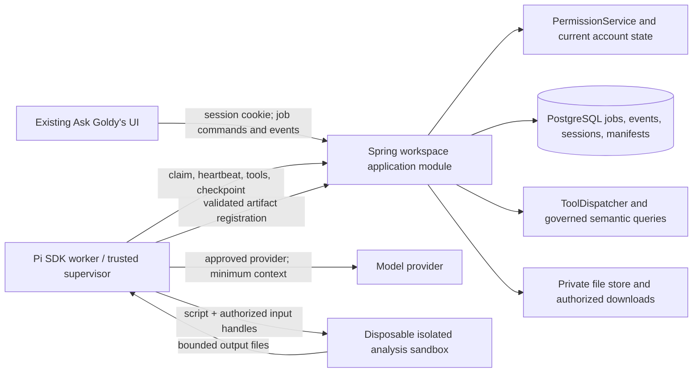

# Ask Goldy's agent workspace migration proposal — 15 November 2026

**Status: proposed; research only, not an accepted specification or ADR.** Code baseline: `807a4e74` (`origin/main` when fetched). This investigation changed documentation only. It did not inspect credentials or production data, operate production, install an agent runtime, or implement the migration.

## Recommendation

Keep Ask Goldy's in the existing website. Use a **pinned Pi TypeScript SDK worker**, with Spring retaining identity, `PermissionService`, governed data access, durable job ownership, conversation storage and artifact delivery. Execute generated Python in disposable, network-denied sandboxes on a **separate analysis VM**, not this production VM. Start with one worker supervisor and two concurrent analysis slots, an existing PostgreSQL database queue, and a private file volume managed through Spring. Do not introduce Redis, a message bus, Kubernetes, a second database or Pi Durable.

Candidate: `@earendil-works/pi-coding-agent@1.5.2`, release commit `b4afdddf44e059c67ccf5097e5317d913521b470`; lock all transitive dependencies and runtime/image digests at implementation. This is a **candidate for a compatibility spike**, not a claim that Goldy's has run it. [Release verification and pinned primary sources](pi-release-evidence-2026-11-15.md) distinguish release behavior from upstream main and experimental Durable.

Pi supplies the model/tool loop, provider abstractions, session tree, compaction and events. Most of the workspace product—authorization, safe execution, files, artifacts, recovery and manager UX—must be built by Goldy's regardless of harness. Proceed only if the first slice shows that the SDK makes those needs easier than retaining Spring AI. The agent must generate and execute analysis scripts, but has no application repository, Git, deployment authority or source-system write tools. Application-code changes are a later owner/general-manager capability with separate approval and execution design; that permission confers no salary access.

A new worker and off-host sandbox are deliberate departures from the documented single-deployable architecture. They are justified by executing untrusted code and by Pi's TypeScript runtime, not by hypothetical scale. Architecture approval, attachment-retention policy, manager grants and provider policy are release gates; this proposal does not edit the accepted contracts to grant them.

### Alternatives and trade-offs

| Choice | Benefit | Cost / decision |
|---|---|---|
| **SDK worker + off-host sandbox (recommended)** | Explicit custom tools/resources; typed events and session export; one narrow adapter to Spring | New runtime/service, job protocol and patched sandbox host; best fit if code execution remains required |
| Spring supervises Pi JSONL RPC | Java can launch/communicate with Pi; less TypeScript host code | Still needs Pi runtime, custom extension/tool bridge, process supervision and separate script sandbox; RPC is an administrative protocol, not a browser API or sandbox |
| Keep Spring AI, add workspace around it | Smallest provider/integration change; existing eval and answer behavior retained | Must build session/compaction/tool-runtime features; same sandbox/jobs/files investment. Choose this if Pi spike gives no measured benefit |
| Pi Durable | Promising checkpoint/replay primitives | Experimental, separate persistence/ownership semantics, unsafe replay still application concern; defer |
| Managed sandbox service | Less host/kernel/runtime operation | Additional data processor, network dependency, region/retention/price review; reasonable substitute if separate-VM operation is unacceptable |
| Plain container on production VM | Cheapest setup | Shared-host escape/resource-exhaustion blast radius; reject for manager-supplied/generated code |

## Evidence and authority

Read this proposal with three evidence inventories:

- [Current implementation, exact interfaces/files/tests and failure behavior](ask-workspace-current-flow-2026-11-15.md).
- [Pi release capabilities and source-level integration details](pi-release-evidence-2026-11-15.md).
- [Data contracts, authorization, source limitations and upload-policy conflict](ask-workspace-data-security-2026-11-15.md).

The requested preliminary `manager-agent-harness-research-2026-11-15.md` was absent from current main. It was read from `/home/stiring/.codex/worktrees/manager-agent-design/goldys/docs/design/manager-agent-harness-research-2026-11-15.md`, treated as preliminary evidence, and independently checked. It has not been copied into accepted architecture.

Authorities remain [PRD](../prd.md), [SRS](../srs.md), [system context](../system-context.md), [architecture](../architecture/current-state.md), [AI tool contract](../contracts/ai-tool-boundary.md), [governed-planning decision](../decisions/0001-governed-conversational-planning.md), [DESIGN](../../DESIGN.md), [visual direction](ui-direction.md) and [interaction system](design-system.md). The relevant scoped [dispositions](../requirements/dispositions.md) retain ACC-001–008 and NFR-003–009 subject to explicit manager, retention, recovery and volume decisions. RPT-001/002 require reproducible issued reports and usable authorized exports; an agent-generated exploratory file must not masquerade as an issued authoritative report.

## Current → proposed architecture

The worker/supervisor and sandboxes run on the separate analysis host. The sandbox cannot call Spring, the model provider, the internet, the database or the host supervisor. Input/output crosses a controlled staging mechanism, not a mounted host root or arbitrary network tool. Worker compromise remains a risk: its Spring capability is job-scoped, and it has no database credentials or access to unrelated sessions. The production backend retains ordinary database authority, but never executes model-generated scripts.

| Current seam / verified code | Proposed responsibility |
|---|---|
| [use-ask-goldys](../../frontend/components/ask-goldys/use-ask-goldys.ts), [stream](../../frontend/components/ask-goldys/stream.ts) POST SSE | Submit persisted job, consume replayable events through typed live/demo `Api`; reconnect independent of execution |
| [ChatController](../../backend/src/main/java/com/goldys/platform/conversational/ChatController.java) | Thin authenticated command/event adapter; no subscription owns a business job |
| [ConversationService](../../backend/src/main/java/com/goldys/platform/conversational/ConversationService.java) | Retain ownership/CRUD; replace Spring-AI message/context/summary construction with versioned session checkpoint and read projections |
| [ChatClientAssistantService](../../backend/src/main/java/com/goldys/platform/conversational/ChatClientAssistantService.java), [ConversationalAiConfig](../../backend/src/main/java/com/goldys/platform/conversational/ConversationalAiConfig.java) | Replace Ask-specific model loop with Pi adapter; retain deterministic evidence/answer safeguards as orchestration-independent behavior |
| [ToolDispatcher](../../backend/src/main/java/com/goldys/platform/reporting/ToolDispatcher.java), [MetricQueryService](../../backend/src/main/java/com/goldys/platform/semantic/catalog/MetricQueryService.java) | Keep authoritative authorization/calculation; worker receives bounded typed results, never DB access |
| [PermissionService](../../backend/src/main/java/com/goldys/platform/auth/PermissionService.java) | Keep enforcement point; extend its inputs/supporting policy for export, provenance dependencies and any approved row scope |
| [SavedDashboardApplicationService](../../backend/src/main/java/com/goldys/platform/application/SavedDashboardApplicationService.java), widget schema v2 | Keep query-only dashboard storage and live reauthorization; add artifact references to conversations, not executable widgets |
| [ForecastService](../../backend/src/main/java/com/goldys/platform/forecasting/ForecastService.java) | Useful persisted-run/input-snapshot precedent; do not copy its in-memory execution claim or fail-on-start recovery as durable workspace semantics |

### Actual gaps that must not carry forward

The current backend buffers complete model output before text events; network disconnection does not dispose the model subscription. `SseEmitter(0L)` has no idle deadline. Frontend Stop aborts fetch and ignores late events, but does not prove server work stopped. There is no durable job, server session lock, turn idempotency or reconnect cursor. A final answer save can fail independently of text delivery. Current persistence keeps prose and trace, not widgets/notices/dashboard drafts. Existing history is a read-only transcript and cannot restore the full active drawer state. Chat streaming bypasses the typed demo API and can call the real endpoint in demo mode. These are code findings, not verified production incidents. [Detailed evidence](ask-workspace-current-flow-2026-11-15.md).

Conversation summaries and prose are not reauthorized for their underlying metrics; the summary is inserted as a system message. Compaction must never upgrade untrusted content into trusted policy. A role change must invalidate old summaries/context and stored outputs, not merely reject the next data query. [Security evidence](ask-workspace-data-security-2026-11-15.md).

## Capability matrix

| Capability | Exists today | Pi release supplies | Goldy's must build / preserve | Deferred |
|---|---|---|---|---|
| Website identity and owned threads | Email/password, Spring session, thread ownership | No application identity | Current-account binding, job/file ownership, manager onboarding | External-user access |
| Multi-step authorized analysis | Bounded metric tools, eight tool-round cap | Agent/tool loop, custom tools | Budgets, Spring authorization, deterministic results, evidence qualification | Unbounded autonomous work |
| Broad business discovery | Metric catalogue; separate bounded relational registry | Tool schemas/instructions | Permission-aware discovery, reviewed semantic relationships | Generic SQL/raw access prohibited |
| Session history/compaction | Text, traces, running summary | Tree entries, resume/fork, compaction | Sole durable storage, provenance labels, history compatibility | User-visible branch editor |
| Progress/steering/stop | Text/answer/error; client abort | Events, steering/follow-up, abort primitives | Job state, durable queue, replay, process kill deadlines | Immediate mid-turn steering initially |
| Files and document generation | Connector uploads; separate PDF extraction | File/tool primitives, not safe workspace product | Quarantine, parsing, sandbox, libraries, storage/downloads | OCR-first universal import, macro files |
| Charts/widgets/dashboards | Typed v2 widgets and query-only saved dashboards | No Goldy's renderer | Preserve widgets; safe chart artifacts; source manifest | Generated interactive UI prohibited |
| Durable jobs | No durable chat execution | Ordinary sessions are history, not crash-safe jobs | Lease/fencing/retries/checkpoints/idempotency | Experimental Durable |
| Data security | Table-driven resource/operand checks | No business grants or sandbox | History/export/cache control, inference policy, isolation | Salary aggregates until approved |
| Costs/observability | Existing logs/metrics infrastructure | Provider usage events | Account budgets, attempt accounting, audit, redaction | Billing platform |
| Application code changes | Outside Ask workflow | Coding tools exist | No such tools/mounts in release one | Owner/GM-only reviewed proposal workflow |

## Module responsibilities and state ownership

Use a deep **workspace application module** in Spring: its interface is submit/get/events/stop, attachment/artifact operations and the private worker protocol. Keep the external API small while hiding queueing, ownership, recovery and policy inside it. Its Pi adapter is the variable implementation seam; do not leak Pi RPC commands or provider message types into frontend contracts.

| State | Authoritative owner | Rules |
|---|---|---|
| Accounts, permissions, grants and effective policy generation | Spring/PostgreSQL | Worker loads current grants per call; no captured `UserRole` as enduring authority |
| Conversation identity/title/ownership and ordered turns | Spring/PostgreSQL | Existing UUIDs retained; one active turn per conversation |
| Pi session tree/header/leaf, compaction entries, model/thinking selections and transcript metadata | Versioned opaque checkpoint stored by Spring in PostgreSQL | Worker reconstructs an ephemeral `SessionManager`; no independently durable worker JSONL store |
| User-visible text, widgets, progress and terminal outcomes | Persisted job events and finalized turn payload | Read projections of committed events; UI/localStorage is only a cache |
| Queue/attempt/lease/cancellation and quotas | Spring/PostgreSQL | Worker memory/queues cannot be authoritative |
| Upload/artifact bytes | Private file store | DB manifests hold digest, size, owner, dependencies, status and object key; never caller-supplied filesystem path |
| Temporary parsing/script files | Disposable sandbox | Not durable; copied back only after validation and authorization |
| Authoritative metrics and dashboard definitions | Existing semantic implementations and dashboard tables | Pi or Python cannot redefine them |

Pi v1.5.2 permits `SessionManager.inMemory(..., entries)`; export header/entries plus the active leaf and restore it explicitly. See the [pinned API evidence](pi-release-evidence-2026-11-15.md) for exact methods. A checkpoint is **not** a saved process, Python heap, pending promise or durable tool queue. Store runtime/schema version with each checkpoint. Read-only historical display must not require the old Pi package to run. Pin migrations/adapter tests for changing session format.

Persist ordered turn input before dispatch. At tool boundaries persist invocation IDs, authorized input references/digests, completed result references and session checkpoint. Commit a final answer, widgets, artifact links, checkpoint version and terminal event transactionally after all artifact registrations are ready. A displayed progress event may precede a durable model checkpoint; restart reconstructs model context from the last safe committed checkpoint and starts a host-controlled retry attempt, explicitly marking the interrupted attempt. It does not restore in-flight execution, provider-side state/caches, or runtime credentials/catalogue state. Never imply that a streamed partial answer is final.

## Business-data access without a tool per question

1. Expose permission-aware **discovery** over existing `DESCRIBE_METRICS`: definitions, units, supported grains/dimensions, periods, source basis, qualifications and allowed combinations. Schema names and existence can be sensitive; inaccessible definitions are omitted only for open discovery, while explicit requests for a denied metric produce an explicit denial.
2. Reuse `GET_METRIC`, `RUN_METRIC_ANALYSIS` (currently 1–6 explicit queries), comparisons and ranking. Execute and format approved business arithmetic in Spring. A script can visualize or explore their returned values, but cannot silently replace a governed ratio, sum stock balances or derive authoritative prime cost.
3. Add **registered dataset extraction** as a separately reviewed capability: stable enum dataset/field/relationship identifiers, bounded filter nodes and scalar types, allowed comparisons, date bounds, paging and server ceilings. Generate tool schemas from a reviewed mapping to the registry, not arbitrary identifiers supplied by the model. A small number of discovery/describe/extract tools covers combinations of approved concepts. A server manifest records the full input scope and output count.
4. Do not directly connect today's relational registry to the AI. The accepted planning decision explicitly leaves its semantics unaligned. Before each dataset is exposed, review units, entity grain, additive/non-additive measures, joins and metric equivalence. Reuse the existing compiler's allowlist, permission checks, fanout guards, read-only role and timeout; add no second SQL generator. Extend the approved AI contract/package dependency rules intentionally if a query-backed application adapter is introduced. The agent gets no `DataExplorer` raw/canonical browse endpoints.
5. The only canonical exception remains explicitly approved invoice/line and CTB product-sale evidence, labelled `CANONICAL_DIRECT`; it is not reconciled fact. Release one can deliver meaningful workspace analysis with the existing catalogue plus uploaded files while the first reviewed dataset slice lands. It cannot promise every business question.

Authorize **all operands before reading**: output fields, filters (including hidden salary predicates), grouping, sort, joins and relationship metadata, derived metric dependencies, totals/denominators and exports. Validate a complete multi-query plan atomically. Unknown/denied operands must not cause execution of the allowed subset with a misleading complete answer. Selected query limits, paging or sampling remain explicit in results and files. Long exports use stable input snapshots or a consistent database snapshot with bounded lifetime; page-by-page queries against changing projections cannot claim one reproducible result.

Salary inference is not solved by removing names or suppressing only tiny groups. Totals minus another total, overlapping time ranges, unique shifts, average pay × headcount, and exports across chats can disclose pay. Recommend **no pay-derived amounts for managers until a policy is approved**, including labour cost ratios/forecasts whose operands disclose the same fact. Existing historical grants are evidence to audit, not authority to broaden them. If aggregates are approved, start with fixed reviewed populations/time buckets, no arbitrary exclusions/employee filters, coordinated disclosure history across views/jobs/exports, and documented residual inference limits; this is substantial policy work, not a prompt. Do not claim differential privacy or safe anonymous aggregates without a separate design.

Each result states one of: **Goldy's governed metric**, **qualified source observation**, or **exploratory calculation on supplied files/data**. Store metric/query/version, period/timezone, units and tax/cost basis, coverage/status, source snapshot/digest and calculation/image version. Python results must carry “Exploratory” and their formulas/assumptions. Persist generated script and dependency image digest with artifacts so calculations can be inspected. If a user asks for an authoritative report, use the governed export/report path; promotion of an exploratory formula requires reviewed metric definition and tests.

Pi cannot repair missing source schemas, identity bridges, units or accounting policy. Deputy raw-only evidence and unvalidated labour components, stock movements/valuation, invoice purchases versus consumed cost, reservations versus actual attendance, receipts/product mappings and partial historical coverage remain limitations. No new connector/parser design is included without real sample/schema access. [Specific current bottlenecks](ask-workspace-data-security-2026-11-15.md).

## Execution and security design

### Isolate the code and its authority

Run one Pi session process per active job attempt, with a small trusted supervisor managing the two slots; do not multiplex user sessions through shared mutable agent state. The trusted Pi worker receives only its claimed job, approved prompt/resources, current checkpoint, short-lived job capability and selected input handles. Spring authenticates the worker separately from the browser, binds the capability to user/job/attempt/fence/audience and expiry, and resolves current account/grants from its own store. No request-supplied role, user ID, path or tool name can override that binding. Worker enrollment uses a dedicated service credential kept outside sandbox mounts; prefer a rotated host identity and mutually authenticated transport. No application DB password, session cookie, connector token or deployment credential reaches the worker or sandbox.

Configure a custom `ResourceLoader`, in-memory settings and isolated model-runtime configuration with no home/project discovery. Activate exact plain tool names, not `+`/`-` modifiers of default tools, and assert the resulting set at startup. The SDK tool list is explicit: Spring business tools, list/read authorized attachment handles, execute analysis, and register outputs. No built-in host `bash`, filesystem write/edit, arbitrary MCP connection or project discovery. `execute_analysis` takes script content and opaque input handles, not a host command/path or network address. Scripts are intentionally arbitrary programs **inside the sandbox**; bounds/JSON validation are not their security mechanism. This is a proposed new workspace-execution contract, separate from `ReportingTool`'s enum-only business-query contract, and requires a documented architecture change. The generated script cannot query Spring/SQL or install packages.

Use an immutable Python/document image under gVisor on a dedicated analysis VM as the initial candidate. Enforce non-root UID, dropped capabilities, seccomp/runtime confinement, read-only root, bounded writable job disk/tmp, no host PID/IPC/network, no devices or Docker socket, no mounts of home/source/secrets, and no shared writable package caches. Stage inputs read-only; unique job/attempt directories; path resolution rejects symlinks, hardlink escapes and traversal. Supervisor controls runtime lifecycle but is never exposed to model tools. Quotas must actually work in the chosen host configuration.

gVisor narrows the host syscall attack surface but does not solve application authorization, network exposure, side channels or unsafe mounts. Rootless containers reduce daemon privilege; they are not proof of containment. Firecracker with a jailer is an alternative if compatibility/performance or stronger guest separation justifies VM-image/KVM operation. A managed microVM provider is the fallback if maintaining the separate sandbox host is too costly. These are risk trade-offs, not a sandbox-escape guarantee. [gVisor security model](https://gvisor.dev/docs/architecture_guide/security/), [Docker rootless model](https://docs.docker.com/engine/security/rootless/), [Firecracker production-host requirements](https://github.com/firecracker-microvm/firecracker/blob/main/docs/prod-host-setup.md).

Deny all sandbox egress, including DNS, IPv6, link-local metadata and internal/private networks. Permit the trusted worker only the Spring worker endpoint, approved model endpoints and necessary infrastructure under operator policy. Model tool arguments cannot add destinations. Package installation happens during reviewed image builds with lockfiles, checksums and vulnerability scanning; runtime `pip`, `npm`, curl/download tools and user extensions are unavailable. Trusted skills/templates/extensions ship in the worker image, versioned and reviewed; uploads named `AGENTS.md`, `.pi/*` or `SKILL.md` never become resources. Skills guide behavior, not access.

### Revocation, context and outputs

Reauthorize at job submission, claim, every data read/export, checkpoint/context restore, artifact registration/download and event/history delivery. Track a policy generation on accounts/grants. A change fences active jobs and stops their sandbox/provider work; block new output immediately even if abort takes time. Before sending data to a model and before publishing a response, compare current generation in an atomic authorization/commit operation. A remote call already in flight cannot be recalled; record that limitation. Expired/revoked worker capabilities cannot heartbeat, read, register or commit.

Label evidence, prompts, user messages containing copied figures, assistant prose, summaries, filenames/titles, previews, scripts, stdout and artifacts with the **union of all contributing access dependencies**. This is conservative: arbitrary generated code can mix any supplied input, so its outputs inherit all inputs rather than trusting the model to classify them. No declassification by removing a column or saying “summary”. Arbitrary uploads and user-copied figures cannot be reliably classified from their content: default to an unclassified-sensitive class and prevent manager analysis/model transmission until an approved handling policy establishes permitted scope. Accept known low-sensitivity sources through reviewed deterministic import/schema controls, or obtain classification from an explicitly authorized reviewer; a model guess or uploader assertion alone cannot remove pay/personal-data restrictions. An upload grant is not a salary-data grant. Access to unclassified content requires explicit grants covering its possible sensitive classes, not merely conversation ownership. This introduces real friction for arbitrary manager uploads until the business policy is settled. Reopening a denied historical bundle shows an explicit restricted-history state and starts a clean context; do not leak title/preview or silently replay cached prose. Legacy entries with unknown provenance require a separately approved archival policy and explicit resource grants in addition to thread ownership; otherwise deny content access. Owner title alone is insufficient. They are not automatically fed into new sessions.

Caches key on actor, authorized scope, policy generation, input/version and query; no shared sensitive prompt/result cache in release one. Revocation invalidates caches and ephemeral workspaces. Compaction summarizes only currently authorized inputs, preserves lineage outside the model summary and never makes uploaded instructions system policy. Spring owns the trusted system prompt; delimit tool/file content as untrusted. Prompt-injection defenses constrain available actions and egress; detection/prompt wording are supplementary. The model still sees authorized data and can be misled about its meaning, so final numerical qualification tests remain necessary.

Keep `PermissionService` as the application enforcement point. Ownership checks accompany it, not a new worker role hierarchy or policy engine. Extend it for approved scope/export policies instead of duplicating policy in TypeScript. Database defense in depth: retain the registry's `goldys_ro` allowlisted role/read-only transaction and no raw-table privileges. The worker has no SQL login. Row-level security is optional later for approved employee/department scope: it needs transaction-local identity, verified policy coverage and a non-bypass role; a pooled superuser/app table owner defeats naive RLS. Do not introduce RLS as a replacement for operand/derived-result authorization or new business queries.

### Provider and audit handling

Goldy's must approve the model provider/model, data classes permitted off-host, retention/region/training terms and spend limits before real data is sent. This research did not inspect the account contract or assert zero retention. Minimize payloads: schema/summary then only necessary rows/pages, exclude credentials and unnecessary personal data. Provider requests, compaction and retries all count as disclosure and cost. Pin provider/model and disable or control catalogue overlays; a pinned Pi package alone does not freeze upstream model metadata or pricing. Do not expose raw chain-of-thought as progress; show tool purpose/state and validated outcomes.

Audit actor/job/attempt, permission generation and decision, bounded query identifiers/digest, input/output object IDs, image/script digest, provider/model, usage, cancellation and publication outcome. Keep raw files, full prompts, tool rows, error stacks with data, signed URLs and secrets out of general logs/Sentry. Restrict any diagnostic payload capture as sensitive evidence with its own retention. Streaming events are authenticated sensitive responses, not an operational log feed.

## Files, artifacts and manager experience

### Uploads and retention: an explicit decision gate

Current invariant says every ingested payload is retained byte-faithfully in the append-only raw ledger before parsing. Current connector uploads eagerly load `MultipartFile.getBytes()` under a 2 GB global cap; neither is suitable as the general workspace upload path. [Current configuration](../../backend/src/main/resources/application.yml), [connector controller](../../backend/src/main/java/com/goldys/platform/api/ConnectorStatusController.java).

**Recommended proposed distinction:** private exploratory attachments are temporary workspace inputs, not ingestion into Goldy's authoritative source model. Store their original bytes in private attachment storage, hash before parsing, and retain under an explicit deletable attachment policy. Promotion into authoritative ingestion is a separate authorized connector workflow that retains bytes in the raw ledger. This distinction requires an approved amendment/clarification to the raw-ledger invariant; it is not assumed by this proposal.

If that change is declined, route uploads through the ledger, describe deletion honestly as removal of workspace access/derived copies while original evidence remains immutable, and do not promise full deletion. Never silently duplicate into the ledger while offering “delete permanently”. First release with deletable uploads is blocked until this policy is chosen. Proposed retention defaults for owner review: temporary sandbox destroyed at terminal state, orphan cleanup within 24 hours, attachments/artifacts 30 days unless retained as an issued report, conversation history 90 days with explicit keep/delete controls. These are planning defaults, not accepted legal/business retention periods. Issued-report and source-evidence retention remains separately governed; deletion from backups follows their approved expiry, with tombstones reapplied on restore.

### Concrete flow and initial format scope

1. Authenticate/create pending attachment manifest under the conversation, enforce current upload grant and quota, then stream bounded bytes into quarantine. Do not pass file paths from the browser or buffer whole uploads in JVM heap. Validate extension, magic/MIME and declared size independently; sanitize display names while storing by random object ID. Hash the full original, inspect archive expansion limits, scan and reject encrypted/unsupported/oversized content before parsing. Malware scanning is defense in depth, not permission to run active content.
2. Parse in a network-denied isolated process with memory/time limits. First input formats: UTF-8 CSV/TSV, `.xlsx` without macros, text-based PDF, `.docx` text/tables and plain text. Detect encoding/delimiter ambiguity, workbook sheets/formulas/external links, PDF page count and extraction coverage. Do not execute workbook formulas/macros, Office embedded objects, PDF JavaScript or external references. Formula cached values may be stale: label them or ask for a values-only export. Reject `.xlsm`, legacy `.xls`, arbitrary ZIP and password-protected files initially with a useful conversion instruction.
3. Produce a manifest of sheets/pages/rows/columns, types and parse warnings with small paged previews. Let users choose relevant sheets/columns instead of putting whole files in model context. Keep original bytes separate from parsed derivative and derived analysis. Never imply parser coverage from synthetic examples; representative user-authorized files and measured extraction checks are an acceptance gate. No source-specific ingestion parser is designed here.
4. Run analysis over selected handles; stream/chunk large tabular reads within limits. Candidate image toolchain: Python, pandas, NumPy, openpyxl/XlsxWriter, Matplotlib, pypdf, python-docx and ReportLab; pin exact versions at the build spike. These are proposed dependencies, **not tools installed by this investigation**. Prefer templates for branded documents; no shell-based LibreOffice/web renderer initially. OCR of scanned PDFs is deferred: explain “This PDF has no readable text; upload a text PDF or spreadsheet.” Partially readable PDFs report extracted/total pages and never imply complete totals.
5. Produce CSV, XLSX, PDF, DOCX and PNG chart artifacts. Validate output types and size, strip unsafe paths/active links, check ZIP expansion for Office files, reject macros/HTML/script artifacts, and formula-escape untrusted spreadsheet text. Server-generated manifests record original filename, media type, byte size/hash, author/job, script/image, authorized inputs, calculation category, period/units/qualifications and retention class. Validate and atomically register the bytes before emitting `artifact_ready`; a printed file path is not an artifact.

Downloads go through Spring ownership and current dependency/export authorization; no public bucket or permanent bearer URL. Prefer backend streaming for immediate revocation; if temporary URLs are later used, document the residual expiry window. Use attachment disposition, `nosniff` and private/no-store caching. Safe previews are server-produced bounded table/text summaries or raster images; render PDFs/Office previews to inert images/text in a sandbox. Never embed generated HTML/SVG with active content on the authenticated origin. Artifacts inherit input restrictions; cross-user sharing and anonymous links are **off** in release one. User-downloaded files cannot be recalled after revocation.

Deleting a conversation cancels jobs, immediately revokes manifests, and queues byte/derivative/checkpoint cleanup. Keep minimal audit/tombstone records without content under the agreed policy; holds/issued-report retention show why deletion is restricted. A janitor reconciles DB manifests and objects, removes unregistered partial output after expiry, and reports failures. Backup/restore includes manifests and bytes together; a dangling object reference is an explicit unavailable-artifact state.

### Proposed limits (tune using representative workloads)

Start with 25 MiB/file, five files and 100 MiB total input per job; 100 PDF pages; 100,000 parsed spreadsheet rows; 250 MiB decompressed Office content; 50 MiB/artifact and 200 MiB total output. Reject limits before expensive processing where possible, otherwise stop with exact processed/total counts. Sandbox: 2 vCPU, 2 GiB RAM, 2 GiB scratch, bounded process count, 120 seconds per script and 10 minutes per job. Model: bounded context, 20 tool invocations and a configured per-job/per-day spend ceiling; discovery, failed calls and compaction count. These are engineering starting points, not measured venue capacity or approved spend. Exhaustion produces a partial/limited result, not silently truncated “complete” exports. Benchmark and raise only with corresponding host/storage/cost budgets.

### UI contract

Preserve the drawer entry/keyboard shortcut and existing conversations navigation. Use the conversation page for the larger workspace with transcript, attached-file chips, ordered activity and artifact cards. Detail opens in the established right-hand URL-addressable Sheet. Retain ink/gold tokens, source/status meanings, en-AU dates/units, tabular figures, explicit missing/denied states and widget v2 renderer. Reuse `EmptyState`, `PermissionDenied`, `InlineError`, accessible buttons and focus restoration; do not introduce a new visual system.

Submit yields a job ID immediately. Activity says “Queued”, “Reading workbook”, “Checking sales for 1–7 November”, “Running analysis”, “Preparing spreadsheet”, or “Stopping”; no fabricated percentage. Show the period/data used, assumptions, authoritative versus exploratory labels and partial-result limitations beside the answer. Progress is throttled for an `aria-live` region; status is readable without colour, all file/stop/download controls keyboard-accessible, and adding messages does not steal focus. A failed tool can be corrected within budget; permission denial remains explicit, malformed files name the affected file and next action, provider outage offers retry, and sandbox timeout offers a smaller analysis. Do not expose stack traces, raw tool schemas or lease mechanics to managers.

Disconnect means “Work continues; reconnecting”, not cancellation. On reconnect, GET snapshot then replay events after cursor; deduplicate sequence IDs. An expired cursor returns a fresh snapshot without losing finalized widgets/artifacts. Stop calls a server command and shows “Stopping” until acknowledged terminal; pending follow-ups are cancelled as part of Stop. While running, new messages are queued follow-ups with visible edit/remove controls, each a separately persisted authorized turn. Release one applies them after the current turn; Pi steering is available but immediate mid-step changes complicate reproducibility and are deferred. Closing the drawer does not kill a job. Account revocation blocks further delivery.

Keep old threads as legacy transcript records under existing IDs. They cannot recover widgets never stored; display that limitation. Continue starts a new Pi session with an explicitly selected, currently authorized legacy excerpt, not an automatic privileged summary import. Preserve titles/text/trace for authorized archival reading; redact/deny metadata when provenance cannot establish access. Saved dashboards are unchanged query configurations, still reauthorized on render. Only governed widgets can be saved as live dashboards; exploratory chart files remain artifacts rather than fake live metrics.

## Jobs, recovery and operations

### Durable job protocol

Proposed states: `QUEUED → RUNNING → SUCCEEDED | PARTIAL | FAILED`; `QUEUED/RUNNING → CANCELLING → CANCELLED`; lost lease → `INTERRUPTED`, followed by an explicit retry attempt or terminal failure. Use a PostgreSQL claim with row locking, lease expiry, monotonic fencing token and heartbeat. Initial engineering values: heartbeat every five seconds, 30-second lease, bounded lease renewal during provider calls; expiry revokes publication even while local process cleanup finishes. A unique active-conversation constraint prevents concurrent turns across tabs/replicas. Submission uses `(owner, client_request_id)` uniqueness; duplicate submission returns the existing job, and reuse with different content conflicts. Order queued turns in the database, not Pi memory. Do not hold a database transaction open during provider calls or script execution.

Spring persists events with `(job, sequence)` uniqueness and transactional terminal state. Worker event batches include attempt/fence and idempotency key; reject stale fences even if the worker later reconnects. Attachments, capabilities and snapshots are bound to the same attempt. Example proposed transport: `POST /api/conversational/jobs`, `GET /jobs/{id}`, `GET /jobs/{id}/events?after=...`, `POST /jobs/{id}/stop`, and attachment/artifact routes; separate `/internal/workspace/...` claim/heartbeat/tool/checkpoint routes authenticated as workers. Event envelope: schemaVersion, jobId, turnId, attempt, sequence, timestamp, type, payload. Types include state, tool progress, text draft, widget, artifact ready, usage, warning, error and finalized answer. HTTP/SSE auth/CSRF/CORS follow existing session rules; private worker routes never accept browser identity headers.

Stop is idempotent: mark cancellation and revoke publication capability first, clear queued turns, abort Pi/provider, signal sandbox process group, then forcibly terminate after a bounded grace period (candidate five seconds). Finalize only once termination is confirmed or mark cleanup failure for operators with publication still blocked. Provider billing may continue for an already submitted request. A dead network must not prevent the supervisor's local lease watchdog from killing expired work. Shutdown drains claims; orphan processes have a maximum lifetime independent of Spring availability.

On restart, reconcile leases; never run two owners of the same checkpoint. Resume only from a committed safe checkpoint. Completed business reads reuse their stored result snapshot if still authorized, not a fresh result silently substituted; new reads explicitly record new as-of time. Script retries start fresh from immutable inputs and the pinned script/image. Artifact registration is unique by job/output identity and digest; repeated registration cannot duplicate or replace another job's file. Crash after remote inference but before commit may incur duplicate model cost; exactly-once provider execution is not promised. Cap automatic retries (candidate two for transient reads/provider transport with jitter), never retry denials/invalid files/unsupported queries, and surface interruption when a safe replay boundary is absent. Generated analysis has no external mutations, which makes bounded replay practical.

Map Pi session completion from `agent_settled`, not `agent_end` or prompt admission; persist the Goldy’s terminal result only after pending tool/artifact work and publication checks finish. Goldy’s owns follow-up admission, so no hidden Pi queue is authoritative. Capture usage per provider response/attempt, including compaction, failed attempts, cached tokens where supplied, and model/version. Reserve budget before each call; settle actual usage with a versioned price schedule and flag unknown usage after crashes. Hard ceilings also constrain tokens/time/tool calls so missing provider billing cannot mean unlimited work. Track query rows/bytes, sandbox CPU/time, storage and output totals. Do not assert dollar estimates from token counts without a verified pricing table.

### Development, packaging, backup and observability

Local development runs Spring/PostgreSQL plus the worker and a disposable local sandbox profile using synthetic fixtures; no production mounts/network. Add a fake Pi/provider adapter and fake sandbox for deterministic tests, but require a separate real-sandbox test lane for containment claims. Bun remains the package manager for TypeScript work; select supported Node/Bun execution after the pinned runtime spike. Keep models disabled by default; fake/demo workspace exercises upload, progress, reconnect, stop, denied access and artifacts without contacting a live API.

Build separately pinned worker and analysis images. Keep parser/document dependencies out of the production JVM. An explicit development Compose profile is convenient; production packaging adds an independently supervised off-host worker/sandbox host through a reviewed runbook. No production Compose edits/operations are part of this research. Worker credentials/provider secret are injected only into the trusted process; images contain neither. Security-patch cadence, image scanning, egress rules, disk alerts and cleanup monitoring are real ongoing operating work.

Keep PostgreSQL as the queue and metadata store. For current-pub volume, private application-managed filesystem storage avoids another object-store service; provision it outside the web root with quotas and authenticated streaming. Store with write-temp/fsync/atomic-rename and checksum verification; registration occurs only after durable bytes. The remote sandbox sees only per-job staged copies. Upgrade to object storage only when volume, multi-host delivery or backup operations justify it. Encrypt backups and sensitive storage, restrict service identities and coordinate DB/file backup manifests. Rehearse restoration with missing/corrupt files, cancellation state, stale leases, revoked users and deletion tombstones. RPO/RTO remain owner decisions; don't claim availability from a backup existing.

Extend Micrometer/Sentry with job queue age, running/expired leases, tool/provider latency, error/denial counts, cancel-to-termination latency, retry counts, budget usage, parser failures, storage/orphans and worker health. Correlate opaque job/attempt IDs across services. Only readiness to accept work—not access to every provider—is required for other Goldy's pages to remain available when the worker fails. Alert on stuck cancellations and cleanup failures; no silent success. Existing weekly reports/dashboards must work with the worker disabled.

## Concrete change inventory

Paths below refer to existing code unless marked **new**; fuller symbol/test details are in the [implementation inventory](ask-workspace-current-flow-2026-11-15.md).

| Area | Change |
|---|---|
| `backend/.../conversational/` | Split `ConversationService` persistence from Spring AI types/summary calls; replace `ChatClientAssistantService`, `ReportingToolCallbacks`, `BoundedToolCallingManager` and Ask-specific config with worker-backed orchestration; preserve deterministic evidence/answer behavior and `AnswerPayload` compatibility where useful |
| `backend/.../application/`, `api/`, **new workspace package** | Job/attachment/artifact application interface, controllers, worker authentication, lease/queue/event/checkpoint/cleanup implementation. Keep accepted read-direction rules; extend architecture tests for new dependencies |
| `backend/.../auth/` | Current account/policy generation, explicit workspace/upload/export resources and scope support in `PermissionService`; manager-account creation only after mapping; new grants seed `ALL × OWNER` only |
| `backend/.../reporting/`, `semantic/catalog/`, `query/` | Retain tools/catalogue/calculations; provider-neutral JSON contract for worker; reviewed discovery/extract mapping and semantic alignment tests, not generic SQL; preserve current read-only query role |
| `backend/.../widget/`, `application/SavedDashboardApplicationService` | Retain schema v2 and query-only render/revision semantics; prove regressions. Artifacts are conversation references, not widget execution code |
| **New Flyway migrations** | Add job/attempt/event, checkpoint, attachment/artifact manifests, evidence dependencies/policy generation, ownership/FKs/unique idempotency and active-conversation indexes, cleanup/outbox state. Extend legacy conversation messages with versioned answer payload/engine provenance or new finalized-turn table; no applied migration edits |
| Proposed schema detail | `workspace_job`: actor/thread/turn/request ID/state/attempt/fence/lease/cancel/budget; `workspace_event`: sequence/type/version/redacted payload; `workspace_checkpoint`: thread/turn/version/Pi version/header/entries/leaf/dependency set; `workspace_file`: owner/thread/job/kind/hash/size/media/object/status/retention; `workspace_tool_call`: invocation/input/result/digest/policy; per-user/grant policy generation. Use JSONB for bounded versioned payloads; never duplicate raw ledger authority |
| **New `agent-worker/`** | Pinned Pi adapter, trusted resource loader, Spring tool bridge, event mapping, checkpoint import/export, job supervisor client; Bun lockfile, runtime pin, unit/contract tests and Dockerfile |
| **New `analysis-runtime/`** | Pinned Python/doc image, manifest runner, resource/egress policy, safe parser/output validation, sandbox fixtures/tests; no app source/credentials |
| `frontend/lib/api/{types,live,demo}.ts` | Typed submit/status/events/stop/upload/download contracts and both implementations; runtime event parsing. Streaming must honor chosen demo mode |
| `frontend/components/ask-goldys/*`, conversations page, widgets | Job reducer/replay, reconnect/queued turns, uploads/progress/artifacts, legacy history and persisted full answer; reuse drawer, answer blocks, renderer and dashboard save path |
| `backend/build.gradle`, `application.yml` | Retain Spring AI BOM/starter for other consumers; isolate Ask provider config from classification/invoice AI, add worker/limit/storage config without secrets. Remove Ask-only Spring AI classes after transition, not the shared dependency |
| `.github/workflows/ci.yml`, development Compose, image/runbooks | Worker typecheck/test/build, sandbox containment lane, image scan/build, PostgreSQL integration and browser regression tests; separate production change approval |
| Documentation after approval | ADR for worker/isolation/state ownership; approved attachment policy and execution-tool contract; update system context, app-state, API/schema docs, operation/backup/recovery and testing docs. PRD/SRS edits only for approved behavior; roadmap/issues track delivery |

Spring AI 1.1.8 is also used by taxonomy naming, CTB invoice extraction and OCR. Removing `spring-ai-starter-model-openai`/BOM or shared `spring.ai.*` configuration during Ask migration breaks or disables those paths. Keep them until separately migrated and tested. Forecasting/embedding HTTP services are not a reason to retain the Ask loop. [Verified consumer inventory](ask-workspace-current-flow-2026-11-15.md).

## Rollout and rollback

Recommend a **short controlled transition**, followed by a clean removal of Ask's old loop. Additive schema and `engineVersion` distinguish legacy and workspace turns. Keep old threads readable; enable the new engine for a small explicitly approved cohort with synthetic then authorized data. Route each new turn to exactly one engine. Do not dual-run real prompts or mirror history into two writable stores. Compare frozen synthetic workloads instead of shadow queries that double disclosure and spend.

A one-step replacement is less code but makes isolation, cancellation and history migration defects harder to contain. A long dual-engine product creates permanent drift and is unnecessary. After the bounded acceptance window, remove the legacy Ask execution path; retain legacy transcript reader and the Spring AI uses outside Ask. The transition length is governed by acceptance evidence, not a silent calendar deadline.

Rollback disables new job submission, fences/cancels workers and leaves existing files/events/history readable under current policy. Existing weekly reports/dashboards continue independently. Fall back to the old chat only for new legacy turns; do not pass Pi tool messages/checkpoints to Spring AI or pretend it can continue the workspace process. No schema downgrade or restoration of an older whole database merely to switch engines. Reversible additive migrations and versioned readers allow a forward fix. Any deployment, push or merge is separately authorized.

## Delivery slices and acceptance

Each slice is independently reviewable and produces tests or a bounded evidence report. No implementation tickets were created during this research.

| Order / estimate | Dependencies | Slice and verifiable acceptance |
|---|---|---|
| **0. Policy/architecture gates, 2–4 engineering days plus owner time** | None | Record explicit deployment/isolation choice, attachment/ledger treatment, provider/data classes, initial grants/export policy and limits. No manager/pay access until decided; document any remaining gate with the dependent slice blocked |
| **1. Pinned Pi compatibility spike, 3–5 days** | Synthetic data only; can run alongside 0 | Bun install/locked runtime; explicit empty resources/default tools disabled; fake Spring tools; provider fake + separately authorized live synthetic evaluation; event/abort/queued-input behavior; inMemory snapshot/tree/leaf/compaction round-trip; compare 10–15 representative tasks to current loop. Go/no-go on correctness, integration complexity and cancellation |
| **2. Durable workspace vertical slice, 5–8 days** | 1; architecture choice | Spring job/events/ownership/idempotency/lease/fence, worker fake, one active turn/thread; synthetic metric result displayed and survives refresh/restart. Duplicate request produces one job; stale worker cannot publish; Stop terminates fake work; DB migrations tested |
| **3. Authorization and governed data bridge, 5–8 days** | 2; approved access policy for real roles | Existing tools via `ToolDispatcher`, full operand checks; current-account lookup; policy-change fencing; dependency labels on histories/checkpoints/caches/exports. Negative tests across every return path; no changed metric values |
| **4. Isolated script execution, 5–8 days** | 2; isolated host/egress policy | Fresh sandbox runs generated Python over synthetic staged inputs; no host/DB/network/secrets; quota/fork/timeout/path/symlink tests; cancel and host restart leave no orphan publication. Record actual resource behavior and library compatibility |
| **5. Attachments/artifacts vertical slice, 6–10 days** | 3,4; ledger/retention decision | Quarantine → parse → analysis → validated CSV/XLSX/PDF/DOCX/PNG → authorized download; test damaged/large/macro/partial files, formula injection, cross-user handles, delete/cleanup and backup restoration. Measure parsing on authorized representative files before claiming format fitness |
| **6. Workspace UX/history/demo, 5–8 days** | 2,3,5 | Typed live/demo contracts, progress/reconnect/stop/queued turns, accessible file controls, complete answer reload, restricted legacy archive, preserved widgets/dashboard creation. Browser tests prove demo never calls live chat and disconnect/reconnect doesn't duplicate work |
| **7. First reviewed broad dataset extraction, 4–8 days** | 3; semantic alignment evidence | Choose approved sales/product evidence dataset supported by inspected model; enum schema generated from reviewed mapping; hidden predicates/joins/order/derived denial tests; fanout/null/coverage equivalence and paged snapshot export. Unsupported domains explicitly unavailable. Do not expose whole registry at once |
| **8. Operational acceptance and transition, 5–8 days** | 3–7; real-data/provider authorization | Worker/image CI, restart/failure injection, budget alerts, retention/restore rehearsal, approved workloads and current reporting regressions; controlled cohort cutover/rollback drill. Remove Ask legacy loop after observed acceptance; retain shared Spring AI consumers |

Assumption-based effort: approximately **40–67 engineering days (8–14 person-weeks)** including the spike and basic regression/operational work, excluding waiting for decisions, source onboarding, advanced privacy aggregation, formal penetration testing and later application-code editing. One experienced full-stack engineer plus periodic security/operations review: roughly **10–16 calendar weeks** allowing integration/review overhead; two engineers can overlap UI/runtime work but policy and integration are serial. Confidence is medium-low until the spike and representative files; budget a further 20–30% contingency for sandbox compatibility and historical-context policy. These are estimates, not measured velocity.

Operational complexity rises from the existing web/backend deployment to one additional supervised worker and one patched analysis host/runtime plus private file storage/backup and model spend controls. At the proposed two-slot limits, plan an analysis host with roughly 4 vCPU/8 GiB RAM plus quota-sized disk as an initial sizing hypothesis; benchmark before purchase. No vendor-price quote is asserted. Initial runbook/monitoring/security setup is included above; reserve recurring monthly patch/restore checks and incident ownership. If that burden is disproportionate, managed isolation or retaining Spring AI with the same job/sandbox module is preferable to pretending Pi removes it.

## Verification plan and release gates

| Risk | Required test and pass condition |
|---|---|
| Unauthorized operands/metadata | Denied metric hidden in formula/filter/group/order/join/denominator, explicitly selected denied metadata, mixed allowed/denied plan: no restricted read or result, explicit denial, no existence/count leak |
| Pay inference | Repeated/overlapping totals, unique shifts, ratios, averages, separate sessions and exports: release-one pay-derived capabilities denied unless explicitly approved; any later aggregate design tested across all interfaces |
| History and revocation | Downgrade/deactivate before claim, between read/provider call, during script, during final commit/download/replay, after compaction: no new restricted output; checkpoint/cache invalidation and clean context; legacy unknown provenance denied appropriately |
| Ownership and capability misuse | Swap user/thread/job/file IDs, replay expired capability, steal another attempt's handle, call worker route from browser, stale fence: rejected without content; same user cannot use a cancelled attempt to publish |
| Prompt injection | Instructions in CSV cells, PDF text, filenames, tool results, legacy summary, skill-like uploads and document metadata: cannot load extension, call unauthorized tool, exfiltrate or alter trusted instructions; misleading findings still caught by evidence tests |
| Sandbox attack paths | Read host paths/proc/env/devices, symlink/hardlink/traversal, socket mount, IPv4/IPv6/DNS/metadata/private egress, fork/memory/disk bombs and lingering child processes: blocked or killed within measured caps; no production host used |
| File/preview safety | Polyglots, archive bombs, macros/external links/formulas, malformed/encrypted/scanned PDFs, huge images and HTML/SVG payloads: safe rejection/partial notices; no script execution in browser; CSV/XLSX cells cannot inject formulas |
| Cancellation | Stop queued/running/compacting/tool-running/just-finalizing work, queued follow-ups and disconnected clients: one terminal outcome, no post-cancel publication, bounded worker/process termination, costs marked if provider continues |
| Crash/recovery/idempotency | Kill worker/Spring at claim, read completion, provider return, file write/registration and terminal commit; expire lease/restart twice: no duplicate accepted turn/artifact, stale worker fenced, truthful interrupted/partial state, deterministic tool result reuse |
| Reporting regressions | Existing governed metric/tool fixtures, null vs zero, percentage display, tax basis, coverage qualifications, dashboard render/sharing/revisions and weekly-report/export comparison remain correct with worker on/off |
| UX/demo/transport | Reordered/duplicate/unknown events, expired cursor, slow network, 401/403/provider outage, reload/history, keyboard/screen-reader flow: recoverable state, no hidden denials, no live requests in demo, preserved widgets/artifacts |
| Backup/deletion/provider | Restore DB and bytes to isolated environment, reapply tombstones and policy, test missing objects; verify configured provider data contract and redacted telemetry. No claim of remote recall or zero retention without evidence |

Extend actual test seams listed in the [current-flow inventory](ask-workspace-current-flow-2026-11-15.md): existing permission/dispatcher/metric/relational-query tests, `ConversationRepositoryTest`, dashboard render/sharing tests, `WeeklyReportOutputComparisonTest`, `ArchitectureBoundariesTest` and `DatabaseMigrationTest`; replace Ask-loop tests with provider-neutral behavior plus Pi adapter contract tests. Run PostgreSQL 16/Testcontainers, never H2. Backend implementation gates remain `./gradlew test spotlessCheck`; frontend gates remain sequential `bun run typecheck && bun run lint && bun run test && bun run build`, then fixture browser tests. Worker uses frozen-lockfile typecheck/tests/build; containment lane needs the actual selected runtime, not mocks. Live-model correctness and real-file extraction are separately authorized acceptance, not established by unit tests.

## Owner decisions needed

Only consequential business choices remain; none are requests for facts available in code.

1. **Manager grants and exports:** approve department/seniority-to-data mapping and upload/export actions. Recommendation: no manager pay-derived amounts until separately resolved; all new resources owner-only by default. GM/owner future code authority is a separate grant.
2. **Attachment versus source evidence and retention:** approve the temporary-workspace distinction, retention/hold/deletion periods and legacy-history policy. Recommendation: private deletable exploratory attachments; explicit promotion into immutable ingestion; private artifacts and no sharing initially.
3. **Model/provider data handling and cost:** approve provider/model, off-host categories (especially uploaded employee/customer data), contractual handling and daily/job spend ceilings. Recommendation: minimum necessary data and no sensitive-data enablement before contract review.
4. **Isolation/operations:** approve a separate analysis host or a managed sandbox and the corresponding operating budget/responsibility. Recommendation: off-production gVisor candidate with measured compatibility; never same-host shell access as a shortcut.
5. **Acceptance envelope:** select representative weekly investigations/files, desired turnaround and recovery/loss targets. Recommendation: benchmark the proposed limits against those tasks, preserve reporting-first priority, and defer sharing/OCR/code-editing until the core passes.

These decisions can be resolved before their dependent slices; research and synthetic spike planning need no further broad discovery. Later merge/deployment authority for generated application changes remains explicitly undecided.

## Reasons Pi might be the wrong choice

- If SDK integration requires substantial custom session/event compatibility code and supplies little benefit over current Spring AI, it adds runtime maintenance without reducing product work.
- Safe custom-tool and resource isolation, snapshot/compaction round-trip, stop semantics or supported runtime/library compatibility may fail the spike. Do not compensate with unrestricted default coding tools.
- Upstream main is materially ahead of the candidate release; main-only features and experimental Durable cannot be relied on for release-one correctness.
- Pi is a coding-agent harness, not an authorized restaurant data model, browser workspace, file product, sandbox or durable distributed scheduler. If the business expects those turnkey, it does not meet that expectation.
- Privacy policy may rule out sending required files to the selected provider; source gaps may make the desired questions unanswerable; operational appetite may not support isolated execution. A harness change fixes none of these.

## What was checked, not checked and remaining risk

Checked: current-main source paths/interfaces/tests/configuration, applicable scope/architecture/design/research guidance, the preliminary research in its original worktree, released Pi documentation/source versus main, and official isolation documentation. Documentation verification resolved 212 local links across the four research documents and index; checked 13 requirement-preservation assertions; confirmed the applied research/codebase-design skill files are readable through both canonical and Codex discovery paths; and reviewed the proposal against the independent release and security findings. Accepted requirements/architecture and skill definitions remain unchanged. External evidence verification covered 15 pinned Pi source paths; published npm tarball contents were not independently inspected. No accepted architecture, requirements, runtime configuration, application code or skills were changed.

Not checked: no Pi installation/execution, provider call, sandbox deployment/escape test, measured workload/cost, representative uploaded-file parse, production behavior/data, account/provider contractual terms, current host sandbox compatibility, backup restoration or application test suite run. Documentation-only verification is not runtime acceptance. Existing tests were inspected, not claimed passing. Source integration design remains blocked on separately authorized real evidence where unavailable.

Material risks: sandbox escape or host misconfiguration; sensitive data already transmitted before revocation; legacy prose with unknown lineage; inferred pay through cross-query information; SDK/session-format churn; duplicate provider spend after crashes; new file-store backup/cleanup obligations; and business/source-policy decisions delaying manager release. All deployment, push, merge and implementation remain outside this research authorization.
