# Domain model — Goldy's Unified Data Platform

Date: 14 October 2026 (Australia/Melbourne). Status: supporting documentation; stakeholder validation and operational acceptance pending.

Authority: [SRS v1.1](SRS.md), especially its source precedence and obligation/maturity rules. Existing SRS identifiers are retained. These documents explain the baseline and its proposals; they do not approve a capability, assign a grant, choose architecture or establish implementation acceptance. Revision 1.1 extends proposed information contracts under DR-049–DR-055 and existing IDs, as recorded in [REVISION-LOG.md](REVISION-LOG.md). These supporting documents mirror that SRS revision; they do not independently adopt policies or approve capabilities. Validation questions remain in [OPEN-DECISIONS.md](OPEN-DECISIONS.md).

## Source register

- [Project charter](../PROJECT_CHARTER.md): domain coverage, role-to-value chain and documentation-only boundary.
- [Domain research](research/domain-australian-pub-operational-information-m-2026-10-14/research.md): derivation and applicability/evidence limitations.
- [Business-domain model](../research/business-domain-model.md) and [capability map](../research/business-capability-map.md): proposed E01–E43, C01–C22 and K01–K12.
- [BMAD brief](briefs/brief-goldys-requirements-2026-10-14/brief.md) and [brief addendum](briefs/brief-goldys-requirements-2026-10-14/addendum.md): reported duties, discovery examples and boundaries.
- [BMAD PRD](prds/prd-goldys-requirements-2026-10-14/prd.md) and [PRD addendum](prds/prd-goldys-requirements-2026-10-14/addendum.md): reporting intent, candidate journeys and open questions.
- [BMAD EXPERIENCE](ux-designs/ux-goldys-requirements-2026-10-14/EXPERIENCE.md) and [DESIGN](ux-designs/ux-goldys-requirements-2026-10-14/DESIGN.md): agreed contexts and responsive web, proposed compositions and interaction contracts.
- [Implementation gap analysis](IMPLEMENTATION-GAP-ANALYSIS.md): informative static evidence at commit `9d625c7f23c88112302acc0a89d7826a3443f462`; no runtime acceptance.

SRS source names S01–S08 retain the SRS namespace. A `PRD trace` uses the PRD's separate source namespace. E01 in the domain model is Venue; E01 in the gap analysis is its raw-ledger evidence bundle. Those namespaces must not be combined.

## Shared minimum contract and key semantics

The scope is the current pub. Opening assumptions are scenarios, not live second-venue facts. All external operational facts are read-only; local records retain their separate origin and authority (CON-001, CON-003, CON-005).

Every assertion retains stable venue/business identity, atomic grain, source/evidence reference, evidence status, recorded-at time, relevant occurrence/effective time and its precision, correction/supersession lineage and units or money basis. A material attribute or relationship is known (including a legitimate zero), unknown, not captured, disputed, or not applicable with a reason. Missing conditional minima prevent a complete assertion; they do not justify invented values or erasing the known portion (BR-001–BR-005, DR-001–DR-055).

Keys below are business identity/uniqueness contracts, not database primary keys, column names or a storage schema. Names, amounts, email addresses and unqualified vendor/document numbers cannot establish identity. Source aliases are qualified by issuer/source, concept/type and issuance context. Reimporting evidence is not new activity; legitimate identical occurrences remain distinct. Versioned concepts retain enduring identity plus version. Event facts retain occurrence identity and revision; scope/period alone does not deduplicate distinct events.

Instants retain timezone/offset; venue-local attribution uses a validated named timezone and policy. Recorded, occurred, effective, prepared, issued, reviewed, paid and settled times retain distinct meanings. Inclusive-start/exclusive-end is a candidate interval convention pending OD-03 validation, not an adopted rule. Canonical attribution retains the adopted boundary policy/version or remains unresolved; source period semantics and occurrence instants stay intact. Unknown occurrence time is not recorded-at time. Quantities retain item/unit/conversion basis; money retains currency, sign/direction and tax basis. Costs require priced unit, effective date and cost method/scope. Conversion, valuation and rounding policies remain open (BR-002–BR-003, OD-03/OD-05/OD-08/OD-09).

Cardinality describes business relationships, not access. `0..1`, `1`, `0..*` and `1..*` mean optional single, required single, optional many and required many. Required links apply to the claimed complete assertion. Incomplete endpoint evidence stays unresolved. Each entry inherits these rules and its SRS verification contract.

## Canonical entity register

E01–E43 map one-for-one to DR-001–DR-043. Definitions and keys below come from the domain model; minima, relationships and acceptance authority come from the SRS. Detailed entity boundaries/cardinalities remain proposed under AS-04. Optional fields from the underlying model do not become required minima here.

### E01 / DR-001 — Venue

**Status:** Mandatory — proposed. **Authority:** [SRS DR-001](SRS.md#dr-001--venue).

**Canonical definition:** The operational establishment whose service, stock, labour and financial performance are being analysed; establishes scope.

**Business key / uniqueness:** Stable venue identity; a name or address change does not create another venue.

**Grain / minimum contract:** One enduring establishment: identity and identifying label. Named timezone is required for local-time attribution; legal operator/jurisdiction are required for an applicability claim.

**Cardinality and assertion invariants:** Venue owns many operational locations/periods/facts; name/operator changes retain identity and dated context.

**Additional inherited business invariants:** Venue totals cannot silently combine different establishments, currencies or ownership scopes.

**Incomplete evidence consequence:** Unknown jurisdiction/operator blocks claims about applicable obligations, not the identity of the venue.

**Validation gates:** OD-03,OD-10. **Acceptance:** DR-001.AC1; I/T/A: inspect representative complete, incomplete and conflicting records and validate cardinality/conditional-field predicates. Unknown operator/jurisdiction leaves obligations unresolved, without erasing known venue activity.

### E02 / DR-002 — Operational location

**Status:** Mandatory — proposed. **Authority:** [SRS DR-002](SRS.md#dr-002--operational-location).

**Canonical definition:** An identifiable place or responsibility area such as cellar, kitchen, bar, dining area or table; locates stock, service or work.

**Business key / uniqueness:** Stable identity within venue; labels may change and are not unique across venues.

**Grain / minimum contract:** One identified operating/holding area: venue, identity, label/type; capacity requires value, persons/seats basis and effective dates.

**Cardinality and assertion invariants:** One venue; zero/one parent and many children, with no hierarchy cycles. A stockholding assertion needs an identified holding location; department and physical area differ.

**Additional inherited business invariants:** No hierarchy cycles; responsibility areas are not automatically physical stores; parent and child totals must avoid double counting.

**Incomplete evidence consequence:** Unassigned location remains explicitly unknown; venue-level evidence is not attributed to an invented bar/store.

**Validation gates:** OD-02,OD-03,OD-05. **Acceptance:** DR-002.AC1; I/T/A: inspect representative complete, incomplete and conflicting records and validate cardinality/conditional-field predicates. An unknown area remains unassigned; parent/child aggregation counts activity once.

### E03 / DR-003 — Reporting period

**Status:** Mandatory — proposed. **Authority:** [SRS DR-003](SRS.md#dr-003--reporting-period).

**Canonical definition:** An explicitly bounded trading day, service period, accounting period or pay period; supports comparable attribution.

**Business key / uniqueness:** Venue + period type + scope + policy/version + boundaries; display date alone is insufficient.

**Grain / minimum contract:** One bounded interval/type/scope: start, end, policy/version, timezone for local boundaries and label for a named service.

**Cardinality and assertion invariants:** One venue; optional parent in a declared hierarchy; end follows start. Exclusive partitions do not overlap within a scope; operational/pay/accounting periods differ.

**Additional inherited business invariants:** End follows start. Overlap across different scopes/types is valid; a supposedly exclusive reporting partition must not overlap within its scope. Attribution cannot duplicate a fact within a partition.

**Incomplete evidence consequence:** Unresolved attribution stays unassigned; occurrence time remains intact. No default lunch/dinner times or trading cutoff is asserted.

**Validation gates:** OD-03,OD-09. **Acceptance:** DR-003.AC1; I/T/A: inspect representative complete, incomplete and conflicting records and validate cardinality/conditional-field predicates. A midnight-crossing example is assigned by an explicit agreed rule while its original timestamp remains intact; unresolved assignment is shown.

### E04 / DR-004 — Product

**Status:** Mandatory — proposed. **Authority:** [SRS DR-004](SRS.md#dr-004--product).

**Canonical definition:** A customer-facing item or service the venue can sell, including a selectable modifier product; identifies demand and sales mix.

**Business key / uniqueness:** Venue/business product identity; equal names do not establish equivalence. Size variants may be separate products or explicit variants, consistently defined.

**Grain / minimum contract:** One stable commercial concept: identity, description; asserted quantity requires sale unit/variant basis; category mapping has effective history.

**Cardinality and assertion invariants:** Many offerings/prices/sale lines; optional direct stock/recipe mapping. Product, ingredient and supplier pack are independent identities.

**Additional inherited business invariants:** Product, purchased pack and ingredient are not automatically the same thing. Historical sales retain historical classifications or an explicit restatement basis.

**Incomplete evidence consequence:** A sale with a known description but unidentified product remains an unmapped sale; it is excluded from claims of complete product mix.

**Validation gates:** OD-03,OD-05. **Acceptance:** DR-004.AC1; I/T/A: inspect representative complete, incomplete and conflicting records and validate cardinality/conditional-field predicates. An unidentified product leaves an unmapped sale and incomplete product mix, not deleted revenue; identical names do not force a merge.

### E05 / DR-005 — Menu offering version

**Status:** Mandatory — proposed. **Authority:** [SRS DR-005](SRS.md#dr-005--menu-offering-version).

**Canonical definition:** A product's availability and presentation in a menu/channel/context; supports service availability independently of sales.

**Business key / uniqueness:** Offering identity + version; menu name alone is insufficient.

**Grain / minimum contract:** One effective presentation/availability context: product, menu/context identity, version, effective start and description. Allergen/availability assertions require supporting versioned evidence.

**Cardinality and assertion invariants:** One product; many contextual price terms; parallel contexts may exist. Effective withdrawal does not invalidate prior sales.

**Additional inherited business invariants:** Withdrawn availability does not invalidate past sales. Claimed allergen information requires evidence and applicable version; no allergen-free claim is inferred from absence.

**Incomplete evidence consequence:** Missing menu evidence does not prevent recording an identifiable sale. Availability and allergen status remain unknown.

**Validation gates:** OD-03,OD-05,OD-10. **Acceptance:** DR-005.AC1; I/T/A: inspect representative complete, incomplete and conflicting records and validate cardinality/conditional-field predicates. A sale can be known without menu evidence; unknown availability/allergen evidence is not treated as available/allergen-free.

### E06 / DR-006 — Price term

**Status:** Mandatory — proposed. **Authority:** [SRS DR-006](SRS.md#dr-006--price-term).

**Canonical definition:** A stated selling price for a product/offering under defined conditions; distinguishes intended pricing from actual charged consideration.

**Business key / uniqueness:** Product/offering + context + effective interval + price-term identity; overlapping eligible terms require an explicit selection rule.

**Grain / minimum contract:** One eligible price/context/version: product/offering, amount/currency, priced quantity/unit, effective start; tax basis required for inclusive/exclusive claims.

**Cardinality and assertion invariants:** One product, optional offering; overlapping eligible terms require a selection rule. Historical charged amount is independent.

**Additional inherited business invariants:** Zero price is valid. Historical charged amounts are not recalculated from today's price; conflicting terms are unresolved rather than arbitrarily selected.

**Incomplete evidence consequence:** Unknown list price prevents a claimed list-price discount calculation, not an observed sale amount.

**Validation gates:** OD-03,OD-08. **Acceptance:** DR-006.AC1; I/T/A: inspect representative complete, incomplete and conflicting records and validate cardinality/conditional-field predicates. Zero price is valid; today’s price never recalculates past sales. Unknown intended price makes list-price reduction unavailable.

### E07 / DR-007 — Customer check

**Status:** Mandatory — proposed. **Authority:** [SRS DR-007](SRS.md#dr-007--customer-check).

**Canonical definition:** The commercial account grouping customer charges, reductions and related lines, including an open tab; explains customer obligation and sale lifecycle.

**Business key / uniqueness:** Venue check identity; printed number is qualified by venue/business context and issuance cycle.

**Grain / minimum contract:** One commercial account with split/merge lineage: venue, identity and lifecycle status; timed opening/closure claims require relevant times. Monetary total requires currency/tax basis.

**Cardinality and assertion invariants:** Many sale lines/adjustments/payment allocations; many visits via service allocations. Empty/open checks are valid.

**Additional inherited business invariants:** A closed check is not proof of payment or service completion. A balance is derived from compatible charges and allocations; unexplained differences remain visible.

**Incomplete evidence consequence:** Absent line detail permits a labelled check-level total, not reconstructed product quantities or invented covers.

**Validation gates:** OD-03,OD-08. **Acceptance:** DR-007.AC1; I/T/A: inspect representative complete, incomplete and conflicting records and validate cardinality/conditional-field predicates. Closed does not prove paid/fulfilled. Aggregate-only check evidence cannot establish missing product quantities or covers.

### E08 / DR-008 — Sale line

**Status:** Mandatory — proposed. **Authority:** [SRS DR-008](SRS.md#dr-008--sale-line).

**Canonical definition:** One ordered/charged commercial item occurrence; preserves quantity, consideration and fulfilment evidence.

**Business key / uniqueness:** Check + stable line identity; identical products on two lines remain separate occurrences.

**Grain / minimum contract:** One check item occurrence/revision: parent check, line identity, item reference/description, lifecycle status. Quantity claim requires quantity/unit; money claim requires amount/currency/basis; fulfilment claim requires relevant quantity/time evidence.

**Cardinality and assertion invariants:** Exactly one check; optional canonical product; many modifiers/adjustments. Partial fulfilment/cancellation is attributable; partitions cannot exceed amended ordered quantity.

**Additional inherited business invariants:** Refund does not imply return to stock. Fulfilment/cancellation partitions cannot exceed ordered quantity without an explicit amended order. Zero-price fulfilled items can consume stock.

**Incomplete evidence consequence:** Unknown fulfilment is not unfulfilled; unknown product mapping does not erase known revenue. Missing money prevents financial totals but need not invalidate a known order fact.

**Validation gates:** OD-03,OD-05,OD-08. **Acceptance:** DR-008.AC1; I/T/A: inspect representative complete, incomplete and conflicting records and validate cardinality/conditional-field predicates. Missing fulfilment means unknown, not unfulfilled. Financial reversal never automatically restocks; zero-price fulfilled lines can consume stock.

**Revision 1.1 conditional contract:** The system shall retain repeatable fulfilment-stage observations through DR-054, linked to the relevant amended quantity partition; a line timestamp alone shall not replace missing stage events. For a tax-exclusive derivation, the system shall retain the conditional tax evidence and allocation/rounding lineage required by BR-003. A known inclusive amount alone does not establish the exclusive amount.

### E09 / DR-009 — Modifier selection

**Status:** Mandatory — proposed. **Authority:** [SRS DR-009](SRS.md#dr-009--modifier-selection).

**Canonical definition:** An actual selected addition, omission or substitution on a sale line; explains price, preparation and consumption differences.

**Business key / uniqueness:** Parent line + selection identity; repeated selections are valid if explicitly quantified.

**Grain / minimum contract:** One selected option occurrence: parent line, selection meaning, quantity/unit where meaningful, target for omission/substitution. Price/recipe effects require explicit inclusion/mapping basis.

**Cardinality and assertion invariants:** Exactly one sale line; optional mapped modifier product and component effects; repeated quantified selections can be legitimate.

**Additional inherited business invariants:** A modifier price effect is either included in the line or separately counted, never both. Omission and substitution must not be treated as extra consumption by default.

**Incomplete evidence consequence:** Unmapped modifier meaning leaves theoretical consumption incomplete even when its charged amount is known.

**Validation gates:** OD-03,OD-05. **Acceptance:** DR-009.AC1; I/T/A: inspect representative complete, incomplete and conflicting records and validate cardinality/conditional-field predicates. Price effect counts once; unknown substitution mapping leaves theoretical ingredient usage incomplete even when charged amount is known.

### E10 / DR-010 — Commercial adjustment

**Status:** Mandatory — proposed. **Authority:** [SRS DR-010](SRS.md#dr-010--commercial-adjustment).

**Canonical definition:** A discount, comp, surcharge, tip charge, return credit or amount-only revenue reversal applied to customer consideration; distinguishes commercial treatment from cash refund.

**Business key / uniqueness:** Adjustment identity + allocation identity; do not add a parent total and its allocated children.

**Grain / minimum contract:** One adjustment allocation: check or line target, type, signed amount/currency/basis, status; percent requires eligible basis; approved requires policy/evidence.

**Cardinality and assertion invariants:** Exactly one target; optional original fact, reason and linked money movement. Shared parent and allocated children are not additive.

**Additional inherited business invariants:** Tips/surcharges are not automatically revenue reductions. Discounts reconcile to the eligible charge; unresolved excess is an exception. A void before sale recognition is not automatically a revenue refund.

**Incomplete evidence consequence:** Unknown reason remains unknown. No stock return or cash movement is inferred from an amount-only credit.

**Validation gates:** OD-02,OD-03,OD-08. **Acceptance:** DR-010.AC1; I/T/A: inspect representative complete, incomplete and conflicting records and validate cardinality/conditional-field predicates. Amount-only credit creates neither stock return nor cash refund; unknown reason stays unknown and unresolved excess remains visible.

**Revision 1.1 conditional contract:** For a tax-exclusive derivation, the system shall retain the conditional tax evidence and allocation/rounding lineage required by BR-003. A known inclusive amount alone does not establish the exclusive amount.

### E11 / DR-011 — Money movement

**Status:** Mandatory — proposed. **Authority:** [SRS DR-011](SRS.md#dr-011--money-movement).

**Canonical definition:** A receipt or disbursement of money, including customer tender/refund, supplier payment, payroll payment, float transfer or bank transfer; explains cash independently of revenue/expense.

**Business key / uniqueness:** Stable payment identity; processor/bank references qualified by issuer. Lifecycle updates are not additional payments.

**Grain / minimum contract:** One money transfer/receipt/disbursement: amount/currency, direction/purpose, status, identified venue endpoint; dated cash requires occurrence precision.

**Cardinality and assertion invariants:** Many allocations/settlement components; original refund/payment link where known. Authorised, captured, received and settled status/time differ.

**Additional inherited business invariants:** Transfer between venue accounts is not new revenue. Pending authorisation is not settled cash. Direction/sign are consistent. Reversed movements preserve history.

**Incomplete evidence consequence:** Unknown allocation leaves unapplied cash. Unknown payment method does not invalidate an evidenced monetary receipt.

**Validation gates:** OD-08,OD-10. **Acceptance:** DR-011.AC1; I/T/A: inspect representative complete, incomplete and conflicting records and validate cardinality/conditional-field predicates. Internal transfers are not revenue; pending authorisation is not settled cash. Unknown method does not invalidate an evidenced receipt; unknown target leaves it unapplied.

### E12 / DR-012 — Payment allocation

**Status:** Mandatory — proposed. **Authority:** [SRS DR-012](SRS.md#dr-012--payment-allocation).

**Canonical definition:** The amount of a money movement or separately evidenced non-cash liability release applied to an obligation; supports split tenders, part payments, voucher/credit redemption and consolidated supplier payments.

**Business key / uniqueness:** Typed cash-movement or liability-release source + stable allocation identity; several allocations to the same target may be legitimate, but duplicated evidence is not.

**Grain / minimum contract:** One applied amount with stable allocation identity: explicitly typed source (DR-011 money movement or DR-013 liability-release entry), exactly one target identity/type, amount/currency, effective application time, application direction/status and reversal/reallocation lineage. Cross-currency application requires conversion evidence. The existing payment-allocation ID also covers non-cash liability settlement.

**Cardinality and assertion invariants:** A cash-source target is one check, supplier charge/credit, customer liability, pay obligation or settlement obligation. A liability-release source settles an identified check/charge. Each allocation has exactly one source and target; totals shall conserve available source value and eligible outstanding charge. Liability releases shall not exceed available liability without an explicit exception. Reversal restores the affected allocation and liability balance without implying a cash refund. Applying earlier cash and redeeming its funded liability shall not both settle the same charge; neither is a new receipt.

**Additional inherited business invariants:** Applied amounts cannot exceed available payment without an explicitly identified exception. Cross-currency allocation requires conversion evidence. Target allocations reconcile to its balance; liabilities and revenue are not counted twice.

**Incomplete evidence consequence:** No target means unapplied payment, not a fabricated allocation. Missing conversion leaves a cross-currency reconciliation incomplete.

**Validation gates:** OD-08; OD-03. **Acceptance:** DR-012.AC1; I/T/A: inspect representative complete, incomplete and conflicting records and validate cardinality/conditional-field predicates. Part payments reconcile independently; missing conversion or unknown target produces unresolved/unapplied balance, never invented settlement. AT-05.REDEEM verifies original receipt, non-cash redemption and its reversal with independent cash, liability and check balances.

### E13 / DR-013 — Customer liability entry

**Status:** Mandatory — proposed. **Authority:** [SRS DR-013](SRS.md#dr-013--customer-liability-entry).

**Canonical definition:** An increase/decrease in the venue's obligation from a deposit, voucher, gift value or customer credit; prevents issuance/redemption double counting.

**Business key / uniqueness:** Liability account/instrument + entry identity; repeated redemptions are separate entries.

**Grain / minimum contract:** One deposit/voucher/credit balance change: liability identity or evidenced pool, entry type, amount/currency/direction; dated balance requires effective date.

**Cardinality and assertion invariants:** One liability scope; optional reservation/check; payment allocations and linked original entries. Recognition, expiry and tax are separately validated.

**Additional inherited business invariants:** Redeemed/returned value cannot silently exceed available value. A liability entry is not itself proof of payment or revenue; breakage/tax treatment requires an agreed policy.

**Incomplete evidence consequence:** Unknown instrument detail may support an evidenced pooled balance but not individual redeemable balances. Unknown expiry never means expired.

**Validation gates:** OD-08,OD-10. **Acceptance:** DR-013.AC1; I/T/A: inspect representative complete, incomplete and conflicting records and validate cardinality/conditional-field predicates. Pooled evidence cannot prove individual redemption balances; unknown expiry never means expired. Redemption/issuance are not duplicate sales.

**Revision 1.1 conditional contract:** The system shall link a redemption release to its DR-012 non-cash settlement allocations and conserve both released liability value and the settled charge; a check link alone is not settlement evidence.

### E14 / DR-014 — Cash reconciliation observation

**Status:** Mandatory — proposed. **Authority:** [SRS DR-014](SRS.md#dr-014--cash-reconciliation-observation).

**Canonical definition:** An observed cash holding for a drawer/safe/accountability session compared with an independently derived expected holding; supports cash control.

**Business key / uniqueness:** Holding/session + observation identity; recounts retain distinct evidence and supersession.

**Grain / minimum contract:** One monetary holding count: holding/session identity, observed amount/currency and cutoff precision; variance requires expected amount and basis.

**Cardinality and assertion invariants:** One venue/holding scope; many relevant movements; optional previous opening observation. Recounts retain lineage.

**Additional inherited business invariants:** Variance = observed minus expected on a matching scope. Unknown expected amount prevents variance calculation. A cash discrepancy does not change sales automatically.

**Incomplete evidence consequence:** Uncounted cash is unknown, never a zero holding. Missing denomination detail does not invalidate a total count.

**Validation gates:** OD-02,OD-08. **Acceptance:** DR-014.AC1; I/T/A: inspect representative complete, incomplete and conflicting records and validate cardinality/conditional-field predicates. No count is unknown rather than zero; missing expected holding prevents variance, not observed cash reporting.

### E15 / DR-015 — Settlement component

**Status:** Mandatory — proposed. **Authority:** [SRS DR-015](SRS.md#dr-015--settlement-component).

**Canonical definition:** One processor settlement statement component such as captured tender, refund, fee, reserve or chargeback; explains net bank settlement.

**Business key / uniqueness:** Provider + settlement identity + component identity.

**Grain / minimum contract:** One element of one provider settlement: provider, grouping/component identity, type, signed amount/currency; dated reconciliation needs statement/eligibility/receipt dates.

**Cardinality and assertion invariants:** One settlement group; optional original payment; bank receipt allocations. Fees, refunds/reserves and chargebacks retain separate meanings.

**Additional inherited business invariants:** Components reconcile to stated net settlement with declared signs. A processor fee is not a discount to product sales. A chargeback does not itself establish the commercial revenue treatment.

**Incomplete evidence consequence:** Known bank deposit with no statement remains an unmatched receipt; it cannot establish gross sales or fees.

**Validation gates:** OD-08. **Acceptance:** DR-015.AC1; I/T/A: inspect representative complete, incomplete and conflicting records and validate cardinality/conditional-field predicates. A bank deposit without statement detail remains unmatched, not reconstructed gross sales; components explain net settlement with declared signs.

### E16 / DR-016 — Supplier

**Status:** Mandatory — proposed. **Authority:** [SRS DR-016](SRS.md#dr-016--supplier).

**Canonical definition:** The party supplying goods/services or issuing the related commercial documents; groups commitments, deliveries and amounts owed.

**Business key / uniqueness:** Stable party identity; name similarity alone is insufficient to merge suppliers.

**Grain / minimum contract:** One supplying counterparty: stable identity and distinguishing label/reference; terms, contacts and lead time require relevant dated evidence.

**Cardinality and assertion invariants:** Many pack terms/documents/payments; a branch/account is not automatically a separate legal supplier.

**Additional inherited business invariants:** An unverified ABN is not treated as verified; a branch account is not automatically a different legal supplier.

**Incomplete evidence consequence:** Missing contact/tax details do not erase a known delivery, but prevent claims that document/compliance evidence is complete.

**Validation gates:** OD-06,OD-10. **Acceptance:** DR-016.AC1; I/T/A: inspect representative complete, incomplete and conflicting records and validate cardinality/conditional-field predicates. Name similarity does not merge suppliers; unknown contact/tax identity does not erase a known receipt or claim verified compliance.

### E17 / DR-017 — Supplier item and pack term

**Status:** Mandatory — proposed. **Authority:** [SRS DR-017](SRS.md#dr-017--supplier-item-and-pack-term).

**Canonical definition:** A supplier's supplied item and pack definition; translates ordering quantities into stock quantities and purchase costs.

**Business key / uniqueness:** Supplier + supplier item reference + effective version; pack changes are explicit versions.

**Grain / minimum contract:** One effective pack/item version: supplier, description/reference, purchase unit; stock equivalence requires stock-item mapping, pack contents and conversion; priced comparisons require money/unit/date/basis.

**Cardinality and assertion invariants:** One supplier; optional stock item; one stock item may have many supplier packs. Positive item-specific conversions and pack history are retained.

**Additional inherited business invariants:** A case, keg and serving are not equal units. Conversion must be positive and item-specific; substitutions require their own mapping.

**Incomplete evidence consequence:** Unknown conversion permits a pack-level receipt/invoice but prevents a trustworthy base-stock balance or per-litre cost.

**Validation gates:** OD-05,OD-06,OD-08. **Acceptance:** DR-017.AC1; I/T/A: inspect representative complete, incomplete and conflicting records and validate cardinality/conditional-field predicates. Unknown conversion preserves pack evidence but prevents base-stock/per-litre claims; a replacement pack is not treated as the old size.

### E18 / DR-018 — Purchase document

**Status:** Mandatory — proposed. **Authority:** [SRS DR-018](SRS.md#dr-018--purchase-document).

**Canonical definition:** A typed business document asserting **purchase order**, **goods receipt**, **supplier invoice**, or **supplier credit**. These are four distinct facts with separate identities and lifecycles, represented by one shared document vocabulary.

**Business key / uniqueness:** Issuer + document type + document identity; amendments/duplicates retain lineage. Venue-assigned identity is acceptable when no supplier number exists.

**Grain / minimum contract:** One separately identified order, receipt, invoice or credit: exactly one type, venue, counterparty, identity, status; dated assertion requires its own date; monetary invoice/credit requires currency/basis.

**Cardinality and assertion invariants:** Many document lines/matches; charges/credits can have many payments. Issuer/type qualify external numbers; orders, receipts, invoices and credits do not share identity merely by number.

**Additional inherited business invariants:** Orders assert commitments, receipts physical acceptance/rejection, invoices payable charges and credits reductions to charges. None proves the others. Service invoices need not create stock.

**Incomplete evidence consequence:** A known receipt can precede an unknown invoice/order. Missing line detail supports only a labelled document-level value, not invented quantities.

**Validation gates:** OD-06,OD-08. **Acceptance:** DR-018.AC1; I/T/A: inspect representative complete, incomplete and conflicting records and validate cardinality/conditional-field predicates. A receipt without order/invoice remains a physical fact. Missing detail supports only a labelled document total, not invented quantities; service invoices need not create stock.

### E19 / DR-019 — Purchase document line

**Status:** Mandatory — proposed. **Authority:** [SRS DR-019](SRS.md#dr-019--purchase-document-line).

**Canonical definition:** One ordered, physically received, invoiced or credited item/service assertion on its typed parent document; supports quantity/price discrepancy analysis.

**Business key / uniqueness:** Parent document + line identity; identical descriptions may be separate lines.

**Grain / minimum contract:** One line on one typed document: parent, line identity, item/service description. Order quantity requires unit; receipt quantity requires disposition; charge/credit requires signed amount/currency; optional quantity charge requires quantity/unit.

**Cardinality and assertion invariants:** Exactly one parent; optional supplier/stock mapping; many matches/movements. Accepted/rejected portions do not overlap; lot/expiry is conditional.

**Additional inherited business invariants:** Accepted and rejected portions do not overlap. A credit does not prove returned stock. A recorded pack price without conversion cannot establish stock-unit cost.

**Incomplete evidence consequence:** Unknown unit price does not invalidate a measured receipt; unknown received quantity prevents quantity-based stock recognition even if invoice value is known.

**Validation gates:** OD-05,OD-06,OD-08. **Acceptance:** DR-019.AC1; I/T/A: inspect representative complete, incomplete and conflicting records and validate cardinality/conditional-field predicates. Unknown receipt price does not invalidate measured acceptance; unknown received quantity cannot be derived from invoiced money or post trustworthy stock.

**Revision 1.1 conditional contract:** For a tax-exclusive derivation, the system shall retain the conditional tax evidence and allocation/rounding lineage required by BR-003. A known inclusive amount alone does not establish the exclusive amount. The system shall link an order line to its quantity/window promise tranches and receipt allocations under DR-053 when claiming scheduled supply; a document date alone is insufficient.

### E20 / DR-020 — Purchase match allocation

**Status:** Mandatory — proposed. **Authority:** [SRS DR-020](SRS.md#dr-020--purchase-match-allocation).

**Canonical definition:** An evidenced association allocating all/part of a purchase assertion to another document assertion; explains partial deliveries, combined invoices and credits.

**Business key / uniqueness:** Match identity; repeated evidence of the same allocation is deduplicated.

**Grain / minimum contract:** One association between two typed endpoints: endpoint identities/levels, match type/basis; quantitative match requires quantity/unit or value/currency.

**Cardinality and assertion invariants:** Exactly two document or line endpoints; many-to-many matches support partial/consolidated documents. Allocation is not extra activity.

**Additional inherited business invariants:** Document-level matches cannot prove line-level quantity agreement. Over-allocation is an explicit exception; allocation totals are not additional purchasing activity.

**Incomplete evidence consequence:** No order or invoice evidence leaves an unmatched receipt; it does not invalidate the physical observation.

**Validation gates:** OD-06,OD-08. **Acceptance:** DR-020.AC1; I/T/A: inspect representative complete, incomplete and conflicting records and validate cardinality/conditional-field predicates. Document match cannot prove line agreement; over-allocation is explicit. Missing matches leave independently known receipts/charges intact.

### E21 / DR-021 — Stock item

**Status:** Mandatory — proposed. **Authority:** [SRS DR-021](SRS.md#dr-021--stock-item).

**Canonical definition:** A materially identifiable inventory item such as beer, raw ingredient or prepared component; establishes a comparable quantity balance.

**Business key / uniqueness:** Venue/business stock identity; supplier packs and sale products are separate identities. Non-interchangeable items are not merged by description.

**Grain / minimum contract:** One materially identifiable inventory concept: identity, description, base unit for quantity accounting; interchangeability basis for aggregation.

**Cardinality and assertion invariants:** Many locations/movements/counts/recipe/pack links; lot/expiry controls conditional. Units and non-interchangeability remain explicit.

**Additional inherited business invariants:** Stock balance is always scoped by item, location and cutoff; aggregate quantities must be compatible. Lot tracking is conditional, not universally mandatory.

**Incomplete evidence consequence:** Unknown category does not invalidate an identified quantity; unknown base conversion prevents combining incompatible packs.

**Validation gates:** OD-05. **Acceptance:** DR-021.AC1; I/T/A: inspect representative complete, incomplete and conflicting records and validate cardinality/conditional-field predicates. Unknown category does not erase known quantity; unknown base conversion prevents incompatible-pack aggregation.

### E22 / DR-022 — Recipe version

**Status:** Mandatory — proposed. **Authority:** [SRS DR-022](SRS.md#dr-022--recipe-version).

**Canonical definition:** A dated specification of inputs and usable output for a dish, drink or prepared component; supports preparation, allergens and theoretical consumption/cost.

**Business key / uniqueness:** Recipe identity + version; material recipe/yield changes create explicit versions.

**Grain / minimum contract:** One output specification/version: output identity/description, positive output quantity/unit, effective start; complete ingredient assertion needs defined components and usable yield basis.

**Cardinality and assertion invariants:** One output concept, optional product/prepared-stock mapping; many components/sales/production inputs. Version attribution is explicit.

**Additional inherited business invariants:** Output is positive; yield losses are counted once. A recipe cost is theoretical, not proof of actual usage or accounting COGS.

**Incomplete evidence consequence:** Unknown yield/components prevents a complete consumption/cost claim; a known recipe name alone is not a costed recipe.

**Validation gates:** OD-05. **Acceptance:** DR-022.AC1; I/T/A: inspect representative complete, incomplete and conflicting records and validate cardinality/conditional-field predicates. Unknown yield/components prevents complete theoretical usage/cost; recipe cost never becomes evidence of actual COGS.

### E23 / DR-023 — Recipe component

**Status:** Mandatory — proposed. **Authority:** [SRS DR-023](SRS.md#dr-023--recipe-component).

**Canonical definition:** A specified ingredient/prepared input and quantity in a recipe version; establishes the material requirement.

**Business key / uniqueness:** Recipe version + component identity; repeated use of one ingredient at different stages is legitimate.

**Grain / minimum contract:** One input occurrence/preparation stage: recipe version, identifiable input, quantity/unit and gross/net basis; conversion and substitution effects where required.

**Cardinality and assertion invariants:** Exactly one recipe version; optional stock mapping/prepared-input dependency. Dependency cycles are invalid; component/recipe losses count once.

**Additional inherited business invariants:** Quantities cannot be negative; zero requires an explicit meaningful omission. Recipe dependencies cannot form a circular consumption definition. Component and recipe loss must not duplicate each other.

**Incomplete evidence consequence:** Unmapped ingredients remain identifiable recipe evidence but block complete stock-specific theoretical usage.

**Validation gates:** OD-05. **Acceptance:** DR-023.AC1; I/T/A: inspect representative complete, incomplete and conflicting records and validate cardinality/conditional-field predicates. Unmapped ingredient remains descriptive evidence but cannot prove stock-specific usage. Negative quantities are invalid; zero requires meaningful omission.

### E24 / DR-024 — Stock movement

**Status:** Mandatory — proposed. **Authority:** [SRS DR-024](SRS.md#dr-024--stock-movement).

**Canonical definition:** A physical or authorised book-balance change for one stock item; separates receipts, transfers, production, consumption, disposal and correcting adjustments.

**Business key / uniqueness:** Movement identity + leg identity; shared transfer/production identity links legs without creating another quantity.

**Grain / minimum contract:** One item/location change leg: item, location, signed quantity/unit, type, effective time/cutoff precision, evidence status. Adjustment needs reason/basis; authorised status needs evidence; transfer needs counterpart or pending state.

**Cardinality and assertion invariants:** One originating fact per leg with other related evidence; grouped transfer/production legs. Counts are not movements; theoretical usage is not observed posting.

**Additional inherited business invariants:** Transfer legs net to zero per item venue-wide. Production inputs/outputs use recipe/yield evidence, not equal numerical quantities across unlike units. Counts are never movements. Negative book balance is an exception to investigate, not evidence to erase. Theoretical estimates do not silently post as observed usage.

**Incomplete evidence consequence:** Unknown location/item/quantity leaves an unresolved movement assertion and incomplete balance; known cost alone cannot supply missing physical quantity.

**Validation gates:** OD-02,OD-05. **Acceptance:** DR-024.AC1; I/T/A: inspect representative complete, incomplete and conflicting records and validate cardinality/conditional-field predicates. Incomplete item/location/quantity leaves balance incomplete; transfer nets item quantity venue-wide, and negative balances stay visible. Source changes are observed read-only.

**Revision 1.1 conditional contract:** The system shall link valued movements to distinct DR-050 cost allocations; value-only corrections shall not create or duplicate physical movement quantities.

### E25 / DR-025 — Wastage observation

**Status:** Mandatory — proposed. **Authority:** [SRS DR-025](SRS.md#dr-025--wastage-observation).

**Canonical definition:** An evidenced loss/disposal such as spoilage, spillage or preparation waste; explains known stock loss independently of unexplained variance.

**Business key / uniqueness:** Waste identity; several items from one incident are separate linked observations.

**Grain / minimum contract:** One item/output loss occurrence: material identity, location/scope, occurrence precision, reason (including unknown); measured waste requires quantity/unit and measured/estimated method.

**Cardinality and assertion invariants:** Optional stock/recipe/batch and disposal links; several linked legs may represent wasted preparation inputs. Cost needs independent basis.

**Additional inherited business invariants:** A linked disposal is counted once in balances. An unexplained count discrepancy is not classified as waste without evidence. Descriptive incidents without quantity cannot enter measured waste totals.

**Incomplete evidence consequence:** Unknown cost permits quantity reporting; unknown quantity permits incident reporting only, with waste measurement marked incomplete.

**Validation gates:** OD-05,OD-08. **Acceptance:** DR-025.AC1; I/T/A: inspect representative complete, incomplete and conflicting records and validate cardinality/conditional-field predicates. Unknown quantity permits an incident, not a zero/complete measured loss; disposal/waste count once. A discrepancy alone never proves waste.

### E26 / DR-026 — Stock count session

**Status:** Mandatory — proposed. **Authority:** [SRS DR-026](SRS.md#dr-026--stock-count-session).

**Canonical definition:** A defined stocktaking exercise with scope and cutoff; establishes whether observations can support a closing balance.

**Business key / uniqueness:** Session identity; recounts have separate identity or explicit revision lineage.

**Grain / minimum contract:** One intended count/recount exercise: venue, planned item/location population, cutoff and completion status.

**Cardinality and assertion invariants:** Many observations; optional previous session and movement-reconciliation policy. Completed status and observed population are separately meaningful.

**Additional inherited business invariants:** Completed does not mean every item is zero or counted. Snapshot comparisons require aligned scope/cutoff and intervening movements; discrepancies require separately evidenced adjustments.

**Incomplete evidence consequence:** Missing observations mean uncounted stock; absence is never a zero count. Unknown cutoff prevents a precise reconciled balance.

**Validation gates:** OD-02,OD-05. **Acceptance:** DR-026.AC1; I/T/A: inspect representative complete, incomplete and conflicting records and validate cardinality/conditional-field predicates. A completed session with missing observations remains incomplete for full stock measurement; unknown cutoff limits reconciled balance claims.

### E27 / DR-027 — Stock count observation

**Status:** Mandatory — proposed. **Authority:** [SRS DR-027](SRS.md#dr-027--stock-count-observation).

**Canonical definition:** An observed quantity of one stock item at a location; establishes physical evidence rather than a change to book stock.

**Business key / uniqueness:** Session + item + location + lot/scope + observation identity; multiple partial containers may be sub-observations with explicit aggregation.

**Grain / minimum contract:** One item/location/optional lot observation/revision: session, item, location, observed quantity/unit and observation time or confirmed cutoff basis.

**Cardinality and assertion invariants:** Exactly one session/item/location; optional partial-container children and conversion. Recounts supersede; adjustments remain separate evidence.

**Additional inherited business invariants:** Zero is an affirmative observation. Partial/duplicate counts do not imply a complete balance. Count variance does not itself authorise adjustment or prove wastage/theft.

**Incomplete evidence consequence:** Unknown conversion retains pack-level evidence; unknown book quantity prevents variance calculation, not the observed count.

**Validation gates:** OD-05. **Acceptance:** DR-027.AC1; I/T/A: inspect representative complete, incomplete and conflicting records and validate cardinality/conditional-field predicates. Zero is affirmative; no observation is uncounted. Unknown book quantity prevents variance, not physical reporting; duplicates/subcounts do not add twice.

### E28 / DR-028 — Consumption assessment

**Status:** Mandatory — proposed. **Authority:** [SRS DR-028](SRS.md#dr-028--consumption-assessment).

**Canonical definition:** A reproducible usage estimate or residual calculation; distinguishes theoretical recipe usage from movement/count-based depletion.

**Business key / uniqueness:** Item + scope + interval + method + assessment revision; different methods are separate comparable assertions.

**Grain / minimum contract:** One item/scope/bounded interval/method revision: quantity/unit, method/basis, completeness/estimate status; variance requires both named compatible inputs.

**Cardinality and assertion invariants:** Many sale/modifier/recipe or count/movement inputs; assessment is not an additional stock movement. Residual exclusions and known losses are explicit.

**Additional inherited business invariants:** Opening + accepted receipts + inbound transfers + production − outbound transfers − closing, with separately known losses/other movements treated consistently, determines the declared residual. Recorded consumption/waste cannot be subtracted twice. Residual minus theoretical usage is unexplained usage variance, not automatically waste. Assessments are not additional stock movements.

**Incomplete evidence consequence:** Missing endpoints/recipes/movements produce incomplete estimates or unavailable values; neither missing observations nor unexplained residuals become zero usage.

**Validation gates:** OD-05,OD-09. **Acceptance:** DR-028.AC1; I/T/A: inspect representative complete, incomplete and conflicting records and validate cardinality/conditional-field predicates. Missing endpoints/recipes/movements yield incomplete/unavailable usage; residual minus theoretical is unexplained, not automatically known waste.

### E29 / DR-029 — Employee

**Status:** Mandatory — proposed. **Authority:** [SRS DR-029](SRS.md#dr-029--employee).

**Canonical definition:** An identifiable person engaged as a worker; links work and employment evidence over time.

**Business key / uniqueness:** Stable person identity; name, email or payroll number alone is not proof of uniqueness.

**Grain / minimum contract:** One worker: stable person identity and distinguishing label/reference; private/contact/competency data only for justified authorised purpose.

**Cardinality and assertion invariants:** Many assignments/shifts/timesheets/evidence; name/email/payroll alias alone does not establish unique identity. Historical work remains attributable after departure.

**Additional inherited business invariants:** Position title does not establish responsibility, access or qualification. Leavers' historical work remains attributable.

**Incomplete evidence consequence:** An unidentified worker interval is unresolved attendance, not invented employee identity; missing private details need not invalidate known work.

**Validation gates:** OD-02,OD-07,OD-10. **Acceptance:** DR-029.AC1; I/T/A: inspect representative complete, incomplete and conflicting records and validate cardinality/conditional-field predicates. Unknown worker interval remains unresolved attendance; missing unnecessary private fields does not invalidate identified work.

### E30 / DR-030 — Position and work role

**Status:** Mandatory — proposed. **Authority:** [SRS DR-030](SRS.md#dr-030--position-and-work-role).

**Canonical definition:** A defined kind of work or organisational responsibility, such as bartender, kitchen manager or payroll function; describes staffing need and accountability.

**Business key / uniqueness:** Role identity; similar titles do not establish equal duties/classification.

**Grain / minimum contract:** One duties definition/version: identity, label and distinguishing responsibility meaning; task competencies/delegations need their own applicable evidence.

**Cardinality and assertion invariants:** Many assignments and planned/actual allocations. Work role, employment classification, decision authority and software permissions differ.

**Additional inherited business invariants:** Role, employment classification and software permission remain distinct. A duty can require competency evidence only under an applicable agreed rule.

**Incomplete evidence consequence:** Unknown responsibility is flagged for validation; title alone cannot resolve approval authority.

**Validation gates:** OD-02,OD-07. **Acceptance:** DR-030.AC1; I/T/A: inspect representative complete, incomplete and conflicting records and validate cardinality/conditional-field predicates. Title-only evidence leaves duties/authority unresolved rather than granting approval/access or proving qualifications.

### E31 / DR-031 — Employment assignment

**Status:** Mandatory — proposed. **Authority:** [SRS DR-031](SRS.md#dr-031--employment-assignment).

**Canonical definition:** The dated engagement/terms under which an employee works for an employer; supports correct interpretation of labour and pay.

**Business key / uniqueness:** Engagement identity + terms version; re-engagement and concurrent assignments remain distinguishable.

**Grain / minimum contract:** One engagement/terms version: employee, identifiable employer/engagement and effective start; pay-verified claim requires applicable terms/classification and rule evidence.

**Cardinality and assertion invariants:** One employee/employer; many role/time/cost associations. Concurrent/re-engaged assignments remain distinguishable.

**Additional inherited business invariants:** Applicable instrument is established from coverage/duties, never inferred solely from kitchen/pub setting. Unknown terms cannot support a claim of verified lawful pay.

**Incomplete evidence consequence:** Attendance can be known while classification/rate is unknown; resulting pay estimates remain incomplete/unverified.

**Validation gates:** OD-07,OD-10. **Acceptance:** DR-031.AC1; I/T/A: inspect representative complete, incomplete and conflicting records and validate cardinality/conditional-field predicates. Known attendance with unknown rate/classification remains usable work but unverified/incomplete pay; no award is inferred from workplace setting.

### E32 / DR-032 — Roster version

**Status:** Mandatory — proposed. **Authority:** [SRS DR-032](SRS.md#dr-032--roster-version).

**Canonical definition:** A dated staffing plan for a scope and period; distinguishes published plans from later edits and actual work.

**Business key / uniqueness:** Roster identity + version; revisions preserve publication history.

**Grain / minimum contract:** One staffing plan version: scope, planning interval, version/status; publication-at claim needs publication time/evidence.

**Cardinality and assertion invariants:** Many planned shifts/demand/budget references; one venue scope; published and amended plans retain lineage.

**Additional inherited business invariants:** Published roster hours are planned hours; later actual attendance must not overwrite the published plan. Empty coverage and missing plan are different.

**Incomplete evidence consequence:** Missing roster prevents plan-versus-actual comparison, not reporting evidenced attendance.

**Validation gates:** OD-02,OD-04,OD-07. **Acceptance:** DR-032.AC1; I/T/A: inspect representative complete, incomplete and conflicting records and validate cardinality/conditional-field predicates. No roster is not an empty confirmed plan. Actual attendance never overwrites published planned hours.

### E33 / DR-033 — Planned shift

**Status:** Mandatory — proposed. **Authority:** [SRS DR-033](SRS.md#dr-033--planned-shift).

**Canonical definition:** One intended work assignment or unfilled staffing slot in a roster; plans coverage and expected cost.

**Business key / uniqueness:** Roster version + shift identity; cross-version lineage identifies the same planned slot.

**Grain / minimum contract:** One intended continuous assignment/slot: roster version, start/end and work scope; assigned claim requires worker; role-specific coverage requires defined role.

**Cardinality and assertion invariants:** Exactly one roster, zero/one employee, many actual intervals. Breaks and work allocations have their own basis; end follows start.

**Additional inherited business invariants:** End follows start; unfilled slots are valid. Overlap is a coverage/conflict exception to assess, not automatic duplicate work.

**Incomplete evidence consequence:** Unknown worker leaves an unfilled plan; missing planned break detail cannot be treated as no break.

**Validation gates:** OD-04,OD-07. **Acceptance:** DR-033.AC1; I/T/A: inspect representative complete, incomplete and conflicting records and validate cardinality/conditional-field predicates. Unfilled slot is valid; missing planned break is not no break. Overlap is an explicit planning conflict, not automatic duplicate actual work.

### E34 / DR-034 — Timesheet

**Status:** Mandatory — proposed. **Authority:** [SRS DR-034](SRS.md#dr-034--timesheet).

**Canonical definition:** A worker's collected actual work/break evidence and its review lifecycle for a period; supports attendance and payroll review.

**Business key / uniqueness:** Employee + statement identity/version; overlapping statements require a declared scope and deduplication of underlying intervals.

**Grain / minimum contract:** One worker statement/version: employee, covered interval/scope, status; asserted submission/review/approval needs evidence/time.

**Cardinality and assertion invariants:** One employee; many actual intervals/cost links; overlapping statements deduplicate underlying work.

**Additional inherited business invariants:** Approved timesheet is not proof of payment; approval does not remove original work/correction evidence. Empty confirmed no-work and incomplete attendance are distinct.

**Incomplete evidence consequence:** Missing approval leaves work unapproved, not unworked; missing intervals make totals incomplete unless independently evidenced as statement-level totals.

**Validation gates:** OD-02,OD-07. **Acceptance:** DR-034.AC1; I/T/A: inspect representative complete, incomplete and conflicting records and validate cardinality/conditional-field predicates. Missing approval means unapproved, not unworked; empty confirmed no-work differs from missing intervals. Approved is not paid.

### E35 / DR-035 — Actual work and break interval

**Status:** Mandatory — proposed. **Authority:** [SRS DR-035](SRS.md#dr-035--actual-work-and-break-interval).

**Canonical definition:** An observed or attested interval of work, break or other attendance activity; measures actual time independently of roster and payable hours.

**Business key / uniqueness:** Interval identity with correction lineage; repeated clock evidence for the same interval is not duplicate work.

**Grain / minimum contract:** One worker/activity/allocation interval: employee, activity type, start; duration requires end; attributed role/department requires scope; break pay treatment is distinct.

**Cardinality and assertion invariants:** Optional timesheet/planned shift/assignment; many cost components; end cannot precede start; concurrent allocation sums do not exceed known work.

**Additional inherited business invariants:** End cannot precede start. Work and break periods cannot be double counted; concurrent departmental allocations sum to at most the known worked time (or one allocation fraction). Unresolved overlaps remain exceptions. Open intervals have no fabricated duration.

**Incomplete evidence consequence:** Missing clock-out leaves duration unknown. No break evidence means break status unknown, not zero breaks or automatically payable time.

**Validation gates:** OD-03,OD-07. **Acceptance:** DR-035.AC1; I/T/A: inspect representative complete, incomplete and conflicting records and validate cardinality/conditional-field predicates. Unknown clock-out means unknown duration, not rostered duration. Work/break overlaps remain unresolved and never double count; no break evidence means unknown break status.

### E36 / DR-036 — Labour cost and entitlement component

**Status:** Mandatory — proposed. **Authority:** [SRS DR-036](SRS.md#dr-036--labour-cost-and-entitlement-component).

**Canonical definition:** An evidenced or calculated wage, penalty, allowance, leave, super or other defined labour-cost/pay entitlement component; distinguishes estimates, payroll results and cash paid.

**Business key / uniqueness:** Component identity + calculation version; estimate and final result are distinguishable, not additive actual costs.

**Grain / minimum contract:** One worker/engagement/earning period/component/calculation revision: employee/engagement, type, period, amount/currency, status and cost/entitlement basis; rate formula requires quantity/rate evidence.

**Cardinality and assertion invariants:** Many time evidence/payment links; due, earned, accrued, paid and received times differ. Estimate/final replacement and accrual/payment cannot double cost.

**Additional inherited business invariants:** Payable hours need not equal worked/rostered hours. Cost scope explicitly states wages-only/loaded. Leave accrual and payment, and superseded estimates/final results, cannot be double counted. No universal hours × base-rate rule is assumed.

**Incomplete evidence consequence:** Unknown rates/on-costs prevent complete loaded-cost claims; actual hours can still be reported. Unallocated payment is not proof that a specific entitlement is settled.

**Validation gates:** OD-07,OD-08. **Acceptance:** DR-036.AC1; I/T/A: inspect representative complete, incomplete and conflicting records and validate cardinality/conditional-field predicates. Unknown on-cost scope prevents complete loaded labour cost; known hours remain available. Unallocated payment cannot prove entitlement settled.

### E37 / DR-037 — Reservation

**Status:** Mandatory — proposed. **Authority:** [SRS DR-037](SRS.md#dr-037--reservation).

**Canonical definition:** A booking or request for intended attendance/service; forecasts demand and supports booking outcomes independently of actual attendance.

**Business key / uniqueness:** Reservation identity; contact name/time alone does not establish uniqueness.

**Grain / minimum contract:** One booking party/request with amendment history: identity/status, intended date/time or pending time; booked-cover claim requires positive stated size.

**Cardinality and assertion invariants:** One venue; many visits/liability entries; contact identity only for justified booking purpose. Eligibility/no-show assessment is a separate rule.

**Additional inherited business invariants:** Positive booked size when stated. No-show requires an agreed eligible population and assessment rule; lack of a visit link alone is not conclusive evidence of no-show.

**Incomplete evidence consequence:** Unknown party size leaves forecast covers incomplete; unknown contact is not necessarily invalid for an internally held booking.

**Validation gates:** OD-03,OD-10. **Acceptance:** DR-037.AC1; I/T/A: inspect representative complete, incomplete and conflicting records and validate cardinality/conditional-field predicates. Unknown party size makes booked covers incomplete; missing visit link alone never establishes no-show; no invented customer profile is required.

### E38 / DR-038 — Visit and actual covers

**Status:** Mandatory — proposed. **Authority:** [SRS DR-038](SRS.md#dr-038--visit-and-actual-covers).

**Canonical definition:** An actual party/service attendance episode, including a walk-in; establishes realised demand and actual covers.

**Business key / uniqueness:** Visit identity; customer identity and number of checks do not define uniqueness.

**Grain / minimum contract:** One actual attendance episode: venue, identity, attendance evidence/time precision; covers require observed count, counting basis and observation/cutoff.

**Cardinality and assertion invariants:** Zero/one originating reservation; many checks via allocations; table/area history. Split parties and re-entry follow agreed rules.

**Additional inherited business invariants:** Booked size is not copied as actual covers without attendance evidence. A check can exist without a visit link. Recounts supersede previous counts; they are not additional people. Cross-table moves do not create new covers.

**Incomplete evidence consequence:** Known attendance with unknown party size supports a visit count but not complete actual covers. No departure time prevents duration, not visit identity.

**Validation gates:** OD-03,OD-09. **Acceptance:** DR-038.AC1; I/T/A: inspect representative complete, incomplete and conflicting records and validate cardinality/conditional-field predicates. Booking size never substitutes for actual count. Recount/table move is not new people; unknown size permits visit count, not complete covers.

### E39 / DR-039 — Service allocation

**Status:** Mandatory — proposed. **Authority:** [SRS DR-039](SRS.md#dr-039--service-allocation).

**Canonical definition:** An explicit association of customer charges to visits; supports split checks and shared bills without equating checks to people.

**Business key / uniqueness:** Allocation identity; endpoint pair alone does not permit duplicate monetary attribution.

**Grain / minimum contract:** One visit-to-check/line association: visit, check/line identity, basis/status; quantified attribution requires amount/currency or fraction and eligible sales basis.

**Cardinality and assertion invariants:** Exactly one visit/check and optional child line; many associations; whole-check/line allocations do not overlap or exceed eligible charges.

**Additional inherited business invariants:** Quantified allocations cannot exceed eligible charge totals. Whole-check and line allocations cannot overlap. Unquantified links do not prove precise spend per visit. Covers are counted from visits once, not per allocation.

**Incomplete evidence consequence:** Unlinked checks/visits stay visible; spend per cover is incomplete unless sales and cover populations are demonstrably aligned.

**Validation gates:** OD-03,OD-09. **Acceptance:** DR-039.AC1; I/T/A: inspect representative complete, incomplete and conflicting records and validate cardinality/conditional-field predicates. Unquantified link is not precise spend attribution; unlinked populations remain visible; covers count once per visit, not per check.

### E40 / DR-040 — Metric definition

**Status:** Mandatory — proposed. **Authority:** [SRS DR-040](SRS.md#dr-040--metric-definition).

**Canonical definition:** A governed meaning and calculation for an operational/financial measure; makes KPI comparisons interpretable.

**Business key / uniqueness:** Metric identity + version; a changed denominator or cost scope is a changed definition.

**Grain / minimum contract:** One effective metric definition/version: name, meaning, population/scope, formula/observation method, unit, time basis and missing/zero-denominator rule. Ratios name numerator/denominator; financial measures state tax/cost basis.

**Cardinality and assertion invariants:** Many measurements/plans; dependencies may reference other versions without circular calculation. Definition changes are versioned.

**Additional inherited business invariants:** Same label does not guarantee equivalence. Undefined denominator yields unavailable, never zero. No universal performance target is assumed.

**Incomplete evidence consequence:** Undefined scope/basis leaves a proposed metric unsuitable for an authoritative KPI, though raw observations remain usable.

**Validation gates:** OD-03,OD-08,OD-09. **Acceptance:** DR-040.AC1; I/T/A: inspect representative complete, incomplete and conflicting records and validate cardinality/conditional-field predicates. Same label with different denominator/cost scope is not equivalent; undefined meaning cannot support an authoritative KPI.

### E41 / DR-041 — Measurement

**Status:** Mandatory — proposed. **Authority:** [SRS DR-041](SRS.md#dr-041--measurement).

**Canonical definition:** An observed or calculated operational/financial value, including reconciled COGS, revenue, labour, cash or service results; supports performance decisions with provenance.

**Business key / uniqueness:** Definition + scope + period + scenario + revision; aggregates do not become additional atomic activity.

**Grain / minimum contract:** One metric version/scope/period/scenario/result revision: metric version, scope, period/cutoff, status; available value has unit, unavailable has reason.

**Cardinality and assertion invariants:** Many underlying facts/measurements and optional comparable plan values; retain input coverage, calculation time, uncertainty and reconciliation state.

**Additional inherited business invariants:** Known aggregates may be retained without atomic detail but cannot imply detail completeness. Recipe cost is not relabelled actual COGS; purchases/payments do not substitute for expenses. Costed waste and losses must not be counted twice. Incompatible currencies/tax/cost scopes cannot be combined silently.

**Incomplete evidence consequence:** Incomplete inputs produce unavailable or explicitly partial/estimated results with coverage; missing period costs never mean zero cost or full margin.

**Validation gates:** OD-09; DR-049; DR-050 for detailed financial operands. **Acceptance:** DR-041.AC1; I/T/A: inspect representative complete, incomplete and conflicting records and validate cardinality/conditional-field predicates. Aggregate-only detail is disclosed; incomplete costs cannot prove final profit; incompatible currencies/tax/cost bases do not silently combine.

**Revision 1.1 detailed-input lineage:** Atomic financial operands link DR-049 recognised entry allocations and DR-050 carrying-cost allocations to this measurement; aggregate-only evidence does not establish missing detail.

### E42 / DR-042 — Plan and target value

**Status:** Mandatory — proposed. **Authority:** [SRS DR-042](SRS.md#dr-042--plan-and-target-value).

**Canonical definition:** A budget, forecast or target for a governed measure; provides an explicit decision comparator.

**Business key / uniqueness:** Plan identity/version + metric + scope + period; revised forecasts and approved budgets are distinct.

**Grain / minimum contract:** One budget/forecast/target version: plan type/status, metric version, scope, period, value/unit, scenario/version; claimed approval requires evidence.

**Cardinality and assertion invariants:** One metric version, many comparable measurements; issue/publication/approval time and assumptions are explicit.

**Additional inherited business invariants:** Actual minus budget is a signed variance; favourable/unfavourable depends on the measure. No target is invented from an industry convention. Forecasts must not overwrite approved budgets.

**Incomplete evidence consequence:** No agreed budget means budget variance unavailable, not actual minus zero.

**Validation gates:** OD-04,OD-08,OD-09,OD-11. **Acceptance:** DR-042.AC1; I/T/A: inspect representative complete, incomplete and conflicting records and validate cardinality/conditional-field predicates. Revised forecast does not overwrite budget; absent approved comparator makes budget variance unavailable, not actual minus zero.

### E43 / DR-043 — Operational control evidence

**Status:** Mandatory — proposed. **Authority:** [SRS DR-043](SRS.md#dr-043--operational-control-evidence).

**Canonical definition:** A scoped safety, competency, licence/recordkeeping check, incident or corrective-action assertion; supports operational assurance when the activity/obligation applies.

**Business key / uniqueness:** Evidence identity; renewals, repeated checks and corrective actions remain distinguishable and linked.

**Grain / minimum contract:** One subject/control/incident/evidence assertion: subject identity, type, status/outcome, observation/validity basis; numeric reading needs value/unit; qualification claim needs identifiable issuer/evidence.

**Cardinality and assertion invariants:** One subject, many preceding/corrective links; conditional employee/stock/licence links and applicable criterion/version.

**Additional inherited business invariants:** No pass/fail without a defined applicable criterion. Missing evidence is not proof of compliance or breach. A corrective action claimed completed requires completion evidence; role title does not prove competency. No universal retention or licence rule is asserted.

**Incomplete evidence consequence:** Applicability unknown is explicit. Uncaptured readings/certificates remain evidence gaps, not fabricated successful checks.

**Validation gates:** OD-02,OD-07,OD-10. **Acceptance:** DR-043.AC1; I/T/A: inspect representative complete, incomplete and conflicting records and validate cardinality/conditional-field predicates. No pass/fail without applicability/criterion; missing evidence is not compliance/breach. Claimed corrective completion requires verification evidence.

**Revision 1.1 conditional contract:** For overdue or missed-control claims, the system shall link observations to the independently expected population under DR-055; observed records alone shall not define all controls due.

### DR-044 — Workload observation or assumption

**Status:** Mandatory — proposed. **Authority:** [SRS DR-044](SRS.md#dr-044--workload-observation-or-assumption).

**Canonical definition:** Evidence or a labelled assumption about task effort, skills or competing work; separates workload from revenue/headcount.

**Business key / uniqueness:** Workload assertion identity + revision, qualified by task/output, scope, period and observed/assumed basis. These are explanatory applications of BR-001/BR-005 and the stated grain, not additional entity IDs or mandatory fields beyond the SRS.

**Grain / minimum contract:** One task/product/preparation workload assertion for a scope/period: identity, activity/output unit, effort quantity/unit or qualitative limitation, observed/estimated status, method/evidence and effective basis.

**Cardinality and assertion invariants:** Links to products/recipes/service tasks, skill requirements, work intervals or scenario assumptions where justified. Competing duties and parallel work are distinguished.

**Validation gates:** OD-04,OD-09; OD-13 for report-effort claims; DR-048. **Acceptance:** DR-044.AC1; I/T/A: inspect representative complete, incomplete and conflicting records and validate cardinality/conditional-field predicates. Cocktail effort recorded as an estimate stays estimated; no evidence permits neither invented duration nor headcount-derived measured workload. AT-01.EFFORT verifies report-linked person-time, elapsed time and correction/reissue scope.

**Revision 1.1 conditional contract:** For report-effort claims, the system shall represent each effort observation/allocation with stable identity, report definition/instance/revision (DR-048), assembly/checking/rework stage, observed duration or interval, contributor or privacy-safe contributor count, measured/estimated basis, method/provenance and shared-effort allocation. Person-time and elapsed time shall remain distinct; concurrent/shared allocations shall not duplicate a contributor’s effort. Corrections and reissues within the declared comparison window shall be included across revisions; estimated effort shall not become an observed baseline.

### DR-045 — Contextual evidence item

**Status:** Mandatory — proposed. **Authority:** [SRS DR-045](SRS.md#dr-045--contextual-evidence-item).

**Canonical definition:** Purpose-bound contextual observation such as a review, article, weather input or internal work record; contextual evidence is not an operational fact of attendance or completion.

**Business key / uniqueness:** Source-qualified item identity + assertion revision; receiving the same item again is not another contextual occurrence. These are explanatory applications of BR-001/BR-005 and the stated grain, not additional entity IDs or mandatory fields beyond the SRS.

**Grain / minimum contract:** One review/article/internal-work/context observation: source/item identity, subject/venue relevance, type, source reference, publication/occurrence precision, received time and evidence/permission status.

**Cardinality and assertion invariants:** Optional booking, service, local follow-up or scenario relevance links. Author/contact details only for justified purpose; public opinion remains contextual.

**Validation gates:** OD-01,OD-10. **Acceptance:** DR-045.AC1; I/T/A: inspect representative complete, incomplete and conflicting records and validate cardinality/conditional-field predicates. Duplicated articles count once as evidence, not additional attendance; missing publication date is unknown, not receipt date. Source task completion does not alone verify operational outcome.

### DR-046 — Local annotation and correction proposal

**Status:** Mandatory — proposed. **Authority:** [SRS DR-046](SRS.md#dr-046--local-annotation-and-correction-proposal).

**Canonical definition:** Authored local note or suggested correction linked to the original fact/decision; source truth remains independently retained.

**Business key / uniqueness:** Local assertion identity + revision, linked to target and author/time; repeated saves do not create another assertion. These are explanatory applications of BR-001/BR-005 and the stated grain, not additional entity IDs or mandatory fields beyond the SRS.

**Grain / minimum contract:** One authored local assertion/revision: target fact/decision, type, author/time, text or proposed value/meaning with units where needed, reason/evidence and review/status.

**Cardinality and assertion invariants:** Links original/superseded annotation and source fact separately. Authorised review changes proposal status, not source content.

**Validation gates:** OD-02,OD-10,OD-14. **Acceptance:** DR-046.AC1; I/T/A: inspect representative complete, incomplete and conflicting records and validate cardinality/conditional-field predicates. Original remains retrievable; proposal is not a corrected source fact. Sensitive annotations follow the same access purpose as their contents.

### DR-047 — Local follow-up and decision record

**Status:** Mandatory — proposed. **Authority:** [SRS DR-047](SRS.md#dr-047--local-follow-up-and-decision-record).

**Canonical definition:** Local decision or response lifecycle linking the business issue, proposed action, ownership and evidenced outcome.

**Business key / uniqueness:** Local decision/follow-up identity + revision/history; original insight and subsequent external evidence are independent links. These are explanatory applications of BR-001/BR-005 and the stated grain, not additional entity IDs or mandatory fields beyond the SRS.

**Grain / minimum contract:** One local action/decision lifecycle: identity, business issue/decision, source/insight link, proposed action, state, creator/time; owner, due date and decision/approval/closure evidence required only when claimed.

**Cardinality and assertion invariants:** Many annotations and external evidence links; accepted ownership, partial resolution, cancellation, reopening and verified completion are distinguishable.

**Validation gates:** OD-02,OD-14. **Acceptance:** DR-047.AC1; I/T/A: inspect representative complete, incomplete and conflicting records and validate cardinality/conditional-field predicates. No owner is unassigned, not defaulted to a manager. Complete-without-evidence is unverified; local closure does not assert connected-system task execution.

### DR-048 — Report specification and report instance

**Status:** Mandatory — proposed. **Authority:** [SRS DR-048](SRS.md#dr-048--report-specification-and-report-instance).

**Canonical definition:** A reusable report definition and a separately identified prepared report instance; definition versions and instance revisions retain distinct identities.

**Business key / uniqueness:** Report definition identity + version; separately, prepared instance identity + revision linked to definition version, scope, period and as-of. These are explanatory applications of BR-001/BR-005 and the stated grain, not additional entity IDs or mandatory fields beyond the SRS.

**Grain / minimum contract:** One report definition/version and separately one prepared instance/revision: purpose, period policy, scope, selected metric versions/sections; instance has definition, week/period, as-of/prepared time, status and coverage.

**Cardinality and assertion invariants:** Many metric/results/evidence links; authorised audience/sign-off, cadence/deadline and export format belong to the agreed specification. Instances retain supersession lineage.

**Validation gates:** OD-03,OD-09,OD-10,OD-13. **Acceptance:** DR-048.AC1; I/T/A: inspect representative complete, incomplete and conflicting records and validate cardinality/conditional-field predicates. Two revisions of the same week are distinguishable. Missing contributing platform makes relevant results partial/unavailable and the report visibly qualified, including exports.

**Revision 1.1 conditional contract:** The system shall link preparation, checking, correction and reissue effort to the appropriate report revision under DR-044; readiness time alone shall not establish person-time savings.

## Revision 1.1 assertion contracts

DR-049–DR-055 have no inherited E or PRD counterpart. They are independent business assertion grains, not database tables or extra measurements; their adopted evidence can feed DR-041. The original E01–E43 identity crosswalk is unchanged.

### DR-049 — Accounting recognition assertion

**Status:** Mandatory — proposed. **Authority:** [SRS DR-049](SRS.md#dr-049--accounting-recognition-assertion).

**Canonical definition / grain / minimum contract:** One recognised entry/line allocation: stable entry and line/allocation identity, accountable entity/venue and scope, account or expense category and classification version, recognised date/period and allocation basis/policy version, signed amount/currency/tax basis, status and originating evidence. Covered periods and allocation quantities/fractions are required when a cost spans periods; reversals/corrections retain original identity and lineage.

**Business key / uniqueness:** Stable assertion identity plus revision; linked entry, quantity partition, declaration, schedule or occurrence identities remain independent of the result they support.

**Cardinality and assertion invariants:** One recognition allocation belongs to one entry line and recognised scope/period; many allocations can explain a spanning cost without exceeding its evidenced amount. Purchase documents, cash movements and labour components are linked evidence with independent dates, not recognition substitutes. Non-cash entries need their own evidence. Overlapping accounting and operational costs shall use an identified inclusion/exclusion or reconciliation mapping so the same economic cost is recognised once; unresolved overlap blocks complete profit.

**Business rationale:** Explains recognised expenses and operating results from atomic evidence while keeping invoices, payment and period recognition distinct.

**Validation gates:** OD-03,OD-08,OD-09; DR-003; DR-018–DR-020; DR-036; DR-041; BR-003; REL-002/005. **Acceptance:** DR-049.AC1; A/T/I: recompute spanning prepaid and separately evidenced non-cash expense using AT-09.POS; remove expense evidence using AT-09.INC. Duplicate labour/accounting coverage is reconciled once, not summed. Invoice/payment dates remain independent.

### DR-050 — Inventory valuation and cost allocation

**Status:** Mandatory — proposed. **Authority:** [SRS DR-050](SRS.md#dr-050--inventory-valuation-and-cost-allocation).

**Canonical definition / grain / minimum contract:** One valuation assertion and its cost allocations: stable assertion/allocation identity, item/location and optional lot, receipt/movement or identified closing holding, valued quantity/unit (including explicit zero for value-only changes), signed carrying amount/currency/tax basis, included cost components and their originating evidence, method/version, effective recognition date/period, status and correction/reversal lineage.

**Business key / uniqueness:** Stable assertion identity plus revision; linked entry, quantity partition, declaration, schedule or occurrence identities remain independent of the result they support.

**Cardinality and assertion invariants:** Each cost allocation identifies both its cost component and valued population; one component may be allocated across sold, lost, returned and retained quantities. Allocations reconcile to eligible acquisition/conversion costs on the adopted basis. Quantity-valued populations reconcile to DR-024/DR-027 without duplicating movements or valuing the same holding twice. Later freight/credits retain effective versus received dates and allocation/restatement lineage; a zero-quantity value adjustment shall not create a physical movement. FIFO, weighted average and loss classification remain OD-08 decisions.

**Business rationale:** Provides detailed carrying-cost lineage for COGS and stock value without choosing a production valuation method.

**Validation gates:** OD-03,OD-05,OD-08,OD-09; DR-019; DR-021; DR-024; DR-027; DR-041; BR-003; REL-002/005. **Acceptance:** DR-050.AC1; A/T/I: independently reconcile quantities and opening/addition/return/loss/COGS/closing values in AT-09.POS, incomplete inputs in AT-09.INC and value-only credit restatement in AT-09.REV. Missing allocations cannot be replaced by invoice purchases.

### DR-051 — Availability and absence assertion

**Status:** Mandatory — proposed. **Authority:** [SRS DR-051](SRS.md#dr-051--availability-and-absence-assertion).

**Canonical definition / grain / minimum contract:** One person/engagement and work-scope declaration/revision: stable assertion identity, available/unavailable/unknown state, effective interval with timezone/precision or explicit recurrence and exceptions, declaration/confirmation/review status, provenance/declared-at time and supersession lineage. An open end or recurrence boundary must be explicit.

**Business key / uniqueness:** Stable assertion identity plus revision; linked entry, quantity partition, declaration, schedule or occurrence identities remain independent of the result they support.

**Cardinality and assertion invariants:** Many declarations can apply to one person and engagement/scope; recurrence, dated exceptions and partial offers retain separate identities. An adopted precedence rule/version selects applicable declarations for each interval or the conflict remains unresolved. A roster assignment is not an availability declaration; a local cover option does not alter an external published roster. Private reasons are separately permissioned and unnecessary for ordinary coverage decisions (ACC-003).

**Business rationale:** Makes availability conflicts and short-notice cover reproducible without exposing private absence reasons.

**Validation gates:** OD-02,OD-03,OD-04,OD-07,OD-10; DR-029; DR-031–DR-033; ACC-003. **Acceptance:** DR-051.AC1; T/I: apply the explicit fixture precedence to recurrence, dated absence and partial cover in AT-08.AVAIL. Without an adopted rule, disputed overlaps remain unresolved; neither superseded declaration nor private reason silently controls coverage.

### DR-052 — Holding condition and stock commitment assertion

**Status:** Conditional mandatory — proposed. **Authority:** [SRS DR-052](SRS.md#dr-052--holding-condition-and-stock-commitment-assertion).

**Canonical definition / grain / minimum contract:** Where the adopted usable/uncommitted-stock rule depends on them, one holding condition/hold or reservation/allocation revision: stable identity and type, item/location and optional lot, identified quantity population, quantity/unit, effective interval, state/reason, source and release/supersession history. A commitment identifies its demand/function or other commitment basis.

**Business key / uniqueness:** Stable assertion identity plus revision; linked entry, quantity partition, declaration, schedule or occurrence identities remain independent of the result they support.

**Cardinality and assertion invariants:** Many assertions can affect a holding; quantities and overlap mappings identify the union of affected stock or explicitly leave overlap unresolved. Physical quantity, usable quantity and uncommitted usable quantity remain distinct; holds/releases and reservations do not create physical disposal/transfer. A commitment is deducted only where the adopted rule requires it. Lot/reservation tracking is not universally required; unknown applicability or overlap prevents a precise affected availability claim.

**Business rationale:** Explains quantity-specific supply available for ordering without inventing physical stock loss.

**Validation gates:** OD-03,OD-05,OD-06; DR-021; DR-024; DR-027; DR-042; BR-003. **Acceptance:** DR-052.AC1; A/T: AT-07.HOLD distinguishes twenty physical, fifteen usable and seven uncommitted usable portions; release changes availability only. Overlapping holds/commitments count the affected quantity once; unknown overlap stays qualified.

### DR-053 — Delivery schedule and promise assertion

**Status:** Mandatory — proposed. **Authority:** [SRS DR-053](SRS.md#dr-053--delivery-schedule-and-promise-assertion).

**Canonical definition / grain / minimum contract:** One promised delivery tranche/revision: stable schedule identity, order-line identity, promised quantity/unit, arrival window/time precision/timezone, promise issuer and issue time, revision/status and supersession lineage. Accepted revised promises retain acceptance evidence/time separately from the original.

**Business key / uniqueness:** Stable assertion identity plus revision; linked entry, quantity partition, declaration, schedule or occurrence identities remain independent of the result they support.

**Cardinality and assertion invariants:** One order line can have many scheduled tranches; many accepted receipt allocations identify schedule, receipt-line identity, quantity/unit and allocation status. No receipt or promised tranche is counted twice; over-delivery, cancellation and unallocated receipt remain explicit. Outstanding supply cites the selected current promise; performance scoring cites original or accepted revised baseline/version under an adopted rule and preserves both. Missing schedule time blocks timeliness but need not erase known order quantity.

**Business rationale:** Makes split delivery horizons and supplier comparisons reproducible without improving historical scores by overwriting promises.

**Validation gates:** OD-03,OD-05,OD-06,OD-09; DR-018–DR-020; BR-003; REL-005. **Acceptance:** DR-053.AC1; A/T: AT-06.PROMISE allocates partial receipts across two tranches, retains original/revised promise times and recomputes remaining quantities and selected-baseline timeliness; unresolved baseline prevents an authoritative supplier score.

### DR-054 — Service stage event

**Status:** Mandatory — proposed. **Authority:** [SRS DR-054](SRS.md#dr-054--service-stage-event).

**Canonical definition / grain / minimum contract:** One repeatable stage observation/revision: stable event identity, check/order and stable sale-line/amendment reference, stage/type (such as ordered, ready or served), occurrence instant/timezone/precision, affected quantity/unit and identified fulfilment partition, provenance and correction/amendment links. Remakes identify the original fulfilment and replacement/additional-order classification.

**Business key / uniqueness:** Stable assertion identity plus revision; linked entry, quantity partition, declaration, schedule or occurrence identities remain independent of the result they support.

**Cardinality and assertion invariants:** One line can have many events across stages and partial partitions. Ready and served observations of the same units are distinct stages, not additive fulfilled quantities. Corrections supersede events without adding quantity. Order amendments change the eligible ordered population; remakes do not create additional charged or uniquely served units unless evidenced as an additional order. DR-040/MET-003 shall identify start/end event pairing, amendment/remake eligibility and per-event or per-unit weighting; unresolved pairing or weighting qualifies the distribution.

**Business rationale:** Locates service delays and preserves partial fulfilment without conflating financial closure, kitchen-ready and customer-served times.

**Validation gates:** OD-03,OD-09; DR-008–DR-009; DR-040; BR-002. **Acceptance:** DR-054.AC1; A/T: recompute ready and served durations, correction and remake population in AT-04.STAGE. Missing served time affects served coverage only; correction creates neither an extra observation in the current population nor extra served units.

### DR-055 — Control obligation and expected occurrence

**Status:** Conditional mandatory — proposed. **Authority:** [SRS DR-055](SRS.md#dr-055--control-obligation-and-expected-occurrence).

**Canonical definition / grain / minimum contract:** Where a control is adopted and applicable, one obligation/version and each expected occurrence: stable obligation and occurrence identity, subject/scope, criterion/version, trigger or schedule and trigger evidence, due window/time basis, applicability state/evidence, status and revision history. Expected occurrences exist independently of observed control evidence.

**Business key / uniqueness:** Stable assertion identity plus revision; linked entry, quantity partition, declaration, schedule or occurrence identities remain independent of the result they support.

**Cardinality and assertion invariants:** One obligation can create many expected occurrences; fulfilment allocations link each occurrence to eligible DR-043 observations and their scope. Trigger replay does not create duplicate occurrences; one observation cannot fulfil unrelated occurrences without an explicit eligibility rule. Due/unfulfilled/late status is retained separately from pass/fail and verified correction. Not applicable requires evidence; unknown applicability is unresolved and missing observation alone is neither compliance nor an established breach.

**Business rationale:** Provides the missing-work population for adopted controls without inventing a legal duty or universal schedule.

**Validation gates:** OD-02,OD-03,OD-09,OD-10; DR-043; DR-040; CON-004. **Acceptance:** DR-055.AC1; A/T/I: AT-11.DUE distinguishes due with no evidence, evidenced non-applicability and late passing evidence; expected and observed populations remain independently identifiable.

## Cross-entity reconciliation and business invariants

1. **Commercial charge is independent of cash.** Check/line/modifier/adjustment evidence explains consideration. Money movements and allocations explain settlement, deposits and balances. Closure proves neither payment nor fulfilment. A refund proves neither physical return nor restocking (DR-007–DR-015, FR-012–FR-016, BR-010).
2. **Purchasing facts remain separately typed.** Order = commitment; receipt = accepted/rejected physical evidence; invoice/credit = commercial charge/change; payment = money settlement. E18 is shared vocabulary for four separately identified facts. E20 is an allocation between exactly two typed document or line endpoints, not extra purchasing activity (DR-018–DR-020, FR-019–FR-022).
3. **Stock is quantity before valuation.** Closing book = opening + accepted receipts + transfers in + production outputs − transfers out − recorded consumption − disposal ± other evidenced adjustments. Each leg counts once. Internal transfers balance across the venue when both legs exist. Missing counterparts stay pending. Counts observe holdings; a discrepancy is not an adjustment, loss cause or waste classification (DR-024–DR-028, MET-005–MET-006).
4. **Counts, theoretical usage and known waste differ.** Count variance = observed − matched book. Usage variance = named observed/residual depletion − matched theoretical usage. Recipes, modifiers, usable yield and effective conversion explain theoretical need; historical recipe changes cannot rewrite past facts. Known waste and its disposal legs enter once. Residual depletion does not prove theft or waste (FR-025–FR-030, BR-005/BR-010).
5. **Work, plan and pay differ.** Published roster and planned shift do not prove attendance. Actual work and break evidence do not automatically equal payable hours. Employment terms, cost components, accruals and allocations need independent meaning; estimates/final replacements and accrual/payment cannot double cost (DR-029–DR-036, FR-031–FR-037).
6. **Intended people, actual people and checks differ.** Reservation party size is intended; visit evidence supports actual covers; check count is commercial accounts. Visits and checks associate many-to-many through service allocations. Recounts supersede; table moves and split bills do not add people. No-show requires eligibility and assessment evidence (DR-037–DR-039, MET-002/MET-004).
7. **Money and cost meanings are not interchangeable.** Purchases, cash paid, latest unit price, carrying value, theoretical ingredient cost, COGS, labour expense and profit have distinct scopes. Complete margin/profit needs matching revenue and cost coverage. Operating/net profit requires the declared expense scope beyond gross profit (BR-003/BR-009, FR-038–FR-040, MET-007–MET-009/MET-016).
8. **Results are governed assertions.** Measurement references one definition version and named scope/period/revision; underlying aggregates do not create additional activity. Ratios with missing/zero denominator are unavailable with a reason. Original reports/forecasts remain identifiable after restatement. Targets and budgets require independent approval evidence; new forecasts cannot overwrite approved budgets (DR-040–DR-042/DR-048, BR-006–BR-008, REL-001–REL-005).
9. **Authority and applicability require evidence.** Control evidence has one identified subject and applicable criterion before pass/fail. Work role is distinct from employment classification, approval authority and platform grant. Local proposal/review/closure never proves external execution (DR-030/DR-043/DR-046–DR-047, ACC-001–ACC-008, CON-003–CON-004).

## Mermaid conceptual ERD

Principal relationships only; the register above governs conditional minima, alternate endpoints, historical attribution and unshown evidence links. `||` = exactly one; `o|` = zero/one; `o{` = zero/many; `}o--o{` = optional many-to-many. Symbols describe complete business assertions rather than physical storage. Every scoped fact inherits venue identity even where the edge is omitted.

```mermaid
erDiagram
    VENUE ||--o{ LOCATION : contains
    LOCATION o|--o{ LOCATION : groups
    VENUE ||--o{ REPORTING_PERIOD : defines
    VENUE ||--o{ PRODUCT : offers
    PRODUCT ||--o{ OFFERING_VERSION : presented_as
    PRODUCT ||--o{ PRICE_TERM : priced_by
    VENUE ||--o{ CUSTOMER_CHECK : trades
    CUSTOMER_CHECK ||--o{ SALE_LINE : contains
    PRODUCT o|--o{ SALE_LINE : identifies
    SALE_LINE ||--o{ MODIFIER_SELECTION : modified_by
    CUSTOMER_CHECK ||--o{ COMMERCIAL_ADJUSTMENT : adjusted_by
    SALE_LINE o|--o{ COMMERCIAL_ADJUSTMENT : optionally_scopes
    PAYMENT o|--o{ PAYMENT_ALLOCATION : cash_source
    CUSTOMER_LIABILITY_ENTRY o|--o{ PAYMENT_ALLOCATION : non_cash_release_source
    CUSTOMER_CHECK o|--o{ PAYMENT_ALLOCATION : customer_target
    PURCHASE_DOCUMENT o|--o{ PAYMENT_ALLOCATION : supplier_target
    CUSTOMER_LIABILITY_ENTRY o|--o{ PAYMENT_ALLOCATION : liability_target
    LABOUR_COST_COMPONENT o|--o{ PAYMENT_ALLOCATION : pay_target
    SETTLEMENT_COMPONENT o|--o{ PAYMENT_ALLOCATION : settlement_target
    PAYMENT o|--o{ SETTLEMENT_COMPONENT : explained_by
    VENUE ||--o{ CASH_OBSERVATION : counts_money
    SUPPLIER ||--o{ SUPPLIER_ITEM : supplies
    SUPPLIER ||--o{ PURCHASE_DOCUMENT : counterparty_to
    PURCHASE_DOCUMENT ||--o{ PURCHASE_LINE : contains
    SUPPLIER_ITEM o|--o{ PURCHASE_LINE : identifies
    PURCHASE_DOCUMENT ||--o{ PURCHASE_MATCH : document_endpoint
    PURCHASE_LINE o|--o{ PURCHASE_MATCH : optional_line_endpoint
    STOCK_ITEM o|--o{ SUPPLIER_ITEM : mapped_from
    STOCK_ITEM ||--o{ STOCK_MOVEMENT : changes
    LOCATION ||--o{ STOCK_MOVEMENT : holds
    PURCHASE_LINE o|--o{ STOCK_MOVEMENT : receipt_evidence
    PRODUCT o|--o{ RECIPE_VERSION : saleable_output
    STOCK_ITEM o|--o{ RECIPE_VERSION : prepared_output
    RECIPE_VERSION ||--o{ RECIPE_COMPONENT : specifies
    STOCK_ITEM o|--o{ RECIPE_COMPONENT : mapped_input
    VENUE ||--o{ WASTAGE_OBSERVATION : observes_loss
    WASTAGE_OBSERVATION o|--o{ STOCK_MOVEMENT : disposal_evidence
    STOCK_COUNT_SESSION ||--o{ STOCK_COUNT_OBSERVATION : contains
    STOCK_ITEM ||--o{ STOCK_COUNT_OBSERVATION : counted
    LOCATION ||--o{ STOCK_COUNT_OBSERVATION : observed_at
    STOCK_ITEM ||--o{ CONSUMPTION_ASSESSMENT : assessed
    EMPLOYEE ||--o{ EMPLOYMENT_ASSIGNMENT : engaged_under
    POSITION_ROLE }o--o{ EMPLOYMENT_ASSIGNMENT : assigned_duties
    ROSTER_VERSION ||--o{ PLANNED_SHIFT : plans
    EMPLOYEE o|--o{ PLANNED_SHIFT : assigned_to
    EMPLOYEE ||--o{ TIMESHEET : attests
    EMPLOYEE ||--o{ ACTUAL_INTERVAL : works_or_breaks
    TIMESHEET o|--o{ ACTUAL_INTERVAL : collects
    PLANNED_SHIFT o|--o{ ACTUAL_INTERVAL : optionally_fulfils
    EMPLOYMENT_ASSIGNMENT ||--o{ LABOUR_COST_COMPONENT : costed_under
    RESERVATION o|--o{ VISIT : results_in
    RESERVATION o|--o{ CUSTOMER_LIABILITY_ENTRY : booking_context
    VISIT ||--o{ SERVICE_ALLOCATION : attributed_through
    CUSTOMER_CHECK ||--o{ SERVICE_ALLOCATION : associated_with
    METRIC_DEFINITION ||--o{ MEASUREMENT : defines_result
    METRIC_DEFINITION ||--o{ PLAN_TARGET : defines_comparator
    VENUE ||--o{ CONTROL_EVIDENCE : retains
    EMPLOYEE o|--o{ CONTROL_EVIDENCE : competency_subject
    PRODUCT }o--o{ WORKLOAD_ASSERTION : workload_context
    RECIPE_VERSION }o--o{ WORKLOAD_ASSERTION : preparation_context
    ACTUAL_INTERVAL }o--o{ WORKLOAD_ASSERTION : observed_effort_evidence
    PLAN_TARGET }o--o{ WORKLOAD_ASSERTION : scenario_assumption
    CONTEXT_EVIDENCE }o--o{ FOLLOWUP_DECISION : relevant_context
    FOLLOWUP_DECISION o|--o{ LOCAL_ANNOTATION : decision_target
    REPORT_DEFINITION ||--o{ REPORT_INSTANCE : prepares
    REPORT_INSTANCE }o--o{ MEASUREMENT : includes
    REPORT_DEFINITION }o--o{ METRIC_DEFINITION : selects_versions
```

The base diagram's PAYMENT means E11 Money movement. PAYMENT_ALLOCATION has exactly one target across check, supplier charge/credit, customer liability, pay obligation and settlement obligation alternatives, never all five. PURCHASE_MATCH has exactly two endpoint roles; line refinement cannot assert line agreement from a document-only match. COMMERCIAL_ADJUSTMENT's optional line scope is inside its check context; it has one adjustment target, not two additive targets. Recipe output is one business concept with optional product/prepared-stock mappings. CONTROL_EVIDENCE has one subject of an applicable type, not mandatory links to both employee and venue as subjects; venue ownership is a separate scope.

WORKLOAD_ASSERTION, CONTEXT_EVIDENCE, LOCAL_ANNOTATION, FOLLOWUP_DECISION, REPORT_DEFINITION and REPORT_INSTANCE explain DR-044–DR-048. They do not create E44–E48 or new requirements. A local annotation can target a source fact or decision; that polymorphic source target is intentionally omitted from this principal ERD. Report definition/instance belong to the single existing DR-048 contract. Workload and context links are conditional on justified evidence/purpose; the diagram does not require each workload assertion to link to every shown concept.

## Validation boundary

OD-03/OD-05/OD-07/OD-08/OD-09 govern fit of grains, keys, cardinalities and formulas; OD-02/OD-10/OD-14 govern authority, sources and local state. [OPEN-DECISIONS.md](OPEN-DECISIONS.md) records the questions. Acceptance criteria remain DR-001.AC1–DR-048.AC1 plus BR, ACC and relevant REL/INT contracts. No entity or edge selects an implementation schema.

Revision 1.1 relationship additions: DR-049 entry lines allocate recognition across periods and reconcile operational inputs; DR-050 cost components allocate to physical populations; DR-051 declarations qualify worker intervals; DR-052 conditions/commitments qualify holdings; DR-053 tranches allocate accepted receipts; DR-054 events describe line quantity partitions; DR-055 expected occurrences link observed controls. These contracts supplement the inherited conceptual ERD. Exactly one cash or liability-release source is required per DR-012 allocation; the diagram’s optional source edges are mutually exclusive alternatives.
