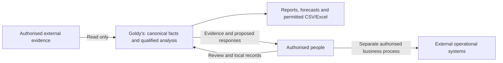

# Software Requirements Specification — Goldy's Unified Data Platform

Version: 1.1. Date: 14 October 2026 (Australia/Melbourne).
Document status: finished consolidated specification; detailed stakeholder validation and operational acceptance pending.
Normative authority: business requirements and agreed product boundaries. Implementation state is informative evidence only.

## 1. Purpose and scope

This SRS defines the business information, behaviour, quality and verification required of Goldy's Unified Data Platform. It consolidates the charter, independent research, business model, capability map, BMAD brief, PRD and UX documents. It is the definitive consolidation for this documentation engagement, not evidence that unresolved requirements have been approved or delivered.

The operating scope is the current Australian pub with bar and kitchen service. Evidence-informed second-pub opening planning is included; second-pub live operations and consolidated multi-venue operations require a separate scope decision. The platform reads connected systems, produces governed analysis and reports, and retains authorised local annotations, proposals, scenarios, decisions and follow-up. Operational transactions remain in external systems.

The structure is informed by ISO/IEC/IEEE 29148 requirements-engineering principles: explicit context, necessary and verifiable statements, identifiable contracts, dependency management and traceability. No certification, compliance, exhaustive clause mapping or access to the full paid standard is claimed. [X01](https://www.iso.org/standard/72089.html) identifies the relevant requirements-engineering publication; this document uses its own structure and wording.

### 1.1 Source register and precedence

- **S01:** [PROJECT_CHARTER.md](../PROJECT_CHARTER.md), governing coverage and business-first discipline.
- **S02:** [Completed domain research](research/domain-australian-pub-operational-information-m-2026-10-14/research.md), including confidence, applicability and freshness limitations and its source ledger.
- **S03:** [Business-domain model](../research/business-domain-model.md), proposed E01–E43 definitions, grains, relationships and invariants.
- **S04:** [Business capability map](../research/business-capability-map.md), proposed C01–C22 and K01–K12.
- **S05:** [BMAD product brief](briefs/brief-goldys-requirements-2026-10-14/brief.md) and [addendum](briefs/brief-goldys-requirements-2026-10-14/addendum.md), reported context and agreed boundaries.
- **S06:** [BMAD PRD](prds/prd-goldys-requirements-2026-10-14/prd.md) and [addendum](prds/prd-goldys-requirements-2026-10-14/addendum.md), GOL requirements, BG goals, UJ journeys and OD decisions. Its source S06 records the user-reported automation/report/forecast/export intent.
- **S07:** [EXPERIENCE.md](ux-designs/ux-goldys-requirements-2026-10-14/EXPERIENCE.md) and [DESIGN.md](ux-designs/ux-goldys-requirements-2026-10-14/DESIGN.md), agreed experience direction and proposed behavioural details.
- **S08:** [Implementation gap analysis](IMPLEMENTATION-GAP-ANALYSIS.md), informative repository assessment at commit `9d625c7f23c88112302acc0a89d7826a3443f462`; no runtime acceptance evidence.

S01 governs domain coverage. Reported user clarification and agreed boundaries preserved in S05–S07 take precedence over older proposals. S02–S04 support domain derivation without establishing Goldy's policies. S08 cannot override normative business meaning. In requirement traces below, `PRD trace:` reproduces the PRD's own Sxx namespace; these are explicitly scoped to S06 and are not this SRS source register. E, C, K, UJ and BG identifiers retain their source meanings.

### 1.2 Requirement language, obligation and maturity

“Shall” denotes an independently verifiable contract. Only identified requirement records are normative; context, examples, diagrams and the implementation commentary are informative. Each record contains rationale, source, dependencies and verification. Multiple listed conditions are conjunctive: every applicable condition must pass.

- **Mandatory — established:** charter safeguard or agreed boundary; no unresolved feature selection is implied. Detailed policy parameters may still be pending.
- **Mandatory — proposed:** necessary contract for a proposed capability if stakeholders adopt it. It is not an approved delivery commitment. Charter domain coverage is mandatory; proposed detailed grains, workflows and KPI choices retain validation gates.
- **Conditional mandatory — proposed:** applies only after the named business activity, authorised purpose or obligation is established. Unknown applicability is blocked, not not-applicable.
- **Optional — proposed:** selectable extension or measure; omission requires an explicit scope decision. Once selected, its shall contract and safeguards apply.

Maturity and obligation are separate. Baseline PRD B maps to established; C and CC remain proposed. Agreed UX context/responsive directions are established; candidate screen compositions remain proposed. No candidate is promoted merely by SRS consolidation. Numerical bounds, policies and KPI contents are deliberately not invented. An unresolved dependency blocks the corresponding acceptance assertion.

Revision 1.1 records verified corrections from [SRS-REVIEW.md](SRS-REVIEW.md) in [REVISION-LOG.md](REVISION-LOG.md). DR-049–DR-055 are new proposed assertion contracts with no PRD/E-number counterpart; all earlier identifiers and meanings remain traceable. Worked verification cases are in [SRS-VERIFICATION-FIXTURES.md](SRS-VERIFICATION-FIXTURES.md); their policies apply only to the fixtures.

IDs are stable and unique within this SRS. FR/DR/ACC/MET/NFR/CON retain the PRD numeric suffix; BR corresponds to PRD SEM; UX corresponds to GUX. BC/INT/REL/GOV are consolidation records. Revisions retain IDs, previous wording, change rationale and decision evidence; retired IDs are never reused. Every requirement has an explicitly labelled child acceptance identifier `<ID>.AC1`, consisting of its Verification contract; compound conditions can receive further child IDs without renumbering.

Verification methods: **I** = document/evidence inspection; **T** = executable contract or scenario test; **A** = independent calculation/analysis; **D** = observed task demonstration with representative users. These describe future verification, not tests executed during authorship.

CON-001–CON-005, BR-001–BR-010 and applicable ACC-001–ACC-008 are cross-cutting safeguards for every product behaviour. Derived results additionally satisfy DR-040–DR-042 and REL-001–REL-006. Cross-cutting applicability is part of each record’s contract, rather than a sequential implementation dependency or a self-dependency. Explicit Dependencies fields identify validation gates and related contracts; they do not prescribe build order. Local writes additionally depend on FR-049/FR-050 and OD-14. Domain/detail requirements depend on INT-001/INT-002 for external evidence, or an explicitly labelled local record; no unavailable source is treated as a fulfilled contract.

## 2. Business context and objectives

The owner and GM report recurring work gathering numbers from several platforms into a weekly spreadsheet. They seek reporting automation, revenue and specific-product forecasts, actionable answers and CSV/formatted Excel output. Reported operational problems include uncertain staffing/workload, short-notice absences and stock through the next delivery. Cocktail effort, hot-day Aperol depletion and busy-dinner parma shortages are discovery examples, without measured frequencies or losses. The owner reportedly expects a purchased second pub to open approximately 6–12 months from 14 October 2026; this is not a committed launch date. Sources: S05–S06.

- **BG-01:** reduce report assembly, checking and rework while preserving correctness (FR-001–FR-006, FR-051–FR-053, MET-015).
- **BG-02:** support decisions with relevant qualified evidence and forecasts (FR-005, FR-007–FR-045, FR-048, FR-054, UX-001).
- **BG-03:** retain canonical atomic facts and comparable, explainable measurements (DR-001–DR-055, BR-001–BR-010, REL-001–REL-006).
- **BG-04:** inform opening decisions through explicit transfer assumptions (FR-043, FR-045, CON-005).
- **BG-05:** preserve authorised control, privacy and read-only sources (CON-001, CON-003–CON-004, ACC-001–ACC-008).

Business benefit has not been measured. MET-015 requires comparable preparation/checking/rework baselines; improved speed with concealed gaps is not success. Service, stock, forecast and follow-up outcomes need matched populations and agreed evaluators, without assigning universal numerical targets.

## 3. Stakeholders and organisational roles

Owner, GM, venue manager, kitchen manager, FOH manager and operational staff are charter stakeholders. Reported duties are FOH managers rostering/ordering FOH; head chef rostering/ordering BOH; sub-head chefs ordering BOH. Head chef is not automatically kitchen manager, and GM is not automatically venue manager. Bookkeeping/payroll, advisers and evidence stewards are supporting functions conditional on justified involvement, not new assumed positions. Customers, employees and suppliers are affected information subjects/counterparties; their inclusion does not establish platform accounts.

One person may hold several responsibilities. Validate performer, outcome owner, evidence verifier, consequential-action approver, delegation limits and absence cover independently. A title establishes neither approval power, system access, employment classification nor competency. Sources: S01, S04–S07; OD-02/OD-07/OD-10.

### GOV-001 — Validated responsibility records

**Obligation/status:** Mandatory — established.

The requirements authority shall record the performer, outcome owner, evidence verifier, consequential-action approver, delegation limits and absence cover for each adopted decision workflow, with participant, date and supporting evidence.

**Business rationale:** Prevents a proposed role hierarchy from becoming undocumented authority.

**Trace:** S01; S04–S07; BG-05. **Dependencies:** OD-02; OD-14.

**Verification — GOV-001.AC1:** I: inspect each adopted workflow for all named functions or an explicitly unresolved field. Unresolved authority blocks authority-dependent acceptance.

## 4. Responsibilities, decisions and KPIs

The following chains are proposed unless the responsibility is explicitly reported. They do not grant permissions or rank business priorities. Measures refer to section 16 and remain candidates until OD-09/OD-13 selection.

- **Owner → sustainability/opening choices → decide reliance, resources and assumptions to test → qualified revenue/cost/cash, commitments and new-site sensitivity → retain a decision/scenario and act externally → MET-007–MET-013, MET-015–MET-016 and later evidenced opening outcomes.** Opening-evidence recipient is reported; financial approval authority is unresolved.
- **GM → weekly review/coordination → decide report readiness and changes requiring response → report revision, coverage, comparisons, outlook and ownership → export or record follow-up → MET-010–MET-012, MET-015.** Report/insight intent is reported; preparation/sign-off ownership is unresolved.
- **Venue manager → cross-department coordination → decide response to service/coverage exceptions → demand, skills, availability and unresolved evidence → local escalation and external coordination → MET-003, MET-008, MET-011–MET-012.** Duties are proposed.
- **FOH manager → reported FOH rostering and ordering → decide skill coverage and supply through delivery → workload, roster/actual time, stock, recipes/pours, packs and delivery horizon → local options and external roster/order actions → MET-003–MET-006, MET-008, MET-010, MET-014.** Service/cash/booking duties require validation.
- **Head chef → reported BOH rostering and ordering → decide preparation, skill coverage and ingredient supply → food outlook, effective recipes/yields, workload, stock and roster → local scenarios and external actions → MET-003, MET-005–MET-008, MET-010, MET-014.** Recipe/control ownership remains proposed.
- **Sub-head chef → reported BOH ordering → decide quantity/timing under uncertainty → demand/recipes, usable stock, conversions and outstanding supply → retain proposal and order externally → MET-005–MET-006, MET-014.** Rostering, pay access and spend approval are unconfirmed.
- **Kitchen manager → validated kitchen duties → decide assigned preparation/supply/control questions → only corresponding evidence → scoped local follow-up/external action → corresponding selected measures.** No head-chef equivalence or duplicate dashboard is assumed.
- **Operational staff → assigned work/evidence → decide what observation to contribute or escalate → relevant instructions, own permitted evidence and issue status → local observation and external work → verified issue response under MET-012.** No personal margin/sales ranking is inferred.
- **Bookkeeping/payroll/adviser → authorised interpretation → decide whether discrepancy is timing, classification or missing evidence → typed money, purchase, valuation, work/pay records → explain/query externally and export permitted evidence → MET-007–MET-008, MET-011, MET-016.** Access is purpose-bound.

### GOV-002 — Decision value and outcome contract

**Obligation/status:** Mandatory — established.

For every adopted feature, the requirements authority shall record role, responsibility, decision, required information, permitted local or external action, selected outcome measure and evidence of operational value; it shall remove, consolidate or relocate a feature whose primary placement lacks that evidence.

**Business rationale:** Makes operational value rather than available data determine product prominence.

**Trace:** S01; S04; S07 GUX-01/09; BG-02. **Dependencies:** GOV-001; OD-01; OD-09; OD-12.

**Verification — GOV-002.AC1:** I/D: trace each adopted feature and primary destination through the complete chain with role holders; unresolved value prevents confirmed primary placement.

## 5. System context and boundaries

Goldy's sits between authorised external evidence and business decision-makers. External evidence families include POS, reservations, supplier/stock/recipe systems, workforce/payroll, accounting/bank/processor records and purpose-validated contextual records. Specific source availability is unresolved. People review qualified results, export permitted information and retain local records. External operational systems and authorised people execute rosters, orders, bookings, stock adjustments, payments, payroll and tasks.

The diagram is an information/authority context, not selected architecture. Local data includes report definitions/instances, scenarios, annotations, grants with separate authority and follow-up history. A local state change never proves external execution. Preparation and export do not authorise automated distribution. Scope and external-action restrictions are specified by CON-001–CON-006 in section 18.

## 6. Business capability requirements

These records require information/decision support, not operational execution of the capability verbs. All C01–C22 needs remain represented independently of present sources. Detailed workflows remain proposed, conditional on OD-01/GOV-001 and listed FR contracts. No list order implies priority.

### BC-001 — Manage the offer, availability and pricing

**Obligation/status:** Mandatory — proposed.

The system shall support authorised review of capability C01 through the linked functional contracts, retaining the following business information or explicitly identifying its evidence gaps: Products, menu/price versions, sale quantities and historical prices, discounts/comps, recipe ingredients/yields, purchase-cost basis, stock availability and service constraints (E04–E10, E17, E21–E28). Cost evidence is required for margin decisions; demand alone can support availability decisions.

**Business rationale:** Enables the capability outcome without equating information review with external execution. Candidate outcome: Net sales and sales mix; realised unit revenue; theoretical ingredient contribution with its basis; product availability. Measure unavailability only if observation/opportunity evidence exists.

**Trace:** S01; S04 C01; S06 capability coverage; BG-02/BG-03. **Dependencies:** OD-01; GOV-001; FR-007; FR-027–FR-028; MET-001.

**Verification — BC-001.AC1:** I/D: inspect a capability-to-information-to-decision chain and demonstrate its linked functional acceptance cases; unavailable evidence must remain visible.

### BC-002 — Manage customer sales and commercial exceptions

**Obligation/status:** Mandatory — proposed.

The system shall support authorised review of capability C02 through the linked functional contracts, retaining the following business information or explicitly identifying its evidence gaps: Check/line identity, order/fulfilment evidence, historical consideration/tax, selected modifiers, financial adjustments, reasons and applicable authorisations (E07–E10); payment status is separate (E11–E12).

**Business rationale:** Enables the capability outcome without equating information review with external execution. Candidate outcome: Correct charge reconciliation; net sales; comp/discount/void/reversal values and reasons; unresolved commercial-exception count/age. Exception frequency is a prompt to investigate, not proof of misconduct.

**Trace:** S01; S04 C02; S06 capability coverage; BG-02/BG-03. **Dependencies:** OD-01; GOV-001; FR-012; DR-007–DR-010.

**Verification — BC-002.AC1:** I/D: inspect a capability-to-information-to-decision chain and demonstrate its linked functional acceptance cases; unavailable evidence must remain visible.

### BC-003 — Manage tender, customer balances and stored value

**Obligation/status:** Mandatory — proposed.

The system shall support authorised review of capability C03 through the linked functional contracts, retaining the following business information or explicitly identifying its evidence gaps: Check consideration, money movements/statuses, allocations, liability entries, reservation deposit links and accountant-approved recognition/tax/expiry rules (E07, E10–E13, E37).

**Business rationale:** Enables the capability outcome without equating information review with external execution. Candidate outcome: Unpaid check balance/age; unapplied receipts; outstanding customer liability; reconciliation exceptions. Cash collected and sales remain distinct outcomes.

**Trace:** S01; S04 C03; S06 capability coverage; BG-02/BG-03. **Dependencies:** OD-01; GOV-001; FR-013–FR-014; DR-011–DR-013.

**Verification — BC-003.AC1:** I/D: inspect a capability-to-information-to-decision chain and demonstrate its linked functional acceptance cases; unavailable evidence must remain visible.

### BC-004 — Manage reservations, attendance and capacity

**Obligation/status:** Mandatory — proposed.

The system shall support authorised review of capability C04 through the linked functional contracts, retaining the following business information or explicitly identifying its evidence gaps: Intended service times/party size, booking outcomes, deposits, actual visits/covers, table/area capacity and assignment history, service-period definitions (E02–E03, E13, E37–E39). Customer identity is needed only for a demonstrated booking/contact purpose.

**Business rationale:** Enables the capability outcome without equating information review with external execution. Candidate outcome: Booked covers versus actual covers; eligible reservation no-show rate; seat/capacity utilisation only where capacity and occupancy duration are evidenced; aligned spend per actual cover.

**Trace:** S01; S04 C04; S06 capability coverage; BG-02/BG-03. **Dependencies:** OD-01; GOV-001; FR-008–FR-009; DR-037–DR-039.

**Verification — BC-004.AC1:** I/D: inspect a capability-to-information-to-decision chain and demonstrate its linked functional acceptance cases; unavailable evidence must remain visible.

### BC-005 — Coordinate service and fulfilment

**Obligation/status:** Mandatory — proposed.

The system shall support authorised review of capability C05 through the linked functional contracts, retaining the following business information or explicitly identifying its evidence gaps: Actual demand/arrivals, order and fulfilment times/statuses, modifiers and recipe instructions, available items, work coverage and relevant control evidence (E05, E08–E09, E22–E23, E33–E35, E38, E43).

**Business rationale:** Enables the capability outcome without equating information review with external execution. Candidate outcome: Order-to-fulfilment duration distribution and coverage; unfulfilled-item backlog; recorded service incidents and correction outcomes. Check closure time is not serving time.

**Trace:** S01; S04 C05; S06 capability coverage; BG-02/BG-03. **Dependencies:** OD-01; GOV-001; FR-009–FR-011; DR-054.

**Verification — BC-005.AC1:** I/D: inspect a capability-to-information-to-decision chain and demonstrate its linked functional acceptance cases; unavailable evidence must remain visible.

### BC-006 — Plan and control purchasing commitments

**Obligation/status:** Mandatory — proposed.

The system shall support authorised review of capability C06 through the linked functional contracts, retaining the following business information or explicitly identifying its evidence gaps: Demand/booking forecasts, usable stock and uncertainty, recipes/yields, supplier items/conversions, lead times, order quantities/prices, outstanding accepted deliveries, budget/cash constraints (E16–E24, E26–E28, E37, E42).

**Business rationale:** Enables the capability outcome without equating information review with external execution. Candidate outcome: Evidenced availability/stockout incidents; outstanding order exposure; forecast-versus-usage variance; purchasing against approved plan. Supplier on-time/in-full performance requires promised and actual receipt evidence.

**Trace:** S01; S04 C06; S06 capability coverage; BG-02/BG-03. **Dependencies:** OD-01; GOV-001; FR-017–FR-019; DR-052; DR-053.

**Verification — BC-006.AC1:** I/D: inspect a capability-to-information-to-decision chain and demonstrate its linked functional acceptance cases; unavailable evidence must remain visible.

### BC-007 — Receive and verify goods

**Obligation/status:** Mandatory — proposed.

The system shall support authorised review of capability C07 through the linked functional contracts, retaining the following business information or explicitly identifying its evidence gaps: Supplier identity, order if available, delivered item/pack quantities, conversions, inspection evidence, acceptance disposition, stock location and conditional lot/expiry information (E16–E21, E24, E43).

**Business rationale:** Enables the capability outcome without equating information review with external execution. Candidate outcome: Accepted versus ordered quantity; damaged/rejected quantities; unresolved delivery discrepancies; receiving-evidence completeness and corrective actions.

**Trace:** S01; S04 C07; S06 capability coverage; BG-02/BG-03. **Dependencies:** OD-01; GOV-001; FR-020–FR-021; DR-053.

**Verification — BC-007.AC1:** I/D: inspect a capability-to-information-to-decision chain and demonstrate its linked functional acceptance cases; unavailable evidence must remain visible.

### BC-008 — Validate supplier charges and manage amounts payable

**Obligation/status:** Mandatory — proposed.

The system shall support authorised review of capability C08 through the linked functional contracts, retaining the following business information or explicitly identifying its evidence gaps: Independently identified orders, receipts, invoices and credits; line/document matches; currency/tax/terms/due dates; payment allocations and cash commitments (E11–E12, E16–E20).

**Business rationale:** Enables the capability outcome without equating information review with external execution. Candidate outcome: Outstanding payable balance/age; due/overdue obligations; unmatched/disputed charges; accepted-versus-invoiced quantity/price differences and unreceived credits.

**Trace:** S01; S04 C08; S06 capability coverage; BG-02/BG-03. **Dependencies:** OD-01; GOV-001; FR-021–FR-022; DR-050.

**Verification — BC-008.AC1:** I/D: inspect a capability-to-information-to-decision chain and demonstrate its linked functional acceptance cases; unavailable evidence must remain visible.

### BC-009 — Maintain stock custody, transfers and production records

**Obligation/status:** Mandatory — proposed.

The system shall support authorised review of capability C09 through the linked functional contracts, retaining the following business information or explicitly identifying its evidence gaps: Item/location identities, units/conversions, accepted receipts, production/transfer legs, consumption and waste evidence, recipe versions and adjustment basis (E02, E17, E19, E21–E25).

**Business rationale:** Enables the capability outcome without equating information review with external execution. Candidate outcome: Book stock by item/location; incomplete transfer/production groups; negative/unresolved balances; movement evidence completeness. Valued stock also requires an agreed cost method.

**Trace:** S01; S04 C09; S06 capability coverage; BG-02/BG-03. **Dependencies:** OD-01; GOV-001; FR-023–FR-024; DR-052.

**Verification — BC-009.AC1:** I/D: inspect a capability-to-information-to-decision chain and demonstrate its linked functional acceptance cases; unavailable evidence must remain visible.

### BC-010 — Observe stock and resolve count discrepancies

**Obligation/status:** Mandatory — proposed.

The system shall support authorised review of capability C10 through the linked functional contracts, retaining the following business information or explicitly identifying its evidence gaps: Count session scope/completeness, item/location observations, unit conversions, matched book balance/cutoff, intervening movements, reasons and adjustment evidence (E21, E24, E26–E27).

**Business rationale:** Enables the capability outcome without equating information review with external execution. Candidate outcome: Count coverage; observed-minus-book variance in physical units and separately valued basis; unresolved discrepancy age; approved correction backlog.

**Trace:** S01; S04 C10; S06 capability coverage; BG-02/BG-03. **Dependencies:** OD-01; GOV-001; FR-025–FR-026.

**Verification — BC-010.AC1:** I/D: inspect a capability-to-information-to-decision chain and demonstrate its linked functional acceptance cases; unavailable evidence must remain visible.

### BC-011 — Manage recipes, yields and preparation economics

**Obligation/status:** Mandatory — proposed.

The system shall support authorised review of capability C11 through the linked functional contracts, retaining the following business information or explicitly identifying its evidence gaps: Product/output identities, recipe/component versions, ingredient units/conversions, usable yields, modifier effects, input cost basis and relevant safety evidence (E04–E06, E09, E17, E21–E24, E43).

**Business rationale:** Enables the capability outcome without equating information review with external execution. Candidate outcome: Theoretical ingredient cost per usable portion; expected-versus-observed yield when batch evidence exists; completeness of recipe/ingredient mapping; prepared availability.

**Trace:** S01; S04 C11; S06 capability coverage; BG-02/BG-03. **Dependencies:** OD-01; GOV-001; FR-027–FR-028.

**Verification — BC-011.AC1:** I/D: inspect a capability-to-information-to-decision chain and demonstrate its linked functional acceptance cases; unavailable evidence must remain visible.

### BC-012 — Measure consumption, known waste and unexplained usage

**Obligation/status:** Mandatory — proposed.

The system shall support authorised review of capability C12 through the linked functional contracts, retaining the following business information or explicitly identifying its evidence gaps: Fulfilled/eligible sold quantities, recipe versions/yields/modifiers, compatible opening/closing counts and movement scope, measured/estimated waste reasons and optional valuation evidence (E08–E09, E21–E28).

**Business rationale:** Enables the capability outcome without equating information review with external execution. Candidate outcome: Theoretical usage; observed/residual depletion distinctly labelled; physical/residual minus theoretical usage variance; recorded waste quantity/value by reason; input completeness.

**Trace:** S01; S04 C12; S06 capability coverage; BG-02/BG-03. **Dependencies:** OD-01; GOV-001; FR-028–FR-030.

**Verification — BC-012.AC1:** I/D: inspect a capability-to-information-to-decision chain and demonstrate its linked functional acceptance cases; unavailable evidence must remain visible.

### BC-013 — Establish employment duties, availability and competency

**Obligation/status:** Mandatory — proposed.

The system shall support authorised review of capability C13 through the linked functional contracts, retaining the following business information or explicitly identifying its evidence gaps: Employee identity, employer/assignment history, actual duties, role definitions, availability, applicable instrument/classification evidence and qualification validity (E29–E31, E43).

**Business rationale:** Enables the capability outcome without equating information review with external execution. Candidate outcome: Relevant competency coverage; unresolved employment-term questions; expiring required evidence; staffing availability. Applicability must be established before reporting compliance.

**Trace:** S01; S04 C13; S06 capability coverage; BG-02/BG-03. **Dependencies:** OD-01; GOV-001; FR-031; DR-029–DR-031; DR-051.

**Verification — BC-013.AC1:** I/D: inspect a capability-to-information-to-decision chain and demonstrate its linked functional acceptance cases; unavailable evidence must remain visible.

### BC-014 — Plan staffing and publish rosters

**Obligation/status:** Mandatory — proposed.

The system shall support authorised review of capability C14 through the linked functional contracts, retaining the following business information or explicitly identifying its evidence gaps: Reservations and demand history, service capacity, employee availability/duties/competencies, effective employment terms, roster versions/planned shifts and forecast cost assumptions (E02–E03, E29–E33, E36–E38, E42–E43).

**Business rationale:** Enables the capability outcome without equating information review with external execution. Candidate outcome: Filled versus required planned coverage; forecast labour cost/percentage on an explicit basis; unfilled or conflicted shifts; publication/change timeliness against agreed policy.

**Trace:** S01; S04 C14; S06 capability coverage; BG-02/BG-03. **Dependencies:** OD-01; GOV-001; FR-032–FR-034; DR-051.

**Verification — BC-014.AC1:** I/D: inspect a capability-to-information-to-decision chain and demonstrate its linked functional acceptance cases; unavailable evidence must remain visible.

### BC-015 — Record, review and approve actual work

**Obligation/status:** Mandatory — proposed.

The system shall support authorised review of capability C15 through the linked functional contracts, retaining the following business information or explicitly identifying its evidence gaps: Employee and assignment, actual intervals/activity, break evidence, planned shifts, scope/allocation, review/correction history and applicable approval policy (E29–E35).

**Business rationale:** Enables the capability outcome without equating information review with external execution. Candidate outcome: Actual worked hours; roster-versus-actual hours on matched scope; missing clock-out/break evidence; unapproved/correction backlog. Paid hours are separately identified.

**Trace:** S01; S04 C15; S06 capability coverage; BG-02/BG-03. **Dependencies:** OD-01; GOV-001; FR-034–FR-035.

**Verification — BC-015.AC1:** I/D: inspect a capability-to-information-to-decision chain and demonstrate its linked functional acceptance cases; unavailable evidence must remain visible.

### BC-016 — Determine labour cost and settle pay obligations

**Obligation/status:** Mandatory — proposed.

The system shall support authorised review of capability C16 through the linked functional contracts, retaining the following business information or explicitly identifying its evidence gaps: Effective employment terms/classification, actual/paid time and breaks, entitlements/rates, cost allocation, payroll calculation status, payment allocations and applicable due/receipt evidence (E11–E12, E31, E34–E36, E43).

**Business rationale:** Enables the capability outcome without equating information review with external execution. Candidate outcome: Wages-only and defined loaded labour cost separately; correction backlog; unresolved payable obligations; payment/contribution timeliness against verified applicable rules; labour cost percentage and sales per declared hour basis.

**Trace:** S01; S04 C16; S06 capability coverage; BG-02/BG-03. **Dependencies:** OD-01; GOV-001; FR-036–FR-037.

**Verification — BC-016.AC1:** I/D: inspect a capability-to-information-to-decision chain and demonstrate its linked functional acceptance cases; unavailable evidence must remain visible.

### BC-017 — Reconcile cash, tenders and processor settlements

**Obligation/status:** Mandatory — proposed.

The system shall support authorised review of capability C17 through the linked functional contracts, retaining the following business information or explicitly identifying its evidence gaps: Money movement/status, allocations, cash observations/cutoffs, processor components, bank receipt evidence and adjustment/approval reasons (E11–E15).

**Business rationale:** Enables the capability outcome without equating information review with external execution. Candidate outcome: Observed-minus-expected cash variance; expected-minus-received settlement difference under declared fee/sign treatment; unmatched settlement count/value/age; unresolved chargebacks/fees.

**Trace:** S01; S04 C17; S06 capability coverage; BG-02/BG-03. **Dependencies:** OD-01; GOV-001; FR-015–FR-016.

**Verification — BC-017.AC1:** I/D: inspect a capability-to-information-to-decision chain and demonstrate its linked functional acceptance cases; unavailable evidence must remain visible.

### BC-018 — Establish comparable financial performance

**Obligation/status:** Mandatory — proposed.

The system shall support authorised review of capability C18 through the linked functional contracts, retaining the following business information or explicitly identifying its evidence gaps: Sales/adjustments/tax, purchase/credit evidence, opening/closing stock quantities and valuations, classified losses, cost-method evidence, labour components, other expense/accountant statements, monetary commitments and reporting periods (E03, E07–E28, E36, E40–E41).

**Business rationale:** Enables the capability outcome without equating information review with external execution. Candidate outcome: Reconciled net revenue, COGS, gross profit/margin, category cost percentages, defined labour/prime cost and, with sufficient account scope, operating/net profit. Cash balances and commitments are separate measures.

**Trace:** S01; S04 C18; S06 capability coverage; BG-02/BG-03. **Dependencies:** OD-01; GOV-001; FR-001–FR-006; FR-038–FR-040; DR-049; DR-050.

**Verification — BC-018.AC1:** I/D: inspect a capability-to-information-to-decision chain and demonstrate its linked functional acceptance cases; unavailable evidence must remain visible.

### BC-019 — Set budgets, forecasts and performance targets

**Obligation/status:** Mandatory — proposed.

The system shall support authorised review of capability C19 through the linked functional contracts, retaining the following business information or explicitly identifying its evidence gaps: Versioned metric definitions, historical results with completeness, service/demand scenarios, cost/price assumptions, planned staffing/purchasing, plan versions and approval history (E03, E32–E33, E37–E42).

**Business rationale:** Enables the capability outcome without equating information review with external execution. Candidate outcome: Actual-minus-budget variance; forecast error on a declared horizon; exposure from commitments; achievement of agreed targets. Favourable direction is measure-specific.

**Trace:** S01; S04 C19; S06 capability coverage; BG-02/BG-03. **Dependencies:** OD-01; GOV-001; FR-039; FR-041–FR-045.

**Verification — BC-019.AC1:** I/D: inspect a capability-to-information-to-decision chain and demonstrate its linked functional acceptance cases; unavailable evidence must remain visible.

### BC-020 — Review operations and act on exceptions

**Obligation/status:** Mandatory — proposed.

The system shall support authorised review of capability C20 through the linked functional contracts, retaining the following business information or explicitly identifying its evidence gaps: Relevant operational facts and evidence gaps, current demand/coverage, reconciled/qualified measures, targets, reasoned exceptions and action evidence (E03, E07–E43 as applicable). This capability consumes other domains; it does not create duplicate sales, stock or labour facts.

**Business rationale:** Enables the capability outcome without equating information review with external execution. Candidate outcome: Named operational outcomes, unresolved exception age and verified action completion; service/productivity/margin changes interpreted with context and completeness.

**Trace:** S01; S04 C20; S06 capability coverage; BG-02/BG-03. **Dependencies:** OD-01; GOV-001; FR-005; FR-048–FR-050.

**Verification — BC-020.AC1:** I/D: inspect a capability-to-information-to-decision chain and demonstrate its linked functional acceptance cases; unavailable evidence must remain visible.

### BC-021 — Manage applicable safety, licence and incident controls

**Obligation/status:** Conditional mandatory — proposed.

The system shall support authorised review of capability C21 through the linked functional contracts, retaining the following business information or explicitly identifying its evidence gaps: Venue jurisdiction/legal operator/licence and actual business activities, current applicable requirements, competent-person evidence, control criteria/observations, incident and corrective-action history, conditional supplier/lot traceability (E01–E02, E16–E27, E29–E31, E43).

**Business rationale:** Enables the capability outcome without equating information review with external execution. Candidate outcome: Applicable control coverage; unresolved critical findings; expired required evidence; action completion. A compliance claim requires verified applicability and evidence, not just a completed checklist.

**Trace:** S01; S04 C21; S06 capability coverage; BG-02/BG-03. **Dependencies:** OD-01; GOV-001; FR-047; DR-043; DR-055.

**Verification — BC-021.AC1:** I/D: inspect a capability-to-information-to-decision chain and demonstrate its linked functional acceptance cases; unavailable evidence must remain visible.

### BC-022 — Govern business definitions, evidence and responsible use

**Obligation/status:** Mandatory — proposed.

The system shall support authorised review of capability C22 through the linked functional contracts, retaining the following business information or explicitly identifying its evidence gaps: Metric versions, provenance/status, correction links, missing-information reasons, unit conversions, role/duty/approval evidence and verified record-class obligations (all domain contracts; particularly E01, E17, E30–E31, E40–E43).

**Business rationale:** Enables the capability outcome without equating information review with external execution. Candidate outcome: Completeness by business population; unresolved reconciliation/mapping/definition issues; proportion of decision measures qualified or unavailable; timely authorised correction and retrieval of evidence.

**Trace:** S01; S04 C22; S06 capability coverage; BG-02/BG-03. **Dependencies:** OD-01; GOV-001; FR-006; FR-048–FR-050; BR-001–BR-010.

**Verification — BC-022.AC1:** I/D: inspect a capability-to-information-to-decision chain and demonstrate its linked functional acceptance cases; unavailable evidence must remain visible.

## 7. Conceptual information model

Canonical concepts express business meaning independently of vendor labels, source tables or present architecture. Entity IDs E01–E43 are S03 references; DR-001–DR-043 specify their minimum contracts. DR-044–DR-048 are explicit PRD extensions for workload, context, local records and reports; there are no source-model E44–E48.

- **Venue/context:** enduring venue → operating locations/areas and separately defined operational, service, accounting and payroll intervals.
- **Commercial:** product → effective menu offering/price term; check → line occurrences → selected modifiers/adjustments. Historic charged consideration is independent of current list price.
- **Money:** money movement or non-cash customer-liability release ↔ obligation through explicitly typed allocations; liabilities, cash observations and settlement components retain independent identity and time.
- **Supply/material:** supplier → effective item/pack terms; distinct orders, physical receipts, invoices and credits ↔ matches. Stock item/location → movement legs and count observations. Recipe versions/components connect outputs to material inputs; usage assessment is derived evidence, not another movement.
- **People:** employee → employer engagement/terms and defined work roles; roster version → planned slots; timesheet → actual work/break intervals; cost/entitlement components remain separate from time and cash paid.
- **Demand/service:** reservation → zero or many attendance episodes; each visit has zero or one originating booking. Visits ↔ checks/lines through service allocations. Covers are observed persons, not check counts.
- **Management:** metric definition/version → measurement and plan/target values; report definition → prepared instances/revisions; local decisions/follow-up reference evidence and subsequent matched outcomes.

Commercial, money, material, workforce and service states evolve independently. Events retain object identity, occurrence/effective precision, recorded time and evidence status; actor/reason/authorisation are retained where available and required for claims about those controls. Known final evidence need not imply every preceding event was captured. Sections 8–9 specify cardinalities and invariants; incomplete evidence is retained without pretending it satisfies a complete assertion.

## 8. Canonical entities and minimum data contracts

Every contract inherits stable venue/business identity, atomic grain, source reference, evidence status, recorded time, occurrence/effective precision where applicable, units/currency/tax basis and correction lineage. Each material attribute and relationship has known (including zero), unknown, not captured, disputed or not applicable-with-reason state. Required minima are necessary to assert the stated business meaning, not instructions to invent absent facts. Quantity and cost can be known independently. Optional personal fields require justified purpose; optional absence never asserts no activity.

The records below preserve conditional minima and business relationships. They define information contracts rather than database tables or mandatory integrations. Detailed grains/fields remain proposed; charter coverage and the shared semantic safeguards are established.

### DR-001 — Venue

**Obligation/status:** Mandatory — proposed.

The system shall represent this concept at the following grain and shall require its conditional minima before asserting the corresponding fact as complete.

**Grain/minimum:** One enduring establishment: identity and identifying label. Named timezone is required for local-time attribution; legal operator/jurisdiction are required for an applicability claim.

The system shall preserve the following relationships and enforce their assertion invariants; incomplete or conflicting evidence shall remain qualified.

**Relationships/invariants:** Venue owns many operational locations/periods/facts; name/operator changes retain identity and dated context.

**Business rationale:** The operational establishment whose service, stock, labour and financial performance are being analysed; establishes scope.

**Trace:** S01; S03 E01; S06 GOL-DR-001; PRD trace: S01; S04 E01; C22. **Dependencies:** OD-03,OD-10.

**Verification — DR-001.AC1:** I/T/A: inspect representative complete, incomplete and conflicting records and validate cardinality/conditional-field predicates. Unknown operator/jurisdiction leaves obligations unresolved, without erasing known venue activity.

### DR-002 — Operational location

**Obligation/status:** Mandatory — proposed.

The system shall represent this concept at the following grain and shall require its conditional minima before asserting the corresponding fact as complete.

**Grain/minimum:** One identified operating/holding area: venue, identity, label/type; capacity requires value, persons/seats basis and effective dates.

The system shall preserve the following relationships and enforce their assertion invariants; incomplete or conflicting evidence shall remain qualified.

**Relationships/invariants:** One venue; zero/one parent and many children, with no hierarchy cycles. A stockholding assertion needs an identified holding location; department and physical area differ.

**Business rationale:** An identifiable place or responsibility area such as cellar, kitchen, bar, dining area or table; locates stock, service or work.

**Trace:** S01; S03 E02; S06 GOL-DR-002; PRD trace: S01; S04 E02; C04,C09,C22. **Dependencies:** OD-02,OD-03,OD-05.

**Verification — DR-002.AC1:** I/T/A: inspect representative complete, incomplete and conflicting records and validate cardinality/conditional-field predicates. An unknown area remains unassigned; parent/child aggregation counts activity once.

### DR-003 — Reporting period

**Obligation/status:** Mandatory — proposed.

The system shall represent this concept at the following grain and shall require its conditional minima before asserting the corresponding fact as complete.

**Grain/minimum:** One bounded interval/type/scope: start, end, policy/version, timezone for local boundaries and label for a named service.

The system shall preserve the following relationships and enforce their assertion invariants; incomplete or conflicting evidence shall remain qualified.

**Relationships/invariants:** One venue; optional parent in a declared hierarchy; end follows start. Exclusive partitions do not overlap within a scope; operational/pay/accounting periods differ.

**Business rationale:** An explicitly bounded trading day, service period, accounting period or pay period; supports comparable attribution.

**Trace:** S01; S03 E03; S06 GOL-DR-003; PRD trace: S01; S04 E03; C18,C19,C22. **Dependencies:** OD-03,OD-09.

**Verification — DR-003.AC1:** I/T/A: inspect representative complete, incomplete and conflicting records and validate cardinality/conditional-field predicates. A midnight-crossing example is assigned by an explicit agreed rule while its original timestamp remains intact; unresolved assignment is shown.

### DR-004 — Product

**Obligation/status:** Mandatory — proposed.

The system shall represent this concept at the following grain and shall require its conditional minima before asserting the corresponding fact as complete.

**Grain/minimum:** One stable commercial concept: identity, description; asserted quantity requires sale unit/variant basis; category mapping has effective history.

The system shall preserve the following relationships and enforce their assertion invariants; incomplete or conflicting evidence shall remain qualified.

**Relationships/invariants:** Many offerings/prices/sale lines; optional direct stock/recipe mapping. Product, ingredient and supplier pack are independent identities.

**Business rationale:** A customer-facing item or service the venue can sell, including a selectable modifier product; identifies demand and sales mix.

**Trace:** S01; S03 E04; S06 GOL-DR-004; PRD trace: S01; S04 E04; C01,C02. **Dependencies:** OD-03,OD-05.

**Verification — DR-004.AC1:** I/T/A: inspect representative complete, incomplete and conflicting records and validate cardinality/conditional-field predicates. An unidentified product leaves an unmapped sale and incomplete product mix, not deleted revenue; identical names do not force a merge.

### DR-005 — Menu offering version

**Obligation/status:** Mandatory — proposed.

The system shall represent this concept at the following grain and shall require its conditional minima before asserting the corresponding fact as complete.

**Grain/minimum:** One effective presentation/availability context: product, menu/context identity, version, effective start and description. Allergen/availability assertions require supporting versioned evidence.

The system shall preserve the following relationships and enforce their assertion invariants; incomplete or conflicting evidence shall remain qualified.

**Relationships/invariants:** One product; many contextual price terms; parallel contexts may exist. Effective withdrawal does not invalidate prior sales.

**Business rationale:** A product's availability and presentation in a menu/channel/context; supports service availability independently of sales.

**Trace:** S01; S03 E05; S06 GOL-DR-005; PRD trace: S01; S04 E05; C01,C05. **Dependencies:** OD-03,OD-05,OD-10.

**Verification — DR-005.AC1:** I/T/A: inspect representative complete, incomplete and conflicting records and validate cardinality/conditional-field predicates. A sale can be known without menu evidence; unknown availability/allergen evidence is not treated as available/allergen-free.

### DR-006 — Price term

**Obligation/status:** Mandatory — proposed.

The system shall represent this concept at the following grain and shall require its conditional minima before asserting the corresponding fact as complete.

**Grain/minimum:** One eligible price/context/version: product/offering, amount/currency, priced quantity/unit, effective start; tax basis required for inclusive/exclusive claims.

The system shall preserve the following relationships and enforce their assertion invariants; incomplete or conflicting evidence shall remain qualified.

**Relationships/invariants:** One product, optional offering; overlapping eligible terms require a selection rule. Historical charged amount is independent.

**Business rationale:** A stated selling price for a product/offering under defined conditions; distinguishes intended pricing from actual charged consideration.

**Trace:** S01; S03 E06; S06 GOL-DR-006; PRD trace: S01; S04 E06; C01,C02. **Dependencies:** OD-03,OD-08.

**Verification — DR-006.AC1:** I/T/A: inspect representative complete, incomplete and conflicting records and validate cardinality/conditional-field predicates. Zero price is valid; today’s price never recalculates past sales. Unknown intended price makes list-price reduction unavailable.

### DR-007 — Customer check

**Obligation/status:** Mandatory — proposed.

The system shall represent this concept at the following grain and shall require its conditional minima before asserting the corresponding fact as complete.

**Grain/minimum:** One commercial account with split/merge lineage: venue, identity and lifecycle status; timed opening/closure claims require relevant times. Monetary total requires currency/tax basis.

The system shall preserve the following relationships and enforce their assertion invariants; incomplete or conflicting evidence shall remain qualified.

**Relationships/invariants:** Many sale lines/adjustments/payment allocations; many visits via service allocations. Empty/open checks are valid.

**Business rationale:** The commercial account grouping customer charges, reductions and related lines, including an open tab; explains customer obligation and sale lifecycle.

**Trace:** S01; S03 E07; S06 GOL-DR-007; PRD trace: S01; S04 E07; C02,C03. **Dependencies:** OD-03,OD-08.

**Verification — DR-007.AC1:** I/T/A: inspect representative complete, incomplete and conflicting records and validate cardinality/conditional-field predicates. Closed does not prove paid/fulfilled. Aggregate-only check evidence cannot establish missing product quantities or covers.

### DR-008 — Sale line

**Obligation/status:** Mandatory — proposed.

The system shall represent this concept at the following grain and shall require its conditional minima before asserting the corresponding fact as complete.

**Grain/minimum:** One check item occurrence/revision: parent check, line identity, item reference/description, lifecycle status. Quantity claim requires quantity/unit; money claim requires amount/currency/basis; fulfilment claim requires relevant quantity/time evidence.

The system shall preserve the following relationships and enforce their assertion invariants; incomplete or conflicting evidence shall remain qualified.

**Relationships/invariants:** Exactly one check; optional canonical product; many modifiers/adjustments. Partial fulfilment/cancellation is attributable; partitions cannot exceed amended ordered quantity.

The system shall retain repeatable fulfilment-stage observations through DR-054, linked to the relevant amended quantity partition; a line timestamp alone shall not replace missing stage events.

For a tax-exclusive derivation, the system shall retain the conditional tax evidence and allocation/rounding lineage required by BR-003. A known inclusive amount alone does not establish the exclusive amount.

**Business rationale:** One ordered/charged commercial item occurrence; preserves quantity, consideration and fulfilment evidence.

**Trace:** S01; S03 E08; S06 GOL-DR-008; PRD trace: S01; S04 E08; C01,C02,C05,C12. **Dependencies:** OD-03,OD-05,OD-08.

**Verification — DR-008.AC1:** I/T/A: inspect representative complete, incomplete and conflicting records and validate cardinality/conditional-field predicates. Missing fulfilment means unknown, not unfulfilled. Financial reversal never automatically restocks; zero-price fulfilled lines can consume stock.

### DR-009 — Modifier selection

**Obligation/status:** Mandatory — proposed.

The system shall represent this concept at the following grain and shall require its conditional minima before asserting the corresponding fact as complete.

**Grain/minimum:** One selected option occurrence: parent line, selection meaning, quantity/unit where meaningful, target for omission/substitution. Price/recipe effects require explicit inclusion/mapping basis.

The system shall preserve the following relationships and enforce their assertion invariants; incomplete or conflicting evidence shall remain qualified.

**Relationships/invariants:** Exactly one sale line; optional mapped modifier product and component effects; repeated quantified selections can be legitimate.

**Business rationale:** An actual selected addition, omission or substitution on a sale line; explains price, preparation and consumption differences.

**Trace:** S01; S03 E09; S06 GOL-DR-009; PRD trace: S01; S04 E09; C01,C02,C05,C11. **Dependencies:** OD-03,OD-05.

**Verification — DR-009.AC1:** I/T/A: inspect representative complete, incomplete and conflicting records and validate cardinality/conditional-field predicates. Price effect counts once; unknown substitution mapping leaves theoretical ingredient usage incomplete even when charged amount is known.

### DR-010 — Commercial adjustment

**Obligation/status:** Mandatory — proposed.

The system shall represent this concept at the following grain and shall require its conditional minima before asserting the corresponding fact as complete.

**Grain/minimum:** One adjustment allocation: check or line target, type, signed amount/currency/basis, status; percent requires eligible basis; approved requires policy/evidence.

The system shall preserve the following relationships and enforce their assertion invariants; incomplete or conflicting evidence shall remain qualified.

**Relationships/invariants:** Exactly one target; optional original fact, reason and linked money movement. Shared parent and allocated children are not additive.

For a tax-exclusive derivation, the system shall retain the conditional tax evidence and allocation/rounding lineage required by BR-003. A known inclusive amount alone does not establish the exclusive amount.

**Business rationale:** A discount, comp, surcharge, tip charge, return credit or amount-only revenue reversal applied to customer consideration; distinguishes commercial treatment from cash refund.

**Trace:** S01; S03 E10; S06 GOL-DR-010; PRD trace: S01; S04 E10; C02,C03. **Dependencies:** OD-02,OD-03,OD-08.

**Verification — DR-010.AC1:** I/T/A: inspect representative complete, incomplete and conflicting records and validate cardinality/conditional-field predicates. Amount-only credit creates neither stock return nor cash refund; unknown reason stays unknown and unresolved excess remains visible.

### DR-011 — Money movement

**Obligation/status:** Mandatory — proposed.

The system shall represent this concept at the following grain and shall require its conditional minima before asserting the corresponding fact as complete.

**Grain/minimum:** One money transfer/receipt/disbursement: amount/currency, direction/purpose, status, identified venue endpoint; dated cash requires occurrence precision.

The system shall preserve the following relationships and enforce their assertion invariants; incomplete or conflicting evidence shall remain qualified.

**Relationships/invariants:** Many allocations/settlement components; original refund/payment link where known. Authorised, captured, received and settled status/time differ.

**Business rationale:** A receipt or disbursement of money, including customer tender/refund, supplier payment, payroll payment, float transfer or bank transfer; explains cash independently of revenue/expense.

**Trace:** S01; S03 E11; S06 GOL-DR-011; PRD trace: S01; S04 E11; C03,C08,C16,C17. **Dependencies:** OD-08,OD-10.

**Verification — DR-011.AC1:** I/T/A: inspect representative complete, incomplete and conflicting records and validate cardinality/conditional-field predicates. Internal transfers are not revenue; pending authorisation is not settled cash. Unknown method does not invalidate an evidenced receipt; unknown target leaves it unapplied.

### DR-012 — Payment allocation

**Obligation/status:** Mandatory — proposed.

The system shall represent this concept at the following grain and shall require its conditional minima before asserting the corresponding fact as complete.

**Grain/minimum:** One applied amount with stable allocation identity: explicitly typed source (DR-011 money movement or DR-013 liability-release entry), exactly one target identity/type, amount/currency, effective application time, application direction/status and reversal/reallocation lineage. Cross-currency application requires conversion evidence. The existing payment-allocation ID also covers non-cash liability settlement.

The system shall preserve the following relationships and enforce their assertion invariants; incomplete or conflicting evidence shall remain qualified.

**Relationships/invariants:** A cash-source target is one check, supplier charge/credit, customer liability, pay obligation or settlement obligation. A liability-release source settles an identified check/charge. Each allocation has exactly one source and target; totals shall conserve available source value and eligible outstanding charge. Liability releases shall not exceed available liability without an explicit exception. Reversal restores the affected allocation and liability balance without implying a cash refund. Applying earlier cash and redeeming its funded liability shall not both settle the same charge; neither is a new receipt.

**Business rationale:** The amount of a money movement or a separately evidenced non-cash liability release applied to an obligation; supports split tenders, part payments, liability redemption and consolidated supplier payments.

**Trace:** S01; S03 E12; S06 GOL-DR-012; PRD trace: S01; S04 E12; C03,C08,C16,C17. **Dependencies:** OD-08; OD-03.

**Verification — DR-012.AC1:** I/T/A: inspect representative complete, incomplete and conflicting records and validate cardinality/conditional-field predicates. Part payments reconcile independently; missing conversion or unknown target produces unresolved/unapplied balance, never invented settlement. AT-05.REDEEM verifies original receipt, non-cash redemption and its reversal with independent cash, liability and check balances.

### DR-013 — Customer liability entry

**Obligation/status:** Mandatory — proposed.

The system shall represent this concept at the following grain and shall require its conditional minima before asserting the corresponding fact as complete.

**Grain/minimum:** One deposit/voucher/credit balance change: liability identity or evidenced pool, entry type, amount/currency/direction; dated balance requires effective date.

The system shall preserve the following relationships and enforce their assertion invariants; incomplete or conflicting evidence shall remain qualified.

**Relationships/invariants:** One liability scope; optional reservation/check; payment allocations and linked original entries. Recognition, expiry and tax are separately validated.

The system shall link a redemption release to its DR-012 non-cash settlement allocations and conserve both released liability value and the settled charge; a check link alone is not settlement evidence.

**Business rationale:** An increase/decrease in the venue's obligation from a deposit, voucher, gift value or customer credit; prevents issuance/redemption double counting.

**Trace:** S01; S03 E13; S06 GOL-DR-013; PRD trace: S01; S04 E13; C03,C04. **Dependencies:** OD-08,OD-10.

**Verification — DR-013.AC1:** I/T/A: inspect representative complete, incomplete and conflicting records and validate cardinality/conditional-field predicates. Pooled evidence cannot prove individual redemption balances; unknown expiry never means expired. Redemption/issuance are not duplicate sales.

### DR-014 — Cash reconciliation observation

**Obligation/status:** Mandatory — proposed.

The system shall represent this concept at the following grain and shall require its conditional minima before asserting the corresponding fact as complete.

**Grain/minimum:** One monetary holding count: holding/session identity, observed amount/currency and cutoff precision; variance requires expected amount and basis.

The system shall preserve the following relationships and enforce their assertion invariants; incomplete or conflicting evidence shall remain qualified.

**Relationships/invariants:** One venue/holding scope; many relevant movements; optional previous opening observation. Recounts retain lineage.

**Business rationale:** An observed cash holding for a drawer/safe/accountability session compared with an independently derived expected holding; supports cash control.

**Trace:** S01; S03 E14; S06 GOL-DR-014; PRD trace: S01; S04 E14; C17. **Dependencies:** OD-02,OD-08.

**Verification — DR-014.AC1:** I/T/A: inspect representative complete, incomplete and conflicting records and validate cardinality/conditional-field predicates. No count is unknown rather than zero; missing expected holding prevents variance, not observed cash reporting.

### DR-015 — Settlement component

**Obligation/status:** Mandatory — proposed.

The system shall represent this concept at the following grain and shall require its conditional minima before asserting the corresponding fact as complete.

**Grain/minimum:** One element of one provider settlement: provider, grouping/component identity, type, signed amount/currency; dated reconciliation needs statement/eligibility/receipt dates.

The system shall preserve the following relationships and enforce their assertion invariants; incomplete or conflicting evidence shall remain qualified.

**Relationships/invariants:** One settlement group; optional original payment; bank receipt allocations. Fees, refunds/reserves and chargebacks retain separate meanings.

**Business rationale:** One processor settlement statement component such as captured tender, refund, fee, reserve or chargeback; explains net bank settlement.

**Trace:** S01; S03 E15; S06 GOL-DR-015; PRD trace: S01; S04 E15; C17. **Dependencies:** OD-08.

**Verification — DR-015.AC1:** I/T/A: inspect representative complete, incomplete and conflicting records and validate cardinality/conditional-field predicates. A bank deposit without statement detail remains unmatched, not reconstructed gross sales; components explain net settlement with declared signs.

### DR-016 — Supplier

**Obligation/status:** Mandatory — proposed.

The system shall represent this concept at the following grain and shall require its conditional minima before asserting the corresponding fact as complete.

**Grain/minimum:** One supplying counterparty: stable identity and distinguishing label/reference; terms, contacts and lead time require relevant dated evidence.

The system shall preserve the following relationships and enforce their assertion invariants; incomplete or conflicting evidence shall remain qualified.

**Relationships/invariants:** Many pack terms/documents/payments; a branch/account is not automatically a separate legal supplier.

**Business rationale:** The party supplying goods/services or issuing the related commercial documents; groups commitments, deliveries and amounts owed.

**Trace:** S01; S03 E16; S06 GOL-DR-016; PRD trace: S01; S04 E16; C06,C07,C08. **Dependencies:** OD-06,OD-10.

**Verification — DR-016.AC1:** I/T/A: inspect representative complete, incomplete and conflicting records and validate cardinality/conditional-field predicates. Name similarity does not merge suppliers; unknown contact/tax identity does not erase a known receipt or claim verified compliance.

### DR-017 — Supplier item and pack term

**Obligation/status:** Mandatory — proposed.

The system shall represent this concept at the following grain and shall require its conditional minima before asserting the corresponding fact as complete.

**Grain/minimum:** One effective pack/item version: supplier, description/reference, purchase unit; stock equivalence requires stock-item mapping, pack contents and conversion; priced comparisons require money/unit/date/basis.

The system shall preserve the following relationships and enforce their assertion invariants; incomplete or conflicting evidence shall remain qualified.

**Relationships/invariants:** One supplier; optional stock item; one stock item may have many supplier packs. Positive item-specific conversions and pack history are retained.

**Business rationale:** A supplier's supplied item and pack definition; translates ordering quantities into stock quantities and purchase costs.

**Trace:** S01; S03 E17; S06 GOL-DR-017; PRD trace: S01; S04 E17; C06,C07,C11. **Dependencies:** OD-05,OD-06,OD-08.

**Verification — DR-017.AC1:** I/T/A: inspect representative complete, incomplete and conflicting records and validate cardinality/conditional-field predicates. Unknown conversion preserves pack evidence but prevents base-stock/per-litre claims; a replacement pack is not treated as the old size.

### DR-018 — Purchase document

**Obligation/status:** Mandatory — proposed.

The system shall represent this concept at the following grain and shall require its conditional minima before asserting the corresponding fact as complete.

**Grain/minimum:** One separately identified order, receipt, invoice or credit: exactly one type, venue, counterparty, identity, status; dated assertion requires its own date; monetary invoice/credit requires currency/basis.

The system shall preserve the following relationships and enforce their assertion invariants; incomplete or conflicting evidence shall remain qualified.

**Relationships/invariants:** Many document lines/matches; charges/credits can have many payments. Issuer/type qualify external numbers; orders, receipts, invoices and credits do not share identity merely by number.

**Business rationale:** A typed business document asserting **purchase order**, **goods receipt**, **supplier invoice**, or **supplier credit**. These are four distinct facts with separate identities and lifecycles, represented by one shared document vocabulary.

**Trace:** S01; S03 E18; S06 GOL-DR-018; PRD trace: S01; S04 E18; C06,C07,C08. **Dependencies:** OD-06,OD-08.

**Verification — DR-018.AC1:** I/T/A: inspect representative complete, incomplete and conflicting records and validate cardinality/conditional-field predicates. A receipt without order/invoice remains a physical fact. Missing detail supports only a labelled document total, not invented quantities; service invoices need not create stock.

### DR-019 — Purchase document line

**Obligation/status:** Mandatory — proposed.

The system shall represent this concept at the following grain and shall require its conditional minima before asserting the corresponding fact as complete.

**Grain/minimum:** One line on one typed document: parent, line identity, item/service description. Order quantity requires unit; receipt quantity requires disposition; charge/credit requires signed amount/currency; optional quantity charge requires quantity/unit.

The system shall preserve the following relationships and enforce their assertion invariants; incomplete or conflicting evidence shall remain qualified.

**Relationships/invariants:** Exactly one parent; optional supplier/stock mapping; many matches/movements. Accepted/rejected portions do not overlap; lot/expiry is conditional.

For a tax-exclusive derivation, the system shall retain the conditional tax evidence and allocation/rounding lineage required by BR-003. A known inclusive amount alone does not establish the exclusive amount.

The system shall link an order line to its quantity/window promise tranches and receipt allocations under DR-053 when claiming scheduled supply; a document date alone is insufficient.

**Business rationale:** One ordered, physically received, invoiced or credited item/service assertion on its typed parent document; supports quantity/price discrepancy analysis.

**Trace:** S01; S03 E19; S06 GOL-DR-019; PRD trace: S01; S04 E19; C06,C07,C08. **Dependencies:** OD-05,OD-06,OD-08.

**Verification — DR-019.AC1:** I/T/A: inspect representative complete, incomplete and conflicting records and validate cardinality/conditional-field predicates. Unknown receipt price does not invalidate measured acceptance; unknown received quantity cannot be derived from invoiced money or post trustworthy stock.

### DR-020 — Purchase match allocation

**Obligation/status:** Mandatory — proposed.

The system shall represent this concept at the following grain and shall require its conditional minima before asserting the corresponding fact as complete.

**Grain/minimum:** One association between two typed endpoints: endpoint identities/levels, match type/basis; quantitative match requires quantity/unit or value/currency.

The system shall preserve the following relationships and enforce their assertion invariants; incomplete or conflicting evidence shall remain qualified.

**Relationships/invariants:** Exactly two document or line endpoints; many-to-many matches support partial/consolidated documents. Allocation is not extra activity.

**Business rationale:** An evidenced association allocating all/part of a purchase assertion to another document assertion; explains partial deliveries, combined invoices and credits.

**Trace:** S01; S03 E20; S06 GOL-DR-020; PRD trace: S01; S04 E20; C07,C08. **Dependencies:** OD-06,OD-08.

**Verification — DR-020.AC1:** I/T/A: inspect representative complete, incomplete and conflicting records and validate cardinality/conditional-field predicates. Document match cannot prove line agreement; over-allocation is explicit. Missing matches leave independently known receipts/charges intact.

### DR-021 — Stock item

**Obligation/status:** Mandatory — proposed.

The system shall represent this concept at the following grain and shall require its conditional minima before asserting the corresponding fact as complete.

**Grain/minimum:** One materially identifiable inventory concept: identity, description, base unit for quantity accounting; interchangeability basis for aggregation.

The system shall preserve the following relationships and enforce their assertion invariants; incomplete or conflicting evidence shall remain qualified.

**Relationships/invariants:** Many locations/movements/counts/recipe/pack links; lot/expiry controls conditional. Units and non-interchangeability remain explicit.

**Business rationale:** A materially identifiable inventory item such as beer, raw ingredient or prepared component; establishes a comparable quantity balance.

**Trace:** S01; S03 E21; S06 GOL-DR-021; PRD trace: S01; S04 E21; C09,C10,C11,C12. **Dependencies:** OD-05.

**Verification — DR-021.AC1:** I/T/A: inspect representative complete, incomplete and conflicting records and validate cardinality/conditional-field predicates. Unknown category does not erase known quantity; unknown base conversion prevents incompatible-pack aggregation.

### DR-022 — Recipe version

**Obligation/status:** Mandatory — proposed.

The system shall represent this concept at the following grain and shall require its conditional minima before asserting the corresponding fact as complete.

**Grain/minimum:** One output specification/version: output identity/description, positive output quantity/unit, effective start; complete ingredient assertion needs defined components and usable yield basis.

The system shall preserve the following relationships and enforce their assertion invariants; incomplete or conflicting evidence shall remain qualified.

**Relationships/invariants:** One output concept, optional product/prepared-stock mapping; many components/sales/production inputs. Version attribution is explicit.

**Business rationale:** A dated specification of inputs and usable output for a dish, drink or prepared component; supports preparation, allergens and theoretical consumption/cost.

**Trace:** S01; S03 E22; S06 GOL-DR-022; PRD trace: S01; S04 E22; C01,C11,C12. **Dependencies:** OD-05.

**Verification — DR-022.AC1:** I/T/A: inspect representative complete, incomplete and conflicting records and validate cardinality/conditional-field predicates. Unknown yield/components prevents complete theoretical usage/cost; recipe cost never becomes evidence of actual COGS.

### DR-023 — Recipe component

**Obligation/status:** Mandatory — proposed.

The system shall represent this concept at the following grain and shall require its conditional minima before asserting the corresponding fact as complete.

**Grain/minimum:** One input occurrence/preparation stage: recipe version, identifiable input, quantity/unit and gross/net basis; conversion and substitution effects where required.

The system shall preserve the following relationships and enforce their assertion invariants; incomplete or conflicting evidence shall remain qualified.

**Relationships/invariants:** Exactly one recipe version; optional stock mapping/prepared-input dependency. Dependency cycles are invalid; component/recipe losses count once.

**Business rationale:** A specified ingredient/prepared input and quantity in a recipe version; establishes the material requirement.

**Trace:** S01; S03 E23; S06 GOL-DR-023; PRD trace: S01; S04 E23; C11,C12. **Dependencies:** OD-05.

**Verification — DR-023.AC1:** I/T/A: inspect representative complete, incomplete and conflicting records and validate cardinality/conditional-field predicates. Unmapped ingredient remains descriptive evidence but cannot prove stock-specific usage. Negative quantities are invalid; zero requires meaningful omission.

### DR-024 — Stock movement

**Obligation/status:** Mandatory — proposed.

The system shall represent this concept at the following grain and shall require its conditional minima before asserting the corresponding fact as complete.

**Grain/minimum:** One item/location change leg: item, location, signed quantity/unit, type, effective time/cutoff precision, evidence status. Adjustment needs reason/basis; authorised status needs evidence; transfer needs counterpart or pending state.

The system shall preserve the following relationships and enforce their assertion invariants; incomplete or conflicting evidence shall remain qualified.

**Relationships/invariants:** One originating fact per leg with other related evidence; grouped transfer/production legs. Counts are not movements; theoretical usage is not observed posting.

The system shall link valued movements to distinct DR-050 cost allocations; value-only corrections shall not create or duplicate physical movement quantities.

**Business rationale:** A physical or authorised book-balance change for one stock item; separates receipts, transfers, production, consumption, disposal and correcting adjustments.

**Trace:** S01; S03 E24; S06 GOL-DR-024; PRD trace: S01; S04 E24; C07,C09,C12. **Dependencies:** OD-02,OD-05.

**Verification — DR-024.AC1:** I/T/A: inspect representative complete, incomplete and conflicting records and validate cardinality/conditional-field predicates. Incomplete item/location/quantity leaves balance incomplete; transfer nets item quantity venue-wide, and negative balances stay visible. Source changes are observed read-only.

### DR-025 — Wastage observation

**Obligation/status:** Mandatory — proposed.

The system shall represent this concept at the following grain and shall require its conditional minima before asserting the corresponding fact as complete.

**Grain/minimum:** One item/output loss occurrence: material identity, location/scope, occurrence precision, reason (including unknown); measured waste requires quantity/unit and measured/estimated method.

The system shall preserve the following relationships and enforce their assertion invariants; incomplete or conflicting evidence shall remain qualified.

**Relationships/invariants:** Optional stock/recipe/batch and disposal links; several linked legs may represent wasted preparation inputs. Cost needs independent basis.

**Business rationale:** An evidenced loss/disposal such as spoilage, spillage or preparation waste; explains known stock loss independently of unexplained variance.

**Trace:** S01; S03 E25; S06 GOL-DR-025; PRD trace: S01; S04 E25; C12. **Dependencies:** OD-05,OD-08.

**Verification — DR-025.AC1:** I/T/A: inspect representative complete, incomplete and conflicting records and validate cardinality/conditional-field predicates. Unknown quantity permits an incident, not a zero/complete measured loss; disposal/waste count once. A discrepancy alone never proves waste.

### DR-026 — Stock count session

**Obligation/status:** Mandatory — proposed.

The system shall represent this concept at the following grain and shall require its conditional minima before asserting the corresponding fact as complete.

**Grain/minimum:** One intended count/recount exercise: venue, planned item/location population, cutoff and completion status.

The system shall preserve the following relationships and enforce their assertion invariants; incomplete or conflicting evidence shall remain qualified.

**Relationships/invariants:** Many observations; optional previous session and movement-reconciliation policy. Completed status and observed population are separately meaningful.

**Business rationale:** A defined stocktaking exercise with scope and cutoff; establishes whether observations can support a closing balance.

**Trace:** S01; S03 E26; S06 GOL-DR-026; PRD trace: S01; S04 E26; C10. **Dependencies:** OD-02,OD-05.

**Verification — DR-026.AC1:** I/T/A: inspect representative complete, incomplete and conflicting records and validate cardinality/conditional-field predicates. A completed session with missing observations remains incomplete for full stock measurement; unknown cutoff limits reconciled balance claims.

### DR-027 — Stock count observation

**Obligation/status:** Mandatory — proposed.

The system shall represent this concept at the following grain and shall require its conditional minima before asserting the corresponding fact as complete.

**Grain/minimum:** One item/location/optional lot observation/revision: session, item, location, observed quantity/unit and observation time or confirmed cutoff basis.

The system shall preserve the following relationships and enforce their assertion invariants; incomplete or conflicting evidence shall remain qualified.

**Relationships/invariants:** Exactly one session/item/location; optional partial-container children and conversion. Recounts supersede; adjustments remain separate evidence.

**Business rationale:** An observed quantity of one stock item at a location; establishes physical evidence rather than a change to book stock.

**Trace:** S01; S03 E27; S06 GOL-DR-027; PRD trace: S01; S04 E27; C10. **Dependencies:** OD-05.

**Verification — DR-027.AC1:** I/T/A: inspect representative complete, incomplete and conflicting records and validate cardinality/conditional-field predicates. Zero is affirmative; no observation is uncounted. Unknown book quantity prevents variance, not physical reporting; duplicates/subcounts do not add twice.

### DR-028 — Consumption assessment

**Obligation/status:** Mandatory — proposed.

The system shall represent this concept at the following grain and shall require its conditional minima before asserting the corresponding fact as complete.

**Grain/minimum:** One item/scope/bounded interval/method revision: quantity/unit, method/basis, completeness/estimate status; variance requires both named compatible inputs.

The system shall preserve the following relationships and enforce their assertion invariants; incomplete or conflicting evidence shall remain qualified.

**Relationships/invariants:** Many sale/modifier/recipe or count/movement inputs; assessment is not an additional stock movement. Residual exclusions and known losses are explicit.

**Business rationale:** A reproducible usage estimate or residual calculation; distinguishes theoretical recipe usage from movement/count-based depletion.

**Trace:** S01; S03 E28; S06 GOL-DR-028; PRD trace: S01; S04 E28; C11,C12. **Dependencies:** OD-05,OD-09.

**Verification — DR-028.AC1:** I/T/A: inspect representative complete, incomplete and conflicting records and validate cardinality/conditional-field predicates. Missing endpoints/recipes/movements yield incomplete/unavailable usage; residual minus theoretical is unexplained, not automatically known waste.

### DR-029 — Employee

**Obligation/status:** Mandatory — proposed.

The system shall represent this concept at the following grain and shall require its conditional minima before asserting the corresponding fact as complete.

**Grain/minimum:** One worker: stable person identity and distinguishing label/reference; private/contact/competency data only for justified authorised purpose.

The system shall preserve the following relationships and enforce their assertion invariants; incomplete or conflicting evidence shall remain qualified.

**Relationships/invariants:** Many assignments/shifts/timesheets/evidence; name/email/payroll alias alone does not establish unique identity. Historical work remains attributable after departure.

**Business rationale:** An identifiable person engaged as a worker; links work and employment evidence over time.

**Trace:** S01; S03 E29; S06 GOL-DR-029; PRD trace: S01; S04 E29; C13,C14,C15. **Dependencies:** OD-02,OD-07,OD-10.

**Verification — DR-029.AC1:** I/T/A: inspect representative complete, incomplete and conflicting records and validate cardinality/conditional-field predicates. Unknown worker interval remains unresolved attendance; missing unnecessary private fields does not invalidate identified work.

### DR-030 — Position and work role

**Obligation/status:** Mandatory — proposed.

The system shall represent this concept at the following grain and shall require its conditional minima before asserting the corresponding fact as complete.

**Grain/minimum:** One duties definition/version: identity, label and distinguishing responsibility meaning; task competencies/delegations need their own applicable evidence.

The system shall preserve the following relationships and enforce their assertion invariants; incomplete or conflicting evidence shall remain qualified.

**Relationships/invariants:** Many assignments and planned/actual allocations. Work role, employment classification, decision authority and software permissions differ.

**Business rationale:** A defined kind of work or organisational responsibility, such as bartender, kitchen manager or payroll function; describes staffing need and accountability.

**Trace:** S01; S03 E30; S06 GOL-DR-030; PRD trace: S01; S04 E30; C13,C14,C22. **Dependencies:** OD-02,OD-07.

**Verification — DR-030.AC1:** I/T/A: inspect representative complete, incomplete and conflicting records and validate cardinality/conditional-field predicates. Title-only evidence leaves duties/authority unresolved rather than granting approval/access or proving qualifications.

### DR-031 — Employment assignment

**Obligation/status:** Mandatory — proposed.

The system shall represent this concept at the following grain and shall require its conditional minima before asserting the corresponding fact as complete.

**Grain/minimum:** One engagement/terms version: employee, identifiable employer/engagement and effective start; pay-verified claim requires applicable terms/classification and rule evidence.

The system shall preserve the following relationships and enforce their assertion invariants; incomplete or conflicting evidence shall remain qualified.

**Relationships/invariants:** One employee/employer; many role/time/cost associations. Concurrent/re-engaged assignments remain distinguishable.

**Business rationale:** The dated engagement/terms under which an employee works for an employer; supports correct interpretation of labour and pay.

**Trace:** S01; S03 E31; S06 GOL-DR-031; PRD trace: S01; S04 E31; C13,C16. **Dependencies:** OD-07,OD-10.

**Verification — DR-031.AC1:** I/T/A: inspect representative complete, incomplete and conflicting records and validate cardinality/conditional-field predicates. Known attendance with unknown rate/classification remains usable work but unverified/incomplete pay; no award is inferred from workplace setting.

### DR-032 — Roster version

**Obligation/status:** Mandatory — proposed.

The system shall represent this concept at the following grain and shall require its conditional minima before asserting the corresponding fact as complete.

**Grain/minimum:** One staffing plan version: scope, planning interval, version/status; publication-at claim needs publication time/evidence.

The system shall preserve the following relationships and enforce their assertion invariants; incomplete or conflicting evidence shall remain qualified.

**Relationships/invariants:** Many planned shifts/demand/budget references; one venue scope; published and amended plans retain lineage.

**Business rationale:** A dated staffing plan for a scope and period; distinguishes published plans from later edits and actual work.

**Trace:** S01; S03 E32; S06 GOL-DR-032; PRD trace: S01; S04 E32; C14,C19. **Dependencies:** OD-02,OD-04,OD-07.

**Verification — DR-032.AC1:** I/T/A: inspect representative complete, incomplete and conflicting records and validate cardinality/conditional-field predicates. No roster is not an empty confirmed plan. Actual attendance never overwrites published planned hours.

### DR-033 — Planned shift

**Obligation/status:** Mandatory — proposed.

The system shall represent this concept at the following grain and shall require its conditional minima before asserting the corresponding fact as complete.

**Grain/minimum:** One intended continuous assignment/slot: roster version, start/end and work scope; assigned claim requires worker; role-specific coverage requires defined role.

The system shall preserve the following relationships and enforce their assertion invariants; incomplete or conflicting evidence shall remain qualified.

**Relationships/invariants:** Exactly one roster, zero/one employee, many actual intervals. Breaks and work allocations have their own basis; end follows start.

**Business rationale:** One intended work assignment or unfilled staffing slot in a roster; plans coverage and expected cost.

**Trace:** S01; S03 E33; S06 GOL-DR-033; PRD trace: S01; S04 E33; C14. **Dependencies:** OD-04,OD-07.

**Verification — DR-033.AC1:** I/T/A: inspect representative complete, incomplete and conflicting records and validate cardinality/conditional-field predicates. Unfilled slot is valid; missing planned break is not no break. Overlap is an explicit planning conflict, not automatic duplicate actual work.

### DR-034 — Timesheet

**Obligation/status:** Mandatory — proposed.

The system shall represent this concept at the following grain and shall require its conditional minima before asserting the corresponding fact as complete.

**Grain/minimum:** One worker statement/version: employee, covered interval/scope, status; asserted submission/review/approval needs evidence/time.

The system shall preserve the following relationships and enforce their assertion invariants; incomplete or conflicting evidence shall remain qualified.

**Relationships/invariants:** One employee; many actual intervals/cost links; overlapping statements deduplicate underlying work.

**Business rationale:** A worker's collected actual work/break evidence and its review lifecycle for a period; supports attendance and payroll review.

**Trace:** S01; S03 E34; S06 GOL-DR-034; PRD trace: S01; S04 E34; C15,C16. **Dependencies:** OD-02,OD-07.

**Verification — DR-034.AC1:** I/T/A: inspect representative complete, incomplete and conflicting records and validate cardinality/conditional-field predicates. Missing approval means unapproved, not unworked; empty confirmed no-work differs from missing intervals. Approved is not paid.

### DR-035 — Actual work and break interval

**Obligation/status:** Mandatory — proposed.

The system shall represent this concept at the following grain and shall require its conditional minima before asserting the corresponding fact as complete.

**Grain/minimum:** One worker/activity/allocation interval: employee, activity type, start; duration requires end; attributed role/department requires scope; break pay treatment is distinct.

The system shall preserve the following relationships and enforce their assertion invariants; incomplete or conflicting evidence shall remain qualified.

**Relationships/invariants:** Optional timesheet/planned shift/assignment; many cost components; end cannot precede start; concurrent allocation sums do not exceed known work.

**Business rationale:** An observed or attested interval of work, break or other attendance activity; measures actual time independently of roster and payable hours.

**Trace:** S01; S03 E35; S06 GOL-DR-035; PRD trace: S01; S04 E35; C15,C16. **Dependencies:** OD-03,OD-07.

**Verification — DR-035.AC1:** I/T/A: inspect representative complete, incomplete and conflicting records and validate cardinality/conditional-field predicates. Unknown clock-out means unknown duration, not rostered duration. Work/break overlaps remain unresolved and never double count; no break evidence means unknown break status.

### DR-036 — Labour cost and entitlement component

**Obligation/status:** Mandatory — proposed.

The system shall represent this concept at the following grain and shall require its conditional minima before asserting the corresponding fact as complete.

**Grain/minimum:** One worker/engagement/earning period/component/calculation revision: employee/engagement, type, period, amount/currency, status and cost/entitlement basis; rate formula requires quantity/rate evidence.

The system shall preserve the following relationships and enforce their assertion invariants; incomplete or conflicting evidence shall remain qualified.

**Relationships/invariants:** Many time evidence/payment links; due, earned, accrued, paid and received times differ. Estimate/final replacement and accrual/payment cannot double cost.

**Business rationale:** An evidenced or calculated wage, penalty, allowance, leave, super or other defined labour-cost/pay entitlement component; distinguishes estimates, payroll results and cash paid.

**Trace:** S01; S03 E36; S06 GOL-DR-036; PRD trace: S01; S04 E36; C16,C18. **Dependencies:** OD-07,OD-08.

**Verification — DR-036.AC1:** I/T/A: inspect representative complete, incomplete and conflicting records and validate cardinality/conditional-field predicates. Unknown on-cost scope prevents complete loaded labour cost; known hours remain available. Unallocated payment cannot prove entitlement settled.

### DR-037 — Reservation

**Obligation/status:** Mandatory — proposed.

The system shall represent this concept at the following grain and shall require its conditional minima before asserting the corresponding fact as complete.

**Grain/minimum:** One booking party/request with amendment history: identity/status, intended date/time or pending time; booked-cover claim requires positive stated size.

The system shall preserve the following relationships and enforce their assertion invariants; incomplete or conflicting evidence shall remain qualified.

**Relationships/invariants:** One venue; many visits/liability entries; contact identity only for justified booking purpose. Eligibility/no-show assessment is a separate rule.

**Business rationale:** A booking or request for intended attendance/service; forecasts demand and supports booking outcomes independently of actual attendance.

**Trace:** S01; S03 E37; S06 GOL-DR-037; PRD trace: S01; S04 E37; C04,C14. **Dependencies:** OD-03,OD-10.

**Verification — DR-037.AC1:** I/T/A: inspect representative complete, incomplete and conflicting records and validate cardinality/conditional-field predicates. Unknown party size makes booked covers incomplete; missing visit link alone never establishes no-show; no invented customer profile is required.

### DR-038 — Visit and actual covers

**Obligation/status:** Mandatory — proposed.

The system shall represent this concept at the following grain and shall require its conditional minima before asserting the corresponding fact as complete.

**Grain/minimum:** One actual attendance episode: venue, identity, attendance evidence/time precision; covers require observed count, counting basis and observation/cutoff.

The system shall preserve the following relationships and enforce their assertion invariants; incomplete or conflicting evidence shall remain qualified.

**Relationships/invariants:** Zero/one originating reservation; many checks via allocations; table/area history. Split parties and re-entry follow agreed rules.

**Business rationale:** An actual party/service attendance episode, including a walk-in; establishes realised demand and actual covers.

**Trace:** S01; S03 E38; S06 GOL-DR-038; PRD trace: S01; S04 E38; C04,C05. **Dependencies:** OD-03,OD-09.

**Verification — DR-038.AC1:** I/T/A: inspect representative complete, incomplete and conflicting records and validate cardinality/conditional-field predicates. Booking size never substitutes for actual count. Recount/table move is not new people; unknown size permits visit count, not complete covers.

### DR-039 — Service allocation

**Obligation/status:** Mandatory — proposed.

The system shall represent this concept at the following grain and shall require its conditional minima before asserting the corresponding fact as complete.

**Grain/minimum:** One visit-to-check/line association: visit, check/line identity, basis/status; quantified attribution requires amount/currency or fraction and eligible sales basis.

The system shall preserve the following relationships and enforce their assertion invariants; incomplete or conflicting evidence shall remain qualified.

**Relationships/invariants:** Exactly one visit/check and optional child line; many associations; whole-check/line allocations do not overlap or exceed eligible charges.

**Business rationale:** An explicit association of customer charges to visits; supports split checks and shared bills without equating checks to people.

**Trace:** S01; S03 E39; S06 GOL-DR-039; PRD trace: S01; S04 E39; C04,C18. **Dependencies:** OD-03,OD-09.

**Verification — DR-039.AC1:** I/T/A: inspect representative complete, incomplete and conflicting records and validate cardinality/conditional-field predicates. Unquantified link is not precise spend attribution; unlinked populations remain visible; covers count once per visit, not per check.

### DR-040 — Metric definition

**Obligation/status:** Mandatory — proposed.

The system shall represent this concept at the following grain and shall require its conditional minima before asserting the corresponding fact as complete.

**Grain/minimum:** One effective metric definition/version: name, meaning, population/scope, formula/observation method, unit, time basis and missing/zero-denominator rule. Ratios name numerator/denominator; financial measures state tax/cost basis.

The system shall preserve the following relationships and enforce their assertion invariants; incomplete or conflicting evidence shall remain qualified.

**Relationships/invariants:** Many measurements/plans; dependencies may reference other versions without circular calculation. Definition changes are versioned.

**Business rationale:** A governed meaning and calculation for an operational/financial measure; makes KPI comparisons interpretable.

**Trace:** S01; S03 E40; S06 GOL-DR-040; PRD trace: S01; S04 E40; C18,C19,C22. **Dependencies:** OD-03,OD-08,OD-09.

**Verification — DR-040.AC1:** I/T/A: inspect representative complete, incomplete and conflicting records and validate cardinality/conditional-field predicates. Same label with different denominator/cost scope is not equivalent; undefined meaning cannot support an authoritative KPI.

### DR-041 — Measurement

**Obligation/status:** Mandatory — proposed.

The system shall represent this concept at the following grain and shall require its conditional minima before asserting the corresponding fact as complete.

**Grain/minimum:** One metric version/scope/period/scenario/result revision: metric version, scope, period/cutoff, status; available value has unit, unavailable has reason.

The system shall preserve the following relationships and enforce their assertion invariants; incomplete or conflicting evidence shall remain qualified.

**Relationships/invariants:** Many underlying facts/measurements and optional comparable plan values; retain input coverage, calculation time, uncertainty and reconciliation state.

When atomic financial evidence exists, the system shall trace recognised expense and carrying-cost operands to DR-049/DR-050 allocations. Supplied aggregate-only measurements retain their actual grain and cannot imply missing entry or valuation detail.

**Business rationale:** An observed or calculated operational/financial value, including reconciled COGS, revenue, labour, cash or service results; supports performance decisions with provenance.

**Trace:** S01; S03 E41; S06 GOL-DR-041; PRD trace: S01; S04 E41; C18,C20,C22. **Dependencies:** OD-09; DR-049; DR-050 for detailed financial operands.

**Verification — DR-041.AC1:** I/T/A: inspect representative complete, incomplete and conflicting records and validate cardinality/conditional-field predicates. Aggregate-only detail is disclosed; incomplete costs cannot prove final profit; incompatible currencies/tax/cost bases do not silently combine.

### DR-042 — Plan and target value

**Obligation/status:** Mandatory — proposed.

The system shall represent this concept at the following grain and shall require its conditional minima before asserting the corresponding fact as complete.

**Grain/minimum:** One budget/forecast/target version: plan type/status, metric version, scope, period, value/unit, scenario/version; claimed approval requires evidence.

The system shall preserve the following relationships and enforce their assertion invariants; incomplete or conflicting evidence shall remain qualified.

**Relationships/invariants:** One metric version, many comparable measurements; issue/publication/approval time and assumptions are explicit.

**Business rationale:** A budget, forecast or target for a governed measure; provides an explicit decision comparator.

**Trace:** S01; S03 E42; S06 GOL-DR-042; PRD trace: S01; S04 E42; C19. **Dependencies:** OD-04,OD-08,OD-09,OD-11.

**Verification — DR-042.AC1:** I/T/A: inspect representative complete, incomplete and conflicting records and validate cardinality/conditional-field predicates. Revised forecast does not overwrite budget; absent approved comparator makes budget variance unavailable, not actual minus zero.

### DR-043 — Operational control evidence

**Obligation/status:** Mandatory — proposed.

The system shall represent this concept at the following grain and shall require its conditional minima before asserting the corresponding fact as complete.

**Grain/minimum:** One subject/control/incident/evidence assertion: subject identity, type, status/outcome, observation/validity basis; numeric reading needs value/unit; qualification claim needs identifiable issuer/evidence.

The system shall preserve the following relationships and enforce their assertion invariants; incomplete or conflicting evidence shall remain qualified.

**Relationships/invariants:** One subject, many preceding/corrective links; conditional employee/stock/licence links and applicable criterion/version.

For overdue or missed-control claims, the system shall link observations to the independently expected population under DR-055; observed records alone shall not define all controls due.

**Business rationale:** A scoped safety, competency, licence/recordkeeping check, incident or corrective-action assertion; supports operational assurance when the activity/obligation applies.

**Trace:** S01; S03 E43; S06 GOL-DR-043; PRD trace: S01; S04 E43; C13,C21,C22. **Dependencies:** OD-02,OD-07,OD-10.

**Verification — DR-043.AC1:** I/T/A: inspect representative complete, incomplete and conflicting records and validate cardinality/conditional-field predicates. No pass/fail without applicability/criterion; missing evidence is not compliance/breach. Claimed corrective completion requires verification evidence.

### DR-044 — Workload observation or assumption

**Obligation/status:** Mandatory — proposed.

The system shall represent this concept at the following grain and shall require its conditional minima before asserting the corresponding fact as complete.

**Grain/minimum:** One task/product/preparation workload assertion for a scope/period: identity, activity/output unit, effort quantity/unit or qualitative limitation, observed/estimated status, method/evidence and effective basis.

The system shall preserve the following relationships and enforce their assertion invariants; incomplete or conflicting evidence shall remain qualified.

**Relationships/invariants:** Links to products/recipes/service tasks, skill requirements, work intervals or scenario assumptions where justified. Competing duties and parallel work are distinguished.

For report-effort claims, the system shall represent each effort observation/allocation with stable identity, report definition/instance/revision (DR-048), assembly/checking/rework stage, observed duration or interval, contributor or privacy-safe contributor count, measured/estimated basis, method/provenance and shared-effort allocation. Person-time and elapsed time shall remain distinct; concurrent/shared allocations shall not duplicate a contributor’s effort. Corrections and reissues within the declared comparison window shall be included across revisions; estimated effort shall not become an observed baseline.

**Business rationale:** Separates measured or assumed task effort from sales/headcount for staffing decisions.

**Trace:** S01; S03 (explicit extension); S06 GOL-DR-044; PRD trace: S01; S02,S06; derived extension for workload/context/local records/reporting; C05,C14,C19. **Dependencies:** OD-04,OD-09; OD-13 for report-effort claims; DR-048.

**Verification — DR-044.AC1:** I/T/A: inspect representative complete, incomplete and conflicting records and validate cardinality/conditional-field predicates. Cocktail effort recorded as an estimate stays estimated; no evidence permits neither invented duration nor headcount-derived measured workload. AT-01.EFFORT verifies report-linked person-time, elapsed time and correction/reissue scope.

### DR-045 — Contextual evidence item

**Obligation/status:** Mandatory — proposed.

The system shall represent this concept at the following grain and shall require its conditional minima before asserting the corresponding fact as complete.

**Grain/minimum:** One review/article/internal-work/context observation: source/item identity, subject/venue relevance, type, source reference, publication/occurrence precision, received time and evidence/permission status.

The system shall preserve the following relationships and enforce their assertion invariants; incomplete or conflicting evidence shall remain qualified.

**Relationships/invariants:** Optional booking, service, local follow-up or scenario relevance links. Author/contact details only for justified purpose; public opinion remains contextual.

**Business rationale:** Provides relevant context without mistaking public opinion or task status for observed operational outcomes.

**Trace:** S01; S03 (explicit extension); S06 GOL-DR-045; PRD trace: S01; S02,S06; derived extension for workload/context/local records/reporting; C19,C20,C22. **Dependencies:** OD-01,OD-10.

**Verification — DR-045.AC1:** I/T/A: inspect representative complete, incomplete and conflicting records and validate cardinality/conditional-field predicates. Duplicated articles count once as evidence, not additional attendance; missing publication date is unknown, not receipt date. Source task completion does not alone verify operational outcome.

### DR-046 — Local annotation and correction proposal

**Obligation/status:** Mandatory — proposed.

The system shall represent this concept at the following grain and shall require its conditional minima before asserting the corresponding fact as complete.

**Grain/minimum:** One authored local assertion/revision: target fact/decision, type, author/time, text or proposed value/meaning with units where needed, reason/evidence and review/status.

The system shall preserve the following relationships and enforce their assertion invariants; incomplete or conflicting evidence shall remain qualified.

**Relationships/invariants:** Links original/superseded annotation and source fact separately. Authorised review changes proposal status, not source content.

**Business rationale:** Allows evidence improvement while retaining the independent original assertion.

**Trace:** S01; S03 (explicit extension); S06 GOL-DR-046; PRD trace: S01; S02,S06; derived extension for workload/context/local records/reporting; C20,C22. **Dependencies:** OD-02,OD-10,OD-14.

**Verification — DR-046.AC1:** I/T/A: inspect representative complete, incomplete and conflicting records and validate cardinality/conditional-field predicates. Original remains retrievable; proposal is not a corrected source fact. Sensitive annotations follow the same access purpose as their contents.

### DR-047 — Local follow-up and decision record

**Obligation/status:** Mandatory — proposed.

The system shall represent this concept at the following grain and shall require its conditional minima before asserting the corresponding fact as complete.

**Grain/minimum:** One local action/decision lifecycle: identity, business issue/decision, source/insight link, proposed action, state, creator/time; owner, due date and decision/approval/closure evidence required only when claimed.

The system shall preserve the following relationships and enforce their assertion invariants; incomplete or conflicting evidence shall remain qualified.

**Relationships/invariants:** Many annotations and external evidence links; accepted ownership, partial resolution, cancellation, reopening and verified completion are distinguishable.

**Business rationale:** Makes decision ownership and verification accountable without external task execution.

**Trace:** S01; S03 (explicit extension); S06 GOL-DR-047; PRD trace: S01; S02,S06; derived extension for workload/context/local records/reporting; C20,C22. **Dependencies:** OD-02,OD-14.

**Verification — DR-047.AC1:** I/T/A: inspect representative complete, incomplete and conflicting records and validate cardinality/conditional-field predicates. No owner is unassigned, not defaulted to a manager. Complete-without-evidence is unverified; local closure does not assert connected-system task execution.

### DR-048 — Report specification and report instance

**Obligation/status:** Mandatory — proposed.

The system shall represent this concept at the following grain and shall require its conditional minima before asserting the corresponding fact as complete.

**Grain/minimum:** One report definition/version and separately one prepared instance/revision: purpose, period policy, scope, selected metric versions/sections; instance has definition, week/period, as-of/prepared time, status and coverage.

The system shall preserve the following relationships and enforce their assertion invariants; incomplete or conflicting evidence shall remain qualified.

**Relationships/invariants:** Many metric/results/evidence links; authorised audience/sign-off, cadence/deadline and export format belong to the agreed specification. Instances retain supersession lineage.

The system shall link preparation, checking, correction and reissue effort to the appropriate report revision under DR-044; readiness time alone shall not establish person-time savings.

**Business rationale:** Makes recurring reporting reproducible and distinguishes prepared results from live queries.

**Trace:** S01; S03 (explicit extension); S06 GOL-DR-048; PRD trace: S01; S02,S06; derived extension for workload/context/local records/reporting; C18,C20,C22. **Dependencies:** OD-03,OD-09,OD-10,OD-13.

**Verification — DR-048.AC1:** I/T/A: inspect representative complete, incomplete and conflicting records and validate cardinality/conditional-field predicates. Two revisions of the same week are distinguishable. Missing contributing platform makes relevant results partial/unavailable and the report visibly qualified, including exports.

### DR-049 — Accounting recognition assertion

**Obligation/status:** Mandatory — proposed.

The system shall represent this concept at the stated grain, require the conditional minima for a complete assertion and preserve the following relationships and invariants. Shared section 8 evidence and missingness rules apply.

**Grain/minimum:** One recognised entry/line allocation: stable entry and line/allocation identity, accountable entity/venue and scope, account or expense category and classification version, recognised date/period and allocation basis/policy version, signed amount/currency/tax basis, status and originating evidence. Covered periods and allocation quantities/fractions are required when a cost spans periods; reversals/corrections retain original identity and lineage.

**Relationships/invariants:** One recognition allocation belongs to one entry line and recognised scope/period; many allocations can explain a spanning cost without exceeding its evidenced amount. Purchase documents, cash movements and labour components are linked evidence with independent dates, not recognition substitutes. Non-cash entries need their own evidence. Overlapping accounting and operational costs shall use an identified inclusion/exclusion or reconciliation mapping so the same economic cost is recognised once; unresolved overlap blocks complete profit.

**Business rationale:** Explains recognised expenses and operating results from atomic evidence while keeping invoices, payment and period recognition distinct.

**Trace:** S01 atomic facts and financial measurements; BC-018; FR-038; MET-016; review R01. No new PRD counterpart. **Dependencies:** OD-03,OD-08,OD-09; DR-003; DR-018–DR-020; DR-036; DR-041; BR-003; REL-002/005.

**Verification — DR-049.AC1:** A/T/I: recompute spanning prepaid and separately evidenced non-cash expense using AT-09.POS; remove expense evidence using AT-09.INC. Duplicate labour/accounting coverage is reconciled once, not summed. Invoice/payment dates remain independent.

### DR-050 — Inventory valuation and cost allocation

**Obligation/status:** Mandatory — proposed.

The system shall represent this concept at the stated grain, require the conditional minima for a complete assertion and preserve the following relationships and invariants. Shared section 8 evidence and missingness rules apply.

**Grain/minimum:** One valuation assertion and its cost allocations: stable assertion/allocation identity, item/location and optional lot, receipt/movement or identified closing holding, valued quantity/unit (including explicit zero for value-only changes), signed carrying amount/currency/tax basis, included cost components and their originating evidence, method/version, effective recognition date/period, status and correction/reversal lineage.

**Relationships/invariants:** Each cost allocation identifies both its cost component and valued population; one component may be allocated across sold, lost, returned and retained quantities. Allocations reconcile to eligible acquisition/conversion costs on the adopted basis. Quantity-valued populations reconcile to DR-024/DR-027 without duplicating movements or valuing the same holding twice. Later freight/credits retain effective versus received dates and allocation/restatement lineage; a zero-quantity value adjustment shall not create a physical movement. FIFO, weighted average and loss classification remain OD-08 decisions.

**Business rationale:** Provides detailed carrying-cost lineage for COGS and stock value without choosing a production valuation method.

**Trace:** S01 inventory, purchasing costs and atomic financial facts; BC-008/BC-018; FR-028/FR-038; MET-007; review R02. No new PRD counterpart. **Dependencies:** OD-03,OD-05,OD-08,OD-09; DR-019; DR-021; DR-024; DR-027; DR-041; BR-003; REL-002/005.

**Verification — DR-050.AC1:** A/T/I: independently reconcile quantities and opening/addition/return/loss/COGS/closing values in AT-09.POS, incomplete inputs in AT-09.INC and value-only credit restatement in AT-09.REV. Missing allocations cannot be replaced by invoice purchases.

### DR-051 — Availability and absence assertion

**Obligation/status:** Mandatory — proposed.

The system shall represent this concept at the stated grain, require the conditional minima for a complete assertion and preserve the following relationships and invariants. Shared section 8 evidence and missingness rules apply.

**Grain/minimum:** One person/engagement and work-scope declaration/revision: stable assertion identity, available/unavailable/unknown state, effective interval with timezone/precision or explicit recurrence and exceptions, declaration/confirmation/review status, provenance/declared-at time and supersession lineage. An open end or recurrence boundary must be explicit.

**Relationships/invariants:** Many declarations can apply to one person and engagement/scope; recurrence, dated exceptions and partial offers retain separate identities. An adopted precedence rule/version selects applicable declarations for each interval or the conflict remains unresolved. A roster assignment is not an availability declaration; a local cover option does not alter an external published roster. Private reasons are separately permissioned and unnecessary for ordinary coverage decisions (ACC-003).

**Business rationale:** Makes availability conflicts and short-notice cover reproducible without exposing private absence reasons.

**Trace:** S01 workforce facts; reported staffing/absence need in S05–S06; BC-013/BC-014; FR-031/FR-033; review R04. No new PRD counterpart. **Dependencies:** OD-02,OD-03,OD-04,OD-07,OD-10; DR-029; DR-031–DR-033; ACC-003.

**Verification — DR-051.AC1:** T/I: apply the explicit fixture precedence to recurrence, dated absence and partial cover in AT-08.AVAIL. Without an adopted rule, disputed overlaps remain unresolved; neither superseded declaration nor private reason silently controls coverage.

### DR-052 — Holding condition and stock commitment assertion

**Obligation/status:** Conditional mandatory — proposed.

The system shall represent this concept at the stated grain, require the conditional minima for a complete assertion and preserve the following relationships and invariants. Shared section 8 evidence and missingness rules apply.

**Grain/minimum:** Where the adopted usable/uncommitted-stock rule depends on them, one holding condition/hold or reservation/allocation revision: stable identity and type, item/location and optional lot, identified quantity population, quantity/unit, effective interval, state/reason, source and release/supersession history. A commitment identifies its demand/function or other commitment basis.

**Relationships/invariants:** Many assertions can affect a holding; quantities and overlap mappings identify the union of affected stock or explicitly leave overlap unresolved. Physical quantity, usable quantity and uncommitted usable quantity remain distinct; holds/releases and reservations do not create physical disposal/transfer. A commitment is deducted only where the adopted rule requires it. Lot/reservation tracking is not universally required; unknown applicability or overlap prevents a precise affected availability claim.

**Business rationale:** Explains quantity-specific supply available for ordering without inventing physical stock loss.

**Trace:** S01 inventory semantics; BC-006/BC-009; FR-017/FR-018; MET-014; review R05. No new PRD counterpart. **Dependencies:** OD-03,OD-05,OD-06; DR-021; DR-024; DR-027; DR-042; BR-003.

**Verification — DR-052.AC1:** A/T: AT-07.HOLD distinguishes twenty physical, fifteen usable and seven uncommitted usable portions; release changes availability only. Overlapping holds/commitments count the affected quantity once; unknown overlap stays qualified.

### DR-053 — Delivery schedule and promise assertion

**Obligation/status:** Mandatory — proposed.

The system shall represent this concept at the stated grain, require the conditional minima for a complete assertion and preserve the following relationships and invariants. Shared section 8 evidence and missingness rules apply.

**Grain/minimum:** One promised delivery tranche/revision: stable schedule identity, order-line identity, promised quantity/unit, arrival window/time precision/timezone, promise issuer and issue time, revision/status and supersession lineage. Accepted revised promises retain acceptance evidence/time separately from the original.

**Relationships/invariants:** One order line can have many scheduled tranches; many accepted receipt allocations identify schedule, receipt-line identity, quantity/unit and allocation status. No receipt or promised tranche is counted twice; over-delivery, cancellation and unallocated receipt remain explicit. Outstanding supply cites the selected current promise; performance scoring cites original or accepted revised baseline/version under an adopted rule and preserves both. Missing schedule time blocks timeliness but need not erase known order quantity.

**Business rationale:** Makes split delivery horizons and supplier comparisons reproducible without improving historical scores by overwriting promises.

**Trace:** S01 supplier/purchasing facts; BC-006/BC-007; FR-017/FR-019; MET-014; review R06. No new PRD counterpart. **Dependencies:** OD-03,OD-05,OD-06,OD-09; DR-018–DR-020; BR-003; REL-005.

**Verification — DR-053.AC1:** A/T: AT-06.PROMISE allocates partial receipts across two tranches, retains original/revised promise times and recomputes remaining quantities and selected-baseline timeliness; unresolved baseline prevents an authoritative supplier score.

### DR-054 — Service stage event

**Obligation/status:** Mandatory — proposed.

The system shall represent this concept at the stated grain, require the conditional minima for a complete assertion and preserve the following relationships and invariants. Shared section 8 evidence and missingness rules apply.

**Grain/minimum:** One repeatable stage observation/revision: stable event identity, check/order and stable sale-line/amendment reference, stage/type (such as ordered, ready or served), occurrence instant/timezone/precision, affected quantity/unit and identified fulfilment partition, provenance and correction/amendment links. Remakes identify the original fulfilment and replacement/additional-order classification.

**Relationships/invariants:** One line can have many events across stages and partial partitions. Ready and served observations of the same units are distinct stages, not additive fulfilled quantities. Corrections supersede events without adding quantity. Order amendments change the eligible ordered population; remakes do not create additional charged or uniquely served units unless evidenced as an additional order. DR-040/MET-003 shall identify start/end event pairing, amendment/remake eligibility and per-event or per-unit weighting; unresolved pairing or weighting qualifies the distribution.

**Business rationale:** Locates service delays and preserves partial fulfilment without conflating financial closure, kitchen-ready and customer-served times.

**Trace:** S01 sales/service atomic facts; BC-005; FR-010; MET-003; review R07. No new PRD counterpart. **Dependencies:** OD-03,OD-09; DR-008–DR-009; DR-040; BR-002.

**Verification — DR-054.AC1:** A/T: recompute ready and served durations, correction and remake population in AT-04.STAGE. Missing served time affects served coverage only; correction creates neither an extra observation in the current population nor extra served units.

### DR-055 — Control obligation and expected occurrence

**Obligation/status:** Conditional mandatory — proposed.

The system shall represent this concept at the stated grain, require the conditional minima for a complete assertion and preserve the following relationships and invariants. Shared section 8 evidence and missingness rules apply.

**Grain/minimum:** Where a control is adopted and applicable, one obligation/version and each expected occurrence: stable obligation and occurrence identity, subject/scope, criterion/version, trigger or schedule and trigger evidence, due window/time basis, applicability state/evidence, status and revision history. Expected occurrences exist independently of observed control evidence.

**Relationships/invariants:** One obligation can create many expected occurrences; fulfilment allocations link each occurrence to eligible DR-043 observations and their scope. Trigger replay does not create duplicate occurrences; one observation cannot fulfil unrelated occurrences without an explicit eligibility rule. Due/unfulfilled/late status is retained separately from pass/fail and verified correction. Not applicable requires evidence; unknown applicability is unresolved and missing observation alone is neither compliance nor an established breach.

**Business rationale:** Provides the missing-work population for adopted controls without inventing a legal duty or universal schedule.

**Trace:** S01 operational assurance and explicit missingness; BC-021; FR-047; MET-012; review R09. No new PRD counterpart. **Dependencies:** OD-02,OD-03,OD-09,OD-10; DR-043; DR-040; CON-004.

**Verification — DR-055.AC1:** A/T/I: AT-11.DUE distinguishes due with no evidence, evidenced non-applicability and late passing evidence; expected and observed populations remain independently identifiable.

## 9. Business rules and data invariants

These rules govern assertions and calculations. An inconsistent imported record can be retained as conflicting evidence but cannot be silently repaired, discarded from known totals or asserted valid. Financial recognition, period policies, usable stock, approval limits and legal criteria remain OD dependencies.

### BR-001 — Identity and duplicate evidence

**Obligation/status:** Mandatory — established.

Each fact shall retain stable venue/business identity, its grain, source identity/reference and evidence status. Names, amounts or display numbers alone shall not merge facts; repeated copies of one fact shall not create new activity.

**Business rationale:** Prevents duplicated activity and merging distinct legitimate facts.

**Trace:** S01; S03 shared contracts; S06 GOL-SEM-001; PRD trace: S01,S04; BG-03; C22. **Dependencies:** none beyond the shared contracts.

**Verification — BR-001.AC1:** T/A/I: Two identical legitimate sale lines remain two occurrences. Repeating the same source observation leaves business totals unchanged. Ambiguous identity/mapping is unresolved rather than guessed.

### BR-002 — Temporal meaning and attribution

**Obligation/status:** Mandatory — established.

Occurrence/effective time, recorded/received time, publication time and calculation time shall remain distinct, with known precision and timezone/offset. Reporting attribution shall cite an agreed period policy/version; boundary inclusion shall be explicit so a fact is counted once within an exclusive reporting partition. Inclusive-start/exclusive-end is the S04 candidate convention for OD-03 validation.

**Business rationale:** Preserves operational versus accounting/payroll meaning and avoids wrong-period decisions.

**Trace:** S01; S03 shared contracts; S06 GOL-SEM-002; PRD trace: S01,S04; BG-03; C22. **Dependencies:** none beyond the shared contracts.

**Verification — BR-002.AC1:** T/A/I: An unknown occurrence time is not replaced by receipt time. Overnight/DST elapsed work uses actual instants; a trading-day rule does not change payroll/calendar dates. Unresolved period assignment stays visible (OD-03). AT-08.BOUNDARY tests unresolved then singly assigned boundary attribution under an identified policy/version.

### BR-003 — Quantity, currency, tax and cost bases

**Obligation/status:** Mandatory — established.

Quantities shall carry units/bases; money shall carry currency, sign/direction and tax basis, including unknown. Conversions shall have item/pack scope, positive factor and effective evidence; unit cost shall state priced unit/date/basis.

For a derived tax-exclusive amount, the system shall require either an evidenced exclusive amount or observed/reconstructible tax components: applicable base/treatment and effective basis, rate or observed tax amount as appropriate, line/header charge allocations and adopted rounding rule, including partial-credit/correction lineage. The derived exclusive amount plus allocated tax shall reconcile to the inclusive observation. Missing tax evidence shall block the unsupported derivation while preserving the known inclusive observation; no universal tax rate shall be inferred.

**Business rationale:** Prevents incompatible quantities or money from producing false costs and totals.

**Trace:** S01; S03 shared contracts; S06 GOL-SEM-003; PRD trace: S01,S04; BG-03; C22. **Dependencies:** none beyond the shared contracts.

**Verification — BR-003.AC1:** T/A/I: Cases, litres and serves are not added without conversions. Mixed-tax values are not assigned a blanket tax rule. Compatible totals reconcile within an agreed rounding tolerance; incompatible bases remain separate (OD-05,OD-08,OD-09). AT-05.TAX independently reconciles mixed treatments, shared charges and partial credit; unsupported exclusive values stay unavailable.

### BR-004 — Known zero and absence states

**Obligation/status:** Mandatory — established.

Every material value/relationship shall distinguish known (including zero), unknown, not captured, not applicable with reason, and disputed. Missing includes absence of captured evidence; it is not a numeric value.

**Business rationale:** Prevents absent evidence from becoming false zero activity or cost.

**Trace:** S01; S03 shared contracts; S06 GOL-SEM-004; PRD trace: S01,S02,S04; BG-03; C22. **Dependencies:** none beyond the shared contracts.

**Verification — BR-004.AC1:** T/A/I: A confirmed zero stock count remains zero; no count remains uncounted. A disputed rate preserves conflicting evidence. Reports/exports do not coerce absence to zero, a false identity or artificial date.

### BR-005 — History, correction and authority

**Obligation/status:** Mandatory — established.

Corrections and restatements shall preserve original assertion, changed assertion, reason, author/evidence, time and supersession link. Approved/final status requires evidence appropriate to validated policy.

**Business rationale:** Allows users to explain corrections and rely on identifiable historical results.

**Trace:** S01; S03 shared contracts; S06 GOL-SEM-005; PRD trace: S01,S02,S04; BG-03,BG-05; C22. **Dependencies:** none beyond the shared contracts.

**Verification — BR-005.AC1:** T/A/I: A late invoice changes a distinguishable result revision, not the original published report unnoticed. A local proposed correction never proves that source history has changed; absent approval evidence cannot claim approval (OD-02,OD-14).

### BR-006 — Derived measures and uncertainty

**Obligation/status:** Mandatory — established.

Every derived result shall retain definition/version, included input scope, as-of/period, units, status, exclusions, completeness and uncertainty appropriate to the assertion. Observed, estimated, scenario, provisional and final results shall remain distinguishable.

**Business rationale:** Makes analytical reliance and estimate status inspectable.

**Trace:** S01; S03 shared contracts; S06 GOL-SEM-006; PRD trace: S01,S02,S04; BG-03; C19,C22. **Dependencies:** none beyond the shared contracts.

**Verification — BR-006.AC1:** T/A/I: A known aggregate without atomic detail is labelled aggregate-only. A missing denominator makes a ratio unavailable with reason; a forecast is never rendered as an observed outcome. Relevant assumptions accompany comparisons (OD-09).

### BR-007 — Completeness by decision population

**Obligation/status:** Mandatory — established.

Completeness shall state expected population, required inputs, known covered population and exclusions/gaps. Unknown expected population shall not yield an invented coverage percentage.

**Business rationale:** Prevents ingestion success from being mistaken for complete business evidence.

**Trace:** S01; S03 shared contracts; S06 GOL-SEM-007; PRD trace: S01,S02; BG-03; C20,C22. **Dependencies:** none beyond the shared contracts.

**Verification — BR-007.AC1:** T/A/I: A report covering four of five known service periods states the omitted period and coverage basis. If total expected visits are unknown, it says denominator unknown; 100% ingestion does not prove complete business activity.

### BR-008 — Freshness and decision eligibility

**Obligation/status:** Mandatory — established.

The system shall enable users to to see last evidenced coverage, last received time and known delays/gaps for decision inputs, and whether an agreed freshness/completeness rule is met.

**Business rationale:** Allows a decision-maker to judge whether inputs are timely enough for that decision.

**Trace:** S01; S03 shared contracts; S06 GOL-SEM-008; PRD trace: S01,S02; BG-02,BG-03; C20,C22. **Dependencies:** none beyond the shared contracts.

**Verification — BR-008.AC1:** T/A/I: An old count newly received is not called fresh stock. If a decision rule is unset, eligibility is unvalidated; if violated, the result is qualified/unavailable under the agreed rule (OD-04,OD-06,OD-09,OD-13).

### BR-009 — Canonical meaning before source mapping

**Obligation/status:** Mandatory — established.

Each contributing source concept shall be mapped to the business meaning or explicitly left unmapped/conflicting. Source totals and aliases may be retained without making their definitions canonical.

**Business rationale:** Prevents vendor labels or present schema choices from defining business truth.

**Trace:** S01; S03 shared contracts; S06 GOL-SEM-009; PRD trace: S01,S04; BG-03; C22. **Dependencies:** none beyond the shared contracts.

**Verification — BR-009.AC1:** T/A/I: Two differently defined “sales” totals retain tax/time/adjustment differences. An unmapped receipt pack is retained as pack evidence but cannot silently enter a stock-unit balance.

### BR-010 — Single recognition and reconciled relationships

**Obligation/status:** Mandatory — established.

Parent totals, allocated children, revisions and linked observations shall not represent additional activity. Reconciliation shall expose residual differences rather than hide them in forced adjustments.

**Business rationale:** Prevents fan-out, allocations and revisions from inflating business activity.

**Trace:** S01; S03 shared contracts; S06 GOL-SEM-010; PRD trace: S01,S04; BG-03; C02,C03,C08,C09,C12,C15,C22. **Dependencies:** none beyond the shared contracts.

**Verification — BR-010.AC1:** T/A/I: A discount parent and its allocations count once; transfer legs net venue-wide without new purchasing. A payroll estimate plus its final replacement is not double actual cost; unexplained residuals stay explicit.

### 9.1 Domain equations and assertion rules

These equations are interpretive rules for the corresponding DR/FR/MET contracts, not additional approved KPIs:

- Check charges are explained by compatible line/modifier/adjustment/tax components, counting shared parent/child amounts once. Unpaid balance requires charges less effective cash and non-cash DR-012 settlement allocations on the same basis; liability release is not a new receipt. Closed, fulfilled, paid and settled are distinct states.
- Stock book closing = opening + accepted receipts + transfer-in + production outputs − transfer-out − recorded consumption − disposal ± other evidenced adjustments. Count variance = observed − matched book quantity. Counts do not create adjustments. Missing opening/movement evidence qualifies the balance.
- Internal transfer legs net to zero per item across the venue; an unmatched leg is an exception. Production inputs and outputs need their own units and yield basis; equal numerical input/output quantity across different units is not an invariant.
- Residual usage identifies count endpoints, included movements and known-loss exclusions. Residual minus theoretical usage is unexplained variance. Known waste/disposal enters once; variance alone proves neither waste nor misconduct.
- Fulfilment/cancellation partitions cannot exceed amended ordered quantity; negative recipe inputs are invalid and recipe dependency cycles are invalid. Zero price is legitimate; refund money does not restock material.
- Worked/break intervals cannot be counted twice; concurrent departmental allocation cannot exceed known work. Payable time depends on verified employment terms. Missing end/break evidence is not roster duration or no breaks.
- Actual covers are counted from attendance evidence once under a validated rule. Table moves, split bills and allocation fan-out do not add people. Missing arrival alone does not prove no-show.
- Ratios use matching eligible numerator/denominator components, not unweighted averages of ratios. Missing/zero denominators yield unavailable with reason. No approved budget means no budget variance.

## 10. Functional requirements

All functions operate within authorised purpose and the read-only boundary. Proposed functions are not ranked or funded by document order. Each verification clause is explicitly labelled with its stable AC1; sample quantities are artificial fixtures, not thresholds or Goldy's observations.

### FR-001 — Repeatable weekly business report

**Obligation/status:** Mandatory — proposed.

The system shall enable the owner/general manager to obtain a recurring consolidated weekly report under an agreed report definition without manually copying every contributing platform total.

**Business rationale:** Reduces recurring report assembly while preserving explainability and usable business decisions.

**Trace:** S06 GOL-FR-001; PRD trace: S06; BG-01; C18,C20,C22; UJ-01. **Dependencies:** OD-01; OD-03,OD-09,OD-13; DR-048; FR-002; FR-004.

**Verification — FR-001.AC1:** T/A/D: For an agreed example week, each selected measure has a defined scope/basis and matches its eligible evidence. Repeating preparation with unchanged evidence and definition yields the same business totals; preparation effort is measured against the agreed baseline.

### FR-002 — Weekly report contract and version

**Obligation/status:** Mandatory — proposed.

The system shall enable users with validated report-definition responsibility to agree the report purpose, week boundaries, included measures, comparison periods, sources, recipients/access and sign-off status.

**Business rationale:** Reduces recurring report assembly while preserving explainability and usable business decisions.

**Trace:** S06 GOL-FR-002; PRD trace: S06; BG-01,BG-03; C18,C22; UJ-01. **Dependencies:** OD-01; OD-03,OD-09,OD-13; DR-048; ACC-001.

**Verification — FR-002.AC1:** T/A/D: A report identifies its definition/version, week, venue/department scope, preparation/as-of time and provisional/final status. A changed calculation or period creates a distinguishable report definition/result revision.

### FR-003 — Automated report timing and readiness

**Obligation/status:** Mandatory — proposed.

Recurring report preparation shall follow the agreed cadence and availability deadline and expose readiness or failure without requiring a person to discover missing reports by comparing platforms.

**Business rationale:** Reduces recurring report assembly while preserving explainability and usable business decisions.

**Trace:** S06 GOL-FR-003; PRD trace: S06; BG-01; C20,C22; UJ-01. **Dependencies:** OD-01; OD-10,OD-13; FR-002; DR-048.

**Verification — FR-003.AC1:** T/A/D: A due report is either available with coverage/status or visibly failed/incomplete with reason and follow-up need. A late source has its own status; report timing, availability deadline and notification behaviour are validated before acceptance.

### FR-004 — Reconciliation of contributing numbers

**Obligation/status:** Mandatory — proposed.

The system shall enable users to explain how contributed numbers relate to canonical definitions, included facts, adjustments and source totals.

**Business rationale:** Reduces recurring report assembly while preserving explainability and usable business decisions.

**Trace:** S06 GOL-FR-004; PRD trace: S01,S06; BG-01,BG-03; C18,C22; UJ-01,UJ-06. **Dependencies:** OD-01; OD-03,OD-08,OD-09,OD-13; BR-009; REL-002.

**Verification — FR-004.AC1:** T/A/D: Two sources covering the same activity do not double its total. A source total with a different time/tax scope is presented as a qualified comparison, with explainable differences rather than forced equality.

### FR-005 — Actionable business summaries

**Obligation/status:** Mandatory — proposed.

The system shall provide summaries identifying the affected business question, scope, period, result or observation, applicable comparator, evidence qualification and candidate permitted response, with access to supporting explanation.

**Business rationale:** Reduces recurring report assembly while preserving explainability and usable business decisions.

**Trace:** S06 GOL-FR-005; PRD trace: S01,S06; BG-02; C20,C22; UJ-01,UJ-02. **Dependencies:** OD-01; OD-01,OD-02,OD-09,OD-12; GOV-002; DR-040–DR-041.

**Verification — FR-005.AC1:** T/A/D: Each summary identifies affected scope/period, measure or observation, comparator where used, business significance or decision question, and evidence qualification. Correlation is not described as a proven cause; no proposed action is automatically executed.

### FR-006 — Trace from summary to evidence

**Obligation/status:** Mandatory — proposed.

The system shall enable an authorised user to move from a report or insight to its definition, eligible population, calculation components and available supporting facts.

**Business rationale:** Reduces recurring report assembly while preserving explainability and usable business decisions.

**Trace:** S06 GOL-FR-006; PRD trace: S01,S06; BG-03; C22; UJ-01,UJ-08. **Dependencies:** OD-01; OD-02,OD-09,OD-10; REL-001; DR-040–DR-041.

**Verification — FR-006.AC1:** T/A/D: A sample total can be reproduced from its retained definition and eligible inputs to the agreed rounding tolerance. Where only an aggregate is available, detail is explicitly unavailable rather than reconstructed; restricted detail remains protected.

### FR-007 — Historical product, menu and price interpretation

**Obligation/status:** Mandatory — proposed.

The system shall enable users responsible for commercial review to compare effective offerings, intended prices and observed charged consideration.

**Business rationale:** Separates intended demand, observed attendance, service stages and availability for service decisions.

**Trace:** S06 GOL-FR-007; PRD trace: S01,S04,S05; BG-02,BG-03; C01; UJ-02,UJ-05. **Dependencies:** OD-01; OD-03,OD-05; DR-004–DR-006.

**Verification — FR-007.AC1:** T/A/D: A later price/menu/category change does not alter historical charged consideration. An unmapped product remains in known venue sales with product-level coverage disclosed.

### FR-008 — Bookings versus attendance and covers

**Obligation/status:** Mandatory — proposed.

The system shall enable users to review intended reservations, booking outcomes, walk-in visits and actual covers as distinct evidence.

**Business rationale:** Separates intended demand, observed attendance, service stages and availability for service decisions.

**Trace:** S06 GOL-FR-008; PRD trace: S01,S02,S04; BG-02; C04; UJ-02,UJ-05. **Dependencies:** OD-01; OD-03,OD-09; DR-037–DR-039.

**Verification — FR-008.AC1:** T/A/D: A booking for six with four observed covers and two checks reports six booked, four actual and two checks. Missing arrival evidence is unresolved, not automatically a no-show.

### FR-009 — Demand and capacity comparison

**Obligation/status:** Mandatory — proposed.

The system shall enable users with service-planning responsibility to compare evidenced attendance and expected demand with defined service capacity and work coverage.

**Business rationale:** Separates intended demand, observed attendance, service stages and availability for service decisions.

**Trace:** S06 GOL-FR-009; PRD trace: S04,S05; BG-02; C04,C05,C14; UJ-03,UJ-05. **Dependencies:** OD-01; OD-03,OD-04,OD-09; DR-002–DR-003; DR-033; DR-037–DR-039; DR-044.

**Verification — FR-009.AC1:** T/A/D: Seat/area utilisation is unavailable without capacity and relevant occupancy evidence. Split arrivals, table moves and split bills do not duplicate covers; demand and workload remain separate quantities.

### FR-010 — Fulfilment and service outcomes

**Obligation/status:** Mandatory — proposed.

The system shall enable users responsible for service review to inspect observed order, amendment and fulfilment stages, delays and recorded service incidents.

**Business rationale:** Separates intended demand, observed attendance, service stages and availability for service decisions.

**Trace:** S06 GOL-FR-010; PRD trace: S01,S04,S05; BG-02; C05; UJ-05. **Dependencies:** OD-01; OD-03,OD-09; DR-008–DR-009; DR-043; DR-054.

**Verification — FR-010.AC1:** T/A/D: Partial fulfilment remains distinguishable from complete fulfilment. Service duration uses observed order/fulfilment evidence; closure time does not fill a missing fulfilment time. AT-04.STAGE verifies stage-specific partial durations and current-revision population.

### FR-011 — Availability and unmet-demand evidence

**Obligation/status:** Mandatory — proposed.

The system shall enable users to distinguish recorded unavailable products/ingredients and unfulfilled demand from products with no recorded sales.

**Business rationale:** Separates intended demand, observed attendance, service stages and availability for service decisions.

**Trace:** S06 GOL-FR-011; PRD trace: S02,S05; BG-02; C01,C05,C06; UJ-04,UJ-05. **Dependencies:** OD-01; OD-03,OD-05,OD-10; DR-005; DR-021; DR-045.

**Verification — FR-011.AC1:** T/A/D: Zero parma sales alone creates no stockout or lost-sales claim. An availability incident records scope/time, affected offering/material and evidence; lost-demand estimates are explicitly qualified.

### FR-012 — Atomic sales and commercial exceptions

**Obligation/status:** Mandatory — proposed.

The system shall enable users with authorised commercial-review responsibility to review checks, lines, modifiers, adjustments, cancellations and reversals independently.

**Business rationale:** Explains commercial charges, liabilities and money independently so reconciliation does not invent revenue or payment.

**Trace:** S06 GOL-FR-012; PRD trace: S01,S04,S05; BG-03; C02; UJ-01,UJ-06. **Dependencies:** OD-01; OD-03,OD-08; DR-007–DR-010.

**Verification — FR-012.AC1:** T/A/D: A prepared zero-price item can contribute consumption without revenue. An amount-only refund does not imply quantity returned, cash paid or stock replenished; reasons/approval are not invented.

### FR-013 — Tender allocation and unpaid balances

**Obligation/status:** Mandatory — proposed.

The system shall enable users responsible for customer balances to distinguish charges, receipts, part payments, allocations, refunds and unresolved balances.

**Business rationale:** Explains commercial charges, liabilities and money independently so reconciliation does not invent revenue or payment.

**Trace:** S06 GOL-FR-013; PRD trace: S01,S04,S05; BG-03; C03; UJ-06. **Dependencies:** OD-01; OD-02,OD-08; DR-007; DR-011–DR-012; DR-013.

**Verification — FR-013.AC1:** T/A/D: A 100-unit-currency check with a 60-unit allocation has a 40-unit unpaid balance on the compatible basis. An unapplied receipt remains unapplied; a closed check does not prove payment. AT-05.REDEEM settles a charge without new cash and restores it on redemption reversal.

### FR-014 — Deposits, vouchers and credits

**Obligation/status:** Mandatory — proposed.

Where these activities apply, authorised users shall be able to explain customer-liability increases, redemptions, refunds and outstanding value separately from sales.

**Business rationale:** Explains commercial charges, liabilities and money independently so reconciliation does not invent revenue or payment.

**Trace:** S06 GOL-FR-014; PRD trace: S03,S04,S05; BG-03; C03,C04; UJ-06. **Dependencies:** OD-01; OD-08,OD-10; DR-013; DR-037; DR-012.

**Verification — FR-014.AC1:** T/A/D: Issuance and redemption are not both counted as product sales. Unknown expiry does not become expiry; an over-redemption remains an exception pending an agreed treatment. Redemption amounts and reversal lineage reconcile through DR-012 in AT-05.REDEEM.

### FR-015 — Cash holding reconciliation

**Obligation/status:** Mandatory — proposed.

The system shall enable users responsible for cash review to compare observed holdings with independently explained expected holdings for a matched cutoff.

**Business rationale:** Explains commercial charges, liabilities and money independently so reconciliation does not invent revenue or payment.

**Trace:** S06 GOL-FR-015; PRD trace: S04,S05; BG-03; C17; UJ-06. **Dependencies:** OD-01; OD-02,OD-08; DR-011; DR-014.

**Verification — FR-015.AC1:** T/A/D: A count of 98 against expected 100 reports observed-minus-expected variance of -2, without adjusting sales. Unknown expected holdings make variance unavailable.

### FR-016 — Processor-to-bank settlement explanation

**Obligation/status:** Mandatory — proposed.

The system shall enable users responsible for settlement review to explain gross tender, refunds, fees, reserves/chargebacks, expected net settlement and actual bank receipts.

**Business rationale:** Explains commercial charges, liabilities and money independently so reconciliation does not invent revenue or payment.

**Trace:** S06 GOL-FR-016; PRD trace: S01,S04,S05; BG-03; C17; UJ-06. **Dependencies:** OD-01; OD-08,OD-10; DR-011–DR-012; DR-015.

**Verification — FR-016.AC1:** T/A/D: A 100 gross settlement less 3 fee matched to a 97 bank receipt is explained without lowering product sales by 3. An unmatched bank deposit does not establish gross sales or fees.

### FR-017 — Replenishment horizon and usable stock

**Obligation/status:** Mandatory — proposed.

The system shall enable ordering managers to assess usable holdings and supply commitments through a stated next-delivery horizon.

**Business rationale:** Supports ordering and payable review using independent commitments, accepted goods, charges and cash.

**Trace:** S06 GOL-FR-017; PRD trace: S02,S04,S05; BG-02; C06; UJ-04. **Dependencies:** OD-01; OD-05,OD-06; DR-017–DR-021; DR-024; DR-027; DR-042; DR-052; DR-053.

**Verification — FR-017.AC1:** T/A/D: The analysis identifies current count/balance cutoff, usable-stock rule, outstanding receipts, lead-time assumptions and horizon. Unknown delivery time or unusable-stock status produces visible uncertainty. AT-07.HOLD separates physical, usable and uncommitted supply; AT-06.PROMISE identifies outstanding scheduled quantities and horizon revisions.

### FR-018 — Candidate purchase quantity explanation

**Obligation/status:** Mandatory — proposed.

The system shall enable ordering managers to compare candidate quantities under explicit demand, recipe, yield, supply and stock assumptions.

**Business rationale:** Supports ordering and payable review using independent commitments, accepted goods, charges and cash.

**Trace:** S06 GOL-FR-018; PRD trace: S02,S04,S05; BG-02; C06,C11,C12,C19; UJ-04. **Dependencies:** OD-01; OD-05,OD-06,OD-09; DR-017; DR-021–DR-023; DR-028; DR-042; DR-052; DR-053.

**Verification — FR-018.AC1:** T/A/D: Each proposal states its units, conversion/pack rounding, expected need, current usable supply and assumptions. Missing recipe/conversion evidence prevents an unqualified quantity recommendation; no safety-stock policy is invented.

### FR-019 — Supplier terms and outstanding commitments

**Obligation/status:** Mandatory — proposed.

The system shall enable users to compare supplier pack/cost terms and separately identified pending, amended or cancelled purchasing commitments.

**Business rationale:** Supports ordering and payable review using independent commitments, accepted goods, charges and cash.

**Trace:** S06 GOL-FR-019; PRD trace: S01,S04,S05; BG-02; C06; UJ-04. **Dependencies:** OD-01; OD-05,OD-06,OD-08; DR-016–DR-020; DR-053.

**Verification — FR-019.AC1:** T/A/D: A partially received order shows only remaining quantities as outstanding on matched units. A changed pack/quote retains effective dates; cost comparisons exclude incompatible tax/currency bases. AT-06.PROMISE retains two delivery tranches and both original and accepted revised promises.

### FR-020 — Accepted and rejected receipt evidence

**Obligation/status:** Mandatory — proposed.

The system shall enable users responsible for receiving review to inspect delivered, accepted, rejected and pending quantities, substitutions, condition and claims.

**Business rationale:** Supports ordering and payable review using independent commitments, accepted goods, charges and cash.

**Trace:** S06 GOL-FR-020; PRD trace: S01,S04,S05; BG-03; C07; UJ-04. **Dependencies:** OD-01; OD-02,OD-05,OD-06; DR-018–DR-019; DR-024.

**Verification — FR-020.AC1:** T/A/D: For ten delivered packs with eight accepted and two rejected, only eight accepted packs support accepted-stock additions after conversion. Missing invoice/order evidence does not invalidate a known receipt.

### FR-021 — Order, receipt, invoice and credit matching

**Obligation/status:** Mandatory — proposed.

The system shall enable authorised reviewers to explain partial/multiple deliveries, consolidated invoices and credits through evidenced matches.

**Business rationale:** Supports ordering and payable review using independent commitments, accepted goods, charges and cash.

**Trace:** S06 GOL-FR-021; PRD trace: S01,S04,S05; BG-03; C07,C08; UJ-04,UJ-06. **Dependencies:** OD-01; OD-02,OD-06,OD-08; DR-018–DR-020.

**Verification — FR-021.AC1:** T/A/D: One order can match several receipts and one invoice several receipts without duplicated purchase activity. A document-level match cannot claim line-level quantity agreement; over-allocation remains an exception. Three-way approval policy is not assumed.

### FR-022 — Payables and supplier payment status

**Obligation/status:** Mandatory — proposed.

The system shall enable authorised users to distinguish asserted supplier charges/credits, disputes, due obligations and allocated payments.

**Business rationale:** Supports ordering and payable review using independent commitments, accepted goods, charges and cash.

**Trace:** S06 GOL-FR-022; PRD trace: S01,S04,S05; BG-03; C08; UJ-06. **Dependencies:** OD-01; OD-02,OD-08; DR-011–DR-012; DR-018–DR-020.

**Verification — FR-022.AC1:** T/A/D: An invoice without a payment remains outstanding, not paid because it was received. Non-stock service charges do not create stock movements; missing due-date evidence prevents an overdue conclusion.

### FR-023 — Stock by item, location and cutoff

**Obligation/status:** Mandatory — proposed.

The system shall enable users to review stock balances from distinct evidenced movement classes and observe unresolved negative or incomplete balances.

**Business rationale:** Supports defensible replenishment, portion economics and stock investigation without false loss attribution.

**Trace:** S06 GOL-FR-023; PRD trace: S01,S04,S05; BG-03; C09; UJ-04. **Dependencies:** OD-01; OD-05; DR-021; DR-024; DR-026–DR-027.

**Verification — FR-023.AC1:** T/A/D: Opening plus classified movements explains closing book quantity, with each fact counted once. A missing location or conversion leaves the affected balance incomplete; a negative balance is retained as an exception.

### FR-024 — Internal transfers and preparation production

**Obligation/status:** Mandatory — proposed.

The system shall enable users to explain linked transfer and production legs without treating internal activity as new purchasing or duplicate consumption.

**Business rationale:** Supports defensible replenishment, portion economics and stock investigation without false loss attribution.

**Trace:** S06 GOL-FR-024; PRD trace: S01,S04,S05; BG-03; C09,C11; UJ-04. **Dependencies:** OD-01; OD-05; DR-022–DR-024.

**Verification — FR-024.AC1:** T/A/D: A venue-internal transfer of two bottles has equal outbound/inbound quantity and zero venue-wide net change. Production inputs/outputs use their own units and yield evidence; a missing counterpart is visible.

### FR-025 — Count scope, observations and recounts

**Obligation/status:** Mandatory — proposed.

The system shall enable users responsible for stock review to identify intended count scope, observed/recounted quantities and matched cutoff balances.

**Business rationale:** Supports defensible replenishment, portion economics and stock investigation without false loss attribution.

**Trace:** S06 GOL-FR-025; PRD trace: S01,S04,S05; BG-03; C10; UJ-04,UJ-08. **Dependencies:** OD-01; OD-02,OD-05; DR-024; DR-026–DR-027.

**Verification — FR-025.AC1:** T/A/D: A missing count line is uncounted, not zero. A recount supersedes rather than adds to the prior observation; movements during the count are reconciled to the comparison cutoff.

### FR-026 — Count variance and proposed adjustment

**Obligation/status:** Mandatory — proposed.

The system shall enable users to investigate count discrepancies and record local adjustment proposals separately from source counts and movements.

**Business rationale:** Supports defensible replenishment, portion economics and stock investigation without false loss attribution.

**Trace:** S06 GOL-FR-026; PRD trace: S01,S04,S05; BG-03; C10,C22; UJ-08. **Dependencies:** OD-01; OD-02,OD-05,OD-14; DR-024; DR-026–DR-027; DR-046.

**Verification — FR-026.AC1:** T/A/D: Eight observed against ten book units yields -2 variance without automatically posting -2 stock movement or labelling waste/theft. A proposal records basis/reason; an external adjustment requires independently obtained evidence.

### FR-027 — Effective recipes, modifiers and yields

**Obligation/status:** Mandatory — proposed.

The system shall enable users responsible for preparation review to relate products/modifiers to effective ingredient/output specifications, portions and usable yields.

**Business rationale:** Supports defensible replenishment, portion economics and stock investigation without false loss attribution.

**Trace:** S06 GOL-FR-027; PRD trace: S01,S02,S04; BG-02,BG-03; C01,C11; UJ-02,UJ-04. **Dependencies:** OD-01; OD-03,OD-05; DR-004; DR-009; DR-021–DR-023.

**Verification — FR-027.AC1:** T/A/D: A historical dish uses the appropriate recipe version under an explicit attribution rule. An omission removes its defined input rather than adding consumption; unknown substitution mapping marks ingredient coverage incomplete.

### FR-028 — Theoretical usage and ingredient economics

**Obligation/status:** Mandatory — proposed.

The system shall enable users to review reproducible theoretical consumption and recipe ingredient cost with price/conversion/yield basis.

**Business rationale:** Supports defensible replenishment, portion economics and stock investigation without false loss attribution.

**Trace:** S06 GOL-FR-028; PRD trace: S01,S04,S05; BG-02; C11,C12; UJ-04. **Dependencies:** OD-01; OD-05,OD-08,OD-09; DR-017; DR-021–DR-023; DR-028; DR-050.

**Verification — FR-028.AC1:** T/A/D: Output multiplied by effective component quantities gives labelled theoretical usage. Cost per usable portion states cost date and yield; purchase pack cost alone does not establish portion cost or actual COGS.

### FR-029 — Known waste and disposal

**Obligation/status:** Mandatory — proposed.

The system shall enable users to review evidenced waste incidents, measured/estimated quantities and reasons independently from unexplained discrepancy.

**Business rationale:** Supports defensible replenishment, portion economics and stock investigation without false loss attribution.

**Trace:** S06 GOL-FR-029; PRD trace: S01,S04,S05; BG-03; C12; UJ-04,UJ-08. **Dependencies:** OD-01; OD-05,OD-08; DR-024–DR-025.

**Verification — FR-029.AC1:** T/A/D: A linked waste observation and disposal movement enter stock balance once. Unknown cost permits physical waste reporting; unknown quantity permits incident reporting with incomplete measured waste, not zero loss.

### FR-030 — Residual depletion and usage variance

**Obligation/status:** Mandatory — proposed.

The system shall enable users to compare named compatible theoretical, observed or residual usage quantities and investigate differences without inferring causes.

**Business rationale:** Supports defensible replenishment, portion economics and stock investigation without false loss attribution.

**Trace:** S06 GOL-FR-030; PRD trace: S01,S04,S05; BG-03; C12; UJ-04,UJ-08. **Dependencies:** OD-01; OD-05,OD-09; DR-024–DR-028.

**Verification — FR-030.AC1:** T/A/D: The residual shows opening/closing counts, included movements and excluded known losses. Residual minus theoretical usage is labelled unexplained usage variance, never automatically waste, theft or employee fault.

### FR-031 — Availability, duties and competency evidence

**Obligation/status:** Mandatory — proposed.

The system shall enable rostering managers to assess relevant availability, duties and validated competency requirements without unnecessary private information.

**Business rationale:** Supports staffing and labour interpretation using separate planned, observed and payable work.

**Trace:** S06 GOL-FR-031; PRD trace: S01,S02,S04; BG-02,BG-05; C13; UJ-03. **Dependencies:** OD-01; OD-02,OD-04,OD-07,OD-10; DR-029–DR-031; DR-043; DR-051.

**Verification — FR-031.AC1:** T/A/D: An employee title alone proves neither competency nor classification. Required-but-expired evidence and unknown availability are distinguished from valid evidence and confirmed unavailability. AT-08.AVAIL resolves or exposes interval-specific declaration conflicts without disclosing private reasons.

### FR-032 — Workload and skill coverage planning

**Obligation/status:** Mandatory — proposed.

The system shall enable department rostering managers to compare candidate capacity/skill mix against demand, preparation effort and competing duties.

**Business rationale:** Supports staffing and labour interpretation using separate planned, observed and payable work.

**Trace:** S06 GOL-FR-032; PRD trace: S02,S04,S05; BG-02; C05,C14,C19; UJ-03. **Dependencies:** OD-01; OD-02,OD-04,OD-07; DR-032–DR-033; DR-037–DR-038; DR-044.

**Verification — FR-032.AC1:** T/A/D: A cocktail-heavy demand scenario can have a separately stated effort assumption; revenue/headcount alone is not declared measured workload. Required coverage and under/overstaffing criteria are validated, and missing task evidence is visible.

### FR-033 — Roster versions and absence risks

**Obligation/status:** Mandatory — proposed.

The system shall enable managers to compare roster versions, unfilled slots, availability conflicts and short-notice absence impacts and record local options.

**Business rationale:** Supports staffing and labour interpretation using separate planned, observed and payable work.

**Trace:** S06 GOL-FR-033; PRD trace: S01,S02,S04; BG-02; C14; UJ-03. **Dependencies:** OD-01; OD-02,OD-04,OD-07; DR-029; DR-032–DR-033; DR-051.

**Verification — FR-033.AC1:** T/A/D: The originally published plan remains available when amended. A sickness-related unfilled slot remains unresolved until external evidence supports cover; sub-head-chef rostering authority is not inferred. AT-08.AVAIL retains the original roster while showing the remaining absence gap and a partial local cover option.

### FR-034 — Planned, actual and payable time

**Obligation/status:** Mandatory — proposed.

The system shall enable authorised users to compare planned shifts, actual work/break intervals and separately determined payable time on aligned scopes.

**Business rationale:** Supports staffing and labour interpretation using separate planned, observed and payable work.

**Trace:** S06 GOL-FR-034; PRD trace: S01,S04,S05; BG-03; C14,C15,C16; UJ-03,UJ-06. **Dependencies:** OD-01; OD-03,OD-07; DR-032–DR-036.

**Verification — FR-034.AC1:** T/A/D: Unrostered work remains actual work; a rostered absence does not become worked hours. A missing clock-out has unknown duration rather than a roster-derived end; department allocations do not duplicate worked time.

### FR-035 — Timesheet evidence and correction follow-up

**Obligation/status:** Mandatory — proposed.

The system shall enable authorised reviewers to inspect timesheet status, missing/overlapping intervals and correction lineage and record local queries.

**Business rationale:** Supports staffing and labour interpretation using separate planned, observed and payable work.

**Trace:** S06 GOL-FR-035; PRD trace: S01,S04,S05; BG-03; C15,C22; UJ-08. **Dependencies:** OD-01; OD-02,OD-07,OD-14; DR-034–DR-035; DR-046.

**Verification — FR-035.AC1:** T/A/D: Approval status does not prove payment. A proposed correction retains original evidence and reason; self-approval and verifier separation apply only when the validated policy requires them.

### FR-036 — Labour cost interpretation and productivity

**Obligation/status:** Mandatory — proposed.

The system shall enable authorised users to compare forecast labour cost, provisional actual cost and final payroll results with explicit included components and hour bases.

**Business rationale:** Supports staffing and labour interpretation using separate planned, observed and payable work.

**Trace:** S06 GOL-FR-036; PRD trace: S01,S04,S05; BG-02,BG-03; C16,C18; UJ-03,UJ-06. **Dependencies:** OD-01; OD-07,OD-08,OD-09; DR-031; DR-035–DR-036; DR-040–DR-041.

**Verification — FR-036.AC1:** T/A/D: Unknown penalties/on-costs prevent a complete loaded-cost claim. Estimate and superseding final components are not both added to actual cost; sales-per-worked-hour and sales-per-paid-hour remain separately named.

### FR-037 — Pay obligations and settlement evidence

**Obligation/status:** Mandatory — proposed.

Where justified and authorised, users shall be able to review pay/contribution obligations, applicable dates and payment/receipt exceptions without operating payroll.

**Business rationale:** Supports staffing and labour interpretation using separate planned, observed and payable work.

**Trace:** S06 GOL-FR-037; PRD trace: S04,S05; BG-05; C16; UJ-06. **Dependencies:** OD-01; OD-02,OD-07,OD-10; DR-011–DR-012; DR-031; DR-036; DR-043.

**Verification — FR-037.AC1:** T/A/D: Paid status requires allocation/evidence appropriate to the obligation. Unknown applicability or due-date basis prevents an overdue/compliance assertion; no universal rate or deadline is introduced.

### FR-038 — Comparable financial results

**Obligation/status:** Mandatory — proposed.

The system shall enable users to review revenue, inventory cost, COGS, labour, other expenses and profit measures on declared matching periods and bases.

**Business rationale:** Supports comparable financial decisions without equating purchase money or incomplete costs with profit.

**Trace:** S06 GOL-FR-038; PRD trace: S01,S04,S05; BG-01,BG-03; C18; UJ-01,UJ-06. **Dependencies:** OD-01; OD-03,OD-08,OD-09; DR-003; DR-007–DR-028; DR-036; DR-040–DR-041; DR-049; DR-050.

**Verification — FR-038.AC1:** T/A/D: Missing cost coverage produces a partial/estimated or unavailable profit measure. Recipe cost, purchasing, cash paid and final COGS remain distinguishable; valued waste is not subtracted twice. AT-09.POS, AT-09.INC and AT-09.REV verify complete financial results, affected missing inputs and linked value restatement respectively.

### FR-039 — Budgets, targets and commitments

**Obligation/status:** Mandatory — proposed.

The system shall enable users to compare actuals and exposure with approved budget/target versions and separate forecast revisions.

**Business rationale:** Supports comparable financial decisions without equating purchase money or incomplete costs with profit.

**Trace:** S06 GOL-FR-039; PRD trace: S04,S05; BG-02; C06,C18,C19; UJ-06,UJ-07. **Dependencies:** OD-01; OD-08,OD-09,OD-11; DR-040–DR-042.

**Verification — FR-039.AC1:** T/A/D: Without an approved budget, budget variance is unavailable. A revised forecast does not overwrite the approved budget; favourable direction follows the agreed measure definition.

### FR-040 — Comparable reporting populations

**Obligation/status:** Mandatory — proposed.

The system shall enable users to identify comparable and incompatible periods, populations, categories and cost bases when reviewing changes.

**Business rationale:** Supports comparable financial decisions without equating purchase money or incomplete costs with profit.

**Trace:** S06 GOL-FR-040; PRD trace: S01,S04,S05; BG-01,BG-03; C18,C19,C22; UJ-01,UJ-06. **Dependencies:** OD-01; OD-03,OD-08,OD-09; DR-003–DR-006; DR-040–DR-042.

**Verification — FR-040.AC1:** T/A/D: A comparison states duration, service scope, category version, tax/cost basis and coverage differences. Incompatible comparisons are qualified or unavailable; an unequal trading-week duration is not silently compared as equivalent.

### FR-041 — Revenue forecast

**Obligation/status:** Mandatory — proposed.

The system shall enable owner/general manager users to obtain a revenue forecast for a defined horizon/scope, with issue date, assumptions, units and uncertainty.

**Business rationale:** Makes the requested forecasts usable and evaluable without hindsight or false certainty.

**Trace:** S06 GOL-FR-041; PRD trace: S06,S02; BG-02; C19; UJ-02. **Dependencies:** OD-01; OD-03,OD-04,OD-08,OD-09,OD-13; DR-040–DR-042; DR-048.

**Verification — FR-041.AC1:** T/A/D: The result states what revenue includes, evidence cutoff/coverage and forecast horizon. Inadequate history yields a labelled scenario or unavailable result; hindsight revisions cannot masquerade as the originally issued forecast.

### FR-042 — Specific-product sales forecast

**Obligation/status:** Mandatory — proposed.

The system shall enable users to obtain a selected product forecast distinguishing expected sale quantities from expected monetary sales and any modifier/variant scope.

**Business rationale:** Makes the requested forecasts usable and evaluable without hindsight or false certainty.

**Trace:** S06 GOL-FR-042; PRD trace: S06,S02; BG-02; C01,C06,C14,C19; UJ-02,UJ-04. **Dependencies:** OD-01; OD-03,OD-04,OD-05,OD-09,OD-13; DR-004; DR-005; DR-008–DR-009; DR-040–DR-042.

**Verification — FR-042.AC1:** T/A/D: A product forecast states sale units, product/version mapping, horizon, price assumptions for money and known availability constraints. Recorded zero sales do not imply zero demand during an evidenced stockout; unknown history is not invented.

### FR-043 — Forecast and scenario assumptions

**Obligation/status:** Mandatory — proposed.

The system shall enable users to inspect, compare and locally vary explicit assumptions without altering actual facts or published forecast history.

**Business rationale:** Makes the requested forecasts usable and evaluable without hindsight or false certainty.

**Trace:** S06 GOL-FR-043; PRD trace: S02,S06; BG-02,BG-04; C19; UJ-02,UJ-07. **Dependencies:** OD-01; OD-04,OD-05,OD-09,OD-11; DR-040–DR-042; DR-046–DR-047.

**Verification — FR-043.AC1:** T/A/D: Each scenario identifies author, version, scope, assumptions, changed inputs and qualified outputs. Weather, bookings and public context remain proposed drivers unless supported; a scenario is not labelled a confirmed causal forecast.

### FR-044 — Forecast outcome evaluation

**Obligation/status:** Mandatory — proposed.

The system shall enable users to compare an issued forecast with eligible later actuals using an agreed horizon/error definition and evidence coverage.

**Business rationale:** Makes the requested forecasts usable and evaluable without hindsight or false certainty.

**Trace:** S06 GOL-FR-044; PRD trace: S02,S05,S06; BG-02; C19,C20; UJ-02. **Dependencies:** OD-01; OD-03,OD-04,OD-09,OD-13; DR-040–DR-042.

**Verification — FR-044.AC1:** T/A/D: Evaluation references the forecast version issued before the outcome and matched actual population. Missing actuals or actual zero with a percentage-error denominator are handled under the agreed missing/denominator rule, not forced to zero error.

### FR-045 — Second-pub decision evidence

**Obligation/status:** Mandatory — proposed.

The system shall enable the owner to compare candidate opening scenarios using current-pub evidence, new-site differences, resources and explicit evidence gaps.

**Business rationale:** Supports second-pub choices without assuming current-pub economics transfer unchanged.

**Trace:** S06 GOL-FR-045; PRD trace: S02; BG-04; C19,C20,C22; UJ-07. **Dependencies:** OD-01; OD-08,OD-11; DR-040–DR-042; DR-047.

**Verification — FR-045.AC1:** T/A/D: A scenario states transfer assumptions, alternative options and sensitivity for the selected decision area. Current-pub performance is not treated as guaranteed new-pub demand or profitability; financial outputs disclose included costs.

### FR-046 — Purpose-bound external and internal context

**Obligation/status:** Mandatory — proposed.

The system shall enable users to review relevant reviews, articles, booking context and internal work evidence, including read access to Asana where access is available and purpose validated.

**Business rationale:** Adds only purpose-justified context and applicable control evidence.

**Trace:** S06 GOL-FR-046; PRD trace: S02; BG-02; C19,C20,C22; UJ-02,UJ-05. **Dependencies:** OD-01; OD-01,OD-10; DR-045.

**Verification — FR-046.AC1:** T/A/D: Each item has source, subject, occurrence/publication/receipt times and relevance/limitations. A review is not counted as a visit; read task status is distinct from independently verified completion. Weather requires a validated use; no unrestricted archive is created.

### FR-047 — Applicable operational control evidence

**Obligation/status:** Mandatory — proposed.

Where applicability is established, authorised users shall be able to review relevant safety, licence, competency, incident and corrective-action evidence.

**Business rationale:** Adds only purpose-justified context and applicable control evidence.

**Trace:** S06 GOL-FR-047; PRD trace: S01,S03,S04; BG-05; C13,C21; UJ-08. **Dependencies:** OD-01; OD-02,OD-07,OD-10; DR-043; DR-055.

**Verification — FR-047.AC1:** T/A/D: A pass/fail assertion has an applicable criterion/version, subject and observation. Unknown applicability or missing observation remains a gap; neither becomes a compliance pass or established breach. AT-11.DUE counts expected occurrences independently of observations and distinguishes late fulfilment from pass/fail.

### FR-048 — Prioritised exception review

**Obligation/status:** Mandatory — proposed.

The system shall enable users to see relevant unresolved exceptions with business effect, evidence state and ownership, under agreed prioritisation rules.

**Business rationale:** Turns evidence gaps into accountable local follow-up without changing external truth.

**Trace:** S06 GOL-FR-048; PRD trace: S01,S02,S05; BG-02,BG-03; C20,C22; UJ-01,UJ-08. **Dependencies:** OD-01; OD-01,OD-02,OD-09,OD-14; DR-041; DR-047.

**Verification — FR-048.AC1:** T/A/D: An issue identifies type, affected facts/decision, first-observed/as-of times, unresolved amount/scope if known and assigned-or-unassigned owner. Unagreed thresholds remain pending; diagnostics do not displace the user’s business question.

### FR-049 — Local annotation and correction proposal

**Obligation/status:** Mandatory — proposed.

The system shall enable authorised users to retain local observations and correction proposals alongside original evidence.

**Business rationale:** Turns evidence gaps into accountable local follow-up without changing external truth.

**Trace:** S06 GOL-FR-049; PRD trace: S01,S02; BG-03,BG-05; C22; UJ-08. **Dependencies:** OD-01; OD-02,OD-10,OD-14; DR-046.

**Verification — FR-049.AC1:** T/A/D: Original fact, author, time, reason, proposed meaning/value and review status remain identifiable. Calculations do not silently substitute a proposal for a source fact; an explicitly hypothetical adjusted view is labelled and independently reproducible.

### FR-050 — Follow-up responsibility and lifecycle

**Obligation/status:** Mandatory — proposed.

The system shall enable authorised users to record local follow-up, proposed/accepted ownership, agreed due dates, escalation and verified closure.

**Business rationale:** Turns evidence gaps into accountable local follow-up without changing external truth.

**Trace:** S06 GOL-FR-050; PRD trace: S02,S05; BG-02; C20,C22; UJ-01,UJ-08. **Dependencies:** OD-01; OD-02,OD-14; DR-047.

**Verification — FR-050.AC1:** T/A/D: Unassigned work stays unassigned until ownership is established. Locally marked completion without required evidence remains unverified; cancellation, supersession, partial resolution and reopening retain history without changing connected tasks.

### FR-051 — CSV export of permitted business information

**Obligation/status:** Mandatory — proposed.

The system shall enable users to export authorised selected facts or report results as CSV with sufficient meaning for subsequent business use.

**Business rationale:** Completes the requested spreadsheet handoff while preserving meaning and permissions.

**Trace:** S06 GOL-FR-051; PRD trace: S06; BG-01,BG-02,BG-05; C18,C20,C22; UJ-01. **Dependencies:** OD-01; OD-02,OD-09,OD-10,OD-13; DR-040–DR-041; DR-048; NFR-012.

**Verification — FR-051.AC1:** T/A/D: Exported rows preserve grain/identity or result scope, meaningful headers, units, dates, currency/tax basis and missing states. Row count/totals match the selected authorised population; delimiters, quotes and line breaks do not corrupt records.

### FR-052 — Readable formatted Excel reports

**Obligation/status:** Mandatory — proposed.

The system shall enable users to export a formatted Excel workbook whose business summary, comparisons and supporting detail are easy to read.

**Business rationale:** Completes the requested spreadsheet handoff while preserving meaning and permissions.

**Trace:** S06 GOL-FR-052; PRD trace: S06; BG-01,BG-02; C18,C20,C22; UJ-01. **Dependencies:** OD-01; OD-09,OD-10,OD-12,OD-13; DR-040–DR-041; DR-048; NFR-012.

**Verification — FR-052.AC1:** T/A/D: Agreed report fields are readable without hidden/truncated critical labels or statuses; money, quantity, percentage and date formats preserve meaning. Summary and detail reconcile, with title, scope/period, as-of/status, units and caveats retained; numbers remain usable numbers.

### FR-053 — Export completeness, provenance and safe use

**Obligation/status:** Mandatory — proposed.

Exports shall preserve applicable report definitions, evidence limitations and permissions and disclose truncation or omitted/restricted detail.

**Business rationale:** Completes the requested spreadsheet handoff while preserving meaning and permissions.

**Trace:** S06 GOL-FR-053; PRD trace: S01,S06; BG-03,BG-05; C22; UJ-01,UJ-08. **Dependencies:** OD-01; OD-02,OD-09,OD-10,OD-13; DR-040–DR-041; DR-048; NFR-012.

**Verification — FR-053.AC1:** T/A/D: A partial report stays marked partial in the file; an export cannot expose restricted staff/customer detail. Known zero and missing values remain distinguishable; untrusted text is not interpreted as executable spreadsheet content.

### FR-054 — Business questions, filters and comparisons

**Obligation/status:** Mandatory — proposed.

The system shall enable users to obtain selected facts, summaries and comparisons for authorised business scopes and meaningful periods/dimensions without preparing a new cross-platform spreadsheet for each question. Candidate dimensions include product/variant/category, location/department, supplier and work role; individual worker detail requires its own permission and purpose.

**Business rationale:** Answers business questions at their relevant scope without manual cross-platform reconstruction.

**Trace:** S06 GOL-FR-054; PRD trace: S01,S06; BG-01,BG-02; C01,C06,C14,C18–C20,C22; UJ-01,UJ-02,UJ-06. **Dependencies:** OD-01,OD-02,OD-03,OD-09,OD-10,OD-12,OD-13; DR-040–DR-041; MET-001–MET-016.

**Verification — FR-054.AC1:** T/A/D: The selected scope, filters, sort/grouping and comparator are visible and retained in the result/export. Changing to a validated product or service-period scope yields corresponding eligible facts without changing canonical meaning; ratios recalculate from eligible components. Unsupported dimensions and restricted detail are explicitly unavailable rather than guessed or exposed.

## 11. Non-functional requirements

Quantitative criteria are deliberately unbound until OD-12/OD-13 decisions. Each performance/recovery/availability verification requires an approved parameter set and operating population; without it the outcome is blocked, never pass. Qualitative invariants remain testable independently. No invented seconds, uptime, retention duration, forecast-error target or service benchmark is included.

### NFR-001 — Decision-speed and report deadlines

**Obligation/status:** Mandatory — proposed.

The system shall meet the stakeholder-approved maximum request-to-usable-result bounds for summary, forecast, CSV and Excel tasks at the approved workload, and the approved recurring-report readiness deadline; it shall expose evidence latency separately from response time.

**Business rationale:** Makes report and quick-check timing match actual business deadlines.

**Trace:** S06 GOL-NFR-001; S07; PRD trace: S06; C20,C22; BG-01/BG-02 for timeliness/usability, BG-03 for integrity, BG-05 for protection. **Dependencies:** OD-12,OD-13.

**Verification — NFR-001.AC1:** T/A/D/I: For the agreed workload/volume, record elapsed request-to-usable-result time against each approved bound. Until bounds and volumes exist, performance acceptance is pending; an old cached result cannot pass freshness by returning quickly.

### NFR-002 — Business-time availability and degraded use

**Obligation/status:** Mandatory — proposed.

The system shall meet the approved availability and interruption bounds within the named operating/reporting windows and shall identify any last-known or partial result with its own cutoff, age and reliance qualification.

**Business rationale:** Preserves qualified decision support during interruptions.

**Trace:** S06 GOL-NFR-002; S07; PRD trace: S02,S06; C20,C22; BG-01/BG-02 for timeliness/usability, BG-03 for integrity, BG-05 for protection. **Dependencies:** OD-04,OD-06,OD-13.

**Verification — NFR-002.AC1:** T/A/D/I: Within the agreed test window, interruption and qualified last-known behaviour are measured against approved limits; unavailable evidence is shown as unavailable. No continuous or offline operation is assumed.

### NFR-003 — Recoverable local evidence and report history

**Obligation/status:** Mandatory — proposed.

The system shall restore local annotations, scenarios, follow-up, report definitions and retained report history within approved recovery-time and loss bounds, preserving identities, access restrictions, status and correction lineage.

**Business rationale:** Protects locally retained evidence and historical explanations from loss.

**Trace:** S06 GOL-NFR-003; S07; PRD trace: S01,S02; C22; BG-01/BG-02 for timeliness/usability, BG-03 for integrity, BG-05 for protection. **Dependencies:** OD-10,OD-13,OD-14.

**Verification — NFR-003.AC1:** T/A/D/I: A recovery exercise verifies the agreed latest retained records, relationships, status and access under the approved loss/time bounds. No value is declared until the stakeholder contract is set.

### NFR-004 — Reproducibility and numerical reconciliation

**Obligation/status:** Mandatory — established.

The system shall reproduce report, forecast and export business results from retained definitions, calculation versions and inputs under declared rounding rules and agreed tolerance, and shall expose unexplained reconciliation differences.

**Business rationale:** Prevents plausible outputs that cannot be independently substantiated.

**Trace:** S06 GOL-NFR-004; S07; PRD trace: S01; C18,C22; BG-01/BG-02 for timeliness/usability, BG-03 for integrity, BG-05 for protection. **Dependencies:** OD-08,OD-09.

**Verification — NFR-004.AC1:** T/A/D/I: Identical definitions/inputs produce the same business results within agreed tolerance; a restatement is attributable. A sample rounding difference is exposed under its rule, not hidden as extra waste or sales.

### NFR-005 — Confidentiality and authorised use

**Obligation/status:** Mandatory — established.

The system shall prevent unauthorised disclosure across summaries, evidence, local records, generated analysis and exports, including prohibited inference from restricted populations under the validated handling policy.

**Business rationale:** Protects information subjects and sensitive business results.

**Trace:** S06 GOL-NFR-005; S07; PRD trace: S01,S02; C22; BG-01/BG-02 for timeliness/usability, BG-03 for integrity, BG-05 for protection. **Dependencies:** OD-02,OD-10.

**Verification — NFR-005.AC1:** T/A/D/I: Attempted unauthorised detail, small-scope inference, export and annotation access reveals no protected information. Authorised operation remains within its validated purpose/scope; tests use approved handling rules.

### NFR-006 — Usability for operational work

**Obligation/status:** Mandatory — proposed.

The system shall enable representative validated users to complete agreed summary, evidence-check, forecast and export tasks under the approved task-success, elapsed-time, error and assistance bounds, without requiring source schema knowledge.

**Business rationale:** Makes operational tasks usable by intended people.

**Trace:** S06 GOL-NFR-006; S07; PRD trace: S01,S06; C20,C22; BG-01/BG-02 for timeliness/usability, BG-03 for integrity, BG-05 for protection. **Dependencies:** OD-01,OD-12,OD-13.

**Verification — NFR-006.AC1:** T/A/D/I: Representative users complete the agreed tasks and can explain period, unit, missing state and proposed action. Record completion rate, time, errors and assistance against agreed bounds; diagnostics do not replace the business task.

### NFR-007 — Accessible interpretation and use

**Obligation/status:** Mandatory — proposed.

The system shall support the agreed accessibility needs and working conditions, and shall communicate critical scope, status, units, qualifications and actions without relying solely on colour, hover or an unlabeled icon.

**Business rationale:** Allows users with validated access needs to understand and operate core tasks.

**Trace:** S06 GOL-NFR-007; S07; PRD trace: S01,S06; C20,C22; BG-01/BG-02 for timeliness/usability, BG-03 for integrity, BG-05 for protection. **Dependencies:** OD-12.

**Verification — NFR-007.AC1:** T/A/D/I: A user under each validated access condition can identify status/unit/scope and complete the agreed task. If formal accessibility conformance is required, name/version and test scope are agreed before claiming compliance.

### NFR-008 — Business volume and growth envelope

**Obligation/status:** Mandatory — proposed.

The system shall preserve complete authorised output counts, business totals and evidence qualifications across the approved current-pub history, activity, workforce, product, report, export-size and concurrent-use envelope; it shall disclose any limit, omission or partial output.

**Business rationale:** Prevents large or concurrent tasks from silently losing business facts.

**Trace:** S06 GOL-NFR-008; S07; PRD trace: S01,S02,S06; C18,C22; BG-01/BG-02 for timeliness/usability, BG-03 for integrity, BG-05 for protection. **Dependencies:** OD-11,OD-13.

**Verification — NFR-008.AC1:** T/A/D/I: Complete-report/export counts and reconciliation remain correct across the approved envelope, including large periods and simultaneous permitted requests. Limits and any partial result are visible; timing is measured under NFR-001.

### NFR-009 — Record-class retention and lawful disposition

**Obligation/status:** Mandatory — proposed.

Where applicability and purpose are verified, the system shall retain, retrieve, hold and dispose of each record class according to its separately approved retention, readable-format, hold and disposition-authority policy.

**Business rationale:** Balances justified evidence retention with applicable obligations and lawful disposition.

**Trace:** S06 GOL-NFR-009; S07; PRD trace: S01,S03; C21,C22; BG-01/BG-02 for timeliness/usability, BG-03 for integrity, BG-05 for protection. **Dependencies:** OD-10.

**Verification — NFR-009.AC1:** T/A/D/I: For each adopted policy, required evidence is retrievable in its agreed readable form during the verified interval; due disposition follows the agreed authority and hold rule. No one-period-for-all retention rule or exemption is inferred.

### NFR-010 — Business-readable dates, units and formats

**Obligation/status:** Mandatory — established.

The system shall present dates, reporting timezone, units, currencies, tax/cost basis and missing/estimate states consistently in views and exports without changing underlying quantities or elapsed-instant duration.

**Business rationale:** Avoids interpreting trading date as calendar date or a pack as a serve.

**Trace:** S06 GOL-NFR-010; S07; PRD trace: S01,S06; C22; BG-01/BG-02 for timeliness/usability, BG-03 for integrity, BG-05 for protection. **Dependencies:** OD-03,OD-05,OD-08,OD-09.

**Verification — NFR-010.AC1:** T/A/D/I: An overnight/DST case and a mixed-tax/pack case are interpretable without assuming calendar date equals trading date or case equals serve. Spreadsheet display/precision does not change values.

### NFR-011 — Interpretability of forecast uncertainty

**Obligation/status:** Mandatory — proposed.

The system shall present forecast coverage, assumptions, constraints and uncertainty meaning in business terms, distinguish forecast from scenario, and identify limitations relevant to reliance without describing model ranges as guaranteed bounds.

**Business rationale:** Prevents false precision from driving unsupported decisions.

**Trace:** S06 GOL-NFR-011; S07; PRD trace: S02,S06; C19,C22; BG-01/BG-02 for timeliness/usability, BG-03 for integrity, BG-05 for protection. **Dependencies:** OD-04,OD-09,OD-12.

**Verification — NFR-011.AC1:** T/A/D/I: A representative user distinguishes a qualified scenario from an evidence-supported forecast and identifies key assumptions. Uncertainty ranges are not called guaranteed bounds; an opaque confidence score does not substitute for evidence coverage.

### NFR-012 — Complete and usable report/export artefacts

**Obligation/status:** Mandatory — proposed.

The system shall produce CSV and formatted Excel outputs that open in approved recipient tools with preserved numeric/date/text meaning, readable labels, all authorised selected information or disclosed omissions, and no execution of untrusted text as spreadsheet content.

**Business rationale:** Makes exported reports usable and faithful outside Goldy’s.

**Trace:** S06 GOL-NFR-012; S07; PRD trace: S06; C18,C22; BG-01/BG-02 for timeliness/usability, BG-03 for integrity, BG-05 for protection. **Dependencies:** OD-10,OD-12,OD-13.

**Verification — NFR-012.AC1:** T/A/D/I: Open representative files in agreed tools; verify row count, money/units/dates, quoting, missing states, readable formatting and totals. Untrusted text cannot execute as spreadsheet content; the original selection is not presented as fully exported after truncation.

### 11.1 Parameter binding register

These are named unresolved acceptance parameters, not defaults:

- **QP-01 / NFR-001:** maximum elapsed times by task, report cadence/deadline, evidence-latency eligibility; OD-12/OD-13 and OD-09.
- **QP-02 / NFR-002:** operating/reporting windows, permitted disruption and degraded reliance, support/escalation responsibility; OD-04/OD-06/OD-13.
- **QP-03 / NFR-003:** acceptable local-record/report-history loss, recovery time, retained recovery point and restore dataset; OD-10/OD-13/OD-14.
- **QP-04 / NFR-004:** money/quantity rounding, precision and tolerance by measure; OD-08/OD-09.
- **QP-05 / NFR-005:** sensitive aggregate/inference policy and protected populations; OD-02/OD-10.
- **QP-06 / NFR-006–NFR-007:** task-success/time/error/assistance criteria, devices/browsers, assistive needs and any formal accessibility standard/version; OD-01/OD-12/OD-13.
- **QP-07 / NFR-008:** atomic volume/history, product/workforce/report counts, export size and concurrent workloads; OD-11/OD-13.
- **QP-08 / NFR-009:** each record class's purpose, verified applicable rule, retention trigger/duration, retrieval format, holds and disposition authority; OD-10.
- **QP-09 / NFR-011:** forecast fitness/uncertainty and user interpretation criteria; OD-04/OD-09/OD-12.
- **QP-10 / NFR-012:** recipient tools, export dialect/metadata convention, formatting and volume cases; OD-10/OD-12/OD-13.

## 12. Access control and data privacy

No complete role-permission matrix has been validated. Candidate needs are owner/GM reporting, departmental managers' assigned planning evidence, sub-head chefs' BOH ordering evidence, staff's assigned work and separately authorised supporting-function detail. Aggregate labour planning does not imply individual wage or medical access. Relevant controls below apply to source access, summaries, analytical operands, retained reports/forecasts, search, local notes, direct links and exports.

### ACC-001 — Validate explicit grants

**Obligation/status:** Mandatory — established.

Every grant shall identify authorised person/function, responsibility/purpose, information category, scope, permitted operations, effective interval and approval/delegation evidence. Viewing, annotating, reviewing, defining reports and exporting are separate permissions.

**Business rationale:** Prevents title-based access from becoming an assumed entitlement.

**Trace:** S06 GOL-ACC-001; S07 GUX-15; PRD trace: S01,S02; C22; BG-05. **Dependencies:** OD-02,OD-10; OD-14 for local approvals.

**Verification — ACC-001.AC1:** T/I: A title-only account receives no inferred grant. A FOH staffing purpose does not automatically expose kitchen/private-pay records or allow report-definition changes.

### ACC-002 — Enforce scope for every view and export

**Obligation/status:** Mandatory — established.

Access restrictions shall apply consistently to summaries, detailed evidence, searches, comparisons, local records and CSV/Excel output.

**Business rationale:** Prevents bypassing detail restrictions through another access path.

**Trace:** S06 GOL-ACC-002; S07 GUX-15; PRD trace: S01,S02; C22; BG-05. **Dependencies:** OD-02,OD-10; OD-14 for local approvals.

**Verification — ACC-002.AC1:** T/I: A denied record cannot be recovered through a total drill-down or export. A user allowed only departmental results sees only that authorised scope; a summary cannot leak a restricted small-population value contrary to the validated policy.

### ACC-003 — Sensitive worker/customer information

**Obligation/status:** Mandatory — established.

Collection and access to personal, employment, pay, health/absence and customer-contact information shall have a validated purpose and appropriate minimum scope.

**Business rationale:** Limits collection and disclosure to demonstrated operational need.

**Trace:** S06 GOL-ACC-003; S07 GUX-15; PRD trace: S01,S02; C13,C16,C22; BG-05. **Dependencies:** OD-02,OD-10; OD-14 for local approvals.

**Verification — ACC-003.AC1:** T/I: Staffing gaps can be shown without unjustified sickness details or individual wages. An ordinary walk-in need not have a customer profile; annotations cannot bypass personal-data restrictions.

### ACC-004 — Operational responsibility and approval separation

**Obligation/status:** Mandatory — proposed.

Delegated performer/verifier/approver functions and any separation/self-approval limits shall be enforceable for permitted local decisions and records after validation.

**Business rationale:** Preserves validated checks on consequential local assertions.

**Trace:** S06 GOL-ACC-004; S07 GUX-15; PRD trace: S01,S02,S05; C20,C22; BG-05. **Dependencies:** OD-02,OD-10; OD-14 for local approvals.

**Verification — ACC-004.AC1:** T/I: If policy requires independent verification, the same person cannot claim that verified status without the necessary role separation/evidence. If no such policy is validated, the PRD does not invent a universal separation rule.

### ACC-005 — Changed duties and revoked access

**Obligation/status:** Mandatory — established.

Access shall follow effective responsibility/delegation changes and revocation while preserving attributable historical evidence.

**Business rationale:** Keeps access aligned with current authority while preserving accountable history.

**Trace:** S06 GOL-ACC-005; S07 GUX-15; PRD trace: S01; C22; BG-05. **Dependencies:** OD-02,OD-10; OD-14 for local approvals.

**Verification — ACC-005.AC1:** T/I: After a validated revocation becomes effective, the user cannot newly view/export/revise restricted information. Historical authorship persists; already downloaded files are not claimed to be recalled or access-controlled retroactively.

### ACC-006 — External and supporting participants

**Obligation/status:** Mandatory — proposed.

Supporting payroll/bookkeeping/adviser access shall be explicitly authorised by purpose, information scope and duration, including relevant evidence-sharing limits.

**Business rationale:** Bounds supporting participants to their approved work.

**Trace:** S06 GOL-ACC-006; S07 GUX-15; PRD trace: S02; C16,C18,C22; BG-05. **Dependencies:** OD-02,OD-10; OD-14 for local approvals.

**Verification — ACC-006.AC1:** T/I: An adviser can obtain only approved information during the agreed interval. Invitation or professional title alone does not establish indefinite full-venue access; electronic distribution is separately agreed.

### ACC-007 — Accountability for sensitive local actions

**Obligation/status:** Mandatory — established.

Relevant grant changes, permitted sensitive exports, report-definition changes and local review/correction decisions shall retain attributable who/what/when/scope and outcome evidence available only to authorised reviewers.

**Business rationale:** Makes sensitive operations attributable and reviewable.

**Trace:** S06 GOL-ACC-007; S07 GUX-15; PRD trace: S01,S02; C22; BG-05. **Dependencies:** OD-02,OD-10; OD-14 for local approvals.

**Verification — ACC-007.AC1:** T/I: A sample changed definition/export can be attributed to its actor and authorised scope. An unknown historical source actor remains unknown; local accountability does not fabricate source approval.

### ACC-008 — Purpose-bound source access and sharing

**Obligation/status:** Mandatory — established.

Connected access and sharing shall stay within authorised scope/purpose; a locally available source record does not authorise collecting every related record or distributing it to others.

**Business rationale:** Prevents accessible source evidence from implying unlimited collection or distribution.

**Trace:** S06 GOL-ACC-008; S07 GUX-15; PRD trace: S02; C22; BG-05. **Dependencies:** OD-02,OD-10; OD-14 for local approvals.

**Verification — ACC-008.AC1:** T/I: A restricted internal task or staff record is not copied into a general weekly export. Automated report preparation grants no implicit email recipient or external messaging authority.

Privacy applicability remains unresolved. OAIC distinguishes small-business coverage and limited employee-record exemptions; neither single-site operation nor “employee data” alone establishes an exemption. FWO record guidance supports confidential handling of relevant employment records. These are applicability inputs, not a declared Goldy's legal regime. See [X04 OAIC employee records](https://www.oaic.gov.au/privacy/privacy-guidance-for-organisations-and-government-agencies/organisations/employee-records-exemption), [X05 OAIC small business](https://www.oaic.gov.au/privacy/privacy-guidance-for-organisations-and-government-agencies/organisations/small-business) and [X03 FWO record-keeping](https://www.fairwork.gov.au/pay-and-wages/paying-wages/record-keeping). CON-004, NFR-009 and OD-10 require validated current applicability before operational adoption.

## 13. Role-centred UX requirements

Three responsibility contexts and responsive web are agreed. Detailed home modules, destination names, individual KPI accountabilities and screen compositions remain proposed. No palette, font, token scale, library or breakpoint has been selected. Candidate navigation from S07 is Upper management Home/Reports/Outlook/Follow-up; FOH Home/Service/Stock & supply/Staffing/Follow-up; BOH Home/Preparation & service/Stock & supply/Staffing/Follow-up, shown only for validated recurring work and grants. Export is contextual. Evidence/administration is a restricted secondary utility. There is no fourth manager/steward context or required page for every entity.

### UX-001 — Operational value test

**Obligation/status:** Mandatory — established.

The system shall organise every primary experience around a validated role → responsibility → decision → evidence → permitted action → KPI-feedback chain and shall keep reliance-changing limitations beside the decision.

**Business rationale:** Ensures prominence is earned by an operational decision.

**Trace:** S07 GUX-01; S06 relevant journeys; BG-02/BG-05. **Dependencies:** GOV-001–GOV-002; OD-01; OD-02; OD-12.

**Verification — UX-001.AC1:** I/D: inspect each adopted primary destination and demonstrate the complete chain, or record its unresolved validation gate.

### UX-002 — Upper management

**Obligation/status:** Mandatory — proposed.

The system shall provide owner/GM reporting and outlook evidence within validated duties and grants, and shall keep opening planning secondary unless explicitly pinned for an authorised active decision.

**Business rationale:** Supports reported management intent without title-based authority.

**Trace:** S07 GUX-02; S06 relevant journeys; BG-02/BG-05. **Dependencies:** FR-001–FR-006; FR-041–FR-045; OD-02.

**Verification — UX-002.AC1:** D/T: management tasks expose only permitted results and distinguish opening assumptions from actual operations.

### UX-003 — Front of house

**Obligation/status:** Mandatory — proposed.

The system shall provide FOH managers with adopted staffing/supply/service review tasks according to their duties and shall provide FOH staff with assigned work/evidence rather than manager-wide cost or worker detail without a separate grant.

**Business rationale:** Supports reported FOH duties while protecting unrelated information.

**Trace:** S07 GUX-03; S06 relevant journeys; BG-02/BG-05. **Dependencies:** FR-017–FR-036; ACC-001–ACC-003; OD-02.

**Verification — UX-003.AC1:** D/T: demonstrate manager and staff tasks and denial of private pay/absence information without a justified grant.

### UX-004 — Back of house

**Obligation/status:** Mandatory — proposed.

The system shall distinguish head-chef rostering/ordering, sub-head-chef ordering, validated kitchen-manager duties and assigned BOH staff work; it shall not infer sub-head-chef rostering or kitchen-manager/head-chef equivalence.

**Business rationale:** Preserves the reported duty differences.

**Trace:** S07 GUX-04; S06 relevant journeys; BG-02/BG-05. **Dependencies:** FR-017–FR-036; GOV-001; OD-02.

**Verification — UX-004.AC1:** D/T: demonstrate separate duty/grant examples; ordering access alone gives no Staffing or pay authority.

### UX-005 — Three responsibility contexts

**Obligation/status:** Mandatory — established.

The system shall organise work within Front of house, Back of house and Upper management contexts and shall allow an authorised multi-responsibility person to switch relevant contexts without changing identity or expanding permission.

**Business rationale:** Matches the agreed organisation of operational work.

**Trace:** S07 GUX-05; S06 relevant journeys; BG-02/BG-05. **Dependencies:** ACC-001–ACC-005; OD-02.

**Verification — UX-005.AC1:** D/T: demonstrate the three contexts, correct scoped navigation and denied access after context switching.

### UX-006 — Unranked management home alternatives

**Obligation/status:** Mandatory — established.

The system shall offer Weekly review and Operational overview with equal prominence, no preselection or recommendation, and shall remember a personal home only after an explicit preference; both alternatives shall remain reachable.

**Business rationale:** Preserves the unresolved organisational priority while permitting personal preference.

**Trace:** S07 GUX-06; S06 relevant journeys; BG-02/BG-05. **Dependencies:** UX-005; ACC-001; OD-01; OD-12.

**Verification — UX-006.AC1:** I/D/T: first entry has neither selected alternative; explicit preference affects only that user and grants nothing.

### UX-007 — FOH home

**Obligation/status:** Mandatory — proposed.

The system shall show adopted FOH decision entries, qualified evidence, scoped follow-up and outcome feedback according to validated duties, without assigning unvalidated priority or a private absence explanation.

**Business rationale:** Supports quick FOH decisions without flattening managers and staff.

**Trace:** S07 GUX-07; S06 relevant journeys; BG-02/BG-05. **Dependencies:** UX-003; FR-048–FR-050; OD-01; OD-02.

**Verification — UX-007.AC1:** D: complete a FOH quick-check and follow-up with evidence limitations visible.

### UX-008 — BOH home

**Obligation/status:** Mandatory — proposed.

The system shall show adopted preparation/availability, supply and coverage entries according to BOH duties and shall distinguish preparation quantities, sale quantities, known waste and unexplained usage.

**Business rationale:** Prevents incorrect material and authority assumptions during kitchen review.

**Trace:** S07 GUX-08; S06 relevant journeys; BG-02/BG-05. **Dependencies:** UX-004; FR-023–FR-036; OD-01; OD-02; OD-05.

**Verification — UX-008.AC1:** D/A: demonstrate head/sub-head/staff use with recipe/yield gaps and no inferred rostering authority.

### UX-009 — Navigation disposition

**Obligation/status:** Mandatory — established.

The system shall place recurring validated decision work in primary navigation, supporting explanation/export contextually and diagnostics/administration secondarily; it shall not create primary entity, review/news, export or technical destinations solely because data exists.

**Business rationale:** Keeps work organised around responsibilities and questions.

**Trace:** S07 GUX-09; S06 relevant journeys; BG-02/BG-05. **Dependencies:** GOV-002; OD-01; OD-12.

**Verification — UX-009.AC1:** I/D: each primary item has independent recurring-work evidence; specialist pins remain within existing grants and contexts.

### UX-010 — Shared decision anatomy

**Obligation/status:** Mandatory — proposed.

The system shall show question, authorised scope/period, result/unit/status, relevant comparator, qualification, permitted response and feedback or feedback gap in every adopted decision surface.

**Business rationale:** Makes a displayed value interpretable and actionable.

**Trace:** S07 GUX-10; S06 relevant journeys; BG-02/BG-05. **Dependencies:** FR-005–FR-006; FR-054; DR-040–DR-041.

**Verification — UX-010.AC1:** I/D: selected surfaces include every applicable element and preserve meaning on filter/revision change.

### UX-011 — Decision-to-feedback loop

**Obligation/status:** Mandatory — proposed.

The system shall link local decisions to original evidence/revision, response or deferred reliance, ownership state and selected outcome measure, then show eligible later actuals or an explicit feedback gap without asserting causality from change alone.

**Business rationale:** Makes action review accountable and comparable.

**Trace:** S07 GUX-11; S06 relevant journeys; BG-02/BG-05. **Dependencies:** FR-043–FR-044; FR-049–FR-050; OD-09; OD-14.

**Verification — UX-011.AC1:** T/A/D: follow a decision through partial/verified outcome and incompatible or missing actuals.

### UX-012 — State meanings

**Obligation/status:** Mandatory — proposed.

The system shall distinguish loading, no selection, no matching records, missing/partial/disputed evidence, last-known, failed task, denied/revoked access and new/concurrent revision; it shall preserve known zero as a value and not flash zero during load.

**Business rationale:** Prevents operational conclusions from ambiguous interface states.

**Trace:** S07 GUX-12; S06 relevant journeys; BG-02/BG-05. **Dependencies:** BR-004–BR-008; FR-003; OD-12.

**Verification — UX-012.AC1:** T/D: inject each state; verify qualification, safe return, retained revision and no protected disclosure.

### UX-013 — Warnings and interruption

**Obligation/status:** Mandatory — proposed.

The system shall present reliance-changing warnings persistently beside affected results with known scope, consequence, permissible response and owner/unassigned state; acknowledgment shall not repair evidence or close work.

**Business rationale:** Keeps warnings tied to business consequences.

**Trace:** S07 GUX-13; S06 relevant journeys; BG-02/BG-05. **Dependencies:** FR-048–FR-050; OD-09; OD-14.

**Verification — UX-013.AC1:** T/D: acknowledging a warning leaves the underlying issue unresolved; urgency requires an adopted criterion and owner.

### UX-014 — Predictable exploration and local saves

**Obligation/status:** Mandatory — proposed.

The system shall preserve authorised scope/comparator/revision through drill-down and return, provide explicit Save/Cancel for local records, retain permitted failed-save input, identify uncertain persistence and detect concurrent edits without silent overwrite.

**Business rationale:** Prevents lost context and false save success.

**Trace:** S07 GUX-14; S06 relevant journeys; BG-02/BG-05. **Dependencies:** FR-049–FR-050; NFR-003; OD-12; OD-14.

**Verification — UX-014.AC1:** T/D: navigate back, fail/retry/cancel a save and exercise concurrent edits; no external execution or duplicate logical record is claimed.

### UX-015 — Personalisation versus permission

**Obligation/status:** Mandatory — established.

The system shall restrict preferences, pins and context selection to currently authorised work; preferences shall not change metric definitions, targets, report finality, authority or another user’s default.

**Business rationale:** Allows useful personalisation without bypassing governance.

**Trace:** S07 GUX-15; S06 relevant journeys; BG-02/BG-05. **Dependencies:** ACC-001–ACC-008; UX-006.

**Verification — UX-015.AC1:** T: pin denied work, change contexts and revoke scope; no new access or policy change results.

### UX-016 — Accessible operation

**Obligation/status:** Mandatory — proposed.

The system shall support keyboard completion of adopted core journeys with visible focus and no traps, accessible control names/states and associated form errors; it shall provide text/data equivalents for charts and retain critical qualifications during supported zoom/reflow.

**Business rationale:** Makes operational evidence available under validated access needs.

**Trace:** S07 GUX-16; S06 relevant journeys; BG-02/BG-05. **Dependencies:** NFR-007; OD-12.

**Verification — UX-016.AC1:** D/T: complete agreed journeys by keyboard and agreed assistive conditions; check dialog focus restoration, labels, error recovery, text meaning and reduced-motion preference where motion exists. Formal conformance remains unselected.

### UX-017 — Responsive web and phone checks

**Obligation/status:** Mandatory — established.

The system shall support website reporting and phone quick checks with the same qualified facts and permission boundaries, preserving scope, caveats and permitted local notes/follow-up during supported resize/rotation.

**Business rationale:** Matches the agreed working surfaces.

**Trace:** S07 GUX-17; S06 relevant journeys; BG-02/BG-05. **Dependencies:** NFR-006–NFR-008; OD-12; OD-13.

**Verification — UX-017.AC1:** D/T: complete reporting on approved website conditions and phone find/read/explain/note/status tasks without lost qualifications or mobile-only reduction of facts.

### UX-018 — Representative UX acceptance

**Obligation/status:** Mandatory — proposed.

The requirements authority shall evaluate adopted UJ-01–UJ-08 and supporting branches with actual role holders under approved working conditions, recording task completion, elapsed time, errors, assistance and interpretation against agreed bounds.

**Business rationale:** Separates a written journey from validated operational usability.

**Trace:** S07 GUX-18; S06 relevant journeys; BG-02/BG-05. **Dependencies:** GOV-001–GOV-002; NFR-006–NFR-007; OD-01; OD-02; OD-12; OD-13.

**Verification — UX-018.AC1:** D/I: retain evaluation evidence and explicit pass/fail/blocked outcomes; absent bounds or sessions cannot pass.

## 14. External system and integration requirements

Required information families: POS checks/lines/modifiers/adjustments/tenders/catalogues; supplier orders/receipts/invoices/credits/packs/stock/recipes; workforce identities/terms/availability/rosters/work/pay; reservations/attendance/capacity; accounting costs/budgets, bank/processor settlement; and purpose-bound context/control evidence. Each family supports its corresponding DR contracts. Missing systems or fields are information gaps rather than excluded domains.

S08 describes historical/current repository paths for Lightspeed, CTB, Deputy and OpenTable. These names are informative evidence, not normative vendor selections or verified live access. Reviews, articles and internal work records including Asana are purpose-bound candidates in S05/S06; weather is optional and unvalidated. Optional weather use is not selected by this SRS; source selection remains OD-01/OD-04/OD-10. Transport, file/API format, authentication implementation and source schedules remain outside architecture selection here. CSV and Excel are required outbound business formats under FR-051–FR-053, not prescribed ingestion transports.

### INT-001 — Source contract and authorised scope

**Obligation/status:** Mandatory — established.

For each adopted external source, the system shall retain a versioned mapping contract identifying authorised purpose/scope, available concepts/grain, source-qualified identity, statuses, units/tax/time meaning, correction/deletion behaviour, access limits and unsupported fields.

**Business rationale:** Makes source mapping assessable against business semantics.

**Trace:** S01; S05–S07; BG-03/BG-05. **Dependencies:** BR-001–BR-003; BR-009; ACC-008; OD-10.

**Verification — INT-001.AC1:** I/T: inspect the contract and test representative mappings and unsupported fields.

### INT-002 — Missing and partial integration evidence

**Obligation/status:** Mandatory — established.

The system shall preserve incomplete, conflicting and aggregate-only source evidence with its original references and limitations, and shall identify which canonical assertions, decisions and measures lack required inputs.

**Business rationale:** Preserves independent facts without fabricating detail.

**Trace:** S01; S05–S07; BG-03/BG-05. **Dependencies:** DR-001–DR-055; BR-004; REL-003.

**Verification — INT-002.AC1:** T: supply aggregate-only, missing-unit and missing-field cases; no invented lines, stock, times or zero values appear.

### INT-003 — Read-only integration boundary

**Obligation/status:** Mandatory — established.

The system shall use connected integrations only for authorised read access and shall prevent Goldy’s review, export, scenario and local-record operations from invoking external operational mutation.

**Business rationale:** Preserves human/external operational control.

**Trace:** S01; S05–S07; BG-03/BG-05. **Dependencies:** CON-001; ACC-008.

**Verification — INT-003.AC1:** T/I: observe adopted integration calls for ordinary and failed/retry tasks; no external create/update/delete, purchase, payment or task-change request occurs.

### INT-004 — Repeat and correction handling

**Obligation/status:** Mandatory — established.

The system shall recognise repeated observations of the same external fact without adding business activity and shall retain distinguishable source corrections, cancellations and replacements with affected result lineage.

**Business rationale:** Allows collection retries and late evidence without double counting.

**Trace:** S01; S05–S07; BG-03/BG-05. **Dependencies:** BR-001; BR-005; REL-005.

**Verification — INT-004.AC1:** T/A: replay identical evidence, then supply a corrected version; totals change only for the evidenced business change and retain original history.

### INT-005 — Dataset failure isolation and impact

**Obligation/status:** Mandatory — established.

When an adopted source dataset fails or is delayed, the system shall expose the affected interval/decision and shall preserve independently received valid evidence from other datasets with its own qualification.

**Business rationale:** Avoids one failed source concealing other usable evidence or a report gap.

**Trace:** S01; S05–S07; BG-03/BG-05. **Dependencies:** FR-003; BR-007–BR-008; OD-13.

**Verification — INT-005.AC1:** T: fail one contributing dataset while another succeeds; readiness and each affected result remain qualified with a recoverable reason.

### INT-006 — Purpose-bound contextual inputs

**Obligation/status:** Conditional mandatory — proposed.

When a contextual source is selected, the system shall retain source identity, subject/relevance, publication/occurrence precision, receipt time, permitted use and limitations, distinguishing review sentiment, article claims and external task status from observed attendance, demand or verified work.

**Business rationale:** Avoids false operational conclusions from contextual material.

**Trace:** S01; S05–S07; BG-03/BG-05. **Dependencies:** FR-046; DR-045; ACC-008; OD-01; OD-10.

**Verification — INT-006.AC1:** T/I: test review/article/task examples and unknown publication time; no inferred visits or verified closure.

### INT-007 — Export and distribution boundary

**Obligation/status:** Mandatory — established.

The system shall treat preparation, download and external distribution as distinct operations; it shall not infer recipient or messaging authority from report automation or export permission.

**Business rationale:** Prevents unauthorised sharing of business and personal information.

**Trace:** S01; S05–S07; BG-03/BG-05. **Dependencies:** FR-051–FR-053; ACC-001; ACC-008; OD-10; OD-13.

**Verification — INT-007.AC1:** T/I: prepare and download a permitted report with no distribution grant; no email/message/delivery assertion occurs.

## 15. Data provenance, reconciliation and reliability

Provenance establishes why a fact or result is believed; it does not guarantee source accuracy. Successful collection, retained raw evidence, a canonical record and a qualified business result are different states. Decision fitness depends on expected business population, required facts, timeliness and reconciliation. Retention of historical inputs/results is subject to adopted record-class policy and holds, not indefinite unrestricted archiving.

### REL-001 — End-to-end explanation

**Obligation/status:** Mandatory — proposed.

The system shall retain links from each reported or forecast result to its definition/calculation version, eligible input identities/revisions, source references, transformations, exclusions, assumptions and as-of time, and shall disclose any aggregate-only endpoint.

**Business rationale:** Allows results to be independently explained without reconstructing missing detail.

**Trace:** S01; S03 shared contracts; S06 SEM/FR acceptance; S07 GUX-10–14; BG-03. **Dependencies:** FR-006; DR-040–DR-041; BR-005–BR-006; NFR-009.

**Verification — REL-001.AC1:** A/I/T: reproduce a selected value and inspect a missing-detail path; absent detail stays unavailable.

### REL-002 — Reconciliation differences

**Obligation/status:** Mandatory — proposed.

The system shall compare independently asserted compatible totals and allocations using named scope/time/tax/unit/cost bases and declared tolerances, retaining residual differences and disputed components without a forced balancing fact.

**Business rationale:** Explains differences instead of hiding them in false sales, stock or costs.

**Trace:** S01; S03 shared contracts; S06 SEM/FR acceptance; S07 GUX-10–14; BG-03. **Dependencies:** FR-004; FR-012–FR-016; FR-021–FR-022; BR-003; BR-010; OD-08; OD-09.

**Verification — REL-002.AC1:** A/T: explain commercial, purchase and settlement fixtures; incompatible bases are qualified, not forced equal.

### REL-003 — Business completeness

**Obligation/status:** Mandatory — proposed.

The system shall show expected population, required inputs, covered population and gaps/exclusions for each decision result; it shall leave a coverage percentage unavailable when the expected denominator is unknown.

**Business rationale:** Prevents source ingestion coverage from masquerading as all business activity.

**Trace:** S01; S03 shared contracts; S06 SEM/FR acceptance; S07 GUX-10–14; BG-03. **Dependencies:** BR-007; DR-041; OD-09; OD-13.

**Verification — REL-003.AC1:** T/A: evaluate known and unknown expected populations; successful ingestion alone never creates complete business coverage.

### REL-004 — Freshness and eligibility

**Obligation/status:** Mandatory — proposed.

The system shall expose last evidenced coverage/cutoff separately from receipt/calculation time and shall evaluate reliance only against a validated decision-specific freshness/completeness rule or identify eligibility as unvalidated.

**Business rationale:** Avoids treating newly received old data as current evidence.

**Trace:** S01; S03 shared contracts; S06 SEM/FR acceptance; S07 GUX-10–14; BG-03. **Dependencies:** BR-008; OD-04; OD-06; OD-09; OD-13.

**Verification — REL-004.AC1:** T: receive an old count today and inspect a forecast with no eligibility policy; old cutoff and unresolved fitness persist.

### REL-005 — Restatement and original issue history

**Obligation/status:** Mandatory — proposed.

The system shall preserve the identifiable original report/forecast definition, inputs and result revision when later evidence changes an output, and shall link the restatement with reason, time and affected scope.

**Business rationale:** Supports defensible weekly reporting and evaluation without hindsight.

**Trace:** S01; S03 shared contracts; S06 SEM/FR acceptance; S07 GUX-10–14; BG-03. **Dependencies:** BR-005; FR-002; FR-043–FR-044; DR-048; NFR-009.

**Verification — REL-005.AC1:** T/A: late correction produces a linked new revision; original results remain reproducible under the adopted retention policy.

### REL-006 — Retry, failure and accountable local persistence

**Obligation/status:** Mandatory — proposed.

The system shall distinguish confirmed save/preparation/export success, failure and uncertain outcome; a retry of the same logical local operation shall not create duplicate business records, and loss/recovery shall be assessed against the approved recovery contract.

**Business rationale:** Prevents users acting on false success or duplicated follow-up.

**Trace:** S01; S03 shared contracts; S06 SEM/FR acceptance; S07 GUX-10–14; BG-03. **Dependencies:** FR-049–FR-053; UX-014; NFR-003; OD-14.

**Verification — REL-006.AC1:** T/D: interrupt/retry local save and export; verify confirmation, no duplicate record, retained permitted draft and agreed restore behaviour.

## 16. Reporting and analytical requirements

The catalogue below defines proposed analytical contracts, not the approved weekly report contents. Selected measures require OD-09 population, formula, attribution, unit, tax/cost basis, missing/zero rule, rounding/tolerance, owner, target direction and comparator; OD-13 selects weekly sections and forecast scope/horizon. Prime cost is optional. Quantity and monetary mix, wages-only and loaded labour, worked and paid productivity, actual and scenario results retain separate definitions. Analytical dimensions depend on evidence and grants under FR-054; individual-worker detail needs separate justification.

Financial meanings are source-independent. Invoice purchasing and supplier payments cannot substitute for COGS; recipe ingredient cost is a theoretical estimate; complete operating/net profit requires its declared expense scope. Accounting evidence includes [X02 AASB 102](https://standards.aasb.gov.au/aasb-102-dec-2021) and S02 sources [14]–[15]; applicable accounting policy and compilation for the reporting period remain OD-08/OD-10 decisions. No valuation method is selected here.

### MET-001 — Net sales and sales mix

**Obligation/status:** Mandatory — proposed.

When this measure is adopted, the system shall calculate or observe it using the following definition, retaining the named eligibility, basis and limitations; it shall not present an authoritative result before the required definition decisions and evidence are resolved.

**Definition:** Eligible line consideration less agreed revenue reductions/reversals, excluding collected tax and separately classified liability/tip amounts; surcharge treatment is explicit. Product/category monetary mix divides compatible eligible net sales by total eligible net sales; quantity mix has its own sale-unit basis.

**Business rationale:** Explains product/category contribution and realised commercial performance without mixing tax, liabilities or duplicate modifiers.

**Trace:** S04 K01. **Dependencies:** OD-03,OD-08,OD-09; OD-04/OD-05 for forecasting/stock; OD-10 for controls; OD-13 for report inclusion; S06 GOL-MET-001; DR-040–DR-042; BR-003.

**Verification:** A/T: independently recompute from the eligible fixture inputs. Line/modifier/adjustment consideration reconciles without double counting. Unmapped products remain in known totals with mix coverage qualified; zero/missing denominator is unavailable, and negative reversal periods remain negative.

**Goal/capability trace:** PRD trace: S01; S05 K01; C01,C02,C18; BG-01–BG-03.

### MET-002 — Spend per actual cover and average check

**Obligation/status:** Mandatory — proposed.

When this measure is adopted, the system shall calculate or observe it using the following definition, retaining the named eligibility, basis and limitations; it shall not present an authoritative result before the required definition decisions and evidence are resolved.

**Definition:** Spend per actual cover = eligible attributed net sales / matching actual covers. Average check = eligible check sales / eligible check count. Cover, check, split/merge and bar/food inclusion rules and charge-attribution coverage are explicit.

**Business rationale:** Distinguishes value per observed guest from value per commercial account for demand and service decisions.

**Trace:** S04 K02. **Dependencies:** OD-03,OD-08,OD-09; OD-04/OD-05 for forecasting/stock; OD-10 for controls; OD-13 for report inclusion; S06 GOL-MET-002; DR-040–DR-042.

**Verification:** A/T: independently recompute from the eligible fixture inputs. Six booked persons, four actual covers and two checks never share a denominator by default. Unlinked sales or unknown cover count qualifies/unavailable spend per cover; missing counts never become booked size.

**Goal/capability trace:** PRD trace: S01; S05 K02; C04,C18; BG-01–BG-03.

### MET-003 — Service duration distribution

**Obligation/status:** Mandatory — proposed.

When this measure is adopted, the system shall calculate or observe it using the following definition, retaining the named eligibility, basis and limitations; it shall not present an authoritative result before the required definition decisions and evidence are resolved.

**Definition:** Eligible fulfilment instant minus order instant for a defined item or service stage; amended/partial orders have explicit eligibility. Report observed count/coverage and agreed distribution summaries.

**Business rationale:** Measures observed service outcomes without using financial closure as a proxy for fulfilment.

**Trace:** S04 K03. **Dependencies:** OD-03,OD-08,OD-09; OD-04/OD-05 for forecasting/stock; OD-10 for controls; OD-13 for report inclusion; S06 GOL-MET-003; DR-040–DR-042; DR-054.

**Verification:** A/T: independently recompute from the eligible fixture inputs. Missing service timestamp is excluded with visible coverage; check closure is not a proxy. Invalid time order is an exception, not negative duration silently averaged away. DR-054 event pairing, per-event/per-unit weighting and remake treatment shall be explicit; verify AT-04.STAGE.

**Goal/capability trace:** PRD trace: S01; S05 K03; C05,C20; BG-01–BG-03.

### MET-004 — Reservation no-show rate

**Obligation/status:** Mandatory — proposed.

When this measure is adopted, the system shall calculate or observe it using the following definition, retaining the named eligibility, basis and limitations; it shall not present an authoritative result before the required definition decisions and evidence are resolved.

**Definition:** Explicitly assessed no-show reservations / eligible expected reservations under agreed cancellation and assessment-cutoff rules × 100. Booking-count and booked-person measures are separately defined.

**Business rationale:** Explains booking attendance outcomes using an eligible expected population rather than every booking record.

**Trace:** S04 K04. **Dependencies:** OD-03,OD-08,OD-09; OD-04/OD-05 for forecasting/stock; OD-10 for controls; OD-13 for report inclusion; S06 GOL-MET-004; DR-040–DR-042.

**Verification:** A/T: independently recompute from the eligible fixture inputs. A missing arrival link remains unresolved without assessment evidence. Zero/missing eligible denominator produces unavailable rate; cancelled-ineligible bookings do not inflate it.

**Goal/capability trace:** PRD trace: S01; S05 K04; C04; BG-01–BG-03.

### MET-005 — Stock balance and count variance

**Obligation/status:** Mandatory — proposed.

When this measure is adopted, the system shall calculate or observe it using the following definition, retaining the named eligibility, basis and limitations; it shall not present an authoritative result before the required definition decisions and evidence are resolved.

**Definition:** Book closing = opening + accepted receipts + transfers in + production outputs − transfers out − recorded consumption − recorded disposal ± other evidenced adjustments. Count variance = observed − book at matched item/location/cutoff.

**Business rationale:** Supports stock investigation at a matched physical and book cutoff without posting an unsupported adjustment.

**Trace:** S04 K05. **Dependencies:** OD-03,OD-08,OD-09; OD-04/OD-05 for forecasting/stock; OD-10 for controls; OD-13 for report inclusion; S06 GOL-MET-005; DR-040–DR-042.

**Verification:** A/T: independently recompute from the eligible fixture inputs. A count eight/book ten gives -2 physical units; absence of a count is not zero. Value variance additionally requires cost method/date; transfer/linked loss counted once.

**Goal/capability trace:** PRD trace: S01; S05 K05; C09,C10; BG-01–BG-03.

### MET-006 — Usage variance and recorded waste

**Obligation/status:** Mandatory — proposed.

When this measure is adopted, the system shall calculate or observe it using the following definition, retaining the named eligibility, basis and limitations; it shall not present an authoritative result before the required definition decisions and evidence are resolved.

**Definition:** Usage variance = named observed or residual depletion − theoretical usage at matched item/period/scope/unit. Recorded waste sums compatible evidenced waste quantities by reason; waste percentage needs its own agreed denominator.

**Business rationale:** Distinguishes known loss from unexplained usage and recipe-derived need for replenishment and preparation decisions.

**Trace:** S04 K06. **Dependencies:** OD-03,OD-08,OD-09; OD-04/OD-05 for forecasting/stock; OD-10 for controls; OD-13 for report inclusion; S06 GOL-MET-006; DR-040–DR-042.

**Verification:** A/T: independently recompute from the eligible fixture inputs. Do not sum litres with kilograms or count residual as known waste. Theoretical calculation shows recipe/modifier/yield coverage; known disposal is not subtracted twice in residual reconciliation.

**Goal/capability trace:** PRD trace: S01; S05 K06; C11,C12; BG-01–BG-03.

### MET-007 — COGS, gross profit and gross margin

**Obligation/status:** Mandatory — proposed.

When this measure is adopted, the system shall calculate or observe it using the following definition, retaining the named eligibility, basis and limitations; it shall not present an authoritative result before the required definition decisions and evidence are resolved.

**Definition:** COGS is agreed carrying cost attributable to period goods sold. Periodic inventory calculations declare additions, conversion costs, returns, transfers and loss treatment. Gross profit = matched net revenue − COGS; gross margin % = gross profit / matched net revenue × 100. Category cost % matches category scopes.

**Business rationale:** Prevents invoice purchases or recipe estimates from overstating final gross profit and margin.

**Trace:** S04 K07. **Dependencies:** OD-03,OD-08,OD-09; OD-04/OD-05 for forecasting/stock; OD-10 for controls; OD-13 for report inclusion; S06 GOL-MET-007; DR-040–DR-042; DR-050.

**Verification:** A/T: independently recompute from the eligible fixture inputs. Purchases/payments alone cannot supply COGS. Missing valuation/cost coverage makes profit partial/estimated or unavailable; waste is not double-subtracted. Markup uses cost denominator and is separately named. Verify the explicit complete result in AT-09.POS, unsupported result in AT-09.INC and cost allocation restatement in AT-09.REV.

**Goal/capability trace:** PRD trace: S01; S05 K07; C01,C18; BG-01–BG-03.

### MET-008 — Labour cost and productivity

**Obligation/status:** Mandatory — proposed.

When this measure is adopted, the system shall calculate or observe it using the following definition, retaining the named eligibility, basis and limitations; it shall not present an authoritative result before the required definition decisions and evidence are resolved.

**Definition:** Labour % = defined labour cost / matched eligible net sales × 100. Sales per labour hour = matched net sales / explicitly worked or payable/paid hours. Included wage/penalty/allowance/super/leave/on-cost components and allocation method are explicit.

**Business rationale:** Allows labour trade-offs using explicit hours and loaded-cost components rather than incomplete wages or unmatched sales.

**Trace:** S04 K08. **Dependencies:** OD-03,OD-08,OD-09; OD-04/OD-05 for forecasting/stock; OD-10 for controls; OD-13 for report inclusion; S06 GOL-MET-008; DR-040–DR-042.

**Verification:** A/T: independently recompute from the eligible fixture inputs. Wages-only, loaded, forecast, provisional and final results are distinguishable. Accrual/payment and estimate/final replacements do not double cost; overlapped departmental allocations cannot inflate hours.

**Goal/capability trace:** PRD trace: S01; S05 K08; C14,C15,C16,C18; BG-01–BG-03.

### MET-009 — Prime cost

**Obligation/status:** Optional — proposed.

When this measure is adopted, the system shall calculate or observe it using the following definition, retaining the named eligibility, basis and limitations; it shall not present an authoritative result before the required definition decisions and evidence are resolved.

**Definition:** Where selected, prime cost = defined COGS + defined labour cost; prime cost % divides by matched net revenue. Both component scopes and non-overlapping inclusions are explicit.

**Business rationale:** Provides an optional combined cost view with complete non-overlapping inventory and labour scope.

**Trace:** S04 K09. **Dependencies:** OD-03,OD-08,OD-09; OD-04/OD-05 for forecasting/stock; OD-10 for controls; OD-13 for report inclusion; S06 GOL-MET-009; DR-040–DR-042.

**Verification:** A/T: independently recompute from the eligible fixture inputs. Missing one component means incomplete/unavailable prime cost, not the other component alone called total. No universal prime-cost target is adopted.

**Goal/capability trace:** PRD trace: S01; S05 K09; C18,C19; BG-01–BG-03.

### MET-010 — Budget variance and forecast error

**Obligation/status:** Mandatory — proposed.

When this measure is adopted, the system shall calculate or observe it using the following definition, retaining the named eligibility, basis and limitations; it shall not present an authoritative result before the required definition decisions and evidence are resolved.

**Definition:** Budget variance = actual − approved budget for same metric/version, period and population; favourable direction is measure-specific. Forecast error has agreed sign, issued version/horizon and eligible actual basis; absolute or relative summaries need explicit weighting/denominator rules.

**Business rationale:** Distinguishes an approved plan deviation from forecast error without revised forecasts rewriting the comparator.

**Trace:** S04 K10. **Dependencies:** OD-03,OD-08,OD-09; OD-04/OD-05 for forecasting/stock; OD-10 for controls; OD-13 for report inclusion; S06 GOL-MET-010; DR-040–DR-042.

**Verification:** A/T: independently recompute from the eligible fixture inputs. No approved budget means unavailable budget variance. Outcome evaluation uses the pre-outcome forecast version; zero actual in a relative-error calculation follows the agreed unavailable/alternative rule.

**Goal/capability trace:** PRD trace: S01; S05 K10; C19,C20; BG-01–BG-03.

### MET-011 — Reconciliation exception count, amount and age

**Obligation/status:** Mandatory — proposed.

When this measure is adopted, the system shall calculate or observe it using the following definition, retaining the named eligibility, basis and limitations; it shall not present an authoritative result before the required definition decisions and evidence are resolved.

**Definition:** Count and compatible outstanding amount of explicitly typed unresolved exceptions, as of a stated time. Age starts at the agreed business event; partial resolution changes remaining amount with history. Cash variance is observed − expected; settlement sign convention is declared.

**Business rationale:** Makes unresolved operational and financial reconciliation work measurable without inventing value or age.

**Trace:** S04 K11. **Dependencies:** OD-03,OD-08,OD-09; OD-04/OD-05 for forecasting/stock; OD-10 for controls; OD-13 for report inclusion; S06 GOL-MET-011; DR-040–DR-042.

**Verification:** A/T: independently recompute from the eligible fixture inputs. Resolved/superseded issues are not counted as current unresolved work. Unknown start/value remains unknown, not zero age/value; invoice, cash and staffing exception quantities are not summed as a single monetary loss.

**Goal/capability trace:** PRD trace: S01; S05 K11; C02,C03,C07,C08,C10,C15,C17,C22; BG-01–BG-03.

### MET-012 — Applicable control and verified action outcomes

**Obligation/status:** Mandatory — proposed.

When this measure is adopted, the system shall calculate or observe it using the following definition, retaining the named eligibility, basis and limitations; it shall not present an authoritative result before the required definition decisions and evidence are resolved.

**Definition:** Applicable overdue controls, expired required evidence and completed-and-verified actions use validated applicability, due/validity dates and completion criteria.

**Business rationale:** Measures applicable controls and evidenced resolution instead of treating missing evidence or local done as success.

**Trace:** S04 K12. **Dependencies:** OD-03,OD-08,OD-09; OD-04/OD-05 for forecasting/stock; OD-10 for controls; OD-13 for report inclusion; S06 GOL-MET-012; DR-040–DR-042; DR-043; DR-055.

**Verification:** A/T: independently recompute from the eligible fixture inputs. Unknown applicability is reported separately from pass/fail or overdue. Locally marked complete but unverified work is not counted as verified resolution. The expected DR-055 population includes due occurrences with no observation; AT-11.DUE verifies separate due and outcome states.

**Goal/capability trace:** PRD trace: S01; S05 K12; C13,C20,C21,C22; BG-01–BG-03.

### MET-013 — Forecast revenue and product-sales outputs

**Obligation/status:** Mandatory — proposed.

When this measure is adopted, the system shall calculate or observe it using the following definition, retaining the named eligibility, basis and limitations; it shall not present an authoritative result before the required definition decisions and evidence are resolved.

**Definition:** Revenue outlook declares money/currency/tax basis and revenue scope. Product outlook declares product/variant, expected sale units and optionally distinct monetary sales under price assumptions. Both include issue time, evidence cutoff, horizon, version, driver assumptions and uncertainty.

**Business rationale:** Makes the requested revenue and specific-product outlook interpretable in money, units, horizon and uncertainty.

**Trace:** S06 analytical extension. **Dependencies:** OD-03,OD-08,OD-09; OD-04/OD-05 for forecasting/stock; OD-10 for controls; OD-13 for report inclusion; S06 GOL-MET-013; DR-040–DR-042.

**Verification:** A/T: independently recompute from the eligible fixture inputs. A quantity forecast does not appear as money; expected money is not units times an unstated price. Stockout-constrained sales, new products and missing history are disclosed; inadequacy produces qualified scenarios/unavailable results.

**Goal/capability trace:** PRD trace: S01; S06; C01,C19; BG-01–BG-03.

### MET-014 — Availability, stockout and supplier outcomes

**Obligation/status:** Mandatory — proposed.

When this measure is adopted, the system shall calculate or observe it using the following definition, retaining the named eligibility, basis and limitations; it shall not present an authoritative result before the required definition decisions and evidence are resolved.

**Definition:** Stockout/availability incidents require direct observation or explicit evidenced unmet demand with time/scope. Supplier timeliness/in-full comparison needs promised and accepted quantities/times and agreed eligibility. Excess/usable holdings use agreed criteria.

**Business rationale:** Supports availability and supplier decisions from observed supply/demand evidence rather than zero sales.

**Trace:** S06 analytical extension. **Dependencies:** OD-03,OD-08,OD-09; OD-04/OD-05 for forecasting/stock; OD-10 for controls; OD-13 for report inclusion; S06 GOL-MET-014; DR-040–DR-042; DR-052; DR-053.

**Verification:** A/T: independently recompute from the eligible fixture inputs. Zero sales alone is not a stockout; a rejected delivery is not full usable supply. Unknown promised time prevents an on-time score; unknown excess policy prevents authoritative excess classification. DR-053 identifies promised tranches and selected scoring baseline; DR-052 identifies quantity-specific availability and overlaps. Verify AT-06.PROMISE and AT-07.HOLD.

**Goal/capability trace:** PRD trace: S01; S02,S05; C01,C06,C07,C12; BG-01–BG-03.

### MET-015 — Report automation outcome

**Obligation/status:** Mandatory — proposed.

When this measure is adopted, the system shall calculate or observe it using the following definition, retaining the named eligibility, basis and limitations; it shall not present an authoritative result before the required definition decisions and evidence are resolved.

**Definition:** Report preparation effort is observed person time for assembly, checking and corrections under an agreed report definition; timeliness is ready/status time against the agreed deadline. Compare equivalent report scope/coverage and record manual interventions/reissues.

**Business rationale:** Verifies whether automation reduces assembly, checking and reissue work at comparable report coverage.

**Trace:** S06 analytical extension. **Dependencies:** OD-03,OD-08,OD-09; OD-04/OD-05 for forecasting/stock; OD-10 for controls; OD-13 for report inclusion; S06 GOL-MET-015; DR-040–DR-042; DR-044; DR-048.

**Verification:** A/T: independently recompute from the eligible fixture inputs. Less preparation time with more hidden gaps or correction work is not unqualified improvement. No baseline or agreed deadline means the corresponding improvement/timeliness conclusion is unavailable. AT-01.EFFORT sums report/revision/stage-linked DR-044 observations in a declared comparison window; elapsed readiness time is not person-time.

**Goal/capability trace:** PRD trace: S01; S06; C20,C22; BG-01–BG-03.

### MET-016 — Operating profit and cash commitments

**Obligation/status:** Mandatory — proposed.

When this measure is adopted, the system shall calculate or observe it using the following definition, retaining the named eligibility, basis and limitations; it shall not present an authoritative result before the required definition decisions and evidence are resolved.

**Definition:** Operating/net profit uses a validated account/expense/period scope beyond gross profit. Cash position, due payables, customer liabilities and future commitments have separate money/status/as-of definitions, not implicit profit classification.

**Business rationale:** Supports financial sustainability decisions without substituting cash or commitments for recognised profit.

**Trace:** S06 analytical extension. **Dependencies:** OD-03,OD-08,OD-09; OD-04/OD-05 for forecasting/stock; OD-10 for controls; OD-13 for report inclusion; S06 GOL-MET-016; DR-040–DR-042; DR-049; DR-050.

**Verification:** A/T: independently recompute from the eligible fixture inputs. Missing rent/other included expenses prevents a complete net-profit claim. Open purchase commitments remain commitments rather than paid expenses; cash received cannot replace revenue recognition evidence. DR-049 recognised costs reconcile to the selected expense scope with operational/accounting overlaps counted once. Verify AT-09.POS, AT-09.INC and AT-09.REV; aggregate-only evidence remains explicitly aggregate-only.

**Goal/capability trace:** PRD trace: S01; S01,S02,S05; C08,C16,C18,C19; BG-01–BG-03.

## 17. Acceptance and verification criteria

Requirement Verification paragraphs explicitly identify stable `<ID>.AC1` criteria and the indicated methods. Verification records must identify requirement/version, obligation/maturity, authorised evaluator, adopted policy/parameter values, evidence fixture/population, method, expected/actual result and pass/fail/blocked/not-applicable rationale. A requirement passes only when every applicable condition and dependency is met. Not-applicable needs verified scope/activity rationale; unknown applicability or absent threshold is blocked. An implementation test that enforces the wrong business semantics is not evidence of conformity to this SRS.

### GOV-003 — Validation and acceptance evidence

**Obligation/status:** Mandatory — established.

The requirements authority shall preserve stakeholder validation and verification evidence for each adopted requirement, including its status, decision dependencies, evaluator, ordinary and exception cases, outcome and approval/change rationale; it shall not record pass for an unbound quality parameter or unknown applicability.

**Business rationale:** Separates finished documentation, stakeholder agreement and operational readiness.

**Trace:** S01; S06 section 14; S07 GUX-18. **Dependencies:** GOV-001; OD-01–OD-14 as applicable; QP-01–QP-10.

**Verification — GOV-003.AC1:** I: inspect the acceptance register for resolved dependencies and evidence-backed outcomes; absent evidence remains blocked.

### 17.1 Cross-domain verification scenarios

Fixture numbers below are inherited from S06 acceptance examples and are not policy thresholds or production observations.

- **AT-01 — Complete, delayed and failed-source report:** FR-001–FR-006, DR-048, MET-015, REL-003–REL-005, NFR-001. Adopt a sample weekly definition and cadence; verify identical input/definition results, missing-source qualification, explicit readiness/failure and linked reissue. Measure assembly, checking and rework against a comparable observed baseline; missing deadline/baseline blocks the associated benefit assertion.
- **AT-02 — CSV/Excel fidelity and denial:** FR-051–FR-053, NFR-012, ACC-002, INT-007. Export an authorised selection containing known zero, unknown, disputed, quoted/multiline and spreadsheet-like text. Verify row counts/totals, types/units, as-of/revision, explicit omissions, safe text and readability in approved tools. Denied detail stays absent; download claims no distribution.
- **AT-03 — Revenue/product forecast:** FR-041–FR-044, MET-013, NFR-011. Select revenue and one stable product/variant; verify money versus units, horizon, original issue version, price/availability assumptions, insufficient/new-product history and stockout qualification. Compare later eligible actuals with the original forecast; unknown actuals or undefined error denominator are not zero error.
- **AT-04 — Six booked, four attended, two checks:** FR-008–FR-010, DR-037–DR-039, MET-002–MET-004. Preserve six intended, four observed and two check occurrences; moves/splits do not add covers. Missing arrival does not automatically become no-show, and unlinked sales qualify spend per cover.
- **AT-05 — Sale, deposit, part payment and commercial reversal:** FR-012–FR-014, DR-007–DR-013. Preserve unpaid 100 sale separately from 100 deposit/liability under adopted recognition policy; allocate 60 to a compatible 100 charge and obtain 40 outstanding. Amount-only credit creates neither returned stock nor cash refund; zero-price fulfilled output can consume ingredients.
- **AT-06 — Partial receipt and consolidated invoice:** FR-019–FR-022, DR-018–DR-020, INT-002. Ten delivered packs/eight accepted/two rejected yield only eight accepted additions after known conversion. Many receipts and invoice/credit matches count once. Unknown conversion leaves pack facts known and base-unit balance incomplete; service expense creates no stock.
- **AT-07 — Count, transfer, waste and recipe change:** FR-023–FR-030, DR-022–DR-028, MET-005–MET-006. Eight observed/ten book gives −2 count variance with no automatic adjustment or waste/theft claim. Two-bottle internal transfer nets zero venue-wide; missing counterpart is visible. Known waste/disposal enters once. Effective recipes and modifier omissions/substitutions alter theoretical inputs under adopted attribution; incomplete yield/conversion prevents complete usage/cost.
- **AT-08 — Planned, actual, payable and paid:** FR-031–FR-037, DR-029–DR-036, MET-008. Preserve original/amended rosters, unfilled slots, unrostered work, unknown clock-out/break and scoped skill validity. Department allocations do not duplicate work. Unknown terms/on-costs prevent verified complete pay/loaded cost. Use overnight and daylight-saving fixtures to keep elapsed instants, operational periods and payroll calendar meaning distinct.
- **AT-09 — Cash, settlement, incomplete profit and restatement:** FR-015–FR-016, FR-038–FR-040, MET-007, MET-016, REL-002/005. Observed 98/expected 100 cash yields −2 variance; missing expected holding makes variance unavailable. Gross settlement 100 minus fee 3 and bank 97 does not lower product sales by 3. Missing valuation/expenses prevents final profit; late reversal creates an attributable report revision.
- **AT-10 — Proposal/follow-up lifecycle and failure:** FR-049–FR-050, DR-046–DR-047, UX-011/014, REL-006. Retain original and local proposal; demonstrate unassigned/accepted ownership, partial resolution, cancellation, completion claimed, verified closure and reopening under adopted authority. Local done/source-task status without required evidence remains unverified. Retry/concurrent edit does not silently duplicate or overwrite work; no external mutation occurs.
- **AT-11 — Opening and applicable control:** FR-045, FR-047, DR-043, CON-004–CON-005. Keep site scenarios/transfer assumptions/sensitivity separate from live current-pub facts. Missing costs/context prevents guaranteed new-site demand/profit. Unknown criterion/applicability remains unresolved; missing observation is neither pass nor breach.
- **AT-12 — Identity, aggregate-only and access revocation:** BR-001–BR-010, ACC-001–ACC-008, INT-004. Replay a fact without added activity; preserve two same-named products and same-number invoices from different issuers. Aggregate-only input has no fabricated detail; unknown expected population gives no invented coverage percentage. Test direct/search/derived-operand/forecast-list/note/export denial, sensitive aggregate handling and effective revocation, including newly accessed cached content.
- **AT-13 — Three contexts and home preferences:** UX-001–UX-010, UX-015, GOV-002. Validate FOH/BOH/Upper management, head/sub-head/staff distinctions, equal unranked home choices and scoped pins. Each primary destination has operational-value evidence; diagnostics do not displace the decision.
- **AT-14 — Accessibility, responsive use and recovery:** UX-012–UX-018, NFR-002–NFR-003, NFR-006–NFR-008, NFR-012. Complete adopted website reporting and phone quick-check journeys under approved keyboard/touch/assistive/browser conditions. Check focus, reflow, scope, caveats, failure input, lost connection and restoration. Bind quantitative criteria before judging completion, recovery, availability or volume acceptance.

S06 UJ-01 maps AT-01/02; UJ-02 maps AT-03; UJ-03 maps AT-08; UJ-04 maps AT-06/07; UJ-05 maps AT-04; UJ-06 maps AT-05/09; UJ-07 maps AT-11; UJ-08 maps AT-10/12. UJ-01a report-definition and UJ-08a specialist-evidence branches additionally test separate grants. AT-13/14 cross all adopted journeys. These supplement rather than replace requirement-level AC1 evidence.

The identified AC1 records require the referenced fixture conditions; fixture inputs and expected values instantiate those verification conditions without adopting their policies for production. Worked subcases supplement AT-01/04/05/06/07/08/09/11 in [SRS-VERIFICATION-FIXTURES.md](SRS-VERIFICATION-FIXTURES.md). AT-09.POS (complete evidence), AT-09.INC (missing evidence) and AT-09.REV (restatement) are separate assertions under AT-09; the cash/settlement example above remains unchanged. Their explicit expected values are independently derived fixture oracles, not observed operational acceptance.

### 17.2 Acceptance gates

Document completion means source coverage, stable IDs, rationale, dependencies, verification and uncertainty are recorded. Stakeholder validation requires recorded adoption of candidates and parameter/policy decisions. Operational acceptance requires permitted source evidence, implemented contracts and completed verification. Business benefit requires comparable observed outcomes and counter-measures (checking/rework, service degradation, over-ordering, false closure and hidden coverage). None follows automatically from a finished SRS or repository capability assessment.

## 18. Constraints and non-goals

### CON-001 — Read-only connected systems

**Obligation/status:** Mandatory — established.

The system shall keep connected systems read-only and shall label retained annotations, proposed corrections, scenarios and follow-up as local records that do not establish source correction, external approval, publication, purchase, payment or task execution.

**Business rationale:** Preserves the agreed platform boundary and external operating authority.

**Trace:** S01; S05 agreed read-only/local-record boundary; S06 GOL-CON-001; BG-05; C22. **Dependencies:** none for the stated boundary.

**Verification — CON-001.AC1:** I/T: Reviewing or exporting a roster, order, task, booking, stock fact, payment or payroll result causes no connected-system change. A local proposal is labelled as local and does not claim source correction, external approval, publication, purchase or payment.

### CON-002 — Full business coverage independent of source availability

**Obligation/status:** Mandatory — established.

The requirements authority shall retain all charter information domains and their minimum contracts regardless of present source availability, and the system shall expose absent evidence and its affected decisions/measures without fabricating activity or treating the domain as unnecessary.

**Business rationale:** Prevents available sources or software from narrowing required business coverage.

**Trace:** S01 charter coverage; S06 GOL-CON-002; BG-03; C01–C22. **Dependencies:** none for the stated boundary.

**Verification — CON-002.AC1:** I/T: Each charter domain resolves to a minimum information contract in section 8. An absent source is recorded as an evidence gap with affected decisions and measures, rather than deleting the requirement or fabricating activity.

### CON-003 — Human authority over decisions

**Obligation/status:** Mandatory — established.

The system shall keep insights, forecasts and proposed responses distinct from human decisions and shall not establish business policy, approve spend, change employment conditions or execute operating decisions automatically.

**Business rationale:** Keeps policy and consequential operating decisions with authorised people.

**Trace:** S01; S05 human/external authority; S06 GOL-CON-003; BG-05; C20/C22. **Dependencies:** none for the stated boundary.

**Verification — CON-003.AC1:** I/T: A forecast is distinguishable from a selected plan. A suggested response remains proposed until the responsible person records a decision; that local decision still does not prove external execution.

### CON-004 — Verified applicability before compliance claims

**Obligation/status:** Mandatory — established.

Before an operational obligation, control threshold or compliance assertion is adopted, the requirements authority shall record its current authoritative reference, verified venue/activity/employer applicability and responsible validator; the system shall show unresolved applicability instead of an inferred obligation, compliance pass or breach.

**Business rationale:** Avoids unsupported legal or compliance claims.

**Trace:** S01; S02 applicability limits; S06 GOL-CON-004; BG-05; C13/C16/C21/C22. **Dependencies:** OD-07; OD-08; OD-10 for the corresponding applicability claim.

**Verification — CON-004.AC1:** I/T: Unknown jurisdiction, employer coverage, licence, business category or record-class obligation produces “applicability unresolved”. No award, rate, control limit, universal retention period or compliance conclusion is inferred from a pub setting or job title.

### CON-005 — Current pub and opening planning scope

**Obligation/status:** Mandatory — established.

The system shall distinguish current-pub actual operations from second-pub opening scenarios and shall exclude live second-pub operations and consolidated multi-venue results unless a separately recorded scope decision adopts them.

**Business rationale:** Supports opening planning without silently expanding into live multi-venue scope.

**Trace:** S05 current-pub/opening boundary; S06 GOL-CON-005; BG-04; C19. **Dependencies:** OD-11 for opening assumptions and any future scope expansion.

**Verification — CON-005.AC1:** I/T: Opening assumptions have a distinct site/scenario scope; they never appear as actual second-pub results. No current-venue total silently incorporates a proposed venue.

### CON-006 — Business-first requirements and bounded work

**Obligation/status:** Mandatory — established.

The requirements authority shall define business contracts independently of existing implementation and shall complete this engagement through documentation only, without application, database or infrastructure change, migration, deployment, architecture selection or implementation planning.

**Business rationale:** Preserves independent requirements and the documentation-only engagement.

**Trace:** S01 documentation-only/business-first boundary; S06 GOL-CON-006. **Dependencies:** none for the stated boundary.

**Verification — CON-006.AC1:** I/T: No requirement mandates a storage schema, platform, vendor, algorithm or framework. The package contains business contracts and verification criteria; no application inspection or downstream workflow is needed to complete it.

Excluded work/behaviour: replacing transactional POS/roster/purchasing/payroll/booking/task systems; automatic external approvals or resource execution; unrestricted raw/schema/query consoles; universal KPI targets or staff league tables inferred from unexplained variance; indiscriminate reviews/news archives; guaranteed forecasts; native mobile/offline queues/push/camera workflows without a separate decision; automatic report distribution; live second-venue consolidation. Application/database/infrastructure changes, migrations, deployment, architecture selection and implementation planning are outside this engagement. No existing storage schema, framework, warehouse, AI interface, resolved-only path, compiled metric catalogue or navigation preset is a normative requirement.

## 19. Assumptions and unresolved stakeholder decisions

All items below remain open except the UX session's agreed three contexts and responsive-web direction within OD-12 and its explicit preservation of unranked management home alternatives within OD-01. Proposed resolving participants are consultation functions, not assigned authority. Each resolution requires participant/date, evidence, chosen value/rule, rationale, disagreement and affected requirement/version. An unresolved decision stays visible; it is not answered by implementation defaults.

### OD-01 — Decision selection and priority

**Status:** OPEN. **Resolve with:** Owner, GM and relevant role holders. **Evidence/decision needed:** Actual report/decision sessions, frequency, impact and success measures. **Gates:** All proposed capabilities/functions, GOV-002 and primary UX; reporting/forecast/export intent narrows direction without ranking all work. **Source:** S06 OD-01, with S07 agreed refinements retained.

### OD-02 — Responsibilities, delegations and grants

**Status:** OPEN. **Resolve with:** Owner/GM and actual role holders. **Evidence/decision needed:** Performer/owner/verifier/approver, limits, absence cover and purpose-based permissions. **Gates:** GOV-001, ACC-001–ACC-008 and role-dependent FR/UX; preserve reported FOH/head/sub-head duties. **Source:** S06 OD-02, with S07 agreed refinements retained.

### OD-03 — Periods, scope, covers and attribution

**Status:** OPEN. **Resolve with:** Service managers and reporting/accounting interpreters. **Evidence/decision needed:** Venue timezone/cutoff, service periods, department/location boundaries, re-entry/splits, sale/fulfilment/closure and late-correction policies. **Gates:** DR-001–DR-003, DR-037–DR-040, time-dependent FR/MET; no calendar/trading/pay equality. **Source:** S06 OD-03, with S07 agreed refinements retained.

### OD-04 — Demand, workload and forecast fitness

**Status:** OPEN. **Resolve with:** Owner/GM, FOH/head chef and reporting users. **Evidence/decision needed:** Work/skill observations, competing duties, horizons/lead times, evidence fitness, uncertainty and absence response. **Gates:** FR-031–FR-036, FR-041–FR-044, DR-044, NFR-011; no proven weather causality. **Source:** S06 OD-04, with S07 agreed refinements retained.

### OD-05 — Stock, recipes, yields, conversions and counts

**Status:** OPEN. **Resolve with:** Ordering/receiving/counting/preparation role holders and accounting interpreter. **Evidence/decision needed:** Usable-stock criteria, item/location/unit/pack mappings, recipes/modifiers, count cutoffs, loss/yield and adjustment evidence. **Gates:** DR-017–DR-028, FR-023–FR-030, physical MET; conditional lot tracking. **Source:** S06 OD-05, with S07 agreed refinements retained.

### OD-06 — Supply horizon and purchasing policy

**Status:** OPEN. **Resolve with:** Actual ordering/receiving people and delegated approver. **Evidence/decision needed:** Delivery promises/lead times, outstanding-order states, pack rounding, substitutions and any safety stock/control. **Gates:** FR-017–FR-022; no assumed safety-stock or universal three-way approval. **Source:** S06 OD-06, with S07 agreed refinements retained.

### OD-07 — Employment and labour meaning

**Status:** OPEN. **Resolve with:** Payroll/bookkeeping function and employment adviser. **Evidence/decision needed:** Actual employer/instrument/classification, break/pay terms, effective entitlements, cost scope, allocation and competency rules. **Gates:** DR-029–DR-036, FR-031–FR-037, MET-008; no generic rate or hours-times-base-rate rule. **Source:** S06 OD-07, with S07 agreed refinements retained.

### OD-08 — Commercial and accounting meaning

**Status:** OPEN. **Resolve with:** Accounting/bookkeeping function and decision owners. **Evidence/decision needed:** Refund/comp/void, tips/surcharge, liability/GST, recognition, valuation, COGS/loss/expense/profit scope and rounding. **Gates:** Money/commercial DR, FR-012–FR-016, FR-038–FR-040, financial MET/NFR-004; no chosen valuation method. **Source:** S06 OD-08, with S07 agreed refinements retained.

### OD-09 — Metric contracts and decision eligibility

**Status:** OPEN. **Resolve with:** Selected metric evaluators and interpreters. **Evidence/decision needed:** Populations, definitions, units, baselines, comparability, target/direction if needed, freshness/coverage, denominator and partial reliance rules. **Gates:** DR-040–DR-042, MET-001–MET-016, BR-006–BR-008, REL-003–REL-004; no universal thresholds. **Source:** S06 OD-09, with S07 agreed refinements retained.

### OD-10 — Source purpose, privacy, records and applicable controls

**Status:** OPEN. **Resolve with:** Authorised source/business owners and relevant advisers. **Evidence/decision needed:** Actual access/coverage, lawful purpose, sensitive scope, jurisdiction/entity/licence/food/privacy/employment applicability and record-class policies. **Gates:** ACC, INT, FR-046–FR-047, DR-043, NFR-009, CON-004; no inferred exemption. **Source:** S06 OD-10, with S07 agreed refinements retained.

### OD-11 — New-pub assumptions and future scope

**Status:** OPEN. **Resolve with:** Owner and actual opening decision-makers. **Evidence/decision needed:** New-site location/customers/capacity/model/resources/date/costs, transfer evidence and selected scenario questions. **Gates:** FR-045, CON-005, NFR-008; reported 6–12 months is not a launch commitment. **Source:** S06 OD-11, with S07 agreed refinements retained.

### OD-12 — Working conditions, accessibility and usability

**Status:** OPEN. **Resolve with:** Actual users and report recipients. **Evidence/decision needed:** Devices/browsers, assistive needs, task conditions/bounds and presentation; any formal accessibility standard/version. **Gates:** UX/NFR-006–NFR-007 and QP-06; responsive web and three contexts are agreed, detailed coverage remains open. **Source:** S06 OD-12, with S07 agreed refinements retained.

### OD-13 — Report, forecast and export operating contract

**Status:** OPEN. **Resolve with:** Owner/GM, report preparer/interpreters and recipients. **Evidence/decision needed:** Real weekly spreadsheet/process baseline, fields/readers/week/cadence/deadline/sign-off/reissue, forecast products/horizon, exports/tools, volume/availability/recovery and separate distribution authority. **Gates:** FR-001–FR-006, FR-041–FR-044, FR-051–FR-054, DR-048, MET-015 and quantitative NFR/QP. **Source:** S06 OD-13, with S07 agreed refinements retained.

### OD-14 — Local proposal/follow-up authority

**Status:** OPEN. **Resolve with:** Owner/GM and actual operational/evidence owners. **Evidence/decision needed:** Correction states, prioritisation/materiality, ownership/acceptance, due/escalation, verifier/closure and reopen/cancel policy. **Gates:** FR-048–FR-050, DR-046–DR-047, MET-011–MET-012, UX-011/013/014; local state is not external execution. **Source:** S06 OD-14, with S07 agreed refinements retained.

### 19.1 Assumptions

- **AS-01 — Unvalidated:** weather/product mix predicts repeatable demand/workload/usage patterns. Resolve OD-04 using measured observations; examples do not establish causality.
- **AS-02 — Unvalidated:** sufficient authorised evidence exists for useful forecasts/opening scenarios. Resolve OD-04/OD-10/OD-11/OD-13; inadequacy yields qualified scenario/unavailable result.
- **AS-03 — Unvalidated:** UJ-01–UJ-08 are useful future sessions. They are candidate narratives, not observed stakeholder sessions; resolve OD-01/OD-02/OD-12.
- **AS-04 — Unvalidated:** detailed E01–E43 grains/cardinalities and proposed KPI formulas fit Goldy's. Validate real forms/cases under OD-03/OD-05/OD-07/OD-08/OD-09; full domain coverage and semantic discipline survive a revised entity boundary.
- **AS-05 — Unvalidated:** automation reduces total reporting effort. Compare assembly/checking/reissue on equivalent scope under OD-13/MET-015; generation speed alone is insufficient.

Reported duties, user intent, agreed read-only/local-record boundaries and agreed UX contexts are evidence classifications rather than new assumptions. Client timezone is not evidence of venue timezone or legal jurisdiction.

### 19.2 External evidence and applicability ledger

External references support derivation or later applicability checks; they do not establish Goldy's present legal duties. Official pages X01–X06 were consulted during consolidation on 14 October 2026. This limited check is not an exhaustive legal review. Remaining S02 sources retain their original verification/confidence limits. Rate, deadline, retention duration, tax classification, control limit and licence rules remain unadopted until CON-004/OD-07/OD-08/OD-10 validation.

- **X01 — [ISO/IEC/IEEE 29148:2018](https://www.iso.org/standard/72089.html):** requirements-engineering reference for this document's disciplined organisation. No conformance claim or clause-by-clause reproduction.
- **X02 — [AASB 102 Inventories](https://standards.aasb.gov.au/aasb-102-dec-2021):** inventory cost/expense distinction supporting DR-021–DR-028, FR-038 and MET-007. Applicability and operative compilation for the reporting period need accounting confirmation; the linked compilation has a stated pre-2027 period scope.
- **X03 — [FWO Record-keeping](https://www.fairwork.gov.au/pay-and-wages/paying-wages/record-keeping):** evidence retention, correction and confidential employment-record handling inputs to DR-034–DR-036, ACC-003 and NFR-009; applicable record classes and Goldy's responsibility require validation.
- **X04 — [OAIC Employee records exemption](https://www.oaic.gov.au/privacy/privacy-guidance-for-organisations-and-government-agencies/organisations/employee-records-exemption):** limited exemption applicability, including third-party handling; supports ACC-003/ACC-006 and OD-10 rather than a blanket exemption.
- **X05 — [OAIC Small business](https://www.oaic.gov.au/privacy/privacy-guidance-for-organisations-and-government-agencies/organisations/small-business):** coverage depends on circumstances; supports CON-004 and OD-10, without deciding Goldy's coverage.
- **X06 — [FSANZ Evidence tool](https://www.foodstandards.gov.au/business/food-safety/evidence-tool):** activity/category-dependent food-safety evidence context for DR-043/FR-047; local activity, regulator and record-class applicability remain unresolved.
- **X07 — S02 sources [2]–[4], [18], [20], National Training Register:** receipt checks, rosters, recipe costing, service and budgeting support the operational distinctions in C01–C22. Competencies describe practice, not mandatory Goldy's schema/roles; original retrieval limitations remain.
- **X08 — S02 sources [1], [12], [14]–[17], [22]–[24]:** business/financial records, tax invoices, inventory, financial definitions, GST and contribution evidence. Consult the S02 linked authority and verify current applicability before adopting financial/recordkeeping/pay criteria. No source's numeric regulatory value is adopted here.
- **X09 — S02 sources [6], [13], [21], [25]–[27]:** employment coverage, jurisdiction-specific liquor example, food and privacy evidence. Goldy's jurisdiction/licence/activity/employer remain unresolved; NSW examples are not a national or inferred Victorian policy.
- **X10 — S02 vendor examples [10], [11], [19]:** examples of differing sales/reporting-day conventions only. Vendor definitions and cutoffs do not determine canonical semantics.

## 20. Requirements traceability

### 20.1 Bidirectional identifier crosswalk

Each SRS record includes its rationale, upstream source/capability/goal references, dependency gates and AC1. The following mappings support reverse lookup without losing PRD identities:

- S06 GOL-CON-001–006 ↔ CON-001–CON-006, section 18.
- S06 GOL-FR-001–054 ↔ FR-001–FR-054, section 10.
- S06 GOL-DR-001–048 ↔ DR-001–DR-048, section 8; E01–E43 map to DR-001–DR-043 one-for-one. DR-049–DR-055 extend the SRS without inventing PRD or E counterparts.
- S06 GOL-SEM-001–010 ↔ BR-001–BR-010, section 9.
- S06 GOL-ACC-001–008 ↔ ACC-001–ACC-008, section 12.
- S06 GOL-MET-001–016 ↔ MET-001–MET-016, section 16; K01–K12 map to MET-001–MET-012.
- S06 GOL-NFR-001–012 ↔ NFR-001–NFR-012, section 11; QP-01–QP-10 hold unbound acceptance criteria.
- S07 GUX-01–18 ↔ UX-001–UX-018, section 13. S07 UX-AC01–10 coverage maps respectively to AT-13; AT-13; AT-10/13; AT-01/02; AT-04–09; AT-03; AT-10; AT-12; AT-14; AT-13.
- S04 C01–C22 ↔ BC-001–BC-022, section 6; each BC points to its downstream FR/DR/MET contracts.
- GOV-001 derives organisational validation from S01/S04/S06/S07; GOV-002 derives the charter's feature-value chain and GUX-01/09; GOV-003 derives acceptance governance from S06 section 14/GUX-18.
- INT-001–INT-007 consolidate source-mapping, read-only, failure and sharing contracts from S01/S05–S07; REL-001–REL-006 consolidate provenance, reconciliation, eligibility, history and persistence safeguards. They do not mandate a new architecture or source vendor.

### 20.2 Charter coverage and business goals

- Sales/transactions/items/modifiers/payments; products/menus/prices/discounts → BC-001–BC-003, DR-004–DR-015, FR-007/FR-012–FR-016, MET-001; BG-02/BG-03.
- Inventory/purchasing/stock movements/wastage; recipes/ingredients/consumption; suppliers/invoices/purchasing costs → BC-006–BC-012, DR-016–DR-028/DR-050/DR-052–DR-053, FR-017–FR-030, MET-005–MET-007/MET-014; BG-02/BG-03.
- Employees/positions/shifts/rosters/timesheets; labour hours/cost/productivity → BC-013–BC-016, DR-029–DR-036/DR-051, FR-031–FR-037, MET-008; BG-02/BG-03/BG-05.
- Reservations/covers/service periods → BC-004–BC-005, DR-001–DR-003/DR-037–DR-039/DR-054, FR-008–FR-011, MET-002–MET-004; BG-02/BG-03.
- Operational KPIs/financial measurements, weekly reports and usable exports → BC-017–BC-020/BC-022, DR-040–DR-042/DR-048–DR-050, FR-001–FR-006/FR-038–FR-044/FR-051–FR-054, MET-001–MET-016; BG-01–BG-03.
- Conditional controls → BC-021, DR-043/DR-055, FR-047, MET-012, CON-004; BG-05.
- Workload/context/local records → DR-044–DR-047, FR-046/FR-048–FR-050, INT-006, UX-011; BG-02/BG-03/BG-05.
- Opening planning → FR-043/FR-045, DR-042, CON-005; BG-04.
- All domains inherit BR, ACC, relevant NFR, INT/REL and CON contracts. No unavailable domain is removed.

### 20.3 Informative implementation findings — outside the normative baseline

S08 assesses one clean reference checkout at the stated commit using static repository evidence. It did not run the acceptance fixtures, verify live populations or establish production readiness. Its gap IDs G01–G25 retain their original meanings. The following reverse links are informative and do not set acceptance status, priority, architecture or a build sequence:

- **G01/G02:** recurring report instances and outbound CSV/Excel gaps → FR-001–FR-003, DR-048, FR-051–FR-053, NFR-012.
- **G03/G13:** purchases-as-COGS and inconsistent summary populations → BR-003/BR-009, FR-038–FR-040, MET-007–MET-008, REL-002–REL-003.
- **G04:** intended versus actual covers and no-show denominator conflation → DR-037–DR-039, FR-008–FR-009, MET-002/MET-004.
- **G05/G06:** raw supplier/pack/order evidence and canonical stock/waste not reaching business results → DR-016–DR-028, FR-017–FR-030, INT-002. Captured source paths are not proof of complete current evidence.
- **G07/G08:** fabricated zero/unit fallbacks and narrow invoice/product identity → BR-001/BR-003/BR-004, DR-004/DR-018/DR-027, INT-004.
- **G09:** incomplete check/modifier/adjustment/payment/liability/settlement relationships → DR-007–DR-015, FR-012–FR-016, REL-002.
- **G10/G11:** current-only recipe effects and price-derived menu availability → DR-005–DR-006/DR-022–DR-023, FR-007/FR-027–FR-028, BR-009.
- **G12:** daily labour aggregate without independent person/plan/work/pay relationships → DR-029–DR-036/DR-044, FR-031–FR-037.
- **G14/G15:** effective-time, result revision, contributor lineage and eligibility limits → BR-002/BR-005–BR-008, DR-040–DR-041/DR-048, REL-001/REL-003–REL-005.
- **G16/G17:** absent product selection and incomplete forecast input/scenario qualification → FR-041–FR-044, MET-013, DR-042, NFR-011.
- **G18/G19:** purpose/scope/operation grants and derived-operand/list access boundaries → ACC-001–ACC-008, NFR-005, UX-015, AT-12.
- **G20/G21:** four focus presets, technical prominence and operative overrides replacing proposed correction/follow-up → UX-001–UX-015, GOV-002, FR-048–FR-050, DR-046–DR-047.
- **G22:** business question/filter limits from compiled daily projections → FR-054, DR-040–DR-041; required grain remains business-led.
- **G23:** absent/uneven context, availability, fulfilment and control evidence → FR-010–FR-011/FR-046–FR-047, DR-043/DR-045, INT-006.
- **G24:** unverified operating quality/recovery/revocation → NFR-001–NFR-003/NFR-005–NFR-009, UX-016–UX-018, QP gates.
- **G25:** absent budget/cash exposure/opening model → FR-039/FR-045, DR-042, MET-010/MET-016, CON-005.

The SRS does not preserve daily-only truth, name-based identity, immediate overrides, source-defined COGS, title-derived entitlements or four navigation presets where they conflict with business requirements. Nor does it prescribe replacements such as a warehouse, arbitrary SQL, framework or storage design. Architecture can later be evaluated against these contracts. Genuine source/policy gaps and software gaps remain separate; fixing one does not prove the other resolved.

### 20.4 Document completion record

All requested input families informed this SRS. Source PRD requirement identities and UX contracts are cross-referenced, full charter coverage is retained, each normative record includes rationale/dependencies/verification, and optional/conditional/proposed status is explicit. Open decisions and unbound thresholds are preserved. No application code, database, infrastructure, source document or implementation findings were changed. This deliverable completes the requested SRS consolidation and initiates no subsequent workflow.

Revision 1.1 is a documentation correction only. DR-049–DR-055 and amended verification conditions remain proposed or conditional as labelled, with OD validation pending. See REVISION-LOG.md for changes, retained prior wording and disagreements; no implementation or stakeholder acceptance was performed.
