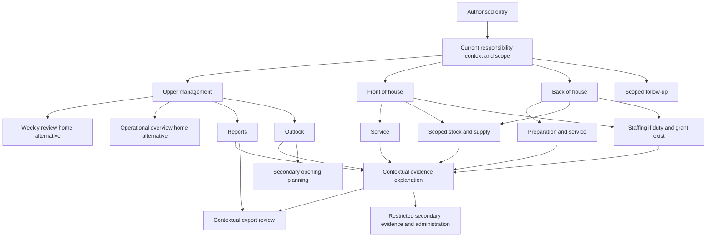

# UX information architecture — Goldy's Unified Data Platform

Date: 14 October 2026 (Australia/Melbourne). Status: supporting documentation; stakeholder validation and operational acceptance pending.

Authority: [SRS v1.1](SRS.md), especially its source precedence and obligation/maturity rules. Existing SRS identifiers are retained. These documents explain the baseline and its proposals; they do not approve a capability, assign a grant, choose architecture or establish implementation acceptance. Revision 1.1 extends proposed information contracts under DR-049–DR-055 and existing IDs, as recorded in [REVISION-LOG.md](REVISION-LOG.md). These supporting documents mirror that SRS revision; they do not independently adopt policies or approve capabilities. Validation questions remain in [OPEN-DECISIONS.md](OPEN-DECISIONS.md).

## Agreed structure and proposed placements

Sources: SRS sections 4 and 13; [BMAD EXPERIENCE](ux-designs/ux-goldys-requirements-2026-10-14/EXPERIENCE.md), especially Information Architecture, Home Screens, Feature Disposition, State Inventory and Core User Flows; [BMAD DESIGN](ux-designs/ux-goldys-requirements-2026-10-14/DESIGN.md); [PRD journeys and intent](prds/prd-goldys-requirements-2026-10-14/prd.md).

Three responsibility contexts and responsive web are agreed: **Front of house**, **Back of house**, **Upper management** (UX-005/UX-017). Each context exposes only currently granted work. Switching context changes relevant scope/navigation without changing identity or expanding permission. One person may have multiple duties; a single-context user need not see a persistent selector. Department/area, period, comparator, as-of and revision/status remain explicit. An incompatible remembered scope is rejected with an explanation (ACC-001–ACC-008, UX-014–UX-015).

Destination names and detailed compositions remain proposed. Primary placement requires evidence of independent recurring decision work and the complete role → responsibility → decision → information → permitted action → outcome chain (GOV-002, UX-001/UX-009). Report/forecast/export intent is reported; it does not rank all candidate work. The workflows below are priority candidates for validation, with no approved relative ranking or release sequence (OD-01).

## Navigation map

| Context | Proposed primary navigation | Conditional scope and placement |
|---|---|---|
| Upper management | Home; Reports; Outlook; Follow-up | Home offers Weekly review and Operational overview equally. Reports contains performance questions and financial explanations. Outlook contains revenue/product forecasts; Opening planning is secondary within Outlook until explicitly pinned for active authorised work |
| Front of house | Home; Service; Stock & supply; Staffing; Follow-up | Service covers attendance, availability and service outcomes. Stock & supply contains replenishment and receiving/count/waste evidence with recipe/pour references. Staffing appears only for assigned coverage duties/grants. Staff receive assigned work entries |
| Back of house | Home; Preparation & service; Stock & supply; Staffing; Follow-up | Preparation includes recipe/yield and fulfilment evidence. Staffing supports confirmed head-chef or other validated rostering duties; sub-head-chef ordering alone does not expose Staffing. Kitchen manager reuses relevant patterns only for assigned duties; staff receive assigned work entries |

Contextual actions are **View evidence**, **Explain measure**, **Compare**, **Export**, and **Record follow-up**. Account/help/preferences are secondary. **Evidence & administration** is a restricted secondary utility, separating evidence stewardship from administration permissions. A validated steward can personally pin their own queue within an existing context; this creates no fourth group. No separate primary Analytics, Insights, Exports, Data, Sources, Raw records, news or reviews destination is established (UX-009/UX-015).

The map is a placement proposal, not an access hierarchy. Both management home alternatives have equal prominence and neither is preselected or recommended. Each context also has Home; shared nodes are reusable patterns with independent scoped access, not a universal cross-department screen.

## Landing screens

### Upper management — two equal alternatives

First entry offers **Weekly review** and **Operational overview** equally, without a selected or recommended default. A remembered home follows only an explicit personal choice; both remain reachable (UX-006.AC1).

Weekly review centres the selected report period/definition/revision, readiness/status, adopted comparable measures, meaningful changes, coverage/reconciliation caveats, outlook, contextual export and owned/unassigned follow-up. A late or failed source prevents false readiness; a restatement links back to the original instance (FR-001–FR-006, DR-048, REL-003–REL-005).

Operational overview centres qualified decision questions across validated responsibilities, relevant service/supply/coverage/financial evidence, selected comparators, outlook and follow-up. It adds no universal KPI catalogue, grade or default ranking. Individual pay/contact and deep diagnostics remain hidden without a separate purpose/grant (FR-005/FR-048/FR-054, UX-002/UX-010).

Opening planning is secondary until an authorised person explicitly pins it for an active decision. It never appears as a second live venue or part of current-pub trading totals (FR-045, CON-005).

### Front of house

The manager's proposed home presents adopted coverage, stock-through-delivery, attendance/service/availability and scoped follow-up entries, together with outcome feedback or its evidence gap. These are unranked candidates. Private sickness explanations are not needed to show an unfilled slot (UX-003/UX-007, ACC-003).

FOH staff land on assigned work, relevant instructions/version, own permitted evidence and issue response. They do not receive a manager menu full of denied controls or an invented personal sales/margin score. Booking or cash duties appear only when separately validated.

### Back of house

The proposed BOH home presents adopted preparation/availability, ingredient supply, assigned coverage and follow-up entries. Quantities distinguish sale units, prepared portions, ingredient/base units, known waste and unexplained usage (UX-004/UX-008).

The head chef receives assigned rostering and ordering work. Sub-head chefs receive ordering evidence; rostering, labour-cost and spend-approval work require separate validation. Kitchen manager duties are checked independently and reuse applicable patterns without a duplicate dashboard. BOH staff see assigned preparation/work evidence and issue response.

## Surface register

The inherited S01–S12 labels below belong to the EXPERIENCE surface namespace, distinct from SRS S01–S08 source IDs. They are explanatory screen references, not new requirement identifiers.

| Surface | Entry / landing | Purpose and requirement trace |
|---|---|---|
| S01 Context home | Entry/context switch | Resume an authorised decision with qualified facts and scope; UX-001–UX-008/UX-015 |
| S02 Weekly review and report history | Reports; Weekly review alternative | Assess report readiness, compare changes and retained revisions; FR-001–FR-006, DR-048, MET-015 |
| S03 Performance question and financial explanation | Reports; report/overview measure | Scoped question, comparison and distinct money/cost/accounting interpretation; FR-012–FR-016/FR-038–FR-040/FR-054 |
| S04 Outlook and scenario comparison | Outlook; departmental forecast link | Revenue/product selection, assumptions, horizon and original-version outcomes; FR-041–FR-044, MET-013 |
| S05 Coverage review | Conditional Staffing; home entry | Workload/skills versus roster and actual work; FR-031–FR-037, DR-044, MET-008 |
| S06 Stock through next delivery | Stock & supply; home entry | Usable supply, horizon, conversions and justified order options; FR-017–FR-030, MET-005–MET-006/MET-014 |
| S07 Service/attendance or preparation review | Service; Preparation & service | Intended/actual attendance, fulfilment, available items and preparation evidence; FR-007–FR-011/FR-027–FR-028/FR-047 |
| S08 Evidence explanation | View evidence; Explain measure | Definition, eligible contributors, original evidence and correction boundaries; FR-006, BR-001–BR-010, REL-001–REL-004 |
| S09 Follow-up and local record detail | Follow-up; contextual action | Ownership/approval states, proposals, outcome evidence and reopening; FR-048–FR-050, DR-046–DR-047 |
| S10 Opening planning | Outlook secondary entry; explicit pin | Transfer assumptions, alternatives and sensitivity; FR-045, CON-005 |
| S11 Evidence & administration utility | Restricted secondary utility; permitted evidence link | Duty-specific mapping/definition/grant investigation; INT-001–INT-006, ACC-001–ACC-008, UX-009/UX-015 |
| S12 Export review and result | Contextual Export | Authorised selection, format, omissions, progress and usable file; FR-051–FR-053, NFR-012, INT-007 |

S03–S08 are reusable page/detail patterns. S12 is a contextual flow. No canonical entity implies its own screen. A specialist may have evidence/financial work promoted within their existing context only after GOV-002 validation and a permitted personal pin.

## Priority workflow candidates and feedback

The named journeys are inherited proposals, not observations of actual users. Illustrative names in BMAD documents identify no real stakeholder. Confirm real sessions under OD-01/OD-02/OD-12 and UX-018 before adopting priority or task bounds.

1. **UJ-01 — weekly report:** select authorised week/scope → inspect definition/version/readiness and coverage → compare reconciled selected results → explain an exception → export retained revision or record follow-up → revisit comparable reporting effort/checking/rework and outcomes. UJ-01a checks or changes the report definition only with a separate grant. A failed/delayed source gives qualified readiness; correction yields a linked reissue. Trace: FR-001–FR-006/FR-051–FR-053, DR-048, MET-015; AT-01/AT-02.
2. **UJ-02 — revenue/product forecast:** select revenue or stable product/variant and sale-unit/money basis → inspect history fitness, evidence cutoff, issued horizon and uncertainty → compare labelled assumption/scenario changes → retain the chosen local scenario/decision → later compare eligible actuals with the forecast issued before outcomes. Stockout-constrained history, new products and inadequate evidence stay visible; changed scenarios cannot rewrite issued history. Trace: FR-041–FR-044, DR-042, MET-010/MET-013; AT-03.
3. **UJ-03 — service staffing:** select department/service → compare demand and labelled effort/skill evidence with roster version, availability and actual work → investigate unfilled/conflicting coverage → retain a local option/follow-up → change roster externally if authorised → compare service/coverage and defined labour outcomes. Sales/headcount are not measured workload, and a missing clock-out is not a roster-derived actual. Trace: FR-031–FR-037, DR-029–DR-036/DR-044; AT-08.
4. **UJ-04 — stock through delivery:** select product/ingredient/item and next delivery horizon → inspect usable-stock cutoff, effective recipes/yields/modifiers, conversions and outstanding supply → compare explained quantity options and uncertainties → save local proposal → order externally → review accepted delivery, availability, excess, waste and eligible usage. Unknown conversion/horizon remains a gap; count variance does not automatically post stock. Trace: FR-017–FR-030, MET-005–MET-006/MET-014; AT-06/AT-07.
5. **UJ-05 — service/demand exception:** inspect intended bookings versus actual visits/covers, availability and observed service → explain a scoped exception → record response/escalation → coordinate service/preparation externally → review matched outcomes. Missing arrival is not automatic no-show; check closure is not fulfilment; zero sales is not a stockout. Trace: FR-008–FR-011, DR-037–DR-039; AT-04.
6. **UJ-06 — financial difference:** start from a permitted report measure/question → inspect compatible population, typed consideration/payment/settlement and purchase/cost/pay evidence → determine timing, classification or missing coverage → retain explanation/proposed correction and permitted export → seek external correction → review the reconciled revision. Incomplete valuation/expenses prevent final profit. Trace: FR-012–FR-016/FR-021–FR-022/FR-034–FR-040/FR-054; AT-05/AT-09.
7. **UJ-07 — opening scenario:** reach secondary Opening planning → select an authorised opening question → compare current-pub evidence, new-site observations and explicit transfer assumptions → assess alternatives/sensitivity and missing costs → save decision/scenario → test assumptions externally and later record qualified outcomes when evidence exists. Trace: FR-043/FR-045, CON-005; AT-11.
8. **UJ-08 — evidence gap and follow-up:** enter from a business limitation → inspect original fact, definition and revision → retain local annotation/proposal → establish permitted owner/acceptance/due state → request source correction externally → review completion evidence and verified/partial/reopened outcome. UJ-08a routes specifically granted specialist work to S11; local done or source-task status alone is not verified resolution. Trace: FR-046–FR-050, DR-045–DR-047, ACC/BR/REL; AT-10/AT-12.

AT-13 tests contexts, home choice and value-based navigation across journeys; AT-14 tests accessibility, phone/web use, failure and recovery. Their criteria supplement every relevant `<requirement>.AC1` in [REQUIREMENTS-TRACEABILITY.md](REQUIREMENTS-TRACEABILITY.md).

## Secondary features and contextual diagnostics

Recipes, menus, prices, modifiers, typed purchase documents, payment allocations and work/pay detail normally explain the active decision within S06/S07/S08 or S03. Independent primary catalogue work requires validated recurring responsibility. Selected KPI definitions explain results within S08; a universal KPI library is not a primary business task. CSV/Excel remain contextual handoff; preparation/export never authorises automatic distribution.

Reviews/articles, weather and read internal work records such as Asana appear only for a validated question, relevance and access purpose. Public sentiment is not attendance; read task status is not verified external completion. No primary news/review archive or unrestricted raw/schema/query console is created (FR-046, DR-045, INT-006, CON-003).

Diagnostics disclose the **business consequence first**: affected decision/measure, evidence scope/as-of, known limitation, owner/unassigned state and permitted response. Reliance-changing qualifications remain persistent beside the result. The contextual explanation progresses from plain meaning → definition and eligible components → original permitted evidence → restricted specialist detail. Aggregate-only evidence ends at its true grain; restricted detail cannot be recovered through another total/drill-down/export. Successful ingestion does not prove complete, current or decision-fit evidence (FR-006/FR-048, UX-010/UX-013, REL-001–REL-004).

A source outage reaches Home only when it affects that person's work. Technical collection details and source repair routes stay in S11 for authorised resolvers. Evidence stewardship does not imply administration access; unspecified connector or grant controls are not invented. Acknowledging a warning changes presentation only, without fixing evidence or closing work. Urgency, escalation, suppression and notification channels/recipients remain unconfigured until validated (OD-09/OD-10/OD-14).

## State, interaction and presentation contract

Shared states distinguish loading/refresh, no selection, no matching records, known zero, not captured, unknown, disputed, not applicable with reason, partial evidence, last-known, failed task, denied/revoked access and new/concurrent revision. Show last evidenced coverage separately from receipt/recalculation time; a newly received old count remains old stock evidence. Do not flash zero while loading (UX-012, BR-004–BR-008).

Every adopted decision surface has question, authorised scope/period, result/unit/status, relevant comparator, qualification, permitted response and outcome feedback or its gap (UX-010–UX-011). Drill-down/back preserves scope, comparator and revision. Local records use Save/Cancel; failure preserves permitted input, uncertainty is explicit, retries avoid logical duplicates and concurrent edits cannot silently overwrite (UX-014, REL-006). A local save says the proposal was saved in Goldy's; it cannot say an order was placed or a roster published.

Responsive website reporting and phone checks preserve the same facts, permissions and warnings. Phone reading order is decision → qualification → evidence → permitted action → feedback; dense evidence may disclose supplementary detail without hiding material caveats. Keyboard operation, focus restoration, accessible names/states/errors and text/data equivalents support adopted journeys. No native mobile, offline write queue or push/camera workflow is adopted. Devices/browsers, assistive conditions, quantitative usability bounds and formal accessibility standard/version remain OD-12/QP-06 (UX-016–UX-018).

Colour, typography, spacing, grids and breakpoints remain unselected in DESIGN. Status, units and favourable direction need explicit text; future colour cannot establish targets or meaning. An export retains scope, revision, caveats, row count/omissions, numeric types and safe text even when partial (FR-051–FR-053, NFR-010/NFR-012, QP-10).

## Open validation gates

OD-01 selects/ranks actual recurring work; OD-02 validates duties/grants; OD-09 selects KPI meaning/eligibility; OD-12 binds working conditions; OD-13 binds reporting/forecast/export operation; OD-14 binds proposal/follow-up states. No pending choice is resolved by this navigation proposal. See [ROLE-KPI-MATRIX.md](ROLE-KPI-MATRIX.md) and [OPEN-DECISIONS.md](OPEN-DECISIONS.md).

## Revision 1.1 evidence in existing journeys

These input clarifications do not add screens or change navigation priority. UJ-01 report review uses report/revision/stage-linked effort (DR-044/DR-048) and the complete, missing-input and restated financial cases (DR-049/DR-050; AT-09.POS/INC/REV). UJ-03 staffing shows dated declarations, recurrence/exception precedence and unresolved interval conflicts (DR-051; AT-08.AVAIL), with private reasons excluded from ordinary coverage. UJ-04/S06 ordering separates physical, usable and uncommitted holdings with conditional quantity-specific holds/commitments (DR-052), and promised delivery tranches/revisions with a declared horizon/scoring baseline (DR-053). UJ-05/S07 service review separates partial ready and served events, corrections and remakes (DR-054; AT-04.STAGE). UJ-06 balance/financial review explains non-cash settlement (DR-012/DR-013; AT-05.REDEEM) and recognition/valuation lineage (DR-049/DR-050). UJ-07 control review shows expected due occurrences independently of observations (DR-055/DR-043; AT-11.DUE).

Every result retains existing purpose grants, qualification and local/external action boundaries. [SRS-VERIFICATION-FIXTURES.md](SRS-VERIFICATION-FIXTURES.md) supplies the expected examples; stakeholder GOV-002 validation remains pending.
