# Business domain model — pub operations

Date: 14 October 2026. Status: proposed business model for stakeholder validation.

## Basis and boundary

This model derives from [PROJECT_CHARTER.md](../PROJECT_CHARTER.md) and the [completed domain research report](../deliverables/research/domain-australian-pub-operational-information-m-2026-10-14/research.md), particularly sections 1–7. The report's evidence limitations and unresolved applicability questions remain in force. Entity boundaries, attributes and cardinalities below are business proposals, not requirements prescribed by a regulator. No Goldy's application source, schemas or existing PRD were inspected.

The scope is one pub with bar and kitchen operations. Entities describe independently meaningful facts, including facts that may initially be unavailable. They do not prescribe storage structures, software components or integrations. Some are conditional: a venue without vouchers need not invent voucher activity; a venue without reliable service timestamps cannot claim measured service duration.

The requested files are under `research/`. The charter's eventual consolidated deliverable package remains a later activity.

## Shared contracts applying to every entity

**Mandatory means necessary to assert the stated fact.** An incomplete piece of evidence can still be retained as unresolved evidence, but cannot be presented as a complete fact of that type. A required relationship need not imply that every attribute of the related party or object is known. For example, an employee identity can exist without a known birth date, and a supplier identity without a known ABN. Operational metrics must disclose incomplete coverage.

Every entity has a stable business identity scoped to the venue or responsible organisation, a fact/evidence status, and a recorded-at instant. Referenced identifiers establish identity; names, descriptions and amounts do not. External document numbers are aliases qualified by issuer and document type, never universal identities. Repeated imports or copies of the same evidence do not create new business facts. Two otherwise identical legitimate transactions retain separate identities.

Occurrence/effective time and recorded-at time are distinct. Every temporal assertion has a precision: instant, local date, interval, or bounded/unknown time. Instants retain timezone/offset; local trading policies retain the venue's named timezone. Intervals use an inclusive start and exclusive end. Unknown time must not be replaced with recorded-at time. Overnight work and daylight-saving changes use elapsed instants; payroll dates and reporting dates retain their own meanings. Corrections retain the superseded assertion, correction reason, time and relationship; finalised evidence is not silently replaced.

Quantities always carry a unit and basis. Money always carries currency, sign/direction and tax basis (inclusive, exclusive, separately stated, or unknown). Quantity conversions must identify the item/pack and effective conversion; mass, volume and count are not interchangeable without evidence. Cost and quantity may be known independently. Unit cost requires its priced unit, effective date and cost basis. Derived values retain inputs, definition and completeness; estimates are labelled. Rounding uses an agreed basis and tolerance, never an unexplained reconciliation difference.

For **every attribute and relationship**, distinguish: **known** (including a legitimate zero), **unknown** (applicable but value not established), **not captured** (no observation/evidence supplied), **not applicable** (with reason), and **disputed** (conflicting evidence retained). A required value that is unknown/not captured/disputed leaves the assertion incomplete; it is not filled with zero, a guessed identity or an artificial date. Optional absence never implies zero or no activity. Each entity's missing-information rule below adds its particular consequences to this common rule.

Common event evidence, when available, includes actor, reason, authoriser and source reference. An actor's absence does not invalidate an observed receipt, count or payment; it affects provenance/control completeness. Approval evidence is required only to claim **approved** status under an agreed policy. Relevant events below describe changes in the business; they need not all be separately observed to retain a known final fact. All cardinalities describe business relationships, not permissions.

## Trading context and commercial offer

### E01 Venue

- **Definition / purpose:** The operational establishment whose service, stock, labour and financial performance are being analysed; establishes scope.
- **Atomic grain:** One enduring establishment, independent of its trading name or software vendors.
- **Identity / uniqueness:** Stable venue identity; a name or address change does not create another venue.
- **Minimum attributes:** Identity and an identifying business label. A timezone is mandatory only when asserting local-time attribution.
- **Optional attributes:** Address, legal operating entity, jurisdiction, licence references, currency defaults, effective trading policies.
- **Relationships:** One venue has zero or many locations, periods and operational facts; each venue-scoped fact belongs to one venue. Legal ownership may change over time.
- **Units / time:** No quantity; policies and ownership are effective-dated.
- **Invariants:** Venue totals cannot silently combine different establishments, currencies or ownership scopes.
- **Events:** Established, renamed, operator changed, trading policy changed, closed.
- **Missing information:** Unknown jurisdiction/operator blocks claims about applicable obligations, not the identity of the venue.

### E02 Operational location or area

- **Definition / purpose:** An identifiable place or responsibility area such as cellar, kitchen, bar, dining area or table; locates stock, service or work.
- **Atomic grain:** One location/area with a declared type.
- **Identity / uniqueness:** Stable identity within venue; labels may change and are not unique across venues.
- **Minimum attributes:** Venue, identity, label and type sufficient to distinguish physical stock location, service place and responsibility area.
- **Optional attributes:** Parent location, capacity, operating dates, stock-holding eligibility.
- **Relationships:** Exactly one venue; zero or one parent and zero or many children. Facts reference zero or one relevant location unless their specific contracts require it.
- **Units / time:** Capacity specifies persons/seats and effective dates; hierarchy changes are dated.
- **Invariants:** No hierarchy cycles; responsibility areas are not automatically physical stores; parent and child totals must avoid double counting.
- **Events:** Opened, reconfigured, renamed, capacity changed, closed.
- **Missing information:** Unassigned location remains explicitly unknown; venue-level evidence is not attributed to an invented bar/store.

### E03 Reporting period

- **Definition / purpose:** An explicitly bounded trading day, service period, accounting period or pay period; supports comparable attribution.
- **Atomic grain:** One interval of one period type and scope.
- **Identity / uniqueness:** Venue + period type + scope + policy/version + boundaries; display date alone is insufficient.
- **Minimum attributes:** Type, scope, start, end and timezone for local boundaries; service-period label for a named service.
- **Optional attributes:** Parent reporting period, reporting date, cutoff policy, accounting calendar reference.
- **Relationships:** One venue; zero or one parent per declared hierarchy; many facts may be attributed to a period by a named rule.
- **Units / time:** Explicit instants; operational, payroll and settlement periods remain distinct.
- **Invariants:** End follows start. Overlap across different scopes/types is valid; a supposedly exclusive reporting partition must not overlap within its scope. Attribution cannot duplicate a fact within a partition.
- **Events:** Defined, opened, closed, restated.
- **Missing information:** Unresolved attribution stays unassigned; occurrence time remains intact. No default lunch/dinner times or trading cutoff is asserted.

### E04 Product

- **Definition / purpose:** A customer-facing item or service the venue can sell, including a selectable modifier product; identifies demand and sales mix.
- **Atomic grain:** One stable commercial concept with a declared sale unit.
- **Identity / uniqueness:** Venue/business product identity; equal names do not establish equivalence. Size variants may be separate products or explicit variants, consistently defined.
- **Minimum attributes:** Identity, identifying description and sale unit when quantity is asserted.
- **Optional attributes:** Category history, food/beverage designation, variant, active dates, stock-item link, recipe association.
- **Relationships:** One venue scope; zero or many offerings, prices and sale lines; zero or many recipe versions over time. A product may reference a directly sold stock item; this is not mandatory.
- **Units / time:** Portions, glasses, serves or other explicit sale units; category assignments have effective dates.
- **Invariants:** Product, purchased pack and ingredient are not automatically the same thing. Historical sales retain historical classifications or an explicit restatement basis.
- **Events:** Introduced, reclassified, withdrawn.
- **Missing information:** A sale with a known description but unidentified product remains an unmapped sale; it is excluded from claims of complete product mix.

### E05 Menu offering version

- **Definition / purpose:** A product's availability and presentation in a menu/channel/context; supports service availability independently of sales.
- **Atomic grain:** One effective version of an offering in a declared context.
- **Identity / uniqueness:** Offering identity + version; menu name alone is insufficient.
- **Minimum attributes:** Product, context/menu identity, effective start and identifying description.
- **Optional attributes:** Effective end, location, service-period eligibility, availability restrictions, published allergen/substitution evidence, display sequence.
- **Relationships:** Exactly one product; zero or many price terms; one product may have multiple concurrent offerings in different contexts.
- **Units / time:** Effective interval; portion/size must align with the product or explicitly identify a variant.
- **Invariants:** Withdrawn availability does not invalidate past sales. Claimed allergen information requires evidence and applicable version; no allergen-free claim is inferred from absence.
- **Events:** Published, availability changed, substituted, withdrawn.
- **Missing information:** Missing menu evidence does not prevent recording an identifiable sale. Availability and allergen status remain unknown.

### E06 Price term

- **Definition / purpose:** A stated selling price for a product/offering under defined conditions; distinguishes intended pricing from actual charged consideration.
- **Atomic grain:** One price and eligible quantity/unit in one effective context.
- **Identity / uniqueness:** Product/offering + context + effective interval + price-term identity; overlapping eligible terms require an explicit selection rule.
- **Minimum attributes:** Priced product/offering, amount, currency, quantity/unit basis and effective start. Tax basis must be known to assert an inclusive/exclusive price.
- **Optional attributes:** Effective end, price tier, time/channel conditions, tax classification evidence.
- **Relationships:** One product, optionally one offering; zero or many sale lines may cite the term used.
- **Units / time:** Currency per stated sale quantity; effective pricing time is distinct from sale closure.
- **Invariants:** Zero price is valid. Historical charged amounts are not recalculated from today's price; conflicting terms are unresolved rather than arbitrarily selected.
- **Events:** Set, revised, expired.
- **Missing information:** Unknown list price prevents a claimed list-price discount calculation, not an observed sale amount.

## Customer trading, money and reconciliation

### E07 Customer check / sale transaction

- **Definition / purpose:** The commercial account grouping customer charges, reductions and related lines, including an open tab; explains customer obligation and sale lifecycle.
- **Atomic grain:** One enduring customer check, including its split/merge lineage.
- **Identity / uniqueness:** Venue check identity; printed number is qualified by venue/business context and issuance cycle.
- **Minimum attributes:** Identity, venue, lifecycle status. Opening/closure times are mandatory only when asserting those timed events.
- **Optional attributes:** Customer reference, service location, opening/closure instants, currency, original-check/split/merge links, responsible staff, check-level financial evidence.
- **Relationships:** Zero or many sale lines, financial adjustments and payment allocations; zero or many visits through service allocations. Empty/open checks are valid.
- **Units / time:** Check totals have currency and tax basis; order, fulfilment, closure and reporting attribution are separate.
- **Invariants:** A closed check is not proof of payment or service completion. A balance is derived from compatible charges and allocations; unexplained differences remain visible.
- **Events:** Opened, transferred, split, merged, closed, reopened, cancelled.
- **Missing information:** Absent line detail permits a labelled check-level total, not reconstructed product quantities or invented covers.

### E08 Sale line

- **Definition / purpose:** One ordered/charged commercial item occurrence; preserves quantity, consideration and fulfilment evidence.
- **Atomic grain:** One line occurrence at a stated revision, with separately attributable changes when only part is fulfilled/cancelled/refunded.
- **Identity / uniqueness:** Check + stable line identity; identical products on two lines remain separate occurrences.
- **Minimum attributes:** Check, line identity, identifying item description/reference, lifecycle status; quantity/unit to assert ordered quantity; consideration/currency to assert a monetary sale. Fulfilled quantity/time is required only for a fulfilment claim.
- **Optional attributes:** Canonical product, offering/price reference, historical description/category, ordered/fulfilled/cancelled quantities and times, base amount, tax components, cost estimate reference.
- **Relationships:** Exactly one check; zero or one mapped product; zero or many modifiers, adjustments and linked consumption assertions.
- **Units / time:** Sale unit; order, service and financial recognition times remain distinct. Monetary components retain inclusive/exclusive/unknown basis.
- **Invariants:** Refund does not imply return to stock. Fulfilment/cancellation partitions cannot exceed ordered quantity without an explicit amended order. Zero-price fulfilled items can consume stock.
- **Events:** Ordered, amended, prepared, fulfilled, cancelled, voided, returned, financially reversed.
- **Missing information:** Unknown fulfilment is not unfulfilled; unknown product mapping does not erase known revenue. Missing money prevents financial totals but need not invalidate a known order fact.

### E09 Modifier selection

- **Definition / purpose:** An actual selected addition, omission or substitution on a sale line; explains price, preparation and consumption differences.
- **Atomic grain:** One selected option occurrence on one sale line.
- **Identity / uniqueness:** Parent line + selection identity; repeated selections are valid if explicitly quantified.
- **Minimum attributes:** Parent line, selection meaning and quantity/unit where count changes meaning; substitution/omission target where needed to identify the change.
- **Optional attributes:** Modifier product, price effect, tax effect, recipe-component changes, selection time, versioned preparation instruction.
- **Relationships:** Exactly one sale line; zero or one mapped modifier product; zero or many explicit recipe effects.
- **Units / time:** Option count or ingredient unit; price effects carry currency/tax basis; effective at the selected line revision.
- **Invariants:** A modifier price effect is either included in the line or separately counted, never both. Omission and substitution must not be treated as extra consumption by default.
- **Events:** Selected, changed, removed, fulfilled.
- **Missing information:** Unmapped modifier meaning leaves theoretical consumption incomplete even when its charged amount is known.

### E10 Commercial adjustment

- **Definition / purpose:** A discount, comp, surcharge, tip charge, return credit or amount-only revenue reversal applied to customer consideration; distinguishes commercial treatment from cash refund.
- **Atomic grain:** One adjustment allocated to one check or line. A shared adjustment has a common identity and separately identified allocations.
- **Identity / uniqueness:** Adjustment identity + allocation identity; do not add a parent total and its allocated children.
- **Minimum attributes:** Target check/line, type, signed amount, currency and business status. A percentage assertion also requires its eligible basis; approved status requires applicable approval evidence.
- **Optional attributes:** Reason, policy, original sale/adjustment, quantity returned, percentage, tax components, authorisation and effective time.
- **Relationships:** Exactly one target; zero or one original commercial fact; zero or many related payment/refund facts through evidence links.
- **Units / time:** Currency and tax basis; financial effective time separate from refund payment time.
- **Invariants:** Tips/surcharges are not automatically revenue reductions. Discounts reconcile to the eligible charge; unresolved excess is an exception. A void before sale recognition is not automatically a revenue refund.
- **Events:** Proposed, authorised, applied, reversed.
- **Missing information:** Unknown reason remains unknown. No stock return or cash movement is inferred from an amount-only credit.

### E11 Money movement / payment

- **Definition / purpose:** A receipt or disbursement of money, including customer tender/refund, supplier payment, payroll payment, float transfer or bank transfer; explains cash independently of revenue/expense.
- **Atomic grain:** One movement between stated monetary parties/accounts in one currency and direction.
- **Identity / uniqueness:** Stable payment identity; processor/bank references qualified by issuer. Lifecycle updates are not additional payments.
- **Minimum attributes:** Amount, currency, direction/purpose sufficient to distinguish receipt/disbursement/transfer, status and identified venue monetary endpoint. Occurrence date/instant is required for a dated cash assertion.
- **Optional attributes:** Method, external counterparty, other endpoint, processor reference, authorisation/capture dates, original payment link, source evidence.
- **Relationships:** Zero or many payment allocations; zero or many settlement components. Refunds can reference an original payment; unidentified originals remain unresolved.
- **Units / time:** Currency; authorised, captured, received, reversed and bank-settled are different statuses/times.
- **Invariants:** Transfer between venue accounts is not new revenue. Pending authorisation is not settled cash. Direction/sign are consistent. Reversed movements preserve history.
- **Events:** Initiated, authorised, received/paid, failed, refunded, reversed, settled.
- **Missing information:** Unknown allocation leaves unapplied cash. Unknown payment method does not invalidate an evidenced monetary receipt.

### E12 Payment allocation

- **Definition / purpose:** The amount of a money movement applied to a particular obligation or entitlement; supports split tenders, part payments and consolidated supplier payments.
- **Atomic grain:** One allocation from one payment to one target.
- **Identity / uniqueness:** Payment + allocation identity; several allocations to the same target may be legitimate, but duplicated evidence is not.
- **Minimum attributes:** Payment, target identity/type, amount, currency and application direction/status.
- **Optional attributes:** Application date, reversal link, exchange-rate and target-currency amount where applicable.
- **Relationships:** Exactly one payment and exactly one check, supplier invoice/credit, customer liability entry, labour-cost/pay obligation or settlement obligation. Each target/payment has zero or many allocations.
- **Units / time:** Payment currency; allocation and payment dates may differ.
- **Invariants:** Applied amounts cannot exceed available payment without an explicitly identified exception. Cross-currency allocation requires conversion evidence. Target allocations reconcile to its balance; liabilities and revenue are not counted twice.
- **Events:** Applied, reapplied, reversed.
- **Missing information:** No target means unapplied payment, not a fabricated allocation. Missing conversion leaves a cross-currency reconciliation incomplete.

### E13 Customer liability entry

- **Definition / purpose:** An increase/decrease in the venue's obligation from a deposit, voucher, gift value or customer credit; prevents issuance/redemption double counting.
- **Atomic grain:** One dated liability change against one identifiable liability account/instrument or evidenced pool.
- **Identity / uniqueness:** Liability account/instrument + entry identity; repeated redemptions are separate entries.
- **Minimum attributes:** Liability identity, entry type, amount, currency and direction; applicable effective date for a dated balance.
- **Optional attributes:** Instrument identifier, customer, reservation, check, expiry terms, original entry, payment allocation, accountant-approved recognition/tax treatment.
- **Relationships:** One venue; zero or many payment allocations; zero or one related reservation/check per application, with separate entries for multiple applications.
- **Units / time:** Currency; issue, cash receipt, redemption and revenue recognition dates remain distinct.
- **Invariants:** Redeemed/returned value cannot silently exceed available value. A liability entry is not itself proof of payment or revenue; breakage/tax treatment requires an agreed policy.
- **Events:** Issued, funded, redeemed, refunded, expired, corrected.
- **Missing information:** Unknown instrument detail may support an evidenced pooled balance but not individual redeemable balances. Unknown expiry never means expired.

### E14 Cash reconciliation observation

- **Definition / purpose:** An observed cash holding for a drawer/safe/accountability session compared with an independently derived expected holding; supports cash control.
- **Atomic grain:** One count of one monetary holding at one cutoff.
- **Identity / uniqueness:** Holding/session + observation identity; recounts retain distinct evidence and supersession.
- **Minimum attributes:** Holding identity, observed amount, currency and count cutoff/date precision.
- **Optional attributes:** Denominations, counter, expected amount and its basis, variance, explanation, approval.
- **Relationships:** One venue/location or cash session; zero or many relevant money movements; zero or one preceding observation used as opening evidence.
- **Units / time:** Currency at a point in time; counted time may differ from recorded time.
- **Invariants:** Variance = observed minus expected on a matching scope. Unknown expected amount prevents variance calculation. A cash discrepancy does not change sales automatically.
- **Events:** Counted, recounted, reconciled, discrepancy escalated.
- **Missing information:** Uncounted cash is unknown, never a zero holding. Missing denomination detail does not invalidate a total count.

### E15 Settlement component

- **Definition / purpose:** One processor settlement statement component such as captured tender, refund, fee, reserve or chargeback; explains net bank settlement.
- **Atomic grain:** One component within an identified settlement statement/batch.
- **Identity / uniqueness:** Provider + settlement identity + component identity.
- **Minimum attributes:** Settlement identity/provider, component type, signed amount and currency.
- **Optional attributes:** Statement date, eligibility period, original payment, gross/net basis, bank payment reference, fee tax, settlement due/received dates.
- **Relationships:** One settlement grouping; zero or one original payment per component (split components for multiple payments); zero or many bank-payment allocations.
- **Units / time:** Currency; transaction, statement and bank receipt dates remain independent.
- **Invariants:** Components reconcile to stated net settlement with declared signs. A processor fee is not a discount to product sales. A chargeback does not itself establish the commercial revenue treatment.
- **Events:** Reported, withheld, paid, reconciled, disputed, corrected.
- **Missing information:** Known bank deposit with no statement remains an unmatched receipt; it cannot establish gross sales or fees.

## Supply, inventory and recipes

### E16 Supplier

- **Definition / purpose:** The party supplying goods/services or issuing the related commercial documents; groups commitments, deliveries and amounts owed.
- **Atomic grain:** One supplier business identity, separate from branches/accounts when they are merely trading contexts.
- **Identity / uniqueness:** Stable party identity; name similarity alone is insufficient to merge suppliers.
- **Minimum attributes:** Identity and identifying name/reference sufficient to distinguish the counterparty.
- **Optional attributes:** Legal name, ABN, contacts, supplier account, terms, lead time, qualification/evidence.
- **Relationships:** Zero or many supplier items, purchase documents and payment relationships; one supplier may serve multiple venue areas.
- **Units / time:** Lead time has a unit/calendar basis; terms and identity evidence have effective dates.
- **Invariants:** An unverified ABN is not treated as verified; a branch account is not automatically a different legal supplier.
- **Events:** Engaged, terms changed, suspended, merged with evidence.
- **Missing information:** Missing contact/tax details do not erase a known delivery, but prevent claims that document/compliance evidence is complete.

### E17 Supplier item / pack term

- **Definition / purpose:** A supplier's supplied item and pack definition; translates ordering quantities into stock quantities and purchase costs.
- **Atomic grain:** One effective supplier item/pack version.
- **Identity / uniqueness:** Supplier + supplier item reference + effective version; pack changes are explicit versions.
- **Minimum attributes:** Supplier, item description/reference and purchase unit; pack contents/conversion only when asserting stock equivalence or unit cost.
- **Optional attributes:** Stock item mapping, pack size, lead time, quoted cost/currency/tax basis, minimum order, substitution rules.
- **Relationships:** One supplier; zero or one mapped stock item per pack version; one stock item may have many supplier packs.
- **Units / time:** Purchase pack, stock base unit, effective conversion and quoted price date.
- **Invariants:** A case, keg and serving are not equal units. Conversion must be positive and item-specific; substitutions require their own mapping.
- **Events:** Listed, pack changed, quoted, discontinued.
- **Missing information:** Unknown conversion permits a pack-level receipt/invoice but prevents a trustworthy base-stock balance or per-litre cost.

### E18 Purchase document

- **Definition / purpose:** A typed business document asserting **purchase order**, **goods receipt**, **supplier invoice**, or **supplier credit**. These are four distinct facts with separate identities and lifecycles, represented by one shared document vocabulary.
- **Atomic grain:** One document of exactly one type; a delivery note and invoice are never the same fact merely because their numbers match.
- **Identity / uniqueness:** Issuer + document type + document identity; amendments/duplicates retain lineage. Venue-assigned identity is acceptable when no supplier number exists.
- **Minimum attributes:** Type, venue, identity, status and identifiable supplier/counterparty. Document date is required to assert a dated order/receipt/invoice; invoice/credit currency is required for a monetary claim.
- **Optional attributes:** Supplier number, order/delivery references, document total/tax, due date, authoriser, receipt inspection evidence, terms and original credited document.
- **Relationships:** One supplier; zero or many document lines and document matches; invoices/credits have zero or many payment allocations.
- **Units / time:** Ordered, received, issued, due and paid dates are separate. Document money retains currency/tax basis.
- **Invariants:** Orders assert commitments, receipts physical acceptance/rejection, invoices payable charges and credits reductions to charges. None proves the others. Service invoices need not create stock.
- **Events:** Order submitted/approved/cancelled; goods received/accepted/rejected; invoice issued/disputed; credit received; document corrected.
- **Missing information:** A known receipt can precede an unknown invoice/order. Missing line detail supports only a labelled document-level value, not invented quantities.

### E19 Purchase document line

- **Definition / purpose:** One ordered, physically received, invoiced or credited item/service assertion on its typed parent document; supports quantity/price discrepancy analysis.
- **Atomic grain:** One line occurrence on one document, separating acceptance/rejection dispositions when necessary.
- **Identity / uniqueness:** Parent document + line identity; identical descriptions may be separate lines.
- **Minimum attributes:** Parent and item/service description. **Order:** ordered quantity/unit for a quantity commitment. **Receipt:** observed quantity/unit and disposition (accepted/rejected/pending). **Invoice/credit:** signed monetary charge/currency for a charge assertion; quantity/unit only if a quantity charge is asserted.
- **Optional attributes:** Supplier item, stock item, unit price/basis, tax, quantity, expiry/lot, condition, original credited line and reason.
- **Relationships:** Exactly one parent; zero or one supplier item/stock item mapping; zero or many matches and related stock movements.
- **Units / time:** Parent type controls quantity meaning; receipt time and invoice date cannot substitute for each other.
- **Invariants:** Accepted and rejected portions do not overlap. A credit does not prove returned stock. A recorded pack price without conversion cannot establish stock-unit cost.
- **Events:** Ordered, substituted, inspected, accepted, rejected, charged, credited, corrected.
- **Missing information:** Unknown unit price does not invalidate a measured receipt; unknown received quantity prevents quantity-based stock recognition even if invoice value is known.

### E20 Purchase match allocation

- **Definition / purpose:** An evidenced association allocating all/part of a purchase assertion to another document assertion; explains partial deliveries, combined invoices and credits.
- **Atomic grain:** One allocation between two typed documents or two typed lines at a declared matching basis.
- **Identity / uniqueness:** Match identity; repeated evidence of the same allocation is deduplicated.
- **Minimum attributes:** Both endpoints, endpoint level (document/line), match type and allocated quantity/unit or value/currency if a quantitative match is claimed.
- **Optional attributes:** Expected/actual difference, tolerance/policy, reason, approval and reconciliation date.
- **Relationships:** Exactly two endpoints; documents/lines participate in zero or many matches. Typical links are order–receipt, receipt–invoice and invoice–credit; no universal one-to-one chain.
- **Units / time:** Quantities require equivalent units; values require matching tax/currency basis and relevant document dates.
- **Invariants:** Document-level matches cannot prove line-level quantity agreement. Over-allocation is an explicit exception; allocation totals are not additional purchasing activity.
- **Events:** Matched, disputed, resolved, unmatched/reversed.
- **Missing information:** No order or invoice evidence leaves an unmatched receipt; it does not invalidate the physical observation.

### E21 Stock item

- **Definition / purpose:** A materially identifiable inventory item such as beer, raw ingredient or prepared component; establishes a comparable quantity balance.
- **Atomic grain:** One inventory identity and base measurement unit with a defined interchangeability basis.
- **Identity / uniqueness:** Venue/business stock identity; supplier packs and sale products are separate identities. Non-interchangeable items are not merged by description.
- **Minimum attributes:** Identity, identifying description and base unit for quantity accounting.
- **Optional attributes:** Category, storage conditions, lot/expiry controls, reorder policy, valuation scope, supplier packs and directly sold product.
- **Relationships:** Zero or many movements, count observations, supplier packs, recipe inputs/outputs and waste records; many locations may hold an item.
- **Units / time:** Explicit mass, volume or count basis; unit changes require a defensible conversion, not rewritten history.
- **Invariants:** Stock balance is always scoped by item, location and cutoff; aggregate quantities must be compatible. Lot tracking is conditional, not universally mandatory.
- **Events:** Introduced, reclassified, control policy changed, discontinued.
- **Missing information:** Unknown category does not invalidate an identified quantity; unknown base conversion prevents combining incompatible packs.

### E22 Recipe version

- **Definition / purpose:** A dated specification of inputs and usable output for a dish, drink or prepared component; supports preparation, allergens and theoretical consumption/cost.
- **Atomic grain:** One version for one defined output and batch/portion basis.
- **Identity / uniqueness:** Recipe identity + version; material recipe/yield changes create explicit versions.
- **Minimum attributes:** Output identity/description, output quantity/unit and effective start; ingredient specifications are required to claim a complete ingredient recipe.
- **Optional attributes:** Output product/stock item mapping, effective end, preparation instructions, expected yield/loss, allergen evidence, approval.
- **Relationships:** One output concept, optionally one product or prepared stock item; zero or many components while incomplete, one or more for a complete ingredient recipe. Many sales/production movements can cite a version.
- **Units / time:** Batch/portion output, gross/net ingredient basis and yield conventions; effective version is selected by an explicit preparation/consumption attribution rule.
- **Invariants:** Output is positive; yield losses are counted once. A recipe cost is theoretical, not proof of actual usage or accounting COGS.
- **Events:** Drafted, tested, approved, revised, retired.
- **Missing information:** Unknown yield/components prevents a complete consumption/cost claim; a known recipe name alone is not a costed recipe.

### E23 Recipe component

- **Definition / purpose:** A specified ingredient/prepared input and quantity in a recipe version; establishes the material requirement.
- **Atomic grain:** One input occurrence in one recipe version at a declared preparation stage.
- **Identity / uniqueness:** Recipe version + component identity; repeated use of one ingredient at different stages is legitimate.
- **Minimum attributes:** Recipe version, identifiable input, quantity/unit and gross/net basis necessary to interpret the quantity.
- **Optional attributes:** Stock item mapping, preparation-stage label, conversion evidence, substitution options, component loss/yield.
- **Relationships:** Exactly one recipe version; zero or one mapped stock item; a prepared input can reference its own recipe version through its stock/output identity.
- **Units / time:** Ingredient quantity per parent recipe's output basis; conversions and substitution rules are effective-dated.
- **Invariants:** Quantities cannot be negative; zero requires an explicit meaningful omission. Recipe dependencies cannot form a circular consumption definition. Component and recipe loss must not duplicate each other.
- **Events:** Specified, substituted, quantity/yield revised, removed.
- **Missing information:** Unmapped ingredients remain identifiable recipe evidence but block complete stock-specific theoretical usage.

### E24 Stock movement

- **Definition / purpose:** A physical or authorised book-balance change for one stock item; separates receipts, transfers, production, consumption, disposal and correcting adjustments.
- **Atomic grain:** One change of one item at one location in one direction. A transfer has paired legs; production has identified input/output legs.
- **Identity / uniqueness:** Movement identity + leg identity; shared transfer/production identity links legs without creating another quantity.
- **Minimum attributes:** Stock item, location, signed quantity/base unit, movement type, effective time/cutoff precision and evidence status. **Adjustment:** reason/basis required; approval required only to claim authorised posting. **Transfer:** counterpart leg or explicitly pending counterpart.
- **Optional attributes:** Lot/batch, receipt line, sale line, recipe version, waste record, count evidence, production group, valuation/cost basis and authoriser.
- **Relationships:** One item/location; zero or one primary originating fact per leg; related evidence may be multiple. Zero or many legs in a linked transfer/production group.
- **Units / time:** Quantity in compatible stock units; cost is optional and independently evidenced. Recorded time can follow physical occurrence.
- **Invariants:** Transfer legs net to zero per item venue-wide. Production inputs/outputs use recipe/yield evidence, not equal numerical quantities across unlike units. Counts are never movements. Negative book balance is an exception to investigate, not evidence to erase. Theoretical estimates do not silently post as observed usage.
- **Events:** Received, transferred, produced, consumed, disposed, adjusted, reversed.
- **Missing information:** Unknown location/item/quantity leaves an unresolved movement assertion and incomplete balance; known cost alone cannot supply missing physical quantity.

### E25 Wastage observation

- **Definition / purpose:** An evidenced loss/disposal such as spoilage, spillage or preparation waste; explains known stock loss independently of unexplained variance.
- **Atomic grain:** One waste occurrence for one item/output at one location and time precision.
- **Identity / uniqueness:** Waste identity; several items from one incident are separate linked observations.
- **Minimum attributes:** Identifiable wasted material, location/scope, quantity/unit to assert measured wastage, occurrence time/date precision and reason/category (including explicitly unknown).
- **Optional attributes:** Stock item mapping, recipe/batch, measured/estimated method, cause, responsible reporter, cost/valuation basis, disposal evidence and movement link.
- **Relationships:** One venue; zero or one mapped stock item; zero or many linked movement legs where a wasted prepared output is represented by ingredients instead.
- **Units / time:** Physical quantity and estimate status; currency/cost optional. Disposal and recording time may differ.
- **Invariants:** A linked disposal is counted once in balances. An unexplained count discrepancy is not classified as waste without evidence. Descriptive incidents without quantity cannot enter measured waste totals.
- **Events:** Observed, measured/estimated, disposed, reviewed, corrected.
- **Missing information:** Unknown cost permits quantity reporting; unknown quantity permits incident reporting only, with waste measurement marked incomplete.

### E26 Stock count session

- **Definition / purpose:** A defined stocktaking exercise with scope and cutoff; establishes whether observations can support a closing balance.
- **Atomic grain:** One count/recount exercise over a declared item/location population.
- **Identity / uniqueness:** Session identity; recounts have separate identity or explicit revision lineage.
- **Minimum attributes:** Venue, scope, cutoff and completion status. Scope must identify what was intended to be counted.
- **Optional attributes:** Counter, count method, movement-freeze/reconciliation policy, start/end times, reviewer, preceding session.
- **Relationships:** Zero or many observations; one venue and one or more declared locations for a location-scoped session.
- **Units / time:** Cutoff instant or date precision with limitation; observations may happen at different times and require movement reconciliation to a common cutoff.
- **Invariants:** Completed does not mean every item is zero or counted. Snapshot comparisons require aligned scope/cutoff and intervening movements; discrepancies require separately evidenced adjustments.
- **Events:** Planned, started, suspended, completed, reviewed, recounted.
- **Missing information:** Missing observations mean uncounted stock; absence is never a zero count. Unknown cutoff prevents a precise reconciled balance.

### E27 Stock count observation

- **Definition / purpose:** An observed quantity of one stock item at a location; establishes physical evidence rather than a change to book stock.
- **Atomic grain:** One item/location/optional lot observation in one count session and observation revision.
- **Identity / uniqueness:** Session + item + location + lot/scope + observation identity; multiple partial containers may be sub-observations with explicit aggregation.
- **Minimum attributes:** Session, identifiable stock item, location, observed quantity/unit and observation time or confirmed session cutoff basis.
- **Optional attributes:** Lot, pack/container breakdown, conversion, method, estimate precision, book quantity at matched cutoff, variance, reviewer and supersession.
- **Relationships:** Exactly one session, item and location; zero or many subsequent adjustment legs can cite the observation.
- **Units / time:** Compatible stock units; observed minus book is count variance. Cutoff reconciliation is explicit when stock moves during counting.
- **Invariants:** Zero is an affirmative observation. Partial/duplicate counts do not imply a complete balance. Count variance does not itself authorise adjustment or prove wastage/theft.
- **Events:** Counted, recounted, reconciled, disputed, accepted.
- **Missing information:** Unknown conversion retains pack-level evidence; unknown book quantity prevents variance calculation, not the observed count.

### E28 Consumption assessment

- **Definition / purpose:** A reproducible usage estimate or residual calculation; distinguishes theoretical recipe usage from movement/count-based depletion.
- **Atomic grain:** One stock item, scope, period and method/version assessment.
- **Identity / uniqueness:** Item + scope + interval + method + assessment revision; different methods are separate comparable assertions.
- **Minimum attributes:** Item, scope, bounded interval, method/basis, quantity/unit and completeness/estimate status. A variance requires both named comparison quantities.
- **Optional attributes:** Recipe/sale inputs, opening/closing counts, movement evidence, cost estimate, exclusions, uncertainty and calculation time.
- **Relationships:** One item; many sale/modifier/recipe or count/movement inputs; one reporting period or explicit interval; zero or many derived measurements.
- **Units / time:** Stock units over an interval; theoretical quantities follow effective recipes/yields. Count-based residual depletion can include unrecorded loss and must be labelled accordingly.
- **Invariants:** Opening + accepted receipts + inbound transfers + production − outbound transfers − closing, with separately known losses/other movements treated consistently, determines the declared residual. Recorded consumption/waste cannot be subtracted twice. Residual minus theoretical usage is unexplained usage variance, not automatically waste. Assessments are not additional stock movements.
- **Events:** Estimated, recalculated, reconciled, challenged, superseded.
- **Missing information:** Missing endpoints/recipes/movements produce incomplete estimates or unavailable values; neither missing observations nor unexplained residuals become zero usage.

## People, planned work and actual work

### E29 Employee

- **Definition / purpose:** An identifiable person engaged as a worker; links work and employment evidence over time.
- **Atomic grain:** One person across role changes and engagements.
- **Identity / uniqueness:** Stable person identity; name, email or payroll number alone is not proof of uniqueness.
- **Minimum attributes:** Identity and an identifying label/reference.
- **Optional attributes:** Preferred name, contact details, competency evidence, availability and relevant employment identifiers. Sensitive information requires a separately established purpose.
- **Relationships:** Zero or many employment assignments, planned shifts, timesheets and control evidence; one person may hold several responsibilities.
- **Units / time:** No quantity; identity/contact/competency evidence has validity dates where applicable.
- **Invariants:** Position title does not establish responsibility, access or qualification. Leavers' historical work remains attributable.
- **Events:** Identified, engaged, details corrected, disengaged.
- **Missing information:** An unidentified worker interval is unresolved attendance, not invented employee identity; missing private details need not invalidate known work.

### E30 Position / work role

- **Definition / purpose:** A defined kind of work or organisational responsibility, such as bartender, kitchen manager or payroll function; describes staffing need and accountability.
- **Atomic grain:** One position/role definition in a business scope, with effective versions of its meaning.
- **Identity / uniqueness:** Role identity; similar titles do not establish equal duties/classification.
- **Minimum attributes:** Identity, label and business duties/responsibility meaning sufficient to distinguish the role.
- **Optional attributes:** Department, competencies, reporting relationship, delegated decisions, employment-classification reference.
- **Relationships:** Zero or many employment assignments and planned/actual work allocations. One employee may fulfil several roles.
- **Units / time:** Effective-dated duties and responsibility assignments; no universal quantity.
- **Invariants:** Role, employment classification and software permission remain distinct. A duty can require competency evidence only under an applicable agreed rule.
- **Events:** Defined, duties changed, delegated, retired.
- **Missing information:** Unknown responsibility is flagged for validation; title alone cannot resolve approval authority.

### E31 Employment assignment

- **Definition / purpose:** The dated engagement/terms under which an employee works for an employer; supports correct interpretation of labour and pay.
- **Atomic grain:** One effective assignment/terms version for an employee and employer.
- **Identity / uniqueness:** Engagement identity + terms version; re-engagement and concurrent assignments remain distinguishable.
- **Minimum attributes:** Employee, identifiable employer/engagement and effective start. Pay terms/classification are mandatory only for a claim that pay was calculated under those terms.
- **Optional attributes:** End date, position(s), employment type, instrument/classification, rates, contracted hours, on-cost rules and evidence/approval.
- **Relationships:** One employee/employer; zero or many role associations, actual intervals and labour-cost components cite the applicable assignment.
- **Units / time:** Rates state currency and per-hour/annual/other basis; effective dates retain payroll calendar meaning.
- **Invariants:** Applicable instrument is established from coverage/duties, never inferred solely from kitchen/pub setting. Unknown terms cannot support a claim of verified lawful pay.
- **Events:** Engaged, reclassified, terms changed, suspended, ended.
- **Missing information:** Attendance can be known while classification/rate is unknown; resulting pay estimates remain incomplete/unverified.

### E32 Roster version

- **Definition / purpose:** A dated staffing plan for a scope and period; distinguishes published plans from later edits and actual work.
- **Atomic grain:** One version of a roster for a defined venue/area and interval.
- **Identity / uniqueness:** Roster identity + version; revisions preserve publication history.
- **Minimum attributes:** Scope, planning interval, version and status; publication time to assert published status at a point in time.
- **Optional attributes:** Author, approval, forecast demand, budget assumptions, superseded roster.
- **Relationships:** One venue/scope; zero or many planned shifts; zero or many budget/demand references.
- **Units / time:** Planned coverage over explicit local-time/instant boundaries; published-at differs from work dates.
- **Invariants:** Published roster hours are planned hours; later actual attendance must not overwrite the published plan. Empty coverage and missing plan are different.
- **Events:** Drafted, published, amended, withdrawn, archived.
- **Missing information:** Missing roster prevents plan-versus-actual comparison, not reporting evidenced attendance.

### E33 Planned shift

- **Definition / purpose:** One intended work assignment or unfilled staffing slot in a roster; plans coverage and expected cost.
- **Atomic grain:** One continuous planned assignment, with separately defined planned breaks/role allocations.
- **Identity / uniqueness:** Roster version + shift identity; cross-version lineage identifies the same planned slot.
- **Minimum attributes:** Roster version, planned start/end and work scope; worker identity only to assert an assigned shift. Required role only to assert role-specific coverage.
- **Optional attributes:** Employee, role, location, planned breaks, forecast pay, availability/skill checks and change reason.
- **Relationships:** One roster; zero or one assigned employee per shift; zero or many actual work intervals may reference it. One actual interval can be unrostered.
- **Units / time:** Planned elapsed hours; breaks specify planned paid/unpaid/unknown treatment, not assumed payroll outcomes.
- **Invariants:** End follows start; unfilled slots are valid. Overlap is a coverage/conflict exception to assess, not automatic duplicate work.
- **Events:** Created, assigned, swapped, amended, cancelled, left unfilled.
- **Missing information:** Unknown worker leaves an unfilled plan; missing planned break detail cannot be treated as no break.

### E34 Timesheet

- **Definition / purpose:** A worker's collected actual work/break evidence and its review lifecycle for a period; supports attendance and payroll review.
- **Atomic grain:** One employee's timesheet statement/version for a declared scope and interval.
- **Identity / uniqueness:** Employee + statement identity/version; overlapping statements require a declared scope and deduplication of underlying intervals.
- **Minimum attributes:** Employee, covered interval/scope and statement status.
- **Optional attributes:** Submitted/acknowledged/approved times, reviewer, source evidence, correction lineage and payroll period.
- **Relationships:** One employee; zero or many actual intervals; zero or many labour-cost components reference the statement or intervals.
- **Units / time:** Work dates, submission time and approval time are independent; totals declare worked/paid/break basis.
- **Invariants:** Approved timesheet is not proof of payment; approval does not remove original work/correction evidence. Empty confirmed no-work and incomplete attendance are distinct.
- **Events:** Started, submitted, queried, corrected, acknowledged, approved.
- **Missing information:** Missing approval leaves work unapproved, not unworked; missing intervals make totals incomplete unless independently evidenced as statement-level totals.

### E35 Actual work / break interval

- **Definition / purpose:** An observed or attested interval of work, break or other attendance activity; measures actual time independently of roster and payable hours.
- **Atomic grain:** One employee, one interval and one activity/allocation scope; split when activity or allocation changes.
- **Identity / uniqueness:** Interval identity with correction lineage; repeated clock evidence for the same interval is not duplicate work.
- **Minimum attributes:** Employee, activity type and start; end is required to assert completed duration. Location/role required only for an attributed department/role claim.
- **Optional attributes:** End, timesheet, planned-shift reference, position/location, source method, attestation, break pay treatment, employment assignment and allocation fractions.
- **Relationships:** One employee; zero or one timesheet and planned shift per interval; zero or many cost components. Several intervals may fulfil one planned shift.
- **Units / time:** Actual elapsed minutes/hours; local public-holiday dates remain independent of trading cutoff. Pay treatment may differ from physical elapsed time.
- **Invariants:** End cannot precede start. Work and break periods cannot be double counted; concurrent departmental allocations sum to at most the known worked time (or one allocation fraction). Unresolved overlaps remain exceptions. Open intervals have no fabricated duration.
- **Events:** Started, ended, break started/ended, attested, corrected, approved.
- **Missing information:** Missing clock-out leaves duration unknown. No break evidence means break status unknown, not zero breaks or automatically payable time.

### E36 Labour cost / entitlement component

- **Definition / purpose:** An evidenced or calculated wage, penalty, allowance, leave, super or other defined labour-cost/pay entitlement component; distinguishes estimates, payroll results and cash paid.
- **Atomic grain:** One employee/engagement, earning or cost period, component type and calculation revision/status.
- **Identity / uniqueness:** Component identity + calculation version; estimate and final result are distinguishable, not additive actual costs.
- **Minimum attributes:** Employee/engagement, component type, period, amount/currency, calculation status and cost/entitlement basis. Quantity/rate required only for an asserted rate-based calculation.
- **Optional attributes:** Paid/worked hours, rate/instrument version, timesheet/interval allocation, department, pay date, due date, on-cost inclusion, fund receipt evidence and adjustments.
- **Relationships:** One employee and applicable engagement; zero or many time evidence links and payment allocations; measurements aggregate only compatible components.
- **Units / time:** Currency, hours or other declared basis; earned, accrued, payday and fund receipt dates are separate.
- **Invariants:** Payable hours need not equal worked/rostered hours. Cost scope explicitly states wages-only/loaded. Leave accrual and payment, and superseded estimates/final results, cannot be double counted. No universal hours × base-rate rule is assumed.
- **Events:** Estimated, calculated, adjusted, approved, payable, paid/reconciled, contribution received/failed.
- **Missing information:** Unknown rates/on-costs prevent complete loaded-cost claims; actual hours can still be reported. Unallocated payment is not proof that a specific entitlement is settled.

## Demand, service and management measures

### E37 Reservation

- **Definition / purpose:** A booking or request for intended attendance/service; forecasts demand and supports booking outcomes independently of actual attendance.
- **Atomic grain:** One booking party/request with amendment history.
- **Identity / uniqueness:** Reservation identity; contact name/time alone does not establish uniqueness.
- **Minimum attributes:** Identity and status; intended date/time or explicitly pending time to represent a booking request. Booked party size is required only to assert booked covers.
- **Optional attributes:** Intended interval, booked size, contact/customer, service area/table, special requests, deposit links, cancellation/no-show decision and reason.
- **Relationships:** One venue; zero or many visits (split arrivals/parties allowed); zero or many liability entries and control evidence.
- **Units / time:** Booked persons are intended covers, not actual covers; booking creation, service time, cancellation and no-show assessment are distinct.
- **Invariants:** Positive booked size when stated. No-show requires an agreed eligible population and assessment rule; lack of a visit link alone is not conclusive evidence of no-show.
- **Events:** Requested, confirmed, amended, cancelled, arrived, no-show assessed.
- **Missing information:** Unknown party size leaves forecast covers incomplete; unknown contact is not necessarily invalid for an internally held booking.

### E38 Visit

- **Definition / purpose:** An actual party/service attendance episode, including a walk-in; establishes realised demand and actual covers.
- **Atomic grain:** One defined attendance episode under an agreed party/re-entry rule.
- **Identity / uniqueness:** Visit identity; customer identity and number of checks do not define uniqueness.
- **Minimum attributes:** Venue, visit identity and evidence of attendance with date/time precision. Actual covers require an observed count, counting basis and observation time/cutoff.
- **Optional attributes:** Reservation, arrival/departure times, actual covers (known/estimated), amendments/recounts, service area/table-assignment history, customer reference and outcome.
- **Relationships:** Zero or one originating reservation per visit; one reservation may generate multiple visits. Zero or many checks through service allocations. Table/location history may include multiple locations.
- **Units / time:** Actual persons; arrival, seating, service and departure are distinct. Cover scope defines children, bar-only attendance, re-entry and split parties before comparison.
- **Invariants:** Booked size is not copied as actual covers without attendance evidence. A check can exist without a visit link. Recounts supersede previous counts; they are not additional people. Cross-table moves do not create new covers.
- **Events:** Arrived, seated, covers observed/corrected, moved, served, departed.
- **Missing information:** Known attendance with unknown party size supports a visit count but not complete actual covers. No departure time prevents duration, not visit identity.

### E39 Service allocation

- **Definition / purpose:** An explicit association of customer charges to visits; supports split checks and shared bills without equating checks to people.
- **Atomic grain:** One check/line-to-visit association, with optional quantified attribution.
- **Identity / uniqueness:** Allocation identity; endpoint pair alone does not permit duplicate monetary attribution.
- **Minimum attributes:** Visit, check (and line if line-scoped), and allocation basis/status. Amount/fraction is required only for quantified attribution.
- **Optional attributes:** Allocated amount/currency, eligible sales basis, fraction, explanation and effective time.
- **Relationships:** Exactly one visit and check; zero or one line within that check. Visits/checks each have zero or many associations.
- **Units / time:** Currency or dimensionless fraction; attributed revenue uses its original financial period unless an explicit service attribution is requested.
- **Invariants:** Quantified allocations cannot exceed eligible charge totals. Whole-check and line allocations cannot overlap. Unquantified links do not prove precise spend per visit. Covers are counted from visits once, not per allocation.
- **Events:** Linked, allocated, revised, unlinked.
- **Missing information:** Unlinked checks/visits stay visible; spend per cover is incomplete unless sales and cover populations are demonstrably aligned.

### E40 Metric definition

- **Definition / purpose:** A governed meaning and calculation for an operational/financial measure; makes KPI comparisons interpretable.
- **Atomic grain:** One effective definition/version for one named measure.
- **Identity / uniqueness:** Metric identity + version; a changed denominator or cost scope is a changed definition.
- **Minimum attributes:** Name, business meaning, eligible population/scope, formula or observation method, unit, time-attribution basis and missing/zero-denominator rule. Ratios require explicit numerator and denominator definitions.
- **Optional attributes:** Responsible role, target direction, exclusions, tax/cost basis, rounding, source evidence, approval and effective interval.
- **Relationships:** Zero or many measurements and plan values; definitions may reference other metric versions without circular calculation.
- **Units / time:** Currency, quantity, persons, hours, duration, percentage or explicitly defined ratio; compare compatible periods and bases only.
- **Invariants:** Same label does not guarantee equivalence. Undefined denominator yields unavailable, never zero. No universal performance target is assumed.
- **Events:** Defined, agreed, revised, retired.
- **Missing information:** Undefined scope/basis leaves a proposed metric unsuitable for an authoritative KPI, though raw observations remain usable.

### E41 Measurement

- **Definition / purpose:** An observed or calculated operational/financial value, including reconciled COGS, revenue, labour, cash or service results; supports performance decisions with provenance.
- **Atomic grain:** One metric version, scope, period/cutoff and result revision/scenario.
- **Identity / uniqueness:** Definition + scope + period + scenario + revision; aggregates do not become additional atomic activity.
- **Minimum attributes:** Metric version, scope, period/cutoff, result status, and value/unit if available. An unavailable result has an explicit reason instead of an invented value.
- **Optional attributes:** Numerator/denominator, source facts, calculation time, accounting valuation/cost statement evidence, completeness, uncertainty, reviewer, restatement and reconciliation differences.
- **Relationships:** One metric version; zero or many underlying facts/measurements; zero or many comparable plan values.
- **Units / time:** Inherit definition; distinguish actual, estimate and final/accountant-reconciled results. COGS and profit require a declared accounting period and expense/valuation scope.
- **Invariants:** Known aggregates may be retained without atomic detail but cannot imply detail completeness. Recipe cost is not relabelled actual COGS; purchases/payments do not substitute for expenses. Costed waste and losses must not be counted twice. Incompatible currencies/tax/cost scopes cannot be combined silently.
- **Events:** Observed, calculated, reconciled, restated, approved.
- **Missing information:** Incomplete inputs produce unavailable or explicitly partial/estimated results with coverage; missing period costs never mean zero cost or full margin.

### E42 Plan / target value

- **Definition / purpose:** A budget, forecast or target for a governed measure; provides an explicit decision comparator.
- **Atomic grain:** One metric version, scope, period and plan version/scenario.
- **Identity / uniqueness:** Plan identity/version + metric + scope + period; revised forecasts and approved budgets are distinct.
- **Minimum attributes:** Plan type/status, metric version, scope, period, value/unit and scenario/version.
- **Optional attributes:** Assumptions, author, approval, effective publication date, favourable direction, forecast drivers and supersession.
- **Relationships:** One metric version; zero or many comparable measurements; related roster/demand evidence can explain assumptions.
- **Units / time:** Same units/bases as comparable actuals; budget period is distinct from approval time.
- **Invariants:** Actual minus budget is a signed variance; favourable/unfavourable depends on the measure. No target is invented from an industry convention. Forecasts must not overwrite approved budgets.
- **Events:** Proposed, approved, forecast updated, superseded.
- **Missing information:** No agreed budget means budget variance unavailable, not actual minus zero.

### E43 Operational control evidence

- **Definition / purpose:** A scoped safety, competency, licence/recordkeeping check, incident or corrective-action assertion; supports operational assurance when the activity/obligation applies.
- **Atomic grain:** One control/incident/evidence item for one defined subject and observation/validity interval.
- **Identity / uniqueness:** Evidence identity; renewals, repeated checks and corrective actions remain distinguishable and linked.
- **Minimum attributes:** Subject, control/evidence type, status/outcome and observation date or validity basis appropriate to the assertion. A numeric reading requires value/unit; a claimed qualification requires identifiable qualification/issuer evidence.
- **Optional attributes:** Employee, supplier, venue/location, product/batch, applicable obligation/policy reference, jurisdiction, limit/version, expiry, assessor, corrective action, owner and due/completed times.
- **Relationships:** One identified subject (venue, employee, role, stock/receipt or service incident); zero or many linked preceding/corrective evidence items. Applicable subject links are conditional, not all mandatory.
- **Units / time:** Control-specific units such as temperature; observation, validity, renewal and action deadlines are distinct.
- **Invariants:** No pass/fail without a defined applicable criterion. Missing evidence is not proof of compliance or breach. A corrective action claimed completed requires completion evidence; role title does not prove competency. No universal retention or licence rule is asserted.
- **Events:** Checked, incident recorded, evidence issued/expired, action assigned, corrected, verified.
- **Missing information:** Applicability unknown is explicit. Uncaptured readings/certificates remain evidence gaps, not fabricated successful checks.

## Critical distinctions and reconciliation rules

1. **Sales versus payments:** E07–E10 assert consideration; E11 asserts money; E12 explains application. An unpaid $100 check can be a sale with no receipt. A $100 booking deposit can be a receipt/liability without a product sale. Recognition and tax treatment require agreement; neither example establishes Goldy's accounting policy.
2. **Purchases versus consumption:** An order commits, a receipt accepts goods, an invoice asserts charges, and payment settles money. E24 records actual stock changes; E28 assesses usage. Buying a keg does not prove it was poured that day. An invoice can include non-stock services.
3. **Counts versus movements:** E27 observes a holding at a cutoff. E24 changes the book balance. A count of eight where book stock is ten establishes a variance of −2; it does not itself create a −2 adjustment. A subsequent adjustment must reference its evidence and basis.
4. **Wastage versus adjustments:** E25 is known loss with measured/estimated evidence. An adjustment can correct an opening balance, unit error, unrecorded receipt or unexplained discrepancy. Only evidenced loss is classified as waste. Linked waste/movement quantities enter balances once.
5. **Rosters, shifts and timesheets:** E32 is the published plan version; E33 a planned slot; E34–E35 actual evidence and review; E36 calculated cost/pay entitlements. An unrostered worker can work, a rostered worker can be absent, and payable hours can differ from elapsed work.
6. **Reservations, visits and covers:** E37 is intended attendance, E38 actual attendance and its observed person count, E39 charge attribution. A six-person booking can yield four actual covers and two checks. It is neither six actual covers nor two people. Walk-ins require no reservation/customer profile.

**Stock balance:** opening book quantity + accepted receipts + transfers in + production outputs − transfers out − recorded consumption − recorded disposal ± other evidenced adjustments = closing book quantity, with each movement classified once. Count variance = observed closing − matched book closing. Where consumption is inferred as a residual, name which recorded movements/losses were excluded; do not claim that residual establishes the cause of loss.

**Commercial reconciliation:** compatible line consideration, modifier effects, commercial adjustments and tax components explain check charges. Payment allocations explain the paid/unpaid balance; customer liabilities and processor fees retain separate treatment. Preserve whether each reported amount is before/after discounts and tax. Tip/surcharge/revenue classifications remain accountant/venue decisions.

**Cost reconciliation:** distinguish latest purchase price, inventory carrying value, theoretical recipe ingredient cost, period COGS, labour expense and cash paid. Value-based measurements require their own cost evidence, scope and method. There is no assumed accounting valuation method or automatic equality between physical depletion and goods sold.

## Conceptual ERD

The diagram shows principal business relationships. `o|` means zero or one; `||` exactly one; `o{` zero or many. Required attributes, typed conditions, additional evidence links and temporal restrictions are defined above. No entity is a prescribed software table. The purchase document family represents separately identified orders, receipts, invoices and credits; it does not merge their facts.

```mermaid
erDiagram
    VENUE ||--o{ LOCATION : contains
    LOCATION o|--o{ LOCATION : groups
    VENUE ||--o{ REPORTING_PERIOD : defines
    VENUE ||--o{ PRODUCT : offers
    PRODUCT ||--o{ OFFERING_VERSION : presented_as
    PRODUCT ||--o{ PRICE_TERM : priced_by
    VENUE ||--o{ CUSTOMER_CHECK : trades
    CUSTOMER_CHECK ||--o{ SALE_LINE : contains
    PRODUCT o|--o{ SALE_LINE : identifies
    SALE_LINE ||--o{ MODIFIER_SELECTION : modified_by
    CUSTOMER_CHECK ||--o{ COMMERCIAL_ADJUSTMENT : adjusted_by
    SALE_LINE o|--o{ COMMERCIAL_ADJUSTMENT : optionally_scopes
    PAYMENT ||--o{ PAYMENT_ALLOCATION : applied_through
    CUSTOMER_CHECK o|--o{ PAYMENT_ALLOCATION : customer_target
    PURCHASE_DOCUMENT o|--o{ PAYMENT_ALLOCATION : supplier_target
    CUSTOMER_LIABILITY_ENTRY o|--o{ PAYMENT_ALLOCATION : liability_target
    LABOUR_COST_COMPONENT o|--o{ PAYMENT_ALLOCATION : pay_target
    SETTLEMENT_COMPONENT o|--o{ PAYMENT_ALLOCATION : settlement_target
    PAYMENT o|--o{ SETTLEMENT_COMPONENT : explained_by
    VENUE ||--o{ CASH_OBSERVATION : counts_money
    SUPPLIER ||--o{ SUPPLIER_ITEM : supplies
    SUPPLIER ||--o{ PURCHASE_DOCUMENT : counterparty_to
    PURCHASE_DOCUMENT ||--o{ PURCHASE_LINE : contains
    SUPPLIER_ITEM o|--o{ PURCHASE_LINE : identifies
    PURCHASE_DOCUMENT ||--o{ PURCHASE_MATCH : document_endpoint
    PURCHASE_LINE o|--o{ PURCHASE_MATCH : optional_line_endpoint
    STOCK_ITEM o|--o{ SUPPLIER_ITEM : mapped_from
    STOCK_ITEM ||--o{ STOCK_MOVEMENT : changes
    LOCATION ||--o{ STOCK_MOVEMENT : holds
    PURCHASE_LINE o|--o{ STOCK_MOVEMENT : receipt_evidence
    PRODUCT o|--o{ RECIPE_VERSION : saleable_output
    STOCK_ITEM o|--o{ RECIPE_VERSION : prepared_output
    RECIPE_VERSION ||--o{ RECIPE_COMPONENT : specifies
    STOCK_ITEM o|--o{ RECIPE_COMPONENT : mapped_input
    VENUE ||--o{ WASTAGE_OBSERVATION : observes_loss
    WASTAGE_OBSERVATION o|--o{ STOCK_MOVEMENT : disposal_evidence
    STOCK_COUNT_SESSION ||--o{ STOCK_COUNT_OBSERVATION : contains
    STOCK_ITEM ||--o{ STOCK_COUNT_OBSERVATION : counted
    LOCATION ||--o{ STOCK_COUNT_OBSERVATION : observed_at
    STOCK_ITEM ||--o{ CONSUMPTION_ASSESSMENT : assessed
    EMPLOYEE ||--o{ EMPLOYMENT_ASSIGNMENT : engaged_under
    POSITION_ROLE }o--o{ EMPLOYMENT_ASSIGNMENT : assigned_duties
    ROSTER_VERSION ||--o{ PLANNED_SHIFT : plans
    EMPLOYEE o|--o{ PLANNED_SHIFT : assigned_to
    EMPLOYEE ||--o{ TIMESHEET : attests
    EMPLOYEE ||--o{ ACTUAL_INTERVAL : works_or_breaks
    TIMESHEET o|--o{ ACTUAL_INTERVAL : collects
    PLANNED_SHIFT o|--o{ ACTUAL_INTERVAL : optionally_fulfils
    EMPLOYMENT_ASSIGNMENT ||--o{ LABOUR_COST_COMPONENT : costed_under
    RESERVATION o|--o{ VISIT : results_in
    RESERVATION o|--o{ CUSTOMER_LIABILITY_ENTRY : booking_context
    VISIT ||--o{ SERVICE_ALLOCATION : attributed_through
    CUSTOMER_CHECK ||--o{ SERVICE_ALLOCATION : associated_with
    METRIC_DEFINITION ||--o{ MEASUREMENT : defines_result
    METRIC_DEFINITION ||--o{ PLAN_TARGET : defines_comparator
    VENUE ||--o{ CONTROL_EVIDENCE : retains
    EMPLOYEE o|--o{ CONTROL_EVIDENCE : competency_subject
```

Payment allocations have exactly one target across the five target alternatives, not one of each. A purchase match has two document endpoints, optionally refined to two line endpoints; its two endpoint roles are implicit in the diagram. Recipe output mappings are optional alternatives; every recipe still identifies its business output. Venue ownership and evidence references apply throughout even where omitted for readability.

## Decisions requiring stakeholder validation

- Venue timezone/cutoff; service periods; sale/fulfilment/refund attribution; handling of overnight tabs and late corrections.
- Product variants, categories, portion/pack conversions, yield conventions, recipe selection and whether observed consumption is available beyond residual depletion.
- Comp/void/refund, deposits/vouchers, tips/surcharges, tax and accounting recognition; inventory valuation and period COGS scope. Confirm with the responsible accounting function.
- Stock locations, count scopes/cutoffs, adjustments/approvals, negative-balance handling and conditional lot traceability.
- Actual employer/coverage/classification, break/pay rules, loaded-labour scope and cost allocations. Re-verify applicable rules before adopting operational requirements.
- Booked/actual cover definitions, split parties/re-entry, table capacity, booking outcomes and matching of sales/attendance populations.
- Who performs, verifies and approves each fact; evidence availability, correction authority, applicable record retention/privacy and safety controls.
- Metric versions, comparable populations, targets and when partial evidence is acceptable. Absence of a current data source does not remove the business domain.
